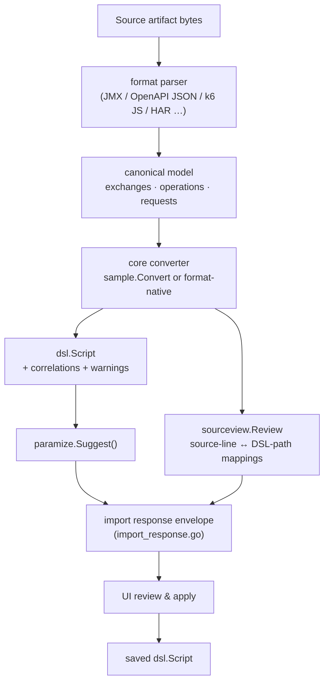
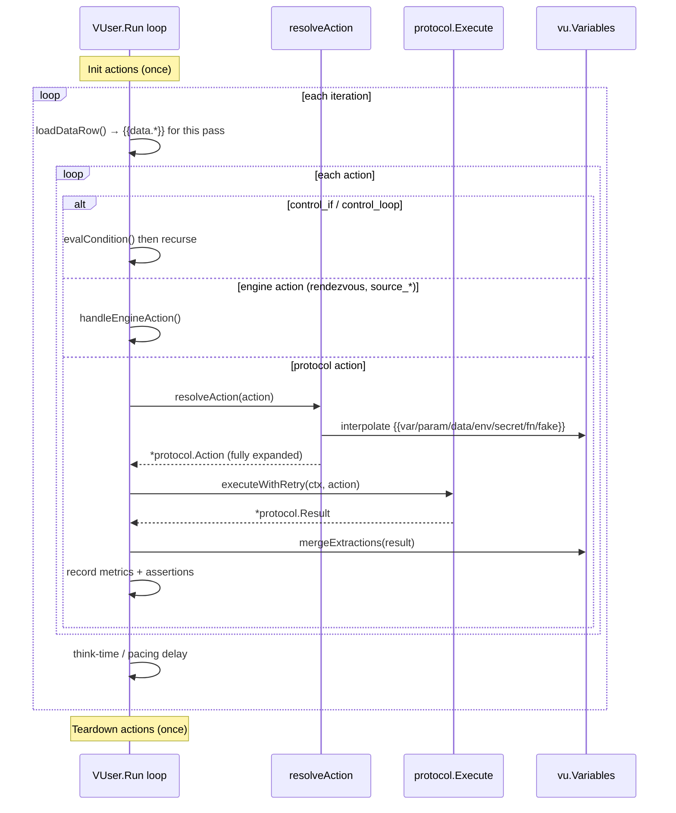
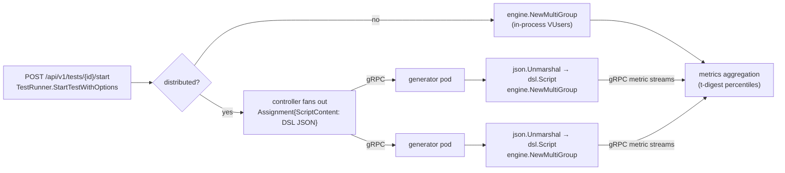

# Script Lifecycle: Source → DSL → Running Test

> How a recording, OpenAPI spec, HAR file, or LoadRunner archive becomes a JSON DSL
> script, and how that script becomes an actual running load test.

## TL;DR — there is no "Go test script"

A common mental model is *"the importer generates a Go test, and the engine compiles/runs
it."* **That is not how APEX Load works.** There is **no code generation and no
transpilation** anywhere in the pipeline — the DSL never becomes a `.go` file.

The real pipeline has **three stages**, and the middle artifact (the JSON DSL) is *data*,
not code:

```
  source artifact            JSON DSL                 running load test
  (HAR / OpenAPI /   ──►   (dsl.Script,      ──►    (pkg/engine interprets
   recording / LR …)        a data struct)           the struct at runtime)
       Stage 1               Stage 2                      Stage 3
     import/convert        parse + validate          goroutine VUsers
```

The closest thing to a "test script" in the Go sense is the **statically-compiled engine
binary** (`pkg/engine`) that *reads the DSL as input*. Each virtual user is a goroutine
that walks the script's `actions` list and dispatches every action to a protocol handler
**by its `type` string at runtime**. The same compiled binary runs every test; only the
JSON data it reads changes.

```mermaid
flowchart LR
    subgraph S1["Stage 1 — import / convert"]
        SRC["Source artifact<br/>HAR · OpenAPI · k6 · JMeter<br/>Postman · LR archive · recording"]
        CONV["pkg/convert/* + pkg/recorder<br/>format-specific Convert()"]
        PARAM["pkg/convert/paramize<br/>Suggest() correlations/params/secrets"]
        SRC --> CONV --> PARAM
    end
    subgraph S2["Stage 2 — the DSL"]
        DSL["dsl.Script (JSON)<br/>config · data_sources · params<br/>init · actions · teardown"]
        VAL["pkg/dsl parse + validate<br/>against the action catalog"]
        PARAM --> DSL --> VAL
    end
    subgraph S3["Stage 3 — interpreted execution"]
        ENG["pkg/engine<br/>1 goroutine = 1 VUser"]
        PROTO["pkg/protocol/*<br/>http · ws · grpc · browser · jms …"]
        VAL --> ENG --> PROTO
        PROTO -->|metrics| MET["t-digest + buffered channels"]
    end
    PROTO -.->|"extractions feed<br/>next iteration"| ENG
```



For multi-pod runs, the controller serializes the **same `dsl.Script` JSON** over gRPC to
generator pods, which deserialize it and run the **identical interpreter** — see
[Stage 3b](#stage-3b--orchestration--distributed-execution).

---

## Stage 1 — Source artifact → JSON DSL

Every supported source format has a converter that produces a `*dsl.Script`. They share a
common contract and a shared post-pass (parameterization + source-traceability).

### 1.1 Entry points (REST API)

| Concern | Location |
|---|---|
| Format imports (`/api/v1/scripts/import/har`, `/jmeter`, `/k6`, `/devweb`, …) | `pkg/api/handlers_import_*.go` |
| Web-API specs (`/openapi`, `/postman`, `/wsdl`, `/asyncapi`) | `pkg/api/handlers_web_api_imports.go` |
| LoadRunner enterprise archive (`/enterprise-script-archive`) | `pkg/api/handlers_import_enterprise.go` |
| Recorder → DSL (`/browser-recorder/.../convert`) | `pkg/api/handlers_recorder_import.go` |
| Response envelope shared by all importers | `pkg/api/import_response.go` (`scriptImportResponseOptions`) |

### 1.2 Per-format converters

Each lives in `pkg/convert/<format>/` and exposes a `Convert(...) (*ConvertResult, error)`:
`har`, `jmeter`, `k6`, `devweb`, `openapi`, `postman`, `wsdl`, `asyncapi`, `raml`,
`enterprisearchive`, `trueclient`, `bruno`, `cloudtest`, `salesforce`, `agentforce`, `mulesoft`,
`eventhubscapture`, `brokerconfig`, `grafana` (monitoring dashboards), and `recorderjson`. Shared
helpers (`sample`, `paramize`, `correlate`, `importreview`, `sourceview`, …) live beside them. The HTTP-family formats (HAR, DevWeb, k6, raw HTTP,
cURL) funnel through a single shared core:

- **`pkg/convert/sample/converter.go` → `Convert(req ImportRequest)`.** It parses
  the source into canonical request/response `exchange` pairs, detects the base URL, runs
  **correlation detection** (values that appear in a response and are reused in a later
  request), builds one `dsl.Action` per exchange (method / target / headers / body), adds
  `status_code` assertions and extractors for detected correlations, and computes think
  time from timestamps.

Every converter ultimately produces a `*dsl.Script` (`pkg/dsl/types.go`) plus warnings,
stats, detected correlations, and a **source review** for traceability.

### 1.3 Source traceability (provenance)

`pkg/convert/sourceview/source_review.go` defines `Review{SourceFiles, Mappings}`:

- `SourceFiles` — the (credential-redacted, truncated) original artifact text.
- `Mappings` — `Mapping{SourceFile, StartLine, EndLine, TargetPath, TargetKind, …}` tying
  each source line range to the DSL element it produced (e.g. `actions[5]`,
  `actions[3].assertions[0]`). This drives the side-by-side import-review UI.

Provenance is also stamped onto the script itself via `Script.Metadata.Import`
(source format, original name, redaction state).



### 1.4 Parameterization pass (`pkg/convert/paramize`)

Runs **after** conversion, on **every** import, in
`pkg/convert/paramize/paramize.go → Suggest(script, opts)`. It proposes three
kinds of edits so the script is data-driven rather than hard-coded:

| Kind | What it finds | Replacement |
|---|---|---|
| `correlation` | response→request value flow (via `pkg/convert/correlate`) | extract from response, inject `{{var.*}}` downstream |
| `data_param` | parameterizable literals (user id, email, search term) | `{{data.*}}` / a `Parameter` |
| `secret` | credential-shaped values (passwords, tokens, keys) | `{{secret.*}}` |

Suggestions at or above `autoApplyConfidence = 0.8` (in `paramize.go`) are pre-selected;
high-confidence correlations may already be wired into the draft (`PreApplied`). The user
accepts/rejects, then applies via `POST /api/v1/scripts/import/parameterize/apply`.

### 1.5 The recorder path (recordings → DSL)

The flagship on-ramp is the embedded browser recorder:

1. **Capture** — `pkg/recorder/browser/capture.js` is injected into every frame. It
   listens for user interactions, builds shadow-DOM-aware CSS/XPath selectors, and posts
   each event to Go via the exposed binding `window.__apexloadRecord(JSON.stringify(...))`
   (in `capture.js`). Pause/resume and the element-picker are driven from Go through
   `window.__apexloadRecorder*` globals.
2. **Session model** — `pkg/recorder/recorder.go` accumulates `Session` /
   `RecordedRequest` (method, URL, headers, body, status, timings, transaction/step
   annotations, WebSocket messages).
3. **Convert** — `pkg/recorder/converter.go → ConvertSession(session, name)`
   produces a `dsl.Script` (HTTP or WebSocket actions), extracts correlations, optionally
   parameterizes recorded inputs, and can export a side-car HAR (`pkg/recorder/har.go`).

Embedded browser capture is intentionally narrower than browser replay. It records clicks,
input/textarea changes as fills, select changes, file-input filenames, Enter/Escape/Tab
keypresses, assertion-picker steps, main-frame navigation, network summaries, and
WebSocket summaries. It does not currently capture double-click, hover, drag/drop, scroll,
arbitrary keyboard shortcuts, clipboard operations, or rich-editor mutations as distinct
gestures; replay can execute hand-authored/imported `browser_dblclick` and
`browser_hover` actions even though the embedded recorder may not produce them directly.

The output is the *same* `dsl.Script` type as every other importer — the recorder is just
another Stage-1 producer.

---

## Stage 2 — The DSL itself (define, parse, validate)

### 2.1 The shape of a script

`pkg/dsl/types.go` defines the root `Script` and its sections:

```go
type Script struct {
    Name, Version, Protocol string
    Config      ScriptConfig     // base URL, timeouts, TLS, default headers, auth
    DataSources []DataSource     // CSV/DAT feeders for {{data.*}}
    Parameters  []Parameter      // file / list / counter / uuid / random / vuser_id …
    Init        []Action         // run once per VUser (setup)
    Actions     []Action         // the per-iteration body
    Teardown    []Action         // run once per VUser (cleanup)
    Metadata    *ScriptMetadata  // import provenance
}
```

An `Action` is a tagged record — `Type` is the discriminator that decides everything else:

```go
type Action struct {
    Name, Type   string             // Type ∈ {"GET","POST","ws_send","control_if", …}
    Method, Target, Selector, Value string
    Headers      map[string]string
    Body         string             // (or BodyFile, inlined at parse time)
    Params       map[string]any     // protocol/type-specific options
    Extractors   []Extractor        // pull values out of the response → variables
    Assertions   []Assertion        // pass/fail checks
    Control      *ControlFlow       // for control_if / control_loop
}
```

### 2.2 The action catalog — single source of truth

`pkg/dsl/catalog.go` is the authority for *what every action type means*. Each type is one
`ActionSpec`:

```go
type ActionSpec struct {
    Type         string        // "POST", "ws_connect", "rendezvous", …
    Aliases      []string
    Protocols    []string      // ["http"] · ["*"] for engine-level actions
    Fields       []FieldSpec   // declared fields (+ Required, Kind, Enum, Doc)
    RequireOneOf [][]string     // "at least one of these fields" groups
    Validate     func(i int, a Action) []string  // residual cross-field rules
}
```

Specs are assembled per-protocol in `catalog_*.go` (one file per protocol, mirroring the
`pkg/protocol/*` layout) and collected by `actionCatalogSeeds()` (`catalog.go`). This
**one catalog** feeds: the validator, `GET /api/v1/dsl/actions`, the dashboard script
editor, and the generated docs (`docs/dsl.schema.json` + [`DSL_ACTION_REFERENCE.md`](DSL_ACTION_REFERENCE.md)).

> **Note on codegen:** the `//go:generate` directive at the top of `catalog.go` runs
> `cmd/dslschema` (via `pkg/dsl/schemagen`) to emit the JSON Schema and the Markdown action
> reference. This generates *documentation and a schema from the catalog* — **not**
> executable Go and **not** anything that runs your test. It only reinforces the point:
> nothing turns the DSL into code.

### 2.3 Parsing

`pkg/dsl/parser.go`:

- `Parse(data)` — for in-memory JSON (API uploads); `ParseFile(path)` — for files, which
  additionally calls `ResolveBodyRefs` to inline `body_file` references
  (`pkg/dsl/bodyrefs.go`, path-confined against traversal).
- Parsing is plain `json.Unmarshal` into the typed structs. **Templates like `{{var.x}}`
  are *not* expanded here** — they are preserved verbatim as strings and resolved later, at
  runtime, per VUser.

### 2.4 Validation

`pkg/dsl/validate.go` validates each action:

1. `CanonicalActionType` normalizes legacy aliases (e.g. `loadrunner_*` → `source_*`).
2. Look the type up in the catalog index — **unknown type ⇒ validation fails.**
3. Check the type is legal for the script's protocol, that required `Fields` are present,
   that `RequireOneOf` groups are satisfied, and run the spec's residual `Validate` func.

---

## Stage 3 — DSL interpreted into a running test

This is the heart of the "no Go script" point: the engine is a **runtime interpreter** of
the `dsl.Script` data structure.

### 3.1 One goroutine per VUser

`pkg/engine/engine.go → Engine.Run` launches `vusers` goroutines with ramp-up
(`for i := 0; i < e.vusers; i++ { … go func(){…}() }`). Each goroutine runs
one `VUser` (`pkg/engine/vuser.go`, ~2–4 KB stack), holding a pointer to the parsed
`*dsl.Script` and a `protocol.Protocol` handler.

### 3.2 The interpreter loop

`VUser.Run(ctx)` (`vuser.go`) executes the script's phases: **`Init` once → loop over
`Actions` → `Teardown` once**. Inside the loop, the `runOne` closure (a local function value inside `VUser.Run` in `vuser.go`) is
the action-dispatch switch:

- `control_if` / `control_loop` — evaluated *at runtime* via `vu.evalCondition`
  (`pkg/engine/control_flow.go`), which supports both a legacy `left/op/right` form and
  CEL expressions (`pkg/engine/condition_expr.go`, normalized in
  `pkg/dsl/condition_expr.go`). The closure recurses into the chosen branch / loop body via
  `runActions`, a sibling closure declared in the same function in `vuser.go` (not a package-level function).
- **engine-level actions** — `vu.handleEngineAction` (`vuser.go` →
  `pkg/engine/vuser_source_actions.go`) handles `rendezvous`, `source_transaction`,
  `http_oauth2_token`, `source_*`, etc. without touching a protocol.
- **everything else** — resolved and dispatched to a protocol handler.



### 3.3 Resolution & templating (runtime)

Just before a protocol action runs, `vu.resolveAction` (`pkg/engine/vuser_resolve.go`)
expands every template in `target`, `headers`, `body`, and `params` via
`interpolateWithSecrets`, producing a `*protocol.Action` with fully-resolved strings (plus
redacted copies for logging). Namespaces:

| Template | Resolves to | Source |
|---|---|---|
| `{{var.NAME}}` | a runtime variable (often an earlier extraction) | `vu.Variables` |
| `{{param.NAME}}` | a parameter (file/list/counter/uuid/…) | `ParameterRuntime` |
| `{{data.source.col}}` | the current data-feeder row | `loadDataRow()` |
| `{{env.KEY}}` | process environment | `os.LookupEnv` |
| `{{secret.NAME}}` | a secret store (vault/k8s/…) | `SecretResolver` |
| `{{fn.*}}` / `{{fake.*}}` | built-ins (`fn.uuid()`, `fn.timestamp.iso8601()`, `fake.email()`) | `pkg/engine/parameters.go` |

### 3.4 Protocol dispatch

All protocols implement one interface — `pkg/protocol/protocol.go` (the `Protocol` interface):

```go
type Protocol interface {
    Name() string
    Init(ctx, config) error
    Execute(ctx, *Action) (*Result, error)   // ← the per-action hot path
    Teardown(ctx) error
    HealthCheck(ctx) error
}
```

Handlers are **compiled in and registered at `init()`** via `pkg/protocol/registry.go`
(`Register`/`Get`) — these are *not* Go runtime plugins; the registry just maps a protocol
name to a factory. Worked example, HTTP (`pkg/protocol/http/http.go → Execute`):
build the `*http.Request` → send via `net/http` (with DNS/TLS/TTFB trace timing) → read the
response → run extractors (JSONPath/XPath/regex) → evaluate assertions → return a
`*protocol.Result`.

### 3.5 The correlation feedback loop

A protocol's `Result.Extractions` (`protocol.go`, `map[string]string`) is merged back
into `vu.Variables` by `vu.mergeExtractions` (`vuser_resolve.go`). That's what lets a
token extracted from one response resolve a `{{var.token}}` in the next action — the same
correlation an importer detected at Stage 1, now closing at runtime.

### 3.6 Metrics & pacing

Results are recorded through a **buffered channel** (cap 10,000) via
`MetricsCollector.Record` (`pkg/engine/metrics.go`) to keep the hot path lock-free;
percentiles are computed with a streaming t-digest. Think-time and inter-iteration pacing
live in `pkg/engine/pacing.go`.

---

## Stage 3b — Orchestration & distributed execution

A test is created and started through the API/runner, then executed either in-process or
fanned out to generator pods.

- `POST /api/v1/tests` → `handleCreateTest` (`pkg/api/handlers.go`) →
  `TestRunner.CreateTest` (`pkg/api/testcreation.go`).
- `POST /api/v1/tests/{id}/start` → `TestRunner.StartTestWithOptions`
  (`pkg/api/testexecution.go`).
- In-process runs build a `*engine.MultiGroupEngine` via `buildRunEngine` →
  `engine.NewMultiGroup` (`pkg/api/testexecution.go`).

For multi-pod runs the controller ships each generator an `Assignment` whose
`ScriptContent []byte` is the **raw DSL JSON** (`pkg/distributed/generatorrpc/client.go`).
The generator service does exactly what the in-process path does
(`pkg/distributed/generatorrpc/service.go`):

```go
var script dsl.Script
if err := json.Unmarshal(rawScript, &script); err != nil { … }
mge, err := engine.NewMultiGroup(engine.MultiGroupConfig{
    Groups: []engine.GroupConfig{{ Name: …, Script: &script, VUsers: …, RampUp: … }},
})
```

That is the whole story of "how the DSL maps to execution" on a generator: **deserialize
the JSON into `dsl.Script`, hand it to the same engine, run the same interpreter.** No
per-test binary is built or shipped — only data crosses the wire.



---

## "Where is the Go test script?" — the direct answer

- **There isn't one.** No file in `pkg/convert/` emits Go; every converter goes
  *foreign-format → DSL*, never *DSL → Go*.
- The analogue of a compiled test is the controller/generator binary (`cmd/controller` /
  `cmd/generator`, both embedding `pkg/engine`), which is built once and runs every test.
- A test's behavior is entirely a **`dsl.Script` value** the engine reads. Dispatch is by
  `action.Type` string through a `switch` (`vuser.go`) and the protocol registry — resolved
  at *runtime*, not compile time.
- This is deliberate (see `AGENTS.md`): "JSON DSL scripts — no proprietary language",
  "Protocol plugins compiled in (not Go runtime plugins)".

---

## End-to-end worked example

A recorded login POST, traced through all three stages:

1. **Stage 1 (capture → convert).** You log in in the recorder. `capture.js` posts the
   `POST /login` exchange to Go; `ConvertSession` emits a `dsl.Script` action:

   ```json
   {
     "name": "login", "type": "POST", "target": "/login",
     "body": "{\"user\":\"alice\",\"pass\":\"{{secret.pw}}\"}",
     "extractors": [{ "name": "token", "type": "json", "expression": "$.token" }],
     "assertions": [{ "type": "status_code", "expected": "200" }]
   }
   ```

   `paramize.Suggest` flags `pass` as a `secret` and, seeing `token` reused in the next
   request's `Authorization` header, proposes a `correlation` that rewrites it to
   `{{var.token}}`.

2. **Stage 2 (parse → validate).** On save, `dsl.Parse` unmarshals the script;
   `validate.go` confirms `POST` is a real catalog action for the `http` protocol and that
   its fields/extractors are well-formed. Templates stay as literal strings.

3. **Stage 3 (interpret).** Per iteration, each VUser goroutine calls `resolveAction`:
   `{{secret.pw}}` → the vaulted password, `{{var.token}}` (on the *next* action) → whatever
   the login extracted last pass. `http.Execute` sends the request; its
   `Result.Extractions["token"]` is merged into `vu.Variables` by `mergeExtractions`, so the
   following `GET /account` resolves `Authorization: Bearer {{var.token}}`. Metrics flow out
   over the buffered channel; pacing applies; repeat.

The Stage-1 *correlation suggestion* and the Stage-3 *runtime variable feedback* are two
ends of the same mechanism — detected statically at import, executed dynamically at run.

---

## Map of the key files

| Stage | Concern | File(s) |
|---|---|---|
| 1 | Import API entry points | `pkg/api/handlers_import_*.go`, `pkg/api/handlers_web_api_imports.go`, `pkg/api/import_response.go` |
| 1 | Per-format converters | `pkg/convert/<format>/`; shared core `pkg/convert/sample/converter.go` |
| 1 | Parameterization | `pkg/convert/paramize/paramize.go`, `pkg/convert/correlate/` |
| 1 | Source traceability | `pkg/convert/sourceview/source_review.go` |
| 1 | Recorder | `pkg/recorder/browser/capture.js`, `pkg/recorder/recorder.go`, `pkg/recorder/converter.go` |
| 2 | DSL types | `pkg/dsl/types.go` |
| 2 | Action catalog (SoT) | `pkg/dsl/catalog.go`, `pkg/dsl/catalog_*.go` |
| 2 | Parse / body refs | `pkg/dsl/parser.go`, `pkg/dsl/bodyrefs.go` |
| 2 | Validate | `pkg/dsl/validate.go`, `pkg/dsl/condition_expr.go` |
| 2 | Generated artifacts | `cmd/dslschema`, `pkg/dsl/schemagen`, [`docs/dsl.schema.json`](dsl.schema.json), [`docs/DSL_ACTION_REFERENCE.md`](DSL_ACTION_REFERENCE.md) |
| 3 | Engine / VUser interpreter | `pkg/engine/engine.go`, `pkg/engine/vuser.go`, `pkg/engine/vuser_resolve.go`, `pkg/engine/vuser_source_actions.go` |
| 3 | Control flow / conditions | `pkg/engine/control_flow.go`, `pkg/engine/condition_expr.go` |
| 3 | Templating built-ins | `pkg/engine/parameters.go` |
| 3 | Metrics / pacing | `pkg/engine/metrics.go`, `pkg/engine/pacing.go` |
| 3 | Protocol interface / registry | `pkg/protocol/protocol.go`, `pkg/protocol/registry.go`, `pkg/protocol/http/http.go` |
| 3b | Orchestration | `pkg/api/handlers.go`, `pkg/api/testcreation.go`, `pkg/api/testexecution.go` |
| 3b | Distribution | `pkg/distributed/generatorrpc/client.go`, `pkg/distributed/generatorrpc/service.go` |

See also [`DSL_ACTION_REFERENCE.md`](DSL_ACTION_REFERENCE.md) for the full per-action-type
field contract and [`dsl.schema.json`](dsl.schema.json) for the JSON Schema.
