# Data Model

<!-- Generated by `go generate ./pkg/storage` (cmd/datamodeldoc). Do not edit by hand. -->

This reference describes the tables the APEX Load controller stores, how they relate, and which domain of the product each one belongs to. It is generated from schema version 84: 165 tables, 1758 columns, 152 foreign key constraints and 125 references the controller maintains without a constraint, where the referenced row may be missing.

Use this page when you plan [backups](ENTERPRISE_PLATFORM_RUNBOOK.md#postgresql-backup-and-restore) and [migrations](ENTERPRISE_PLATFORM_RUNBOOK.md#sqlite-to-postgresql-migration-guide), write reporting queries, or trace a run's records. The API is the supported way to read and change data; change the database directly only when a runbook tells you to.

SQLite and PostgreSQL deployments use the same tables and keys. Column types are shown as SQLite declares them. On PostgreSQL, DATETIME columns are TIMESTAMPTZ; the `enabled`, `active`, `shakeout_enabled`, `resource_baseline_enabled`, `baseline_pinned`, `base_missing` and `auto_promote_on_heal` flags are BOOLEAN; and every other INTEGER column, including the remaining 0/1 flags, is BIGINT.

## Overview

Most tables belong to a project, directly or through a parent table, and a project belongs to a domain. A script belongs to a project and can sit in a folder, and a scenario groups scripts through `scenario_scripts`. A run is a row in `tests`: it references its scenario, release and capacity timeslot, and the run's results, archive, root-cause analysis and monitoring records all point back to it through `test_id`.

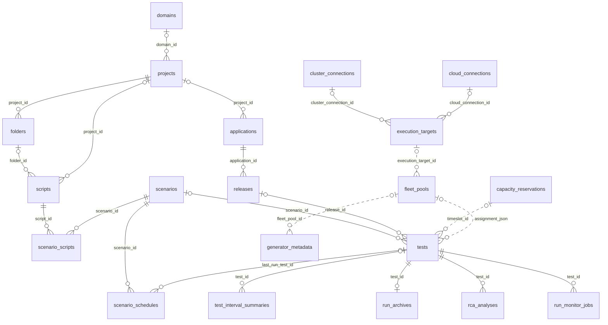

A run's placement settings, frozen in `assignment_json` and per group in `groups_json`, may name a fleet pool or specific generators. That optional link is not a column, so it is drawn dashed.

## Reading the diagrams

- Each box is a table. It lists the primary key (PK), the columns that reference another table (FK), and a few identifying columns. The count at the bottom is the number of columns not shown; the table under each diagram lists every table in the domain.
- A line joins a table to the table whose ID it holds. In Help the arrowhead is at the referenced table; GitHub draws the crow's foot at the referencing table instead. A solid line is a foreign key constraint. A dashed line is a reference with no database constraint, so the referenced row may be missing: use an outer join when you follow one.
- Tables from another domain appear as boxes with no columns.
- Links to `projects`, `users` and `domains` are drawn only in the overview and in the Tenancy, identity & access diagram, because nearly every table has one. Elsewhere they appear as FK columns, and tables whose only links are these are listed in the table but not drawn.
- Columns ending in `_json`, and `payload`, hold nested documents such as a run's scenario snapshot. They are not split into tables.

## Tenancy, identity & access

Each domain has at most one application repository, which holds the domain's repository categories. A project belongs to a domain and is the scope for almost every other table. A role binding grants a user a role on one scope, named by scope_type (`global`, `domain`, `application_repository` or `project`) and scope_id.

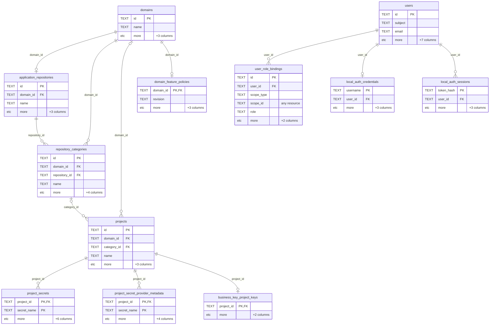

| Table | Primary key | References | Columns |
| --- | --- | --- | --- |
| `domains` | `id` | — | 5 |
| `application_repositories` | `id` | `domain_id` → `domains` | 6 |
| `repository_categories` | `id` | `repository_id` → `application_repositories`; `domain_id` → `domains` | 8 |
| `projects` | `id` | `category_id` → `repository_categories`; `domain_id` → `domains` | 7 |
| `domain_feature_policies` | `domain_id` | `domain_id` → `domains` | 5 |
| `users` | `id` | — | 10 |
| `user_role_bindings` | `id` | `user_id` → `users`; `scope_id` → any resource | 7 |
| `service_accounts` | `id` | — | 18 |
| `local_auth_credentials` | `username` | `user_id` → `users` | 5 |
| `local_auth_sessions` | `token_hash` | `user_id` → `users` | 5 |
| `local_auth_runtime` | `singleton_key` | — | 3 |
| `project_secrets` | `project_id`, `secret_name` | `project_id` → `projects` | 8 |
| `project_secret_provider_metadata` | `project_id`, `secret_name` | `project_id` → `projects` | 6 |
| `business_key_project_keys` | `project_id` | `project_id` → `projects` | 3 |

## Applications, releases & library

An application groups its releases. Scripts and scenarios are assigned to an application and, optionally, to specific releases. Runs and imported external results record the application and release they belong to.

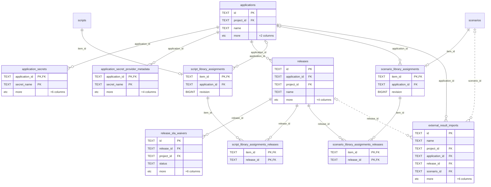

| Table | Primary key | References | Columns |
| --- | --- | --- | --- |
| `applications` | `id` | `project_id` → `projects` | 5 |
| `application_secrets` | `application_id`, `secret_name` | `application_id` → `applications` | 8 |
| `application_secret_provider_metadata` | `application_id`, `secret_name` | `application_id` → `applications` | 6 |
| `releases` | `id` | `application_id` → `applications`; `project_id` → `projects` | 8 |
| `release_sla_waivers` | `id` | `release_id` → `releases`; `project_id` → `projects` (no constraint) | 10 |
| `script_library_assignments` | `item_id` | `application_id` → `applications`; `item_id` → `scripts` | 3 |
| `script_library_assignments_releases` | `item_id`, `release_id` | `release_id` → `releases`; `item_id` → `script_library_assignments` | 2 |
| `scenario_library_assignments` | `item_id` | `application_id` → `applications`; `item_id` → `scenarios` | 3 |
| `scenario_library_assignments_releases` | `item_id`, `release_id` | `release_id` → `releases`; `item_id` → `scenario_library_assignments` | 2 |
| `external_result_imports` | `id` | `application_id` → `applications`; `project_id` → `projects` (no constraint); `release_id` → `releases` (no constraint); `scenario_id` → `scenarios` (no constraint) | 12 |

## Script authoring & import

A script belongs to a project and can sit in a project folder; scripts outside any folder have no folder_id. A script's DSL body (configuration, parameters, data sources, init, actions and teardown) is stored in columns of its own row. Recordings, import receipts and Bruno source revisions record where a script came from.

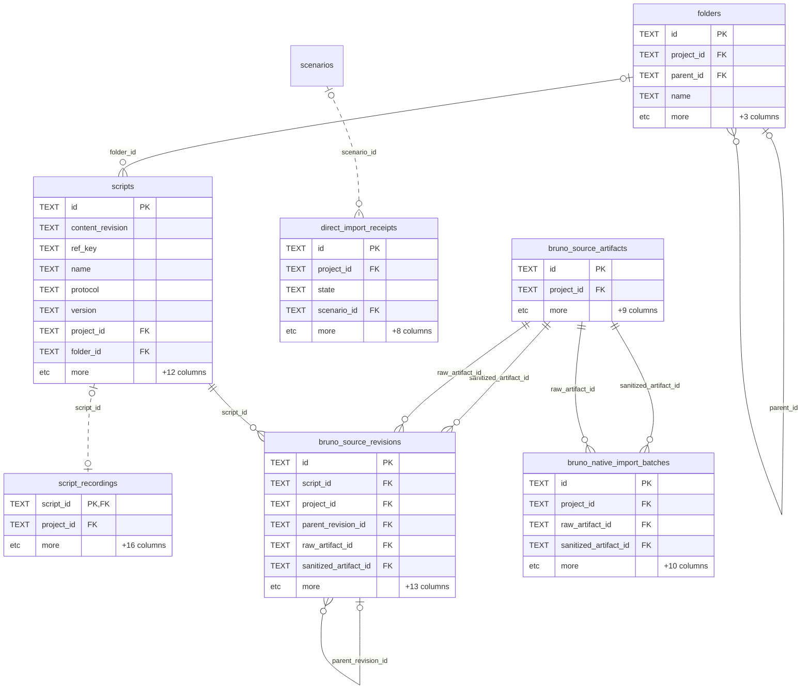

| Table | Primary key | References | Columns |
| --- | --- | --- | --- |
| `folders` | `id` | `parent_id` → `folders`; `project_id` → `projects` | 7 |
| `scripts` | `id` | `folder_id` → `folders`; `project_id` → `projects` | 20 |
| `script_recordings` | `script_id` | `script_id` → `scripts` (no constraint); `project_id` → `projects` (no constraint) | 18 |
| `reusable_blocks` | `id` | `project_id` → `projects` (no constraint) | 7 |
| `correlation_rulesets` | `id` | `project_id` → `projects` (no constraint) | 10 |
| `object_repositories` | `id` | `project_id` → `projects` (no constraint) | 9 |
| `authoring_sessions` | `id` | `project_id` → `projects` (no constraint) | 10 |
| `authoring_mutation_receipts` | `id` | `project_id` → `projects`; `resource_id` → any resource | 19 |
| `import_assets` | `id` | `project_id` → `projects` | 12 |
| `direct_import_receipts` | `id` | `project_id` → `projects`; `scenario_id` → `scenarios` (no constraint) | 12 |
| `bruno_source_artifacts` | `id` | `project_id` → `projects` | 11 |
| `bruno_source_revisions` | `id` | `sanitized_artifact_id` → `bruno_source_artifacts`; `raw_artifact_id` → `bruno_source_artifacts`; `parent_revision_id` → `bruno_source_revisions`; `project_id` → `projects`; `script_id` → `scripts` | 19 |
| `bruno_native_import_batches` | `id` | `sanitized_artifact_id` → `bruno_source_artifacts`; `raw_artifact_id` → `bruno_source_artifacts`; `project_id` → `projects` | 14 |
| `grafana_import_sessions` | `id` | `project_id` → `projects` (no constraint) | 9 |
| `protected_source_secret_sessions` | `id` | `project_id` → `projects` | 10 |
| `replay_session_leases` | `session_id` | `project_id` → `projects` (no constraint) | 7 |
| `replay_artifact_receipts` | `session_id` | `project_id` → `projects` (no constraint) | 9 |

## Scenarios & test data

A scenario has no project column of its own: its project is the project of the scripts in its ordered scenario_scripts groups. Shared data pools and project live tables are bound to a scenario through scenario_data_pool_bindings.

```mermaid
erDiagram
    scenarios {
        TEXT id PK
        TEXT content_revision
        TEXT ref_key
        TEXT name
        etc more "+17 columns"
    }
    scenario_scripts {
        TEXT scenario_id PK, FK
        INTEGER sort_order PK
        TEXT name
        TEXT script_id FK
        TEXT role
        etc more "+10 columns"
    }
    scenario_drafts {
        TEXT id PK
        TEXT project_id FK
        TEXT scenario_id FK
        TEXT name
        INTEGER revision
        etc more "+5 columns"
    }
    scenario_comparison_policies {
        TEXT scenario_id PK, FK
        TEXT project_id FK
        BIGINT revision
        etc more "+1 columns"
    }
    scenario_data_pool_bindings {
        TEXT id PK
        TEXT scenario_id FK
        TEXT pool_id FK
        TEXT alias
        TEXT project_table_id FK
        etc more "+6 columns"
    }
    monitor_bindings {
        TEXT scenario_id PK, FK
        TEXT project_id FK
        BIGINT revision
        etc more "+1 columns"
    }
    shared_data_pools {
        TEXT id PK
        TEXT name
        TEXT project_id FK
        etc more "+8 columns"
    }
    shared_data_pool_rows {
        TEXT id PK
        TEXT pool_id FK
        TEXT status
        INTEGER version
        etc more "+3 columns"
    }
    project_live_tables {
        TEXT id PK
        TEXT project_id FK
        TEXT name
        BIGINT revision
        TEXT state
        TEXT current_instance_id FK
        etc more "+5 columns"
    }
    project_live_table_instances {
        TEXT id PK
        TEXT table_id FK
        TEXT project_id FK
        TEXT state
        BIGINT revision
        etc more "+15 columns"
    }
    project_live_table_attachments {
        TEXT id PK
        TEXT project_id FK
        TEXT table_id FK
        TEXT instance_id FK
        TEXT test_id FK
        TEXT alias
        TEXT state
        etc more "+9 columns"
    }
    project_live_table_journal {
        TEXT instance_id PK, FK
        BIGINT revision PK
        etc more "+4 columns"
    }
    project_live_table_operator_receipts {
        TEXT instance_id PK, FK
        TEXT actor_subject PK
        TEXT key_hash PK
        etc more "+5 columns"
    }
    scripts ||--o{ scenario_scripts : "script_id"
    scenarios ||--o{ scenario_scripts : "scenario_id"
    scenarios |o..o{ scenario_drafts : "scenario_id"
    scenarios ||--o| scenario_comparison_policies : "scenario_id"
    shared_data_pools |o--o{ scenario_data_pool_bindings : "pool_id"
    scenarios ||--o{ scenario_data_pool_bindings : "scenario_id"
    project_live_tables |o..o{ scenario_data_pool_bindings : "project_table_id"
    scenarios ||--o| monitor_bindings : "scenario_id"
    shared_data_pools ||--o{ shared_data_pool_rows : "pool_id"
    project_live_table_instances |o..o{ project_live_tables : "current_instance_id"
    project_live_tables ||--o{ project_live_table_instances : "table_id"
    project_live_table_instances ||--o{ project_live_table_attachments : "instance_id"
    project_live_tables |o..o{ project_live_table_attachments : "table_id"
    tests |o..o{ project_live_table_attachments : "test_id"
    project_live_table_instances ||--o{ project_live_table_journal : "instance_id"
    project_live_table_instances ||--o{ project_live_table_operator_receipts : "instance_id"
```

| Table | Primary key | References | Columns |
| --- | --- | --- | --- |
| `scenarios` | `id` | — | 21 |
| `scenario_scripts` | `scenario_id`, `sort_order` | `script_id` → `scripts`; `scenario_id` → `scenarios` | 15 |
| `scenario_drafts` | `id` | `project_id` → `projects` (no constraint); `scenario_id` → `scenarios` (no constraint) | 10 |
| `scenario_comparison_policies` | `scenario_id` | `scenario_id` → `scenarios`; `project_id` → `projects` (no constraint) | 4 |
| `scenario_data_pool_bindings` | `id` | `pool_id` → `shared_data_pools`; `scenario_id` → `scenarios`; `project_table_id` → `project_live_tables` (no constraint) | 11 |
| `monitor_bindings` | `scenario_id` | `project_id` → `projects`; `scenario_id` → `scenarios` | 4 |
| `shared_data_pools` | `id` | `project_id` → `projects` | 11 |
| `shared_data_pool_rows` | `id` | `pool_id` → `shared_data_pools` | 7 |
| `project_live_tables` | `id` | `project_id` → `projects`; `current_instance_id` → `project_live_table_instances` (no constraint) | 11 |
| `project_live_table_instances` | `id` | `table_id` → `project_live_tables`; `project_id` → `projects` (no constraint) | 20 |
| `project_live_table_attachments` | `id` | `instance_id` → `project_live_table_instances`; `project_id` → `projects` (no constraint); `table_id` → `project_live_tables` (no constraint); `test_id` → `tests` (no constraint) | 16 |
| `project_live_table_journal` | `instance_id`, `revision` | `instance_id` → `project_live_table_instances` | 6 |
| `project_live_table_operator_receipts` | `instance_id`, `actor_subject`, `key_hash` | `instance_id` → `project_live_table_instances` | 8 |

## Scheduling, plans & capacity

Scenario schedules and execution plan schedules each produce occurrences, and an occurrence may wait for an approval before it starts a run. Capacity reservations are the timeslots that runs, execution plans and scenario schedules point at through timeslot_id.

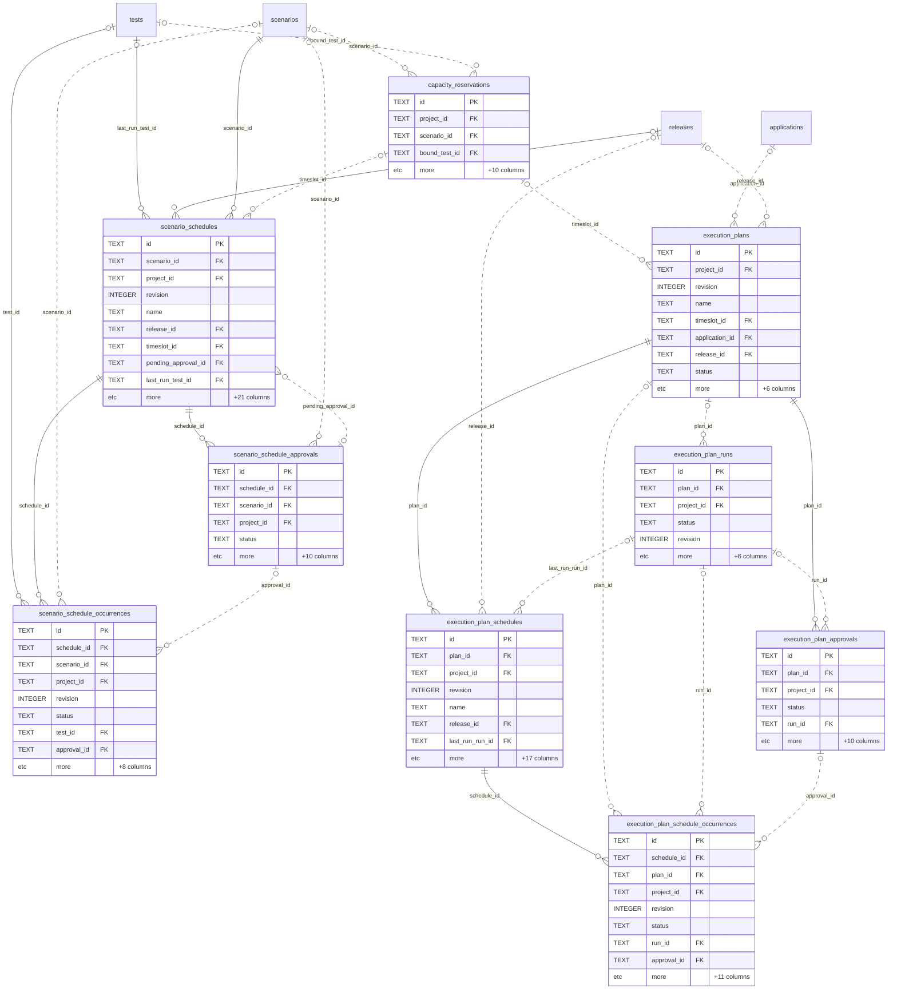

| Table | Primary key | References | Columns |
| --- | --- | --- | --- |
| `scenario_schedules` | `id` | `last_run_test_id` → `tests`; `release_id` → `releases`; `scenario_id` → `scenarios`; `project_id` → `projects` (no constraint); `timeslot_id` → `capacity_reservations` (no constraint); `pending_approval_id` → `scenario_schedule_approvals` (no constraint) | 30 |
| `scenario_schedule_occurrences` | `id` | `test_id` → `tests`; `schedule_id` → `scenario_schedules`; `scenario_id` → `scenarios` (no constraint); `project_id` → `projects` (no constraint); `approval_id` → `scenario_schedule_approvals` (no constraint) | 16 |
| `scenario_schedule_approvals` | `id` | `schedule_id` → `scenario_schedules`; `scenario_id` → `scenarios` (no constraint); `project_id` → `projects` (no constraint) | 15 |
| `execution_plans` | `id` | `project_id` → `projects` (no constraint); `timeslot_id` → `capacity_reservations` (no constraint); `application_id` → `applications` (no constraint); `release_id` → `releases` (no constraint) | 14 |
| `execution_plan_runs` | `id` | `plan_id` → `execution_plans` (no constraint); `project_id` → `projects` (no constraint) | 11 |
| `execution_plan_approvals` | `id` | `plan_id` → `execution_plans`; `project_id` → `projects` (no constraint); `run_id` → `execution_plan_runs` (no constraint) | 15 |
| `execution_plan_schedules` | `id` | `plan_id` → `execution_plans`; `project_id` → `projects` (no constraint); `release_id` → `releases` (no constraint); `last_run_run_id` → `execution_plan_runs` (no constraint) | 24 |
| `execution_plan_schedule_occurrences` | `id` | `schedule_id` → `execution_plan_schedules`; `plan_id` → `execution_plans` (no constraint); `project_id` → `projects` (no constraint); `run_id` → `execution_plan_runs` (no constraint); `approval_id` → `execution_plan_approvals` (no constraint) | 19 |
| `capacity_reservations` | `id` | `project_id` → `projects` (no constraint); `scenario_id` → `scenarios` (no constraint); `bound_test_id` → `tests` (no constraint) | 14 |
| `capacity_approval_locks` | `lock_key` | — | 2 |
| `scheduler_leases` | `name` | — | 6 |
| `scheduler_content_revision` | `id` | — | 2 |
| `start_admission_revision` | `id` | — | 2 |

## Runs & results

A run is a row in tests. It references its scenario, release and application, and also keeps a copy of the groups, pools, goals and plan it started with, so later edits to the scenario do not change its history. Interval summaries are the per-interval metrics written while the run is live. Telemetry policy segments record each policy change made while a run is live, in order, without rewriting earlier ones.

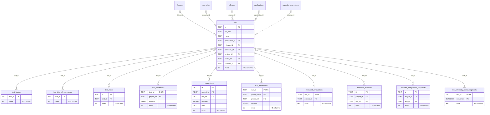

| Table | Primary key | References | Columns |
| --- | --- | --- | --- |
| `tests` | `id` | `folder_id` → `folders`; `project_id` → `projects`; `scenario_id` → `scenarios`; `release_id` → `releases`; `application_id` → `applications`; `timeslot_id` → `capacity_reservations` (no constraint) | 58 |
| `test_history` | — | `test_id` → `tests` | 3 |
| `test_interval_summaries` | — | `test_id` → `tests` | 35 |
| `test_notes` | `id` | `test_id` → `tests` | 7 |
| `run_annotations` | `test_id` | `project_id` → `projects`; `test_id` → `tests` | 4 |
| `preparations` | `id` | `test_id` → `tests`; `project_id` → `projects` | 11 |
| `run_rendezvous` | `run_id`, `group_name` | `project_id` → `projects`; `run_id` → `tests` | 9 |
| `threshold_evaluations` | `test_id` | `project_id` → `projects`; `test_id` → `tests` | 4 |
| `threshold_incidents` | `id` | `test_id` → `tests`; `project_id` → `projects` | 13 |
| `baseline_comparison_snapshots` | `id` | `test_id` → `tests`; `project_id` → `projects` (no constraint) | 5 |
| `usage_accounting_snapshots` | `id` | `project_id` → `projects` (no constraint) | 5 |
| `test_telemetry_policy_segments` | `test_id`, `sequence` | `test_id` → `tests` | 10 |

## Run analysis & live state

Root-cause analyses are revisioned per run, with critiques and evidence revisions. Run live tables hold shared mutable data while a run executes, journal every change, and can be finalized into a shared data pool.

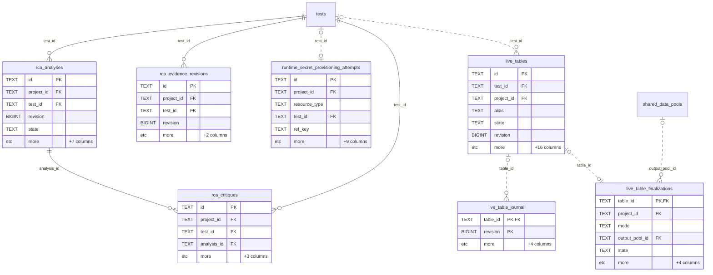

| Table | Primary key | References | Columns |
| --- | --- | --- | --- |
| `rca_analyses` | `id` | `test_id` → `tests`; `project_id` → `projects` | 12 |
| `rca_critiques` | `id` | `analysis_id` → `rca_analyses`; `test_id` → `tests`; `project_id` → `projects` | 7 |
| `rca_evidence_revisions` | `id` | `test_id` → `tests`; `project_id` → `projects` | 6 |
| `runtime_secret_provisioning_attempts` | `id` | `project_id` → `projects`; `test_id` → `tests` (no constraint) | 14 |
| `live_tables` | `id` | `test_id` → `tests` (no constraint); `project_id` → `projects` (no constraint) | 22 |
| `live_table_journal` | `table_id`, `revision` | `table_id` → `live_tables` (no constraint) | 6 |
| `live_table_finalizations` | `table_id` | `table_id` → `live_tables` (no constraint); `project_id` → `projects` (no constraint); `output_pool_id` → `shared_data_pools` (no constraint) | 9 |

## Run archives, evidence & notifications

When a run ends, its raw results are written to an archive in file or object storage and indexed by run_archives. Finalization, refresh and cleanup are durable job rows for a run, so they resume after a controller restart. Cleanup jobs are written when retention expires a run's archive, when a refresh replaces an archive version, and when a run or its project is deleted. Their test_id has no constraint because a job can outlive the tests row, or, for imported results, name a run that was never in tests.

```mermaid
erDiagram
    run_archives {
        TEXT test_id PK, FK
        TEXT ref_key
        etc more "+13 columns"
    }
    archive_finalization_jobs {
        TEXT test_id PK, FK
        TEXT project_id FK
        etc more "+10 columns"
    }
    archive_refresh_jobs {
        TEXT test_id PK, FK
        TEXT project_id FK
        etc more "+4 columns"
    }
    archive_cleanup_jobs {
        TEXT test_id PK, FK
        TEXT project_id FK
        etc more "+5 columns"
    }
    archive_version_cleanup_jobs {
        TEXT id PK
        TEXT test_id FK
        TEXT project_id FK
        etc more "+5 columns"
    }
    run_archive_collection_intents {
        TEXT test_id PK, FK
        TEXT project_id FK
        etc more "+10 columns"
    }
    run_archive_failures {
        TEXT test_id PK, FK
        TEXT project_id FK
        etc more "+5 columns"
    }
    run_archive_replica_holds {
        TEXT test_id PK, FK
        TEXT project_id FK
        etc more "+6 columns"
    }
    run_evidence_receipts {
        TEXT test_id PK, FK
        TEXT source_identity PK
        TEXT source_generation PK
        TEXT kind
        TEXT name
        TEXT state
        etc more "+7 columns"
    }
    telemetry_notification_events {
        TEXT id PK
        TEXT test_id FK
        TEXT project_id FK
        etc more "+3 columns"
    }
    telemetry_notification_deliveries {
        TEXT event_id PK, FK
        TEXT destination PK
        TEXT state
        etc more "+3 columns"
    }
    telemetry_notification_publications {
        TEXT test_id PK, FK
        TEXT project_id FK
        TEXT event_id FK
        etc more "+4 columns"
    }
    tests ||--o| run_archives : "test_id"
    tests ||--o| archive_finalization_jobs : "test_id"
    tests ||--o| archive_refresh_jobs : "test_id"
    tests |o..o| archive_cleanup_jobs : "test_id"
    tests |o..o{ archive_version_cleanup_jobs : "test_id"
    tests ||--o| run_archive_collection_intents : "test_id"
    tests ||--o| run_archive_failures : "test_id"
    tests ||--o| run_archive_replica_holds : "test_id"
    tests |o..o{ run_evidence_receipts : "test_id"
    tests ||--o{ telemetry_notification_events : "test_id"
    telemetry_notification_events ||--o{ telemetry_notification_deliveries : "event_id"
    tests ||--o| telemetry_notification_publications : "test_id"
    telemetry_notification_events |o..o{ telemetry_notification_publications : "event_id"
```

| Table | Primary key | References | Columns |
| --- | --- | --- | --- |
| `run_archives` | `test_id` | `test_id` → `tests` | 15 |
| `archive_finalization_jobs` | `test_id` | `test_id` → `tests`; `project_id` → `projects` (no constraint) | 12 |
| `archive_refresh_jobs` | `test_id` | `test_id` → `tests`; `project_id` → `projects` (no constraint) | 6 |
| `archive_cleanup_jobs` | `test_id` | `test_id` → `tests` (no constraint); `project_id` → `projects` (no constraint) | 7 |
| `archive_version_cleanup_jobs` | `id` | `test_id` → `tests` (no constraint); `project_id` → `projects` (no constraint) | 8 |
| `run_archive_collection_intents` | `test_id` | `project_id` → `projects`; `test_id` → `tests` | 12 |
| `run_archive_failures` | `test_id` | `project_id` → `projects`; `test_id` → `tests` | 7 |
| `run_archive_replica_holds` | `test_id` | `project_id` → `projects`; `test_id` → `tests` | 8 |
| `run_evidence_receipts` | `test_id`, `source_identity`, `source_generation` | `test_id` → `tests` (no constraint) | 13 |
| `telemetry_notification_events` | `id` | `project_id` → `projects`; `test_id` → `tests` | 6 |
| `telemetry_notification_deliveries` | `event_id`, `destination` | `event_id` → `telemetry_notification_events` | 6 |
| `telemetry_notification_publications` | `test_id` | `project_id` → `projects`; `test_id` → `tests`; `event_id` → `telemetry_notification_events` (no constraint) | 7 |

## Execution infrastructure

An execution target runs on a cloud or Kubernetes cluster connection. A fleet pool draws generators from a target, and generator_metadata holds one row per generator. Provisioning requests and capacity instance intents track scale-up work.

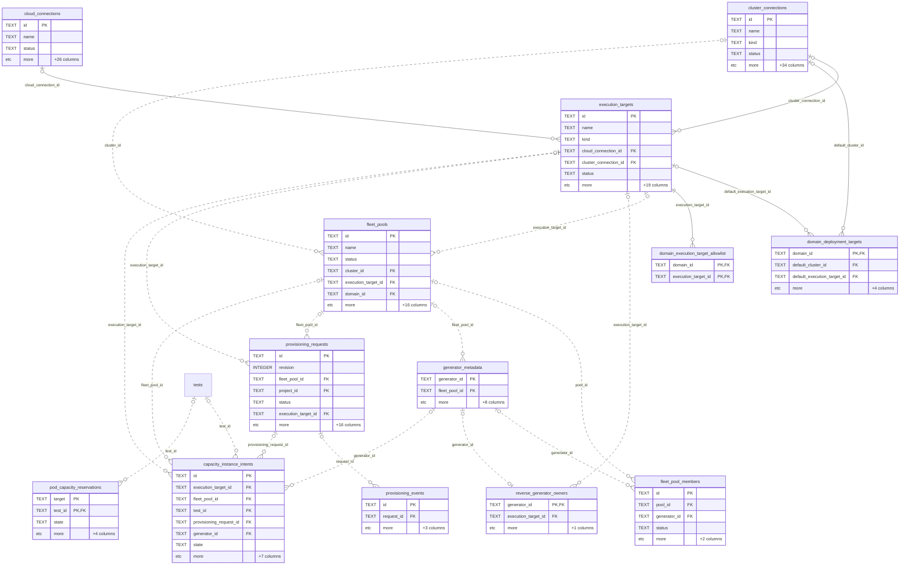

| Table | Primary key | References | Columns |
| --- | --- | --- | --- |
| `cloud_connections` | `id` | — | 29 |
| `cluster_connections` | `id` | — | 38 |
| `execution_targets` | `id` | `cluster_connection_id` → `cluster_connections`; `cloud_connection_id` → `cloud_connections` | 25 |
| `domain_deployment_targets` | `domain_id` | `domain_id` → `domains`; `default_execution_target_id` → `execution_targets`; `default_cluster_id` → `cluster_connections` | 7 |
| `domain_execution_target_allowlist` | `domain_id`, `execution_target_id` | `execution_target_id` → `execution_targets`; `domain_id` → `domains` | 2 |
| `fleet_pools` | `id` | `cluster_id` → `cluster_connections` (no constraint); `execution_target_id` → `execution_targets` (no constraint); `domain_id` → `domains` (no constraint) | 22 |
| `fleet_pool_members` | `id` | `pool_id` → `fleet_pools` (no constraint); `generator_id` → `generator_metadata` (no constraint) | 6 |
| `generator_metadata` | `generator_id` | `fleet_pool_id` → `fleet_pools` (no constraint) | 10 |
| `reverse_generator_owners` | `generator_id` | `generator_id` → `generator_metadata` (no constraint); `execution_target_id` → `execution_targets` (no constraint) | 3 |
| `provisioning_requests` | `id` | `fleet_pool_id` → `fleet_pools` (no constraint); `project_id` → `projects` (no constraint); `execution_target_id` → `execution_targets` (no constraint) | 22 |
| `provisioning_events` | `id` | `request_id` → `provisioning_requests` (no constraint) | 5 |
| `capacity_instance_intents` | `id` | `execution_target_id` → `execution_targets` (no constraint); `fleet_pool_id` → `fleet_pools` (no constraint); `test_id` → `tests` (no constraint); `provisioning_request_id` → `provisioning_requests` (no constraint); `generator_id` → `generator_metadata` (no constraint) | 14 |
| `pod_capacity_reservations` | `target`, `test_id` | `test_id` → `tests` (no constraint) | 7 |
| `fleet_alert_acks` | `id` | — | 11 |
| `deployment_leases` | `name` | — | 7 |

## Monitoring collection

Monitoring collectors poll monitor sources. During a run, run_monitor_jobs schedule collection, each batch records one poll (a digest, a sample count and the key of the stored artifact), and observation heads track the latest point of each series.

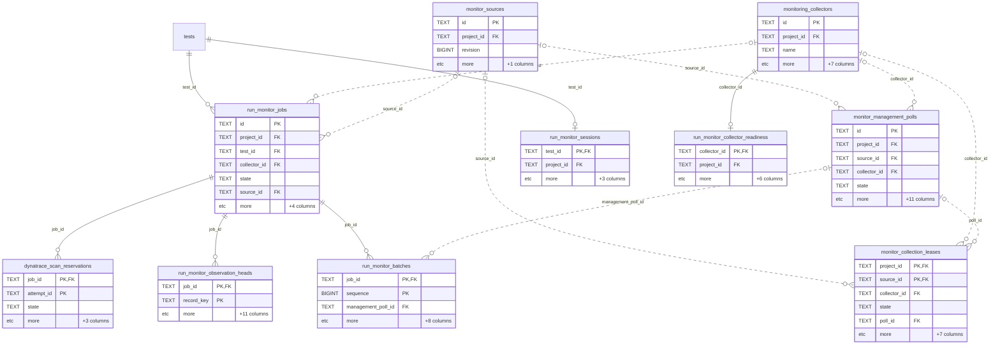

| Table | Primary key | References | Columns |
| --- | --- | --- | --- |
| `monitoring_collectors` | `id` | `project_id` → `projects` (no constraint) | 10 |
| `monitor_sources` | `id` | `project_id` → `projects` | 4 |
| `monitor_management_polls` | `id` | `project_id` → `projects`; `source_id` → `monitor_sources` (no constraint); `collector_id` → `monitoring_collectors` (no constraint) | 16 |
| `monitor_collection_leases` | `project_id`, `source_id` | `project_id` → `projects`; `source_id` → `monitor_sources` (no constraint); `collector_id` → `monitoring_collectors` (no constraint); `poll_id` → `monitor_management_polls` (no constraint) | 12 |
| `run_monitor_jobs` | `id` | `test_id` → `tests`; `project_id` → `projects`; `collector_id` → `monitoring_collectors` (no constraint); `source_id` → `monitor_sources` (no constraint) | 10 |
| `run_monitor_batches` | `job_id`, `sequence` | `job_id` → `run_monitor_jobs`; `management_poll_id` → `monitor_management_polls` (no constraint) | 11 |
| `run_monitor_observation_heads` | `job_id`, `record_key` | `job_id` → `run_monitor_jobs` | 13 |
| `run_monitor_sessions` | `test_id` | `project_id` → `projects`; `test_id` → `tests` | 5 |
| `run_monitor_collector_readiness` | `collector_id` | `project_id` → `projects`; `collector_id` → `monitoring_collectors` | 8 |
| `dynatrace_scan_reservations` | `job_id`, `attempt_id` | `job_id` → `run_monitor_jobs` | 6 |

## APM & observability connections

Per-project connections to Dynatrace, AppDynamics, Elastic and Prometheus, and the Grafana and native dashboards a project has imported or defined. Inspections and operations are durable records of the calls made through a connection.

```mermaid
erDiagram
    dynatrace_connections {
        TEXT id PK
        TEXT project_id FK
        TEXT name
        BIGINT revision
        etc more "+32 columns"
    }
    dynatrace_operations {
        TEXT id PK
        TEXT project_id FK
        TEXT connection_id FK
        TEXT collector_id FK
        TEXT kind
        TEXT state
        etc more "+8 columns"
    }
    appdynamics_connections {
        TEXT id PK
        TEXT project_id FK
        TEXT name
        BIGINT revision
        etc more "+4 columns"
    }
    appdynamics_inspections {
        TEXT id PK
        TEXT project_id FK
        TEXT connection_id FK
        TEXT collector_id FK
        TEXT kind
        TEXT state
        etc more "+9 columns"
    }
    appdynamics_quota_pools {
        TEXT resource_key PK
        etc more "+1 columns"
    }
    appdynamics_quota_leases {
        TEXT resource_key PK, FK
        TEXT executor_id PK
        etc more "+1 columns"
    }
    elk_connections {
        TEXT id PK
        TEXT project_id FK
        TEXT name
        etc more "+22 columns"
    }
    elastic_inspections {
        TEXT id PK
        TEXT project_id FK
        TEXT connection_id FK
        TEXT collector_id FK
        TEXT kind
        TEXT state
        etc more "+9 columns"
    }
    grafana_dashboard_snapshots {
        TEXT test_id PK, FK
        TEXT project_id FK
        etc more "+2 columns"
    }
    dashboard_definitions {
        TEXT id PK
        TEXT project_id FK
        TEXT name
        BIGINT revision
        etc more "+6 columns"
    }
    dashboard_definition_revisions {
        TEXT definition_id PK, FK
        TEXT project_id FK
        BIGINT revision PK
        TEXT name
        etc more "+5 columns"
    }
    dynatrace_connections |o..o{ dynatrace_operations : "connection_id"
    monitoring_collectors |o..o{ dynatrace_operations : "collector_id"
    appdynamics_connections |o..o{ appdynamics_inspections : "connection_id"
    monitoring_collectors |o..o{ appdynamics_inspections : "collector_id"
    appdynamics_quota_pools ||--o{ appdynamics_quota_leases : "resource_key"
    elk_connections |o..o{ elastic_inspections : "connection_id"
    monitoring_collectors |o..o{ elastic_inspections : "collector_id"
    tests ||--o| grafana_dashboard_snapshots : "test_id"
    dashboard_definitions |o..o{ dashboard_definition_revisions : "definition_id"
```

| Table | Primary key | References | Columns |
| --- | --- | --- | --- |
| `dynatrace_connections` | `id` | `project_id` → `projects` | 36 |
| `dynatrace_operations` | `id` | `project_id` → `projects`; `connection_id` → `dynatrace_connections` (no constraint); `collector_id` → `monitoring_collectors` (no constraint) | 14 |
| `appdynamics_connections` | `id` | `project_id` → `projects` | 8 |
| `appdynamics_inspections` | `id` | `project_id` → `projects`; `connection_id` → `appdynamics_connections` (no constraint); `collector_id` → `monitoring_collectors` (no constraint) | 15 |
| `appdynamics_quota_pools` | `resource_key` | — | 2 |
| `appdynamics_quota_leases` | `resource_key`, `executor_id` | `resource_key` → `appdynamics_quota_pools` | 3 |
| `elk_connections` | `id` | `project_id` → `projects` | 25 |
| `elastic_inspections` | `id` | `project_id` → `projects`; `connection_id` → `elk_connections` (no constraint); `collector_id` → `monitoring_collectors` (no constraint) | 15 |
| `prometheus_connections` | `id` | `project_id` → `projects` | 8 |
| `grafana_dashboards` | `id` | `project_id` → `projects` (no constraint) | 15 |
| `grafana_dashboard_snapshots` | `test_id` | `test_id` → `tests`; `project_id` → `projects` (no constraint) | 4 |
| `dashboard_definitions` | `id` | `project_id` → `projects` (no constraint) | 10 |
| `dashboard_definition_revisions` | `definition_id`, `revision` | `definition_id` → `dashboard_definitions` (no constraint); `project_id` → `projects` (no constraint) | 9 |

## GitHub integration

A user's GitHub connection and the GitHub App installations drive script links, two-way sync targets and their claims, and the check runs posted for run results.

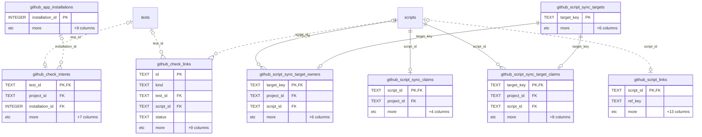

| Table | Primary key | References | Columns |
| --- | --- | --- | --- |
| `github_connections` | `user_id` | `user_id` → `users` (no constraint) | 10 |
| `github_connection_revocations` | `user_id` | `user_id` → `users` (no constraint) | 2 |
| `github_app_installations` | `installation_id` | — | 10 |
| `github_script_links` | `script_id` | `script_id` → `scripts` (no constraint) | 15 |
| `github_script_sync_targets` | `target_key` | — | 7 |
| `github_script_sync_claims` | `script_id` | `project_id` → `projects`; `script_id` → `scripts` | 6 |
| `github_script_sync_target_claims` | `target_key` | `project_id` → `projects`; `script_id` → `scripts`; `target_key` → `github_script_sync_targets` | 11 |
| `github_script_sync_target_owners` | `target_key` | `project_id` → `projects`; `script_id` → `scripts`; `target_key` → `github_script_sync_targets` | 9 |
| `github_sync_jobs` | `id` | `project_id` → `projects` (no constraint) | 19 |
| `github_check_intents` | `test_id` | `project_id` → `projects`; `test_id` → `tests` (no constraint); `installation_id` → `github_app_installations` (no constraint) | 10 |
| `github_check_links` | `id` | `test_id` → `tests` (no constraint); `script_id` → `scripts` (no constraint) | 14 |
| `github_webhook_deliveries` | `delivery_id` | — | 11 |

## Publishing & offline analysis

Confluence and Power BI publications send run results out. Analysis imports bring external result files in for offline analysis, and feature evaluation jobs score acceptance requirements against results.

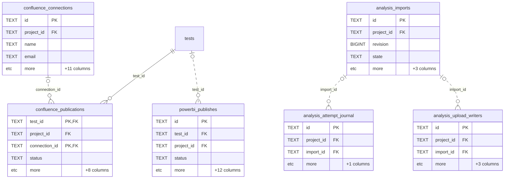

| Table | Primary key | References | Columns |
| --- | --- | --- | --- |
| `confluence_connections` | `id` | `project_id` → `projects` | 15 |
| `confluence_publications` | `test_id`, `connection_id` | `project_id` → `projects`; `test_id` → `tests`; `connection_id` → `confluence_connections` (no constraint) | 12 |
| `powerbi_publishes` | `id` | `test_id` → `tests` (no constraint); `project_id` → `projects` (no constraint) | 16 |
| `analysis_definitions` | `id`, `revision` | `project_id` → `projects` | 5 |
| `analysis_imports` | `id` | `project_id` → `projects` | 7 |
| `analysis_attempt_journal` | `id` | `project_id` → `projects` (no constraint); `import_id` → `analysis_imports` (no constraint) | 4 |
| `analysis_upload_writers` | `id` | `project_id` → `projects` (no constraint); `import_id` → `analysis_imports` (no constraint) | 6 |
| `analysis_cleanup_jobs` | `kind`, `resource_id` | `project_id` → `projects` (no constraint); `resource_id` → any resource | 4 |
| `feature_evaluation_jobs` | `id` | `project_id` → `projects`; `subject_id` → any resource | 24 |
| `feature_acceptance_records` | `id` | — | 17 |

## Audit, lifecycle & system

Audit and activity events point at any resource by resource type and ID, so they carry no foreign keys. Archiving a script or scenario writes an object_archive_states row rather than changing the object's own row; the row counts only while its incarnation matches the object's created_at. Releases and shared data pools archive through their own archived_at column. A deleted run keeps its project in deleted_test_identities, so its ID cannot be reused in another project.

| Table | Primary key | References | Columns |
| --- | --- | --- | --- |
| `audit_events` | `id` | `project_id` → `projects` (no constraint); `domain_id` → `domains` (no constraint); `resource_id` → any resource | 12 |
| `object_activity_events` | `id` | `project_id` → `projects` (no constraint); `resource_id` → any resource | 10 |
| `object_activity_migrations` | `id` | — | 1 |
| `object_archive_states` | `resource_type`, `resource_id` | `resource_id` → any resource | 5 |
| `deleted_test_identities` | `test_id` | `project_id` → `projects` (no constraint) | 3 |
| `app_settings` | `key` | — | 3 |
| `schema_migrations` | `version` | — | 4 |
