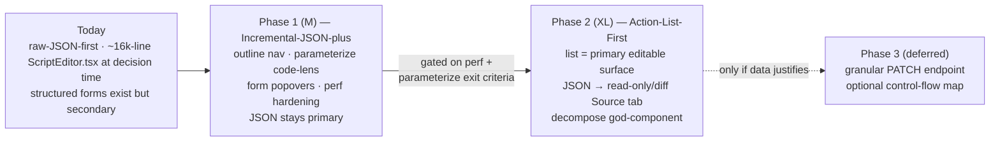

# Script Editor Interaction Model — Decision Memo & Re-Architecture Plan

**Status:** Implemented design record. The direction approved on 2026-06-18 has shipped: the editor no longer
leads with raw JSON. Author mode provides an **Author outline**, an **Action editor**, and a **Source** tab
(with **Edit in Full Script JSON** for whole-document edits); see
[Authoring A Script](APPLICATION_USER_GUIDE.md#authoring-a-script). This memo is kept as the rationale for
that design; the sections below keep their original decision-time wording.
**Audience:** Script-editor product owner + engineering.
**Related:** [SCRIPT_LIFECYCLE.md](SCRIPT_LIFECYCLE.md) (why the DSL is an interpreted action list, not code).

---

## TL;DR

The DSL is an **interpreted action list** (an AST the engine walks per VUser), not a hand-written
test script. A raw-JSON-first code editor optimizes for the wrong mental model and the wrong
audience. We will move to an **Action-List-First** editor in two phases, keeping the JSON DSL as the
single canonical source of truth and demoting raw JSON to a read-only/diff **Source** tab.

> **Recommendation:** ship **Phase 1 (Incremental-JSON-plus, M)** first — outline navigator, in-editor
> parameterize code-lens, per-action form popovers, large-import perf hardening — then **Phase 2
> (Action-List-First, XL)** — promote the action list to the primary editable surface, demote JSON,
> replace JSON-in-textarea control flow with nested rows, and decompose the (then ~16k-line)
> `ScriptEditor.tsx` god-component. **Reject** the bidirectional-hybrid reconciler and the node-flow
> canvas as the default surface.

---

## 1. The problem

At decision time the editor (`dashboard/src/components/ScriptEditor.tsx`) was a **~16,000-line god-component** (it is now roughly 6,900 lines after decomposition) whose
primary surface is raw JSON in CodeMirror (`@uiw/react-codemirror`, the `script-json` center tab). Two
observations make the status quo questionable:

1. **The DSL is structured data, not code.** A script is an ordered `actions[]` list walked
   sequentially by each VUser goroutine. It is declarative, schema-validated data — the per-action
   contract is fully declared in the backend **action catalog** (`pkg/dsl/catalog*.go`, exposed at
   `GET /api/v1/dsl/actions`). Editing it as freeform text means parsing thousands of JSON lines to do
   what is conceptually "edit row 37 / parameterize this value."
2. **The structured model already mostly exists — it's just secondary.** Per-protocol form editors
   (`HttpActionFields`, `BrowserActionFields`, `GrpcActionFields`, `ProtocolExtractorsSection`, … in
   `scriptActionFields.tsx`), an `ActionEditor` detail pane (`ScriptEditor.tsx`), a catalog
   consumer (`dslActionCatalog.ts`), and even an author-mode **virtualized action list** already exist
   (`buildScriptPhaseActionRows()` + `@tanstack/react-virtual`, with a `selectAuthorPhaseAction`
   handler in `ScriptEditor.tsx`). The raw-JSON tab is just what's in front.

Large generated imports are kept alive only by perf caps (`SCRIPT_CODE_LINE_LAYOUT_MAX_LINES=4000`,
`JSON_SOURCE_MAP_MAX_DOC_CHARS=250k`), and the editable ~98k-line case still strains — because
CodeMirror does not virtualize the document.

**Audience (decided):** the editor must serve **both** perf engineers (power users who live in JSON)
**and** less-technical QA (who need guided, form-based authoring). That dual mandate is what tips the
destination toward a structured list with a genuine raw escape hatch.

---

## 2. Recommendation: phased Action-List-First

A two-phase path, because the cheap/safe option and the right-end-state option **share components** —
Phase 1 is Phase 2's foundation, not a detour.

- **Phase 1 — Incremental-JSON-plus (effort M).** Raw JSON stays primary and authoritative. Add an
  action outline navigator, an in-editor "parameterize" code-lens, per-action form popovers over the
  existing `ActionEditor`, and large-import perf hardening. **No backend changes.** This immediately
  kills the navigation pain and proves the parameterize plumbing + the performance ceiling.
- **Phase 2 — Action-List-First (effort XL).** Promote the action list to the **primary editable
  surface**; demote raw JSON to a read-only/diff **Source** tab (kept first-class); replace the
  JSON-in-textarea `ControlFlowFields` with a nested row list; decompose the god-component.
- **Phase 3 — deferred.** A granular `PATCH /scripts/{id}/actions/...` endpoint *only if* whole-script
  PUT latency proves painful; an optional, non-default control-flow **map** view *only if* user
  research shows nested rows don't satisfy branch/loop comprehension.

### Why this and not the alternatives

We evaluated four candidate designs and scored them with three independent adversarial judges (each
axis 1–10; total /60):

| Design | userFit | Total (3 judges) | Verdict |
|---|---|---|---|
| **Incremental-JSON-plus** (D3) | 5 / 6 / 6 | **50 / 49 / 50** | Cheapest, safest, ~80% reuse → the right **first move** |
| **Action-List-First** (D1) | **9 / 9 / 9** | 45 / 47 / 45 | Wins user-fit decisively → the right **destination** |
| **Bidirectional-Hybrid** (D2) | 8 / 8 / 8 | 40 / 43 / 43 | Two editable models = round-trip bug class; maintainability **3–4** → **rejected** |
| **Node-flow canvas** (D4) | 4 / 4 / 5 | 25 / 28 / 28 | Wrong shape for a ~95%-linear list → **rejected as default** |

The panel split 2-1 on raw points (D3 edges D1 by being cheap and low-risk) but **converged
unanimously on the strategy**: ship D3 first, evolve to D1, avoid D2's reconciler and D4's canvas.
That convergence — not the point totals — is the signal. D3 wins the rubric by being safe; D1 wins the
actual product requirement ("the DSL is an action list" + the QA audience). Phasing captures both.

---

## 3. Why — the reasoning

### (a) An action list, not code, changes the economics vs. every code-first tool

Because the script is declarative data constrained by the catalog, a structured surface over it can be
a **lossless one-way projection** of canonical JSON. Code-first competitors structurally cannot do
this — Gatling/k6 generate code one-way (GUI→code, never back), and VuGen's step list is a *read-only
index* over authoritative C. Ours can be an **editable projection**. That's a genuine differentiator,
not parity.

The same flat-ordered shape is also why a **node-graph (D4) is wrong as the default** — the
workflow-tools research is unanimous that node canvases earn their cost only with real
branching/looping/parallelism and otherwise degrade to visual spaghetti; a load script is ~95% linear,
and React Flow has no document virtualization (reviving the large-import freeze at 10k+ nodes). And it
lets us **adopt JMeter's structure-over-code thesis while rejecting its worst foot-gun** — tree
scope/inheritance, where an extractor's *position* silently changes which samplers it applies to. Our
actions carry explicit, local wiring.

### (b) Existing infrastructure already pays for ~80% of the work

This is why D1's "XL" label overstates the true delta — the spine exists. Build on these:

| Need | Reuse (path:symbol) |
|---|---|
| Action contracts / labels / field specs | `dslActionCatalog.ts` (`ensureDslActionCatalog`, `dslSpecForActionType`, `dslActionTypesForProtocol`) ← `GET /api/v1/dsl/actions` |
| Flattened ordered rows + virtualization | `buildScriptPhaseActionRows()` + `ScriptPhaseActionRow` + `@tanstack/react-virtual`; `selectAuthorPhaseAction` (`ScriptEditor.tsx`) |
| Per-protocol forms / detail pane | `scriptActionFields.tsx` (`HttpActionFields`, …, `ProtocolExtractorsSection`, `ProtocolAssertionsSection`) + `ActionEditor` (`ScriptEditor.tsx`) |
| Per-value parameterize | `openParameterizeChoice` / `upsertParameterFromActionEditor` / `ParameterizeDialog` (`ScriptEditor.tsx`) |
| Bulk param suggest/apply | `ParameterizationReview.tsx` ← `/scripts/{id}/parameterize/suggest`, `/scripts/import/parameterize/apply` |
| Path ↔ editor-range ↔ row linking | `dslEditorAssist.ts` (`jsonPathForNode`, `locateJsonPath`, `enclosingActionContext`, `ISSUE_PATH_PATTERN`) |
| Per-row inline affordances pattern | `BrowserRecorderControlPanel.tsx` (exclude/secret/param/delete + confidence badges) |
| Split-pane / diff review pattern | `SourceMappingReview.tsx` (`pkg/convert/sourceview`) |
| Workbench tab plumbing | `scriptEditorWorkbench.ts` (`CenterWorkbenchTabId`, `CENTER_WORKBENCH_TAB_IDS`, `SCRIPT_JSON_TAB_ID`) |

D1 is mostly *re-wiring proven parts + a list shell + a handful of hard custom widgets* — not
greenfield.

### (c) What the Go ecosystem and load-test tools teach

| Source | Lesson | How it lands here |
|---|---|---|
| **JMeter** (tree + property form) | Structure-over-code is the proven winner for load tests; graduated correlation (boundary → JSONPath → regex) makes the hard part approachable. | Adopt structured-list-as-primary + graduated parameterize UX. **Reject** tree scope/inheritance — stay flat-ordered. |
| **VuGen** (step list + C code) | A step index over one artifact + "right-click literal → Replace with Parameter" + keep the original value visible for trust. | Copy the in-place parameterize gesture + replay-value hover (`replayVariableInspectorRef`). **Improve on it:** our list is *editable*, not read-only. |
| **k6 / Gatling** (code-first) | Every structured layer must emit an editable artifact and never trap the user; correlation is THE hard problem, and even code-first leaders punt it to manual. | Keep raw JSON a first-class escape hatch. Our `/correlations/diagnose` + paramize is the deterministic answer they lack — lead with it. |
| **Artillery** (YAML + JSON Schema) | A published schema powers autocomplete/validation cheaply, but schema-only misses cross-field semantics — needs a dry-run validate. | Catalog does the schema half; keep `POST /scripts/validate` authoritative for cross-field rules. |
| **Schema-driven forms** (RJSF / JSON Forms / OpenShift / Backstage) | ~80% of scalar/enum/required/doc fields auto-form for free; conditionals, custom widgets, and round-trip coercion are the documented failure points. | Auto-form the easy 80%; **hand-build** template-input / kv-matrix / extractor-array widgets; never re-encode `Validate`/`RequireOneOf` client-side. |
| **k8s YAML + form toggle** (OpenShift) | Form/YAML radio, JSON canonical, "not all fields shown in form" banner, disable form on malformed text. | This is the exact escape-hatch UX for the Source tab. |
| **Bruno** (text file + GUI) | A human-readable text artifact can stay the git-friendly source of truth alongside a GUI. | Reinforces JSON-as-canonical; the structured surface is a derived front-end. |

The unifying Go-ecosystem pattern (Caddy / Kubernetes / Grafana / HCL): **one typed model as truth,
many front-ends derived from it.** APEX Load is already aligned — the JSON DSL is the right source of
truth, and the editor is correctly just one front-end alongside the REST API. The work is *fidelity,
derivation-from-catalog, and a clear conflict rule* — not rethinking the model.

### (d) Why not the Bidirectional-Hybrid (D2)

D2 matches D1's audience fit and has the best power-user escape, but it commits the one thing every
source warns against: **two co-equal editable surfaces reconciled by a model store** (debounced
object↔string sync, dirty-source tracking, invalid-JSON gating, unknown-key preservation, undo/redo
asymmetry). This is the documented OpenShift/Backstage failure mode (number→quoted-string coercion,
silent selection loss, multi-step state loss); all three judges scored its maintainability lowest
(3–4). A live-synced non-virtualized CodeMirror over 10k+ actions also risks reviving the ~98k-line
freeze. **D1 gets ~90% of D2's value as a one-way projection over canonical JSON, sidestepping the
reconciler entirely** — the decisive simplification.

---

## 4. Position on raw JSON and parameterization

### Raw JSON
**The JSON DSL stays the single canonical source of truth in every phase. The structured surface is
always a one-way projection over it, never a co-equal editable peer.** This is what keeps us out of the
D2/D4 swamp.

- **Phase 1:** raw JSON is primary and authoritative; the outline is a read-only projection; code-lens
  and form popovers are *guided writes* that mutate the JSON in place and re-validate. No second model
  exists, so no round-trip/coercion bug class can arise.
- **Phase 2:** the action list becomes the *default* author surface; raw JSON is *demoted but kept
  first-class* as a "Source" tab — read-only by default with an opt-in edit toggle and a diff view,
  plus a **per-row "edit as JSON"** escape for any field the form can't represent. Two hard rules:
  1. **Preserve unknown / advanced / `params.*` / `FieldKindAny` keys verbatim on every round-trip.** A
     form that edits only catalog-declared keys and leaves the rest untouched cannot silently corrupt
     imports. This is make-or-break; it gets golden round-trip tests.
  2. **Show the "not all fields shown in form" banner** and disable structured editing when JSON is
     unparseable (fail-safe, no silent loss).

The escape hatch must stay *genuinely* first-class — demoting JSON without a real eject path alienates
the power users who live in CodeMirror today.

### Parameterization
**Per-value, raw-value-visible, in-place — reusing the existing paramize stack at two altitudes.**

- The operator always sees the **literal** (session token, order id) *before* it's replaced with
  `{{data.src.col}}` / `{{param.name}}` / `{{var.name}}` (VuGen's trust pattern), and the replay-value
  hover (`replayVariableInspectorRef`) keeps the concrete value visible *after* too.
- **Phase 1 gesture:** in-editor code-lens on a string literal → existing `openParameterizeChoice`.
- **Phase 2 gesture:** an inline "parameterize" button on every value-bearing *form field* → same
  flow; plus a per-action "suggest params" panel hitting `/parameterize/suggest`, with bulk review via
  `ParameterizationReview.tsx`.
- **Cross-field correlation stays server-authoritative** — `/correlations/diagnose` + the rule catalog
  is our deterministic Design-Studio analog and a differentiator vs. Gatling/k6's manual-only
  correlation. Lead with it; never re-encode its logic as client-side form conditionals.

---

## 5. Phased build path

### Phase 1 — Incremental-JSON-plus (M; no backend changes; independently shippable slices)

1. **`ActionOutlineNavigator.tsx`** (new) — virtualized rail over `buildScriptPhaseActionRows()` with
   catalog-derived labels + per-row issue badges (`groupIssuesByAction`); click → scroll/select the
   JSON range via `locateJsonPath()`.
2. **`parameterizeCodeLens.ts`** (new CodeMirror extension) — detect string value-nodes via
   `jsonPathForNode()`, show a "Parameterize" affordance → existing `openParameterizeChoice()`.
3. **`ActionFormPopover.tsx`** (new thin wrapper) — mount the existing `ActionEditor`/
   `scriptActionFields` for one outline-selected action; write back **preserving unknown keys** (lands
   the R1 discipline early, at small scale).
4. **Large-import perf patch** (`ScriptEditor.tsx` / `dslEditorAssist.ts`) — gate new surfaces behind
   existing size caps, lazy-mount outline rows, push CodeMirror viewport-only rendering further;
   fail-soft on a partial Lezer tree.

**Exit criteria (gate to Phase 2):** outline nav fluid on a 10k-action / ~98k-line import; in-place
parameterize proven on real LR/HAR/OpenAPI imports; whole-script PUT save latency acceptable.

### Phase 2 — Action-List-First + god-component decomposition (XL; gated)

1. **`ActionListView.tsx`** — primary virtualized list of expandable rows on a new
   `CenterWorkbenchTabId`, default Author surface.
2. **`ActionRow.tsx`** — catalog label, protocol/method badge, think-time, issues badge, drag handle,
   kebab (duplicate/delete/move/parameterize); modeled on `BrowserRecorderControlPanel`.
3. **`NestedControlFlowList.tsx`** — recursive indented child list for `control_if`/`control_loop`
   (`Action.ControlFlow` in `pkg/dsl/types.go`), replacing the JSON-in-textarea `ControlFlowFields`
   (`ScriptEditor.tsx`); document a depth cap → "drop to JSON" boundary.
4. **Action mutation helpers** — `addAt`/`duplicate`/`delete`/`move`/`reorder` over
   `script.init|actions|teardown` and nested `control.steps`; stable keys; **reference-integrity
   checks** (don't orphan extractor/param refs); atomic PUT for MVP.
5. **Custom field widgets** (budget explicitly) — `{{template}}`-aware input with scope-aware
   autocomplete; headers/params key-value matrix; `extractors[]`/`assertions[]` array builders.
6. **`ParameterizeFieldButton.tsx`** — inline per-field affordance wrapping `openParameterizeChoice`;
   per-action "suggest params" panel via `/parameterize/suggest`.
7. **`SourceTab.tsx`** — demoted read-only/diff JSON view (reuse CodeMirror + `dslEditorAssist`),
   opt-in edit toggle, "not all fields shown" banner, per-row "edit as JSON" escape.
8. **God-component decomposition** — extract the above out of `ScriptEditor.tsx` toward a thin
   orchestrator (continues `refactor/code-quality-pass-2`; reuse the prior AST splitter + verifier).
9. **Transaction wrapping (shipped, Phase 2.x).** Author transactions in the editor — the core
   measurement unit (TPS/percentiles/pass-fail; SLAs attach to them) that previously only arrived via
   import/recording. A per-action "Transaction" field and a multi-select "Wrap N in transaction" with
   two modes: **Grouped** tags actions via the engine's `metadata.source_transaction` (per-action
   aggregation), and **Timed span** inserts a balanced `lr_start_transaction`/`lr_end_transaction`
   marker pair so the engine measures the wall-clock span (incl. think time) — the classic LoadRunner
   transaction. Tagged rows show a pill; marker rows show a TXN start/end badge (so imported/recorded
   transactions light up too). Reviewed by a 24-agent adversarial workflow (0 correctness findings).

10. **Transaction band (shipped, Phase 2.x).** A left accent rail brackets the rows of a multi-row
    transaction in the outline — both a span marker pair (lr_start → members → lr_end) and a
    contiguous run of metadata-tagged rows; single-action transactions are skipped (their pill marks
    them). Computed over the filtered rows so it stays correct under the outline filter.

**Deferred / Phase 3 (only if data justifies):** granular `PATCH /scripts/{id}/actions/...` if PUT
latency hurts; D4 optional non-default control-flow **map** view.

---

## 6. Risks & de-risking

| # | Risk | De-risk |
|---|---|---|
| R1 | Lossy round-trip drops unknown/`params.*`/`FieldKindAny` keys → corrupts imports (**make-or-break**) | JSON canonical; edit only declared keys, preserve rest verbatim; **golden round-trip tests** on real LR/HAR/OpenAPI; per-row "edit as JSON". Land in Phase 1's `ActionFormPopover` first. |
| R2 | `RequireOneOf` / Go-only `Validate` funcs can't be form conditionals → "looks valid, fails on validate" | Keep `POST /scripts/validate` authoritative; surface per-row via `groupIssuesByAction`/`ISSUE_PATH_PATTERN`; no client validator fork. |
| R3 | Large-import / deep-nesting perf regression (freeze history; untested >10k actions) | Phase 1 *is* the perf de-risk; **10k-action / ~98k-line import is an explicit exit-criteria load test**; consider JSON-primary/read-only above a threshold. |
| R4 | Reorder/duplicate across nested `control.steps` orphans extractor/param refs | Stable keys; reference-integrity pass on every structural mutation; server validate catches broken refs. |
| R5 | Atomic whole-script PUT on every edit → save latency/conflict on big docs | Acceptable for MVP; measure in Phase 1. If painful, add granular PATCH in Phase 3 (deferred, non-blocking). |
| R6 | Demoting JSON alienates power users / breaks muscle memory | Source-tab edit + per-row JSON escape kept *genuinely* first-class; preserve existing inline-parameterize gesture at parity. |
| R7 | Custom widgets under-scoped ("auto-form will handle it") | Treat template-input / kv-matrix / extractor-array builders as separately budgeted line items — the research is unanimous these are unavoidable. |
| R8 | New a11y / keyboard-nav / drag-drop surface area | Focus management, keyboard nav, ARIA are explicit deliverables; model row affordances on the shipped recorder step feed. |

---

## 7. Verification

- **Round-trip correctness (R1):** golden `*.test.tsx` — import real LR/HAR/OpenAPI fixtures, open in
  the structured surface, edit one catalog field, re-serialize, assert **no non-target key changed**
  (incl. `params.*` / unknown keys).
- **Validation parity (R2):** structured-edit issues must match `POST /scripts/validate`; test a
  `RequireOneOf` action and a Go-`Validate`-only failure surfacing per-row.
- **Large-import perf (R3):** scripted 10k-action / ~98k-line import; assert outline nav + selection
  stay responsive and no full-document render. Gates Phase 2.
- **Dashboard behavior:** run the dashboard and verify in-browser (type-check alone is insufficient,
  per CLAUDE.md) — outline → select → form edit → JSON updates; parameterize a literal end-to-end;
  control-flow nesting renders. Use the preview tools.
- **Backend:** Phase 1 changes no Go. A Phase 3 PATCH endpoint (if built) needs Go unit tests +
  `go test ./...` + swagger regen (`go generate ./pkg/api`).

---

## 8. Open questions for the product owner (do not block Phase 1)

1. **Control-flow comprehension** — does `NestedControlFlowList` (indented child rows) satisfy
   branch/loop authoring, or is the deferred D4 control-flow *map* ever warranted? Needs user
   observation on real imported scripts.
2. **Large-import policy** — is "structured-read-only above a size threshold" acceptable product
   behavior, or must the structured editor be fully editable at any size? Bounds R3 and the granular
   PATCH decision.

---

*This memo was produced from a 20-agent research workflow: internal codebase exploration; external
research across JMeter, VuGen, k6, Gatling, Artillery, Bruno/Postman/Insomnia, n8n/Temporal/GitHub
Actions, schema-driven form libraries, and the Go config-vs-code pattern; four candidate designs; and a
three-judge adversarial scoring panel. All `path:symbol` reuse anchors were verified against the
current source.*
