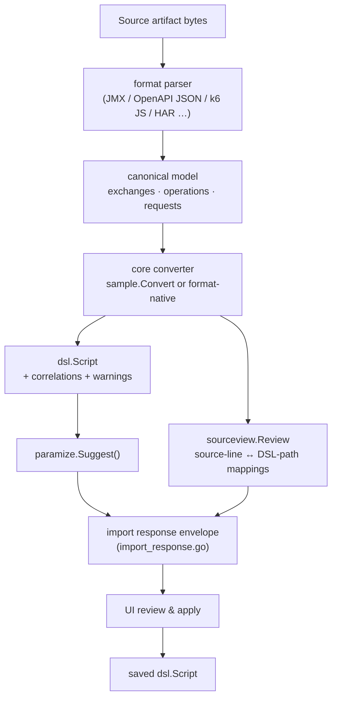
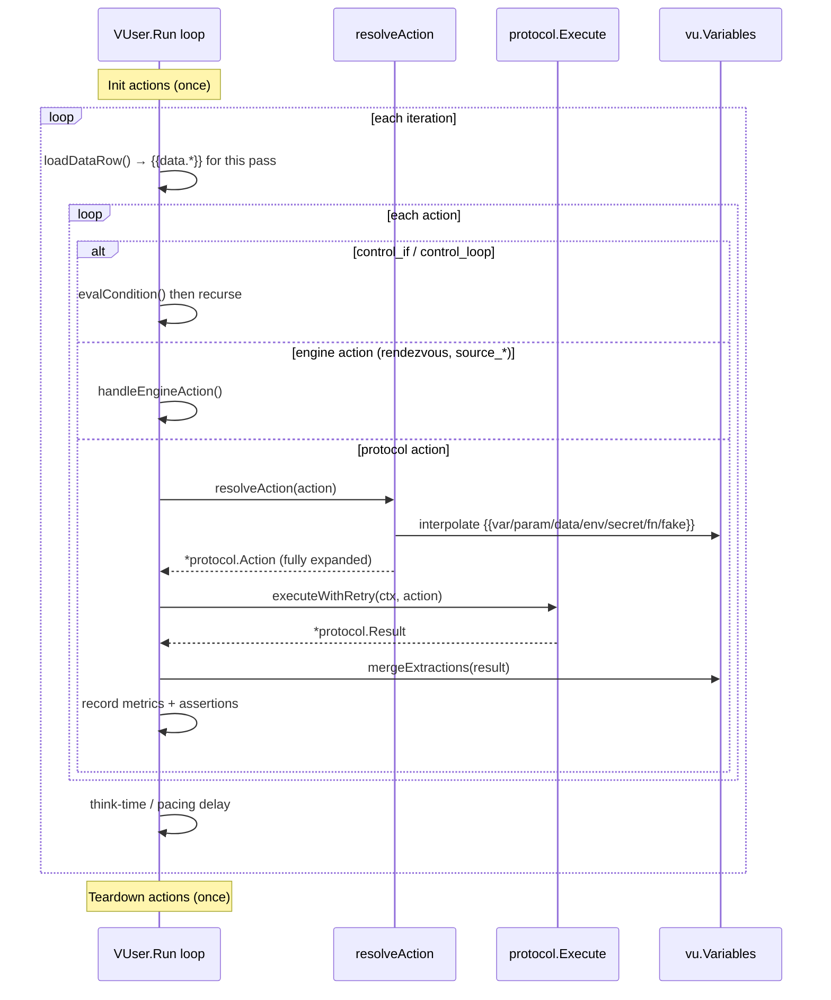
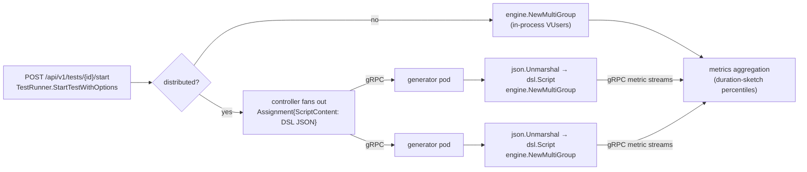

# Script Lifecycle: Source → DSL → Running Test

> How a recording, OpenAPI spec, HAR file, or LoadRunner archive becomes a JSON DSL
> script, and how that script becomes an actual running load test.

## TL;DR — there is no "Go test script"

A common mental model is *"the importer generates a Go test, and the engine compiles/runs
it."* **That is not how APEX Load works.** There is **no code generation and no
transpilation** anywhere in the pipeline — the DSL never becomes a `.go` file.

The real pipeline has **three stages**, and the middle artifact (the JSON DSL) is *data*,
not code:

```
  source artifact            JSON DSL                 running load test
  (HAR / OpenAPI /   ──►   (dsl.Script,      ──►    (pkg/engine interprets
   recording / LR …)        a data struct)           the struct at runtime)
       Stage 1               Stage 2                      Stage 3
     import/convert        parse + validate          goroutine VUsers
```

The closest thing to a "test script" in the Go sense is the **statically-compiled engine
binary** (`pkg/engine`) that *reads the DSL as input*. Each virtual user is a goroutine
that walks the script's `actions` list and dispatches every action to a protocol handler
**by its `type` string at runtime**. The same compiled binary runs every test; only the
JSON data it reads changes.

```mermaid
flowchart LR
    subgraph S1["Stage 1 — import / convert"]
        SRC["Source artifact<br/>HAR · OpenAPI · k6 · JMeter<br/>Postman · LR archive · recording"]
        CONV["pkg/convert/* + pkg/recorder<br/>format-specific Convert()"]
        PARAM["pkg/convert/paramize<br/>Suggest() correlations/params/secrets"]
        SRC --> CONV --> PARAM
    end
    subgraph S2["Stage 2 — the DSL"]
        DSL["dsl.Script (JSON)<br/>config · data_sources · params<br/>init · actions · teardown"]
        VAL["pkg/dsl parse + validate<br/>against the action catalog"]
        PARAM --> DSL --> VAL
    end
    subgraph S3["Stage 3 — interpreted execution"]
        ENG["pkg/engine<br/>1 goroutine = 1 VUser"]
        PROTO["pkg/protocol/*<br/>http · ws · grpc · browser · jms …"]
        VAL --> ENG --> PROTO
        PROTO -->|metrics| MET["duration sketch + buffered channels"]
    end
    PROTO -.->|"extractions feed<br/>next iteration"| ENG
```



For multi-pod runs, the controller serializes the **same `dsl.Script` JSON** over gRPC to
generator pods, which deserialize it and run the **identical interpreter** — see
[Stage 3b](#stage-3b--orchestration--distributed-execution).

---

## Stage 1 — Source artifact → JSON DSL

Every supported source format has a converter that produces a `*dsl.Script`. They share a
common contract and a shared post-pass (parameterization + source-traceability).

### 1.1 Entry points (REST API)

| Concern | Location |
|---|---|
| Format imports (`/api/v1/scripts/import/har`, `/jmeter`, `/k6`, `/devweb`, …) | `pkg/api/handlers_import_*.go` |
| Web-API specs (`/openapi`, `/postman`, `/wsdl`, `/asyncapi`) | `pkg/api/handlers_web_api_imports.go` |
| LoadRunner enterprise archive (`/enterprise-script-archive`) | `pkg/api/handlers_import_enterprise.go` |
| Recorder → DSL (`/browser-recorder/.../convert`) | `pkg/api/handlers_recorder_import.go` |
| Response envelope shared by all importers | `pkg/api/import_response.go` (`scriptImportResponseOptions`) |

### 1.2 Per-format converters

Each lives in `pkg/convert/<format>/` and exposes a `Convert(...) (*ConvertResult, error)`:
`har`, `jmeter`, `k6`, `devweb`, `openapi`, `postman`, `wsdl`, `asyncapi`, `raml`,
`enterprisearchive`, `trueclient`, `bruno`, `cloudtest`, `salesforce`, `agentforce`, `mulesoft`,
`eventhubscapture`, `brokerconfig`, `grafana` (monitoring dashboards), and `recorderjson`. Shared
helpers (`sample`, `paramize`, `correlate`, `importreview`, `sourceview`, …) live beside them. The HTTP-family formats (HAR, DevWeb, k6, raw HTTP,
cURL) funnel through a single shared core:

- **`pkg/convert/sample/converter.go` → `Convert(req ImportRequest)`.** It parses
  the source into canonical request/response `exchange` pairs, detects the base URL, runs
  **correlation detection** (values that appear in a response and are reused in a later
  request), builds one `dsl.Action` per exchange (method / target / headers / body), adds
  `status_code` assertions and extractors for detected correlations, and computes think
  time from timestamps.

Every converter ultimately produces a `*dsl.Script` (`pkg/dsl/types.go`) plus warnings,
stats, detected correlations, and a **source review** for traceability.

### 1.3 Source traceability (provenance)

`pkg/convert/sourceview/source_review.go` defines `Review{SourceFiles, Mappings}`:

- `SourceFiles` — the (credential-redacted, truncated) original artifact text.
- `Mappings` — `Mapping{SourceFile, StartLine, EndLine, TargetPath, TargetKind, …}` tying
  each source line range to the DSL element it produced (e.g. `actions[5]`,
  `actions[3].assertions[0]`). This drives the side-by-side import-review UI.

Provenance is also stamped onto the script itself via `Script.Metadata.Import`
(source format, original name, redaction state).



### 1.4 Parameterization pass (`pkg/convert/paramize`)

Runs **after** conversion, on **every** import, in
`pkg/convert/paramize/paramize.go → Suggest(script, opts)`. It proposes four
kinds of edits so the script is data-driven rather than hard-coded:

| Kind | What it finds | Replacement |
|---|---|---|
| `correlation` | response→request value flow (via `pkg/convert/correlate`) | extract from response, inject `{{var.*}}` downstream |
| `generated` | identifiers and time stamps a client makes up per request (trace, span, message, request and correlation IDs; a request time stamp) | a `uuid`, `random_string` or `date_time` `Parameter` updated each iteration, referenced as `{{var.*}}` |
| `data_param` | parameterizable literals (user id, email, search term) | `{{data.*}}` / a `Parameter` |
| `secret` | credential-shaped values (passwords, tokens, keys) | `{{secret.*}}` |

`data_param` suggestions come from field names (`LooksParameterName` in `heuristics.go`).
A name is split into words at separators, case changes and digits, so `user_id`, `userId`,
`UserID` and `user-id` read alike, and it is judged by its last word, as an English
compound is. It matches when that word is `id`, `user`, `customer`, `account`, `order`,
`sku`, `email` or `zip`, or completes a compound such as `username`, `loginId`,
`accountNumber` or `zipCode`. `userProfileCard`, `browserUserAgent` and `valid_from` do
not match. Runtime and configuration ids (`client_id`, `sessionId`, `x_request_id`),
accessor and header names (`getDeviceId`, `x_request_id`), sort fields and names longer
than five words are excluded.
These suggestions start unchecked (confidence 0.6).

`generated` suggestions (`generated.go`) find GUIDs, ISO date-times and, in a field named
for an identifier, hex runs of 16 or more characters, in header values, the query and the
body (XML elements and attributes, JSON and form fields alike). Only the token is replaced,
so a prefix such as `Partner~` or a trace header's flags stay as recorded, and a value used
in several places is one parameter, new each iteration, so those places still agree. Values
recorded once each in the same kind of field of different requests (an `X-Request-Id` per
request) share one parameter that is new each time it is sent (`update: each_occurrence`),
rather than one parameter per request; two values in one request stay apart. A suggestion
never takes the name of a variable the script reads, even one nothing defines yet (an input
the source left unset). A generated time stamp
keeps the recorded layout (fractional digits and zone style). A suggestion is pre-selected
(confidence 0.85) when every place names a per-request identifier or a time stamp. A
session, conversation, transaction or event ID (the target may already hold it), a GUID in
any other field and a date that may mean something start unchecked.
Credential headers, path segments, templates and values a correlation or secret already
owns are left alone, and a data parameter never claims a literal holding a generated value.

Suggestions at or above `autoApplyConfidence = 0.8` (in `paramize.go`) are pre-selected;
high-confidence correlations may already be wired into the draft (`PreApplied`). The user
accepts/rejects, then applies via `POST /api/v1/scripts/import/parameterize/apply`.

### 1.5 The recorder path (recordings → DSL)

The flagship on-ramp is the embedded browser recorder:

1. **Capture** — `pkg/recorder/browser/capture.js` is injected into every frame. It
   listens for user interactions, builds shadow-DOM-aware CSS/XPath selectors, and posts
   each event to Go via the exposed binding `window.__apexloadRecord(JSON.stringify(...))`
   (in `capture.js`). Pause/resume and the element-picker are driven from Go through
   `window.__apexloadRecorder*` globals.
2. **Session model** — `pkg/recorder/recorder.go` accumulates `Session` /
   `RecordedRequest` (method, URL, headers, body, status, timings, transaction/step
   annotations, WebSocket messages).
3. **Convert** — `pkg/recorder/converter.go → ConvertSessionWithOptions(session, name, opts)`
   produces a `dsl.Script` (HTTP or WebSocket actions), extracts correlations, optionally
   parameterizes recorded inputs, and can export a side-car HAR (`pkg/recorder/har.go`).

All five capture/HAR entry points — dedicated HAR (`POST /api/v1/scripts/import/har`),
Salesforce HAR (`POST /api/v1/scripts/import/salesforce`), sample HAR
(`POST /api/v1/scripts/import/sample` with `format: "har"`), proxy recording conversion
(`POST /api/v1/recorder/{id}/convert` and `/preview`), and browser HTTP companion
conversion (`POST /api/v1/browser-recorder/sessions/{id}/convert` and `/preview` with
`also_create_http_script: true`) — share a negotiated `conversion_policy` (`unified_v1`
versus omitted/`legacy` route defaults) and return `conversion_policy` alongside a
disclosure-safe `effective_settings` summary. Project recording profile correlation
settings propagate into native Salesforce analysis (`salesforce.Analyze`) as well as
`sample.Convert`. Proxy recording preview claims (`RecordingSnapshotDigest`) and durable
baseline observations (`result.Baseline`) are bound to the option-resolved conversion
graph (`resource_mode`, `async_scan`, `recording_profile_id`, `http_version_mode`, and
native rewrites). For browser dual-script recordings, preview responses return per-output
HTTP companion metadata (`http_parameterization`, `http_preflight`, and
`http_secret_binding_requirements`) alongside the browser script's review fields, and grouped
`http_sequence` actions preserve child `body_multipart`, `think_time_after`, and
`attribution` fields through validation, variable-flow readiness (`pkg/dsl/varflow`), and
runtime execution.

Embedded browser capture is intentionally narrower than browser replay. It records clicks,
input/textarea changes as fills, select changes, file-input filenames, Enter/Escape/Tab
keypresses, assertion-picker steps, main-frame navigation, network summaries, and
WebSocket summaries. It does not currently capture double-click, hover, drag/drop, scroll,
arbitrary keyboard shortcuts, clipboard operations, or rich-editor mutations as distinct
gestures; replay can execute hand-authored/imported `browser_dblclick` and
`browser_hover` actions even though the embedded recorder may not produce them directly.

The output is the *same* `dsl.Script` type as every other importer — the recorder is just
another Stage-1 producer.

---

## Stage 2 — The DSL itself (define, parse, validate)

### 2.1 The shape of a script

`pkg/dsl/types.go` defines the root `Script` and its sections:

```go
type Script struct {
    Name, Version, Protocol string
    Config      ScriptConfig     // base URL, timeouts, TLS, default headers, auth
    DataSources []DataSource     // CSV/DAT feeders for {{data.*}}
    Parameters  []Parameter      // file / list / counter / uuid / random / vuser_id …
    Init        []Action         // run once per VUser (setup)
    Actions     []Action         // the per-iteration body
    Teardown    []Action         // run once per VUser (cleanup)
    Metadata    *ScriptMetadata  // import provenance
}
```

An `Action` is a tagged record — `Type` is the discriminator that decides everything else:

```go
type Action struct {
    Name, Type   string             // Type ∈ {"GET","POST","ws_send","control_if", …}
    Method, Target, Selector, Value string
    Headers      map[string]string
    Body         string             // (or BodyFile, inlined at parse time)
    Params       map[string]any     // protocol/type-specific options
    Extractors   []Extractor        // pull values out of the response → variables
    Assertions   []Assertion        // pass/fail checks
    Control      *ControlFlow       // for control_if / control_loop
}
```

### 2.2 The action catalog — single source of truth

`pkg/dsl/catalog.go` is the authority for *what every action type means*. Each type is one
`ActionSpec`:

```go
type ActionSpec struct {
    Type         string        // "POST", "ws_connect", "rendezvous", …
    Aliases      []string
    Protocols    []string      // ["http"] · ["*"] for engine-level actions
    Fields       []FieldSpec   // declared fields (+ Required, Kind, Enum, Doc)
    RequireOneOf [][]string     // "at least one of these fields" groups
    Validate     func(i int, a Action) []string  // residual cross-field rules
}
```

Specs are assembled per-protocol in `catalog_*.go` (one file per protocol, mirroring the
`pkg/protocol/*` layout) and collected by `actionCatalogSeeds()` (`catalog.go`). This
**one catalog** feeds: the validator, `GET /api/v1/dsl/actions`, the dashboard script
editor, and the generated docs (`docs/dsl.schema.json` + [`DSL_ACTION_REFERENCE.md`](DSL_ACTION_REFERENCE.md)).

> **Note on codegen:** the `//go:generate` directive at the top of `catalog.go` runs
> `cmd/dslschema` (via `pkg/dsl/schemagen`) to emit the JSON Schema and the Markdown action
> reference. This generates *documentation and a schema from the catalog* — **not**
> executable Go and **not** anything that runs your test. It only reinforces the point:
> nothing turns the DSL into code.

### 2.3 Parsing

`pkg/dsl/parser.go`:

- `Parse(data)` — for in-memory JSON (API uploads); `ParseFile(path)` — for files, which
  additionally calls `ResolveBodyRefs` to inline `body_file` references
  (`pkg/dsl/bodyrefs.go`, path-confined against traversal).
- Parsing is plain `json.Unmarshal` into the typed structs. **Templates like `{{var.x}}`
  are *not* expanded here** — they are preserved verbatim as strings and resolved later, at
  runtime, per VUser.

### 2.4 Validation

`pkg/dsl/validate.go` validates each action:

1. `CanonicalActionType` normalizes legacy aliases (e.g. `loadrunner_*` → `source_*`).
2. Look the type up in the catalog index — **unknown type ⇒ validation fails.**
3. Check the type is legal for the script's protocol, that required `Fields` are present,
   that `RequireOneOf` groups are satisfied, and run the spec's residual `Validate` func.

---

## Stage 3 — DSL interpreted into a running test

This is the heart of the "no Go script" point: the engine is a **runtime interpreter** of
the `dsl.Script` data structure.

### 3.1 One goroutine per VUser

`pkg/engine/engine.go → Engine.Run` launches `vusers` goroutines with ramp-up
(`for i := 0; i < e.vusers; i++ { … go func(){…}() }`). Each goroutine runs
one `VUser` (`pkg/engine/vuser.go`, parked on an 8 KB stack between actions),
holding a pointer to the parsed `*dsl.Script` and a `protocol.Protocol` handler.

### 3.2 The interpreter loop

`VUser.Run(ctx)` (`vuser_run.go`) executes the script's phases: **`Init` once → loop over
`Actions` → `Teardown` once**. Inside the loop, the `vuserRun.runAction` method
(`vuser_run.go`) is the action-dispatch switch; init and teardown run through the
`lifecycleRun` methods in `vuser.go`. Both keep their state on the heap and their frames
small, so the GC can shrink the stack of a VUser parked in think time or pacing:

- `control_if` / `control_loop` — evaluated *at runtime* via `vu.evalCondition`
  (`pkg/engine/control_flow.go`), which supports both a legacy `left/op/right` form and
  CEL expressions (`pkg/engine/condition_expr.go`, normalized in
  `pkg/dsl/condition_expr.go`). The runner recurses into the chosen branch / loop body via
  its `runActions` method.
- **engine-level actions** — `vu.handleEngineAction` (`vuser.go` →
  `pkg/engine/vuser_source_actions.go`) handles `rendezvous`, `source_transaction`,
  `http_oauth2_token`, `source_*`, etc. without touching a protocol.
- **everything else** — resolved and dispatched to a protocol handler.



### 3.3 Resolution & templating (runtime)

Just before a protocol action runs, `vu.resolveAction` (`pkg/engine/vuser_resolve.go`)
expands every template in `target`, `headers`, `body`, and `params` via
`interpolateWithSecrets`, producing a `*protocol.Action` with fully-resolved strings (plus
redacted copies for logging). Namespaces:

| Template | Resolves to | Source |
|---|---|---|
| `{{var.NAME}}` | a runtime variable (often an earlier extraction) | `vu.Variables` |
| `{{param.NAME}}` | a parameter (file/list/counter/uuid/…) | `ParameterRuntime` |
| `{{data.source.col}}` | the current data-feeder row | `loadDataRow()` |
| `{{env.KEY}}` | process environment | `os.LookupEnv` |
| `{{secret.NAME}}` | a secret store (vault/k8s/…) | `SecretResolver` |
| `{{fn.*}}` / `{{fake.*}}` | built-ins (`fn.uuid()`, `fn.timestamp.iso8601()`, `fake.email()`) | `pkg/engine/parameters.go` |

### 3.4 Protocol dispatch

All protocols implement one interface — `pkg/protocol/protocol.go` (the `Protocol` interface):

```go
type Protocol interface {
    Name() string
    Init(ctx, config) error
    Execute(ctx, *Action) (*Result, error)   // ← the per-action hot path
    Teardown(ctx) error
    HealthCheck(ctx) error
}
```

Handlers are **compiled in and registered at `init()`** via `pkg/protocol/registry.go`
(`Register`/`Get`) — these are *not* Go runtime plugins; the registry just maps a protocol
name to a factory. Worked example, HTTP (`pkg/protocol/http/http.go → Execute`):
build the `*http.Request` → send via `net/http` (with DNS/TLS/TTFB trace timing) → read the
response → run extractors (JSONPath/XPath/regex) → evaluate assertions → return a
`*protocol.Result`.

### 3.5 The correlation feedback loop

A protocol's `Result.Extractions` (`protocol.go`, `map[string]string`) is merged back
into `vu.Variables` by `vu.mergeExtractions` (`vuser_resolve.go`). That's what lets a
token extracted from one response resolve a `{{var.token}}` in the next action — the same
correlation an importer detected at Stage 1, now closing at runtime.

### 3.6 Metrics & pacing

Results are recorded through a **buffered channel** (cap 10,000) via
`MetricsCollector.Record` (`pkg/engine/metrics.go`) to keep the hot path lock-free;
percentiles come from a mergeable duration sketch. Think-time and inter-iteration pacing
live in `pkg/engine/pacing.go`.

---

## Stage 3b — Orchestration & distributed execution

A test is created and started through the API/runner, then executed either in-process or
fanned out to generator pods.

- `POST /api/v1/tests` → `handleCreateTest` (`pkg/api/handlers.go`) →
  `TestRunner.CreateTest` (`pkg/api/testcreation.go`).
- `POST /api/v1/tests/{id}/start` → `TestRunner.StartTestWithOptions`
  (`pkg/api/testexecution.go`).
- In-process runs build a `*engine.MultiGroupEngine` via `buildRunEngine` →
  `engine.NewMultiGroup` (`pkg/api/testexecution.go`).

For multi-pod runs the controller ships each generator an `Assignment` whose
`ScriptContent []byte` is the **raw DSL JSON** (`pkg/distributed/generatorrpc/client.go`).
The generator service does exactly what the in-process path does
(`pkg/distributed/generatorrpc/service.go`):

```go
var script dsl.Script
if err := json.Unmarshal(rawScript, &script); err != nil { … }
mge, err := engine.NewMultiGroup(engine.MultiGroupConfig{
    Groups: []engine.GroupConfig{{ Name: …, Script: &script, VUsers: …, RampUp: … }},
})
```

That is the whole story of "how the DSL maps to execution" on a generator: **deserialize
the JSON into `dsl.Script`, hand it to the same engine, run the same interpreter.** No
per-test binary is built or shipped — only data crosses the wire.



---

## "Where is the Go test script?" — the direct answer

- **There isn't one.** No file in `pkg/convert/` emits Go; every converter goes
  *foreign-format → DSL*, never *DSL → Go*.
- The analogue of a compiled test is the controller/generator binary (`cmd/controller` /
  `cmd/generator`, both embedding `pkg/engine`), which is built once and runs every test.
- A test's behavior is entirely a **`dsl.Script` value** the engine reads. Dispatch is by
  `action.Type` string through a `switch` (`vuser.go`) and the protocol registry — resolved
  at *runtime*, not compile time.
- This is deliberate (see `AGENTS.md`): "JSON DSL scripts — no proprietary language",
  "Protocol plugins compiled in (not Go runtime plugins)".

---

## End-to-end worked example

A recorded login POST, traced through all three stages:

1. **Stage 1 (capture → convert).** You log in in the recorder. `capture.js` posts the
   `POST /login` exchange to Go; `ConvertSession` emits a `dsl.Script` action:

   ```json
   {
     "name": "login", "type": "POST", "target": "/login",
     "body": "{\"user\":\"alice\",\"pass\":\"{{secret.pw}}\"}",
     "extractors": [{ "name": "token", "type": "json", "expression": "$.token" }],
     "assertions": [{ "type": "status_code", "expected": "200" }]
   }
   ```

   `paramize.Suggest` flags `pass` as a `secret` and, seeing `token` reused in the next
   request's `Authorization` header, proposes a `correlation` that rewrites it to
   `{{var.token}}`.

2. **Stage 2 (parse → validate).** On save, `dsl.Parse` unmarshals the script;
   `validate.go` confirms `POST` is a real catalog action for the `http` protocol and that
   its fields/extractors are well-formed. Templates stay as literal strings.

3. **Stage 3 (interpret).** Per iteration, each VUser goroutine calls `resolveAction`:
   `{{secret.pw}}` → the vaulted password, `{{var.token}}` (on the *next* action) → whatever
   the login extracted last pass. `http.Execute` sends the request; its
   `Result.Extractions["token"]` is merged into `vu.Variables` by `mergeExtractions`, so the
   following `GET /account` resolves `Authorization: Bearer {{var.token}}`. Metrics flow out
   over the buffered channel; pacing applies; repeat.

The Stage-1 *correlation suggestion* and the Stage-3 *runtime variable feedback* are two
ends of the same mechanism — detected statically at import, executed dynamically at run.

---

## Map of the key files

| Stage | Concern | File(s) |
|---|---|---|
| 1 | Import API entry points | `pkg/api/handlers_import_*.go`, `pkg/api/handlers_web_api_imports.go`, `pkg/api/import_response.go` |
| 1 | Per-format converters | `pkg/convert/<format>/`; shared core `pkg/convert/sample/converter.go` |
| 1 | Parameterization | `pkg/convert/paramize/paramize.go`, `pkg/convert/correlate/` |
| 1 | Source traceability | `pkg/convert/sourceview/source_review.go` |
| 1 | Recorder | `pkg/recorder/browser/capture.js`, `pkg/recorder/recorder.go`, `pkg/recorder/converter.go` |
| 2 | DSL types | `pkg/dsl/types.go` |
| 2 | Action catalog (SoT) | `pkg/dsl/catalog.go`, `pkg/dsl/catalog_*.go` |
| 2 | Parse / body refs | `pkg/dsl/parser.go`, `pkg/dsl/bodyrefs.go` |
| 2 | Validate | `pkg/dsl/validate.go`, `pkg/dsl/condition_expr.go` |
| 2 | Generated artifacts | `cmd/dslschema`, `pkg/dsl/schemagen`, [`docs/dsl.schema.json`](dsl.schema.json), [`docs/DSL_ACTION_REFERENCE.md`](DSL_ACTION_REFERENCE.md) |
| 3 | Engine / VUser interpreter | `pkg/engine/engine.go`, `pkg/engine/vuser.go`, `pkg/engine/vuser_resolve.go`, `pkg/engine/vuser_source_actions.go` |
| 3 | Control flow / conditions | `pkg/engine/control_flow.go`, `pkg/engine/condition_expr.go` |
| 3 | Templating built-ins | `pkg/engine/parameters.go` |
| 3 | Metrics / pacing | `pkg/engine/metrics.go`, `pkg/engine/pacing.go` |
| 3 | Protocol interface / registry | `pkg/protocol/protocol.go`, `pkg/protocol/registry.go`, `pkg/protocol/http/http.go` |
| 3b | Orchestration | `pkg/api/handlers.go`, `pkg/api/testcreation.go`, `pkg/api/testexecution.go` |
| 3b | Distribution | `pkg/distributed/generatorrpc/client.go`, `pkg/distributed/generatorrpc/service.go` |

See also [`DSL_ACTION_REFERENCE.md`](DSL_ACTION_REFERENCE.md) for the full per-action-type
field contract and [`dsl.schema.json`](dsl.schema.json) for the JSON Schema.

## Durable script authoring saves

Editor clients read the versioned authoring view of a stored script. The response
pairs the authored DSL and application/release placement with an opaque content
revision and one strong `ETag`. Keep that document and tag together. Script
`version`, timestamps, library display names and activity are separate metadata;
they cannot supply a save precondition. The default enriched read remains
available for library context and does not carry a strong authoring ETag.

Send the exact authoring tag as `If-Match` on an ordinary script update. The
controller checks it before credential reconciliation and again within the
mutation transaction. Changes to executable content, authored metadata or
application/release placement invalidate an older tag. A stale save returns
412; malformed, weak, wildcard or multiple tags return 400. Foreign resources
remain 404 before precondition details are evaluated. Successful writes return
the coherent final `authoring_projection` and `content_revision`, with
`X-APEX-Script-Save-Mode: conditioned`. They do not attach an ETag to the enriched
response body.

During the compatibility window, older ordinary PUT callers may omit the tag.
Store-backed compatibility saves require a durable audit intent and outcome and
return `legacy_unconditioned` mode; they do not protect an old client draft from
changes made before admission. Project administrators can set
`settings.authoring.require_script_save_if_match` to require a tag for ordinary
script PUT. Missing tags then return 428. A store that cannot provide durable
revisions cannot bypass this policy or accept a requested conditioned save.
This policy does not make scenario, folder, source or placement operations
require the script header; scenarios have their own policy (below).

An ambiguous persistence outcome or failed outcome audit returns a fixed 503
response with `script_save_outcome_unknown` or
`script_save_outcome_audit_unavailable`. The write may already have committed:
retain the local draft, reload current authored state explicitly and inspect it
before retrying. A stale response cannot grant permission to overwrite a newer
draft. Clients must not downgrade a failed conditioned save to an unconditional
write.

Ordinary creation is create-only. A supplied primary ID is matched exactly;
reference aliases are accepted for reads and updates, not interpreted as a
creation destination. An existing owned ID returns 409 and a foreign/private
ID remains hidden. Protected import and authoring-approval workflows retain
their existing receipt/replay contracts.

### Retry-safe creates

`POST /api/v1/scripts` and `POST /api/v1/scenarios` accept an optional
`Idempotency-Key` header (16–512 visible ASCII characters), scoped to the
project, the caller and the kind of create. For 24 hours the same key and the
same request return the resource the first request created, with
`Idempotent-Replayed: true`; the body is the resource as it is now, and
`X-APEX-Original-Content-Revision` carries the revision the original create
produced when it is known. A changed request with the same key returns 409
`idempotency_key_reused`, an expired key 409 `idempotency_key_expired`, and a
request still in flight 409 `idempotency_request_in_progress` with
`Retry-After`. Once the created resource is deleted the key returns 410
`idempotency_resource_deleted` and never recreates it; a delete that was
refused leaves the key replaying. A scenario create whose commit
acknowledgement was lost returns 503 `scenario_save_outcome_unknown`: retry it
with the same key, which adopts the scenario if it committed. Controllers
without durable receipts refuse a key with 503 `idempotency_unavailable`.

`POST /api/v1/tests` (a run create, including a queued run's revised copy)
accepts the same key under receipt contract 1 only: the key fixes the run ID,
a retry returns the run the first attempt created as it is now, a deleted run
answers 410 and is never recreated, and `X-APEX-Authoring-Receipt-Version: 2`
is refused with 400 `idempotency_receipt_version_unsupported`. A create whose
outcome cannot be confirmed answers 503 `test_create_outcome_unknown`: retry
it with the same key. With a caller-supplied `requested_test_id` an
unconfirmed earlier attempt is never adopted; an existing run there answers
409 `test_identity_in_use`, so read it by that ID. Deleting a run tombstones
its keys in the same transaction. Before this contract, a key on a run create
held only the generic 15-minute duplicate-request fence (any key length,
409 `duplicate idempotency key`); it now follows the receipt rules above,
including the 16-character minimum and the 24-hour replay.

#### Receipt contract version 2

The contract above is receipt version 1. A keyed create may send
`X-APEX-Authoring-Receipt-Version: 2`. The create, its group and data-pool
bindings and the completed receipt then commit in one transaction, together
with the original outcome: the resource ID, project, content revision and
creation time, and the disclosure-safe authoring projection the create
committed. A version 2 retry with the same key returns that recorded
`AuthoringReceiptOutcome` unchanged (`Idempotent-Replayed: true`, no `ETag`),
never the resource as it is now: read the current authoring projection before
editing it. A projection that would bring the outcome near its 4 MiB bound
(more than 4 MiB less 64 KiB), or a script whose stored content alone is that
large, is omitted, and `authoring_projection_omitted` names why. A deleted
resource still returns 410, and the outcome is never refreshed from the
current resource. The stored outcome is cleared once the resource's delete
commits. Until then it keeps what the create committed even after the
resource is edited: a value a later edit removes (scripts are stored as
authored; scenario runtime credentials are masked in the projection) stays
in the receipt, and in backups taken meanwhile, for up to 24 hours, and is
replayed only to the same caller with the same key. Once a key can no longer
replay, its receipt's request digest and outcome are both scrubbed; the
receipt still answers the key as expired or deleted. A create that would
commit after that point is rolled back instead (409
`idempotency_request_in_progress`; a retry then answers the key as expired),
so no outcome is stored for a key that cannot replay it.

A `201` to a keyed create carries `X-APEX-Authoring-Receipt-Version` with the
contract that applied (error responses carry none). A key keeps the contract
it was first claimed under: a version 2 retry of a version 1 key replays the
resource as it is now (echo `1`), so a legacy receipt is never reissued as a
new create, and so do a version 1 retry of a version 2 key and a version 2
receipt that an older controller completed without an outcome during a
rolling upgrade (a version 2 receipt such a controller left pending, with its
resource created, is adopted the same way). Any value other than `1` or `2` is refused with 400
`idempotency_receipt_version_unsupported`, and a controller whose store cannot
complete receipts atomically refuses version 2 with 503
`idempotency_receipt_version_unavailable` before claiming the key.

Keys and requests are stored only as keyed digests, under a key kept in the
settings table. Where a key wrapper is configured (`APEXLOAD_WRAPPING_*`),
credential values never enter that digest: a scenario or run create's runtime
credential values are fingerprinted under a second per-deployment key stored
only wrapped, and the request digest covers that fingerprint with references
in their place. Without a configured wrapper (a project secret store that does
not use one), a scenario create's digest covers the raw request as before, so
a reader of the whole database could test guesses of those values offline;
configure key wrapping to close that. Run creates were never digested before,
so without a wrapper a keyed run create that carries credential values is
refused with 422 `idempotency_credentials_unprotected` before its key is
claimed; use secret references for those values. A wrapper the store cannot keep the
second key for is an error, never a reason to digest the values unprotected.
Receipts claimed under the earlier digest still recognize their own retries.

The dashboard gives every new script and scenario draft, and every queued
run's revised copy (under contract 1), its own intent key, and sends script
and scenario keys under version 2 (falling back to version 1 only on that explicit
refusal). The key is kept after a lost response, a timeout or a server failure,
so the next save replays rather than duplicates; it is replaced only after a
definitive refusal and a changed draft. A scenario draft's key is part of its
browser checkpoint, so a reload keeps it. A new script draft or revised copy is not
checkpointed: its key survives a reload only for the same unchanged draft,
through a local record of keys whose outcome is still unknown (no draft
content is kept there); a revised copy's key is recalled only for the same
source run. When the controller will not create with the key (a
changed draft, an expired key or a deleted original), the editor keeps the
draft and offers **Save as new**, beside that refusal only: it is the only
action that creates another object. A scenario save that replays an earlier
create opens that scenario as it is now, with its own baseline, so the next
save edits that revision rather than overwrite later edits with the replayed
form; **Save and configure run** shows it the same way instead of configuring
a run from it, and one archived since stays in the library to be restored.
After a replayed run create, creating again replays the same run, and a
changed draft is refused while that run stays one click away; **Save as new**
queues another.

### Scenario authoring revisions

`GET /api/v1/scenarios/{id}?view=authoring` returns the scenario's authoring
projection with a strong `ETag` of the form
`"scenario-authoring-v1:<content_revision>"`. The plain `GET
/api/v1/scenarios/{id}` carries the same `ETag`, `content_revision` and
`authoring_projection` whenever its body is the durable state they describe;
create and save responses carry the tag their own transaction committed. Send it as `If-Match` on scenario PUT
and on every other scenario writer (DELETE, data-pools, library assignment,
monitor bindings and runtime apply-to-groups). It is compared inside the
write's transaction: a stale tag returns 412, and malformed, weak, wildcard or
multiple tags return 400. Without a tag the write is unconditioned; a PUT
without one is audited as `save_mode: legacy_unconditioned`. Project administrators can set
`settings.authoring.require_scenario_save_if_match` to require a tag on every
scenario writer (428 without one; the policy is re-read inside each write). The
dashboard sends a tag on every scenario write it makes, so the policy is safe to
enable for dashboard-edited projects (see [Scenario editor conflict
recovery](#scenario-editor-conflict-recovery)). A project update
that omits `settings.authoring` keeps the current policies; send
`"authoring": {}` to clear them. Controllers without durable scenario revisions
refuse a tag with 503 `scenario_save_if_match_unavailable` on PUT and
`scenario_writer_if_match_unavailable` on the other writers, and refuse every
write under the strict policy with 503 `scenario_save_strict_policy_unavailable`.
A save whose commit outcome is unknown returns 503
`scenario_save_outcome_unknown`, and one whose outcome audit failed
`scenario_save_outcome_audit_unavailable`: the save may have committed, so
reload before retrying.

#### Scenario editor conflict recovery

Opening a scenario in the scenario builder reads it first and builds the form
from that durable body, so the tag the editor keeps describes exactly what the
form was built from (never a possibly stale library row). Every save presents
that tag and adopts the committed tag from the response. A stale tag (412), a
missing one under the strict policy (428), an unverified outcome (503
`scenario_save_outcome_unknown` or `scenario_save_outcome_audit_unavailable`)
or a lost response keeps the draft and opens the reconciliation panel, which
refuses another save until it is resolved:

- **Load current baseline** reads the scenario again; it neither saves nor
  replaces the draft.
- **Diff** lists field paths only, never values: what changed in the canonical
  authoring document since the draft's baseline, and what the draft changed.
- **Reapply draft** carries the draft's changes onto the loaded scenario
  (locally changed fields and group lists take precedence; untouched fields take
  the current values) and makes the loaded tag the one the next save presents.
- **Reload scenario and discard draft** rebuilds the form from the loaded
  scenario.

A read that carries no supported revision opens the same panel at once. A
browser checkpoint of an edit records the revision, form and workload shape it
was loaded from: resuming it adopts the durable baseline only for that same
revision and otherwise opens the panel against the draft's own original (a
checkpoint without a revision, from an older dashboard or of an edit whose
read carried none, records the update time of the body its form was built
from, and resumes as an edit only while the listed scenario still has that
time, else as a new scenario). A plain read on a
replica whose cached copy another controller has since saved refreshes once,
so Load current baseline recovers there too. The other dashboard
scenario writers also send a tag: a library delete re-reads the scenario and
refuses one whose authored fields changed (its update time) since the list loaded — a placement or monitor-binding change alone does not count; a library-assignment save presents
the scenario's current tag alongside the assignment's own `expected_revision`;
and the builder's monitor-binding save presents the editor's baseline (a stale
one opens the reconciliation panel) and, when only the bindings changed,
adopts the new revision so the next scenario save is not a self-inflicted
conflict.

Create-intent idempotency keys in the dashboard, queued revise-copy idempotency
and the complete shared-owner/lifecycle matrix remain open in
[AUTH-1–AUTH-3](FEATURE_COMPLETION_SPEC.md#auth-1-two-shared-owners-and-revision-safety).

The generated [OpenAPI contract](swagger.yaml) describes the authoring read and
save representations and error headers. Content revisions are server-owned
metadata and never become executable DSL fields.

The secret-reference rebind helper remains a pure draft transformation. Authoring
clients pass the same observed strong `If-Match` tag; stale authored content or
placement returns 412 and unavailable revision support fails explicitly. The
helper transforms exact executable references without saving the script or issuing
a new ETag. Keep the observed pair for the transformed local draft and use it on
the subsequent conditioned save. Requests without the authoring tag retain the
legacy `UpdatedAt` check and can return 409; an omitted timestamp is not proof of
an observed authored revision.

The dashboard retains the observed baseline independently of its editable draft.
A stale save, uncertain server outcome, lost response or unqualified save receipt
keeps the draft and disables another save until explicit reconciliation. Load the
current authored baseline, inspect Diff, then Reapply selected local edits before
saving with the newly observed tag. Reload and Reapply do not write by themselves.
Conditioned secret-rebind responses exclude read timestamps and library context,
so conflict diffs reflect authored changes.

#### Script editor validation binding

Validate, save, replay, debug and the browser-to-HTTP preview act on one
resolution of the current draft: unblurred data-cell edits are flushed and a
dirty JSON pane is parsed once. A draft validation sends the editor's
fingerprint of that exact document (`fingerprint`, at most 128 visible ASCII
characters, 0x21–0x7E with no spaces) and `POST /api/v1/scripts/validate`
echoes it as `validated_fingerprint`; a stored-script validation reads the
durable revision and names it as `validated_content_revision`. A controller
that attests no stored revision (an older peer, a failed durable read, a
moved script) names none; the clean editor then validates its baseline as a
draft, bound by its fingerprint, instead of reporting the stored script
changed. The editor shows a result only
when it answers the latest request, the editor still holds the document it was
issued for, and the echo names that document (or, for a stored script, the
editor's baseline revision). A result is then bound to the document's
fingerprint, the baseline revision and the project, folder and replay variables
it was issued with; any edit, save, rebaseline or change to those makes it
stale, and the evidence summary stops reporting it as passed. Debug evidence is
bound the same way to the fingerprint of the document the replay ran, so a
configuration, parameter or data-source edit makes it stale too, not only an
action edit. The readiness card also reconciles secret-reference availability
against the live secret probe as it renders; the result itself depends on
that availability through its validation context, below.

#### Validation context

Both validation endpoints also return `validation_context`: the controller
context the result depended on, which an unchanged document does not cover.
It has an opaque `revision` and four keyed component digests:
`capabilities` (the controller's authoring catalog and the runtime a browser
script needs), `policy` (the project's domain feature policy and settings and
the system script-import policy), `approvals` (whether a Java Vuser script
needs authoring approval and, for a script with a library ID, whether its approval is
still valid) and `secret_references` (where the script's secrets resolve:
its project, an application ahead of it, or an application assignment that
cannot supply secrets in this project; and each referenced secret, sorted and
bounded to `secret_reference_limit` names, with its availability;
`secret_references_truncated` marks a longer list). No secret value enters
any digest. Validation depends on whether a secret is configured, not on its
value, so replacing a value leaves the context unchanged, while a rebinding or
a secret becoming available or unavailable changes it. A draft is bound to the
project its request was authorized for, as a draft save is, and its `id`
selects a library assignment and an approval only when it names a stored
script in that project. `contextual_findings` lists
context-dependent findings with a fixed `cause`: `secret_unavailable`,
`approval_required`, `approval_stale` or `capability_unavailable`. They are
distinct from the static `issues` about the document and from execution
admission: starting a run always rechecks authorization, approval, secrets and
placement. (A browser runtime that is not installed is also reported among the
`warnings`, as before.) Only the project settings validation depends on enter
`policy` (`authoring` and `features`), and a failed read of the project or
application secret store, the application or library assignment that scopes
them, the project or a Java approval session is an error, never a changed
context: validation then omits `validation_context`, and the context endpoint
answers 503. A Key Vault fallback reports no read errors, so its outage still
reads as an unavailable secret.

`POST /api/v1/scripts/validation-context` returns the current context for a
draft (`script`, with `project_id` and `folder_id`) or a stored script
(`script_id`), without validating it; exactly one of the two is required. With
`script_id`, `content_revision` names the stored revision the held result
validated, and a newer revision answers 409
`validation_context_revision_changed` instead of a context for content the
result never saw. A script in another project answers 404, as a missing one
does. A service account needs the same `scripts:write` scope as for
validation. The script editor re-reads the context for the result it
holds when the window regains focus or becomes visible and every 60 seconds
while the window has focus, one probe at a time and at most one every 5
seconds (doubling after each failed probe, up to 10 minutes, until a new
result starts afresh). A different
revision makes the result stale like an edit does, and the readiness card says
which components changed (for example, "project secrets changed since the
check"); a stored script's 409 `validation_context_revision_changed` makes it
stale too ("the stored script changed since the check"). A result from a controller that reports no context stays bound to its
document only.

### Archive editor approval handoff

When a plain archive draft is opened directly in the Visual Editor and changed
into a Java Vuser draft, Save queues an authoring session for approval. The
archive review shows **Queued for approval**, with the session identity; it is
not a saved library script and cannot be debugged from that review. Resume the
session from Scripts to continue the approval workflow. If the editor changed
while queueing was pending, those later edits remain open and unsaved.

Pending sibling drafts stay in the archive review. A source session shared by
multiple generated lanes is retained while another lane still needs it.
Protected imports continue to require saving before editing. The
[handoff review](qa/reviews/roadmap-archive-approval-handoff-2026-10-19/README.md)
records coverage and remaining lifecycle work.

### Scenario prerequisite handoff

The first script saved from the scenario prerequisite editor is assigned to the
selected group. Later saves update that script without adding another group.
If its editor returned to an import review, has later edits, or requested
secret setup, the embedded authoring workflow stays open. **Back to scenario
draft** returns explicitly and still checks unsaved import siblings and editor
changes. An ordinary finished save keeps its existing automatic return.

Saving an archive draft while editing continues opens the saved script with
those later edits and keeps the source review mounted. The return to the
converted script remains available after later saves and a failed canonical
reload; sibling drafts and their protected source session stay with that review.
