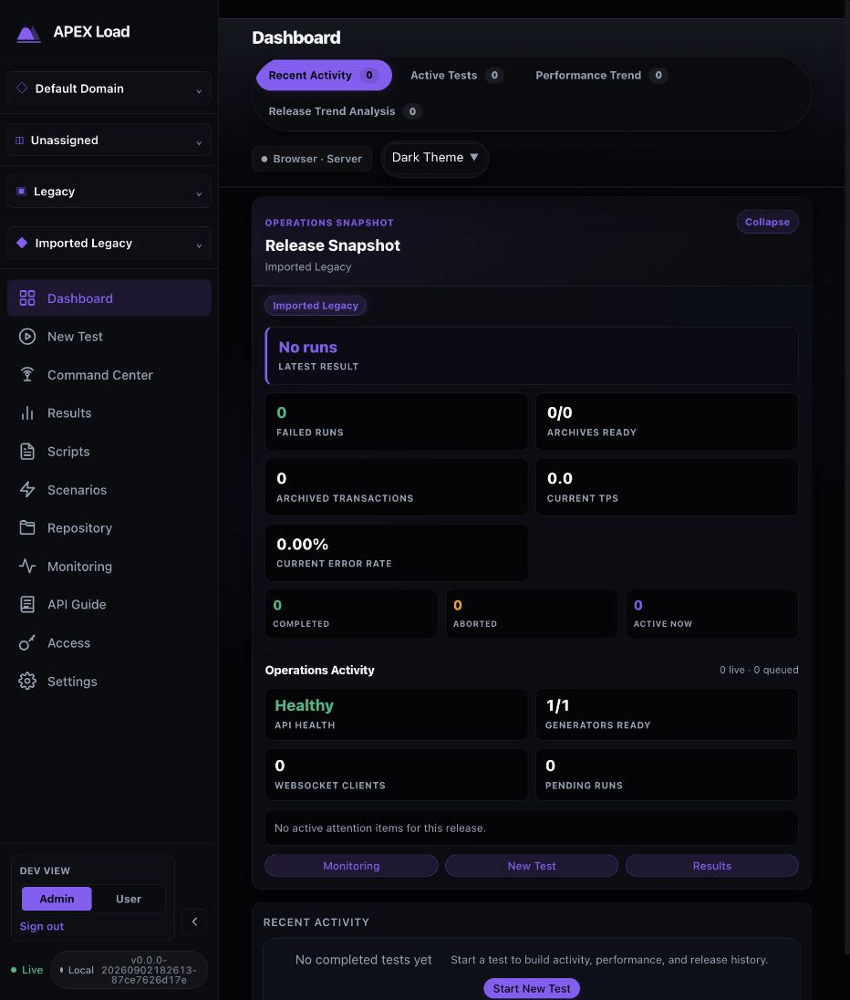
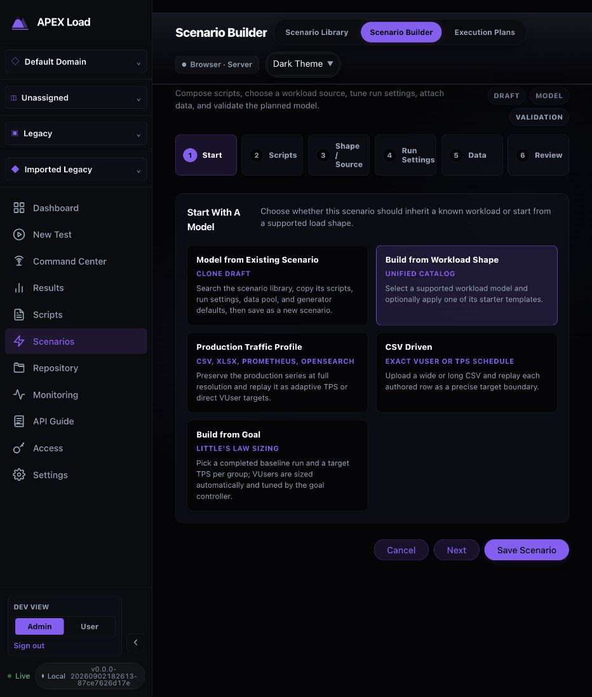
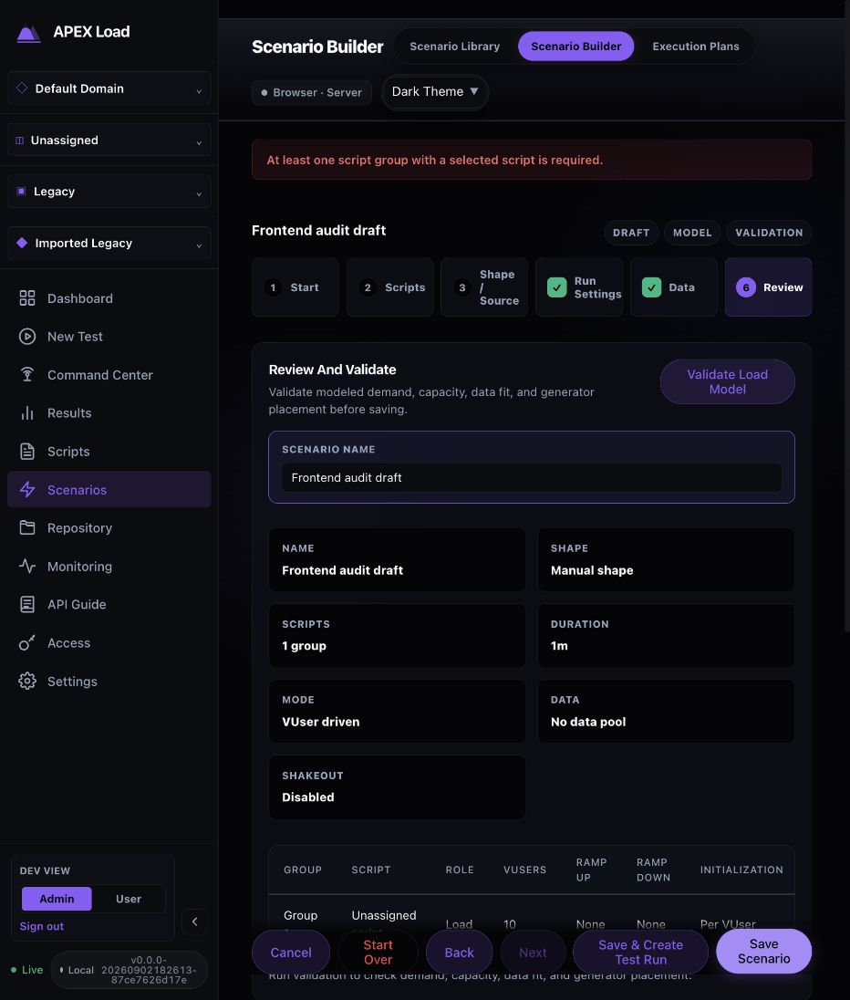
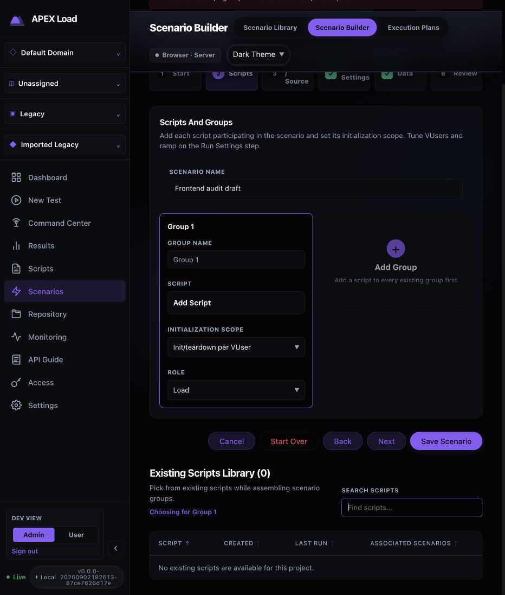

# Dashboard UX Reviews, September 2026

Status: Historical. Three dashboard/usability reviews from September 2026, merged from `docs/qa/` on 2026-09-24. None carries open work tracked in [STATUS.md](../../qa/STATUS.md) or [DEFECTS.md](../../qa/DEFECTS.md). Current browser coverage is in [E2E_SUITES.md](../../qa/E2E_SUITES.md).

Contents: [Frontend user workflow review](#frontend-user-workflow-review) (2026-09-06) · [Usability remediation and regression evidence](#usability-remediation-and-regression-evidence) · [Dashboard analysis implementation and review](#dashboard-analysis-implementation-and-review) (2026-09-20)

---

## Frontend user workflow review

Review date: 2026-09-06. Source revision: `87ce7626d`.

The frontend has a coherent workspace model and useful guards, but a new user can reach scenario creation before having the scripts needed to finish it. Prioritize one continuous first-run journey, recovery from incomplete setup, and preservation of project/run identity across screens. Existing per-step browser coverage is substantial; it does not prove that a user can complete the whole journey without fixture setup between steps.

Implementation follow-up: [automated coverage and normal test cycle](../../qa/E2E_SUITES.md#2-workflow-regression-suite). The observations below describe the original audit, before that implementation. [Annotated Figma review board](https://www.figma.com/design/9tjL68AABdh0cOtSDvexeT).

### Evidence and scope

Reviewed React routing, existing Playwright specs, their fixtures, and the Tier-0 assertion matrix. Manually exercised the current Vite frontend with a freshly built controller, isolated temporary SQLite database, dev-admin identity, and the in-app browser. Screenshots are 932 × 1096 pixels in dark theme. No production records were touched and no load was launched.

The browser evaluation covers first-use navigation, scenario validation, script-selection recovery, and draft protection. Import execution, authenticated roles, scheduling, live runs, reports, downloads, native desktop behavior, and other viewport sizes are proposed test coverage, not newly verified results. Existing specs were inspected, not run; historical `GREEN` labels are not a fresh pass report. No application code or executable tests were changed.

### Observed journey

| Step | User action | Observed outcome | Health |
|---|---|---|---|
| 1 | Open the empty dashboard | Live connection, explicit empty activity, persistent workspace scope, New Test navigation | Usable; first-task guidance is visually subordinate to zero-value metrics |
| 2 | Choose New Test | Explains missing scenarios, offers Open Scenario Builder, disables launch | Good prerequisite handling; observed in accessibility tree, no separate screenshot |
| 3 | Open Scenario Builder | Five model choices, six steps, prominent Save Scenario before any input | Usable for experienced users; primary-action hierarchy can encourage premature saving |
| 4 | Save blank scenario, then supply a name and save again | Jumps to Review, first asks for a name, then requires a selected script; draft name survives | Correct rejection; recovery requires finding a different wizard step |
| 5 | Choose Scripts, then Add Script | Focus moves to an empty library search; no create/import action in this empty picker | First-use friction: the dependency cannot be supplied within this flow |
| 6 | Choose sidebar Scripts, then Keep editing in Unsaved Changes | Dialog receives focus; closing it restores navigation focus and preserves the draft name | Good draft protection; save/discard branches not exercised |

#### 1. Empty dashboard

#### 3. Scenario entry

#### 4. Validation recovery

#### 5. Empty script selection

### Findings and recommendations

| ID | Priority | Evidence | User impact and recommendation | Tests |
|---|---|---|---|---|
| F1 | P1 | Steps 2, 5, 6 | New Test leads to a builder whose empty script picker only offers search. Leaving to create a script triggers the dirty-draft guard. Offer Create/Import Script with an explicit return path that preserves the draft, or check this prerequisite before starting. This is friction, not proof that scripts cannot be created elsewhere. | U01, U03, U07 |
| F2 | P2 | Step 3 | Save Scenario visually outranks Next at the first step. Its validation then jumps to Review. Make the next required setup action primary and give validation an actionable link to the missing field/step. | U03, U08 |
| F3 | P2 | Step 4 | Review says “SCRIPTS 1 group” while the group has an unassigned script; default Run Settings/Data show completion ticks without visits. Distinguish valid defaults and configured groups from selected scripts so readiness is easier to judge. | U08, U09 |
| F4 | P2 | Screenshot 03 | At the captured width, the bottom action row overlaps the visible review table/help area. Verify all content can be scrolled fully clear of sticky controls; reserve footer space and test focus scrolling. This capture does not establish permanent inaccessibility. | U20 |
| F5 | P2 | Screenshot 01 | The empty release snapshot occupies most of the initial view; first-run activity guidance is near the bottom. Prefer a short first-run checklist and compact empty metrics. | U01, U20 |

Accessibility strengths: controls expose names, Add Script moves focus to search, and the unsaved-changes dialog initially focuses Keep editing and restores focus on cancellation. The validation banner has `role="alert"` in `TestHub.tsx`; its announcement still needs assistive-technology verification. Muted purple/gray text on dark backgrounds is a contrast risk requiring measurement, not a confirmed contrast failure. Tab controls exposed as checkboxes and table/focus behavior need keyboard and screen-reader evaluation. No WCAG compliance claim is made.

### Test environment and acceptance rules

- Use a throwaway controller/database/archive directory with an explicitly verified auth profile. Use dev-admin for functional isolation, local-auth for sign-in, and real role fixtures for RBAC; the DEV VIEW User toggle is not an authorization test.
- Use two projects with deliberately similar script/scenario/run names, distinct applications/releases, and unique test prefixes. Include empty and populated workspaces.
- Use a deterministic HTTP test service on a dedicated local port with successful, slow, and failing endpoints. Maximum three VUsers and short bounded runs. Never target production or depend on public services. Use a real generator pool only for the pool-assignment case.
- Keep the existing tiny OpenAPI fixture as the import baseline. Add malformed input, unsupported-runtime import, expired inspection, long names, and a 400-action script. Use synthetic data and dummy secrets.
- Pin report-feature enabled/disabled variants, browser locale, timezone, and viewport. Proposed baseline: 1440×900; reproduce this review at 932×1096; additionally test 1280×720 and 200% zoom. Add smaller widths only if they are product-supported.
- Drive the action under test through the UI. API setup and independent persistence checks are useful, but must not replace the UI step being evaluated. U01 must create its own business objects through the UI and retain them throughout.
- Poll observable states with deadlines; do not use fixed sleeps or exact live TPS/latency values. After pause, allow in-flight work/aggregation to drain before testing stability. Reconcile final metrics after terminalization.
- Every case records screenshot/trace on failure, identity/scope, relevant response status, expected versus observed outcome, and cleanup result. Test-owned runs must be terminated in fixture teardown even after timeout; reuse `support/liveRun.ts` where appropriate.
- P0 = essential release gate; P1 = high-value regression; P2 = broader usability/compatibility. These are proposed expectations, not claims that all cases currently pass.

### Proposed E2E cases

Each row specifies setup, user steps, and a measurable outcome. “Existing” means related inspected coverage exists; extensions still need implementation and execution.

| ID / priority | User goal and setup | User steps | Expected outcome | Coverage relationship |
|---|---|---|---|---|
| U01 / P0 | First successful test; fresh local-auth workspace and controlled HTTP target | Sign in → create Domain/Project/Application/Release → import OpenAPI → validate/convert/save → edit and save script → create scenario → preflight/estimate → start → watch → stop → find Results → download evidence | One continuous set of object IDs and scope; no hidden API-created business objects between stages; exactly one run; advancing samples; graceful COMPLETE; correct report/archive and nonempty download | Full arc explicitly MISSING in current matrix; compose existing per-step workflows |
| U02 / P0 | Sign in and preserve authorized context; local-auth plus viewer/operator/admin fixtures | Enter wrong credentials, correct them, open permitted views, sign out, use Back and a protected deep link; repeat with viewer | Failed login stays outside workspace; successful identity is correct; sign-out prevents protected data reuse; viewer cannot launch or mutate via UI/deep link; denied requests leave no changes | Extend local-auth/auth specs; role behavior needs real fixtures |
| U03 / P1 | Recover when no scripts/scenarios exist; empty project | New Test → Builder → name draft → Scripts → Add Script → attempt to obtain first script and return | Missing prerequisite is clear; proposed create/import return path retains name/settings; selected script belongs to this project; no silent discard or duplicate scenario | New; F1/F2; current empty picker lacks inline recovery |
| U04 / P0 | Keep work in the intended project; two similar workspaces | Select project A, open script/scenario, switch to B; test Back/Forward, reload and copied deep link; create an asset after switching | Header, URL, lists and persisted ownership agree; no A data or stale metrics under B; unauthorized asset links show access recovery rather than content | Extend workspace/routes specs |
| U05 / P0 | Import safely and commit once; valid OpenAPI | Upload → Validate Only → Convert → inspect generated action/method/target → Save → search/reopen library entry | Validation/conversion create no library item; explicit save creates exactly one correctly scoped script; reopened content matches review | Existing import baseline; add duplicate-submit/reload checks |
| U06 / P1 | Recover from failed/expired import; malformed and valid fixtures | Submit malformed input → correct file; separately expire inspection or return a controlled commit failure → retry | Actionable message; no partial library entry; safe retry/revalidation; corrected input remains available; no secret values in UI errors | New fault/recovery variants; use explicit server fault fixture |
| U07 / P0 | Protect unsaved work; dirty script and scenario | Attempt sidebar navigation, scope switch and browser Back; separately choose Keep editing, Save changes and Discard; inject save failure | Keep retains all fields; successful Save persists once then reaches intended destination; Discard leaves stored version unchanged; failed Save keeps user/draft in place | Existing scenario cancellation only; extend to all branches and editor |
| U08 / P0 | Fix invalid scenario; blank/manual draft | Save blank; add name but no script; select script then try invalid duration/VUsers/group configuration; correct and save | No invalid persistence; errors identify field/step and are announced; correction retains valid input; Review reflects selected scripts and actual totals; one valid save | Happy path exists; negative/recovery assertions new |
| U09 / P1 | Compose realistic workload; two scripts, data pool and distinct group roles | Configure groups, init scopes, duration, ramp, data; traverse every step backward/forward, Review, save, reopen | Group identities, role, data binding, duration units, VUsers and ramps survive; summary and stored model agree; model changes do not silently reset unrelated inputs | Extend scenario-builder spec |
| U10 / P0 | Launch exactly the reviewed load; valid scenario | Select release/name, apply run-only overrides, wait for preflight/estimate, change load again, recheck, double-click Start under latency | Stale preflight cannot authorize changed inputs; one run launches with final values; scenario defaults remain unchanged; UI reaches the created run | Extend run-launch; use request counts and persistent run ID |
| U11 / P1 | Recover from unavailable capacity; known unavailable/denied pool | Select placement, preflight, inspect failure, change to available pool and retry; reload configuration | No unintended auto-placement or launch; blocker names corrective action; chosen `pool_id` survives save/reload and generator assignment agrees | Matrix relies partly on lower-level tests; add UI round trip |
| U12 / P0 | Trust live monitoring; executing controlled run | Open live view, observe two samples, navigate to Command Center and back; interrupt/reconnect WebSocket | Progress is observable; disconnect/staleness is visible; reconnection resumes the same run without duplication or history from another project | Existing live metrics; reconnect and cross-view variants new |
| U13 / P0 | Pause/resume, scale and extend deliberately; running test | Open control confirmation and cancel; confirm pause; wait for in-flight drain; resume; scale 1→3; extend duration | Cancel sends no mutation; PAUSED plus stable completed-action counter after drain; resumed progress; visible target becomes 3; projected end moves consistently | Existing lifecycle baseline; add counter stability and reconnect checks |
| U14 / P0 | Distinguish stop from abort; two independent runs | Gracefully Stop run A; force Abort run B; reopen each from Results | A reaches COMPLETE, B ABORTED; no further target traffic after shutdown deadline; final status agrees across views; unavailable evidence is clearly labeled | Existing exact-terminal tests; add cross-view/traffic checks |
| U15 / P1 | Schedule or hold without accidental execution; valid scenario and fixed timezone | Hold for manual start, verify idle then start; schedule future run, reload, cancel; try past/invalid time; repeat across DST boundary | Hold never starts automatically; due run starts once; canceled run never starts; invalid/ambiguous time handled explicitly; displayed time/zone matches persisted instant | New scheduling journey; requires controllable scheduler clock/fixture |
| U16 / P0 | Understand and retrieve results; completed and failed runs | Filter by name/release/status, open run, switch report lenses where enabled, download listed artifact, clear filters | Right run remains identifiable; shared headline values agree; empty filter has recovery; downloaded artifact belongs to same run and matches manifest checksum | Extend report-results/lifecycle; test feature OFF legacy archive path too |
| U17 / P1 | Recover when evidence is incomplete; terminal run with unavailable/corrupt artifact fixture | Open archive/report; verify integrity; attempt download; retry when artifact becomes available | No false “verified” or successful-download indication; useful status/retry; healthy artifacts still accessible; no blank report | New; controlled artifact fixtures only |
| U18 / P1 | Handle concurrent edits and expired identity; two sessions | Edit same asset in both, save A then stale B; separately expire B session before Save | Conflict never silently overwrites A; B draft recoverable; reauthentication returns to intended work without replaying a mutation automatically | New; requires session and conflict fixtures |
| U19 / P1 | Diagnose dependencies; disconnected generator/collector fixture | Open Monitoring/Fleet, inspect warning, filter scope, reconnect dependency, refresh | Actual unavailable/last-seen state is visible; no success-looking stale zero; recovery updates without losing scope; role-appropriate actions only | Route smoke does not prove this workflow |
| U20 / P1 | Complete setup using keyboard and limited space | At baseline/review viewport and 200% zoom, traverse selectors, wizard, picker, validation and modal using keyboard; scroll Review to end | Logical focus order, visible focus, no traps/obscured focused controls, fully reachable table/help/footer; errors announced; contrast measured in both themes | New; F4/F5; add automated accessibility scan plus manual screen-reader pass |
| U21 / P2 | Work with realistic library scale; 400 actions and large paginated catalog | Search last action, switch editor tabs, edit/save/reopen; sort/filter library, change page and clear search | Last item remains reachable; edits survive virtualization; counts/page reset correctly; proposed editor usability deadline ≤30s; no blank pane | Existing large-script bound; extend catalog interactions |
| U22 / P1 | Recover from a page/chunk/API failure; controlled 500 and lazy-chunk failure | Navigate each major destination, fail loading once, retry; separately open missing/deleted object deep link | Correct page heading and landmark appear; meaningful error/retry or not-found recovery; shell alone cannot count as success; no crash loop | Strengthen tier0-routes, which currently checks visible body plus pageerror after 400ms |
| U23 / P1 | Know whether an imported script can run; governed/unsupported runtime fixture | Import and review warnings, acknowledge only where appropriate, save and attempt preflight | Authorable/importable does not imply executable; missing runner/policy or unsupported protocol gives explicit blocker; never silently substitutes runtime | Bruno coverage exists; broader runtime matrix new |
| U24 / P2 | Record a browser task; local recording agent disconnected then connected | Open recording flow, follow setup, connect test agent, record controlled site, stop, review, save and reopen script | Actionable disconnected state; session lifecycle visible; recording stops cleanly; reviewed actions persist in correct project; dummy secrets remain redacted | Separate integration lane with provisioned agent/browser; not required for HTTP smoke |

### Automation sequence and release evidence

First implement U01, U03, U07, U08 and U10: they cover the continuity gap, observed first-use friction, and the highest-cost data-loss/duplicate-launch risks. Strengthen route assertions alongside them: require a destination-specific heading/landmark and resolved loading state, not merely a visible body.

Keep independent per-step specs for diagnosis. Run the P0 critical path on PRs with deterministic fixtures, then add P1 recovery/RBAC checks as their harness support lands. Put timezone, multiple browser engines, agent integrations, large catalogs and wider viewport/theme coverage in a separate scheduled lane. Pin defaults explicitly; don't make the report-enabled path the only report/history acceptance test.

Proposed initial deadlines: ordinary local navigation/recovery 15s, large editor 30s, local launch/terminal transition 60s. Calibrate against reproducible baseline evidence before enforcing; these are test budgets, not claimed performance results. Use target-server counters for pause/stop semantics and run IDs for cross-view identity. Keep request-level inspection as corroboration of user-visible outcomes.

For every execution publish case ID, revision, profile, feature flags, browser/viewport, observed outcome, duration, trace/screenshot and cleanup. Mark Pass/Fail/Blocked/Not run explicitly. An unexecuted case or an API-only assertion must not turn the user journey green.

References: [existing journey](../../qa/E2E_SUITES.md#1-tier-0-journey-m1), [assertion matrix](../../qa/E2E_SUITES.md#tier-0-assertion-matrix), [browser specs](../../../dashboard/e2e), [isolated harness](../../../scripts/run-e2e.sh), [routing](../../../dashboard/src/appRouting.ts), [generated API catalog](../../api-endpoint-catalog.json).

---

## Usability remediation and regression evidence

This change implements the September 2026 walkthrough findings in the existing dashboard and controller. It preserves raw archives and legacy API fields. New fields are additive; generated OpenAPI and TypeScript contracts are refreshed through the existing generators.

### Outcome integrity

Execution termination, workload completion, computed acceptance, and archive coverage are separate signals. An observed breach fails acceptance. No configured criteria means **Not assessed**. Missing evaluation, incomplete evidence, unconfirmed completion, or an unobserved intended load makes otherwise passing criteria **Inconclusive**. Analyst assessment, author, and rationale remain separate from the computed result. Missing narrative and sign-off are **Not provided**.

New archives classify protocol requests/actions and enclosing named transactions explicitly. Reports retain combined raw record counts, but calculate separate count, errors, duration percentiles, and rates for each population. Action drilldown and report action tables use requests; transaction acceptance uses named transactions. Legacy events without positive classification evidence remain unknown. No records are deleted to reconcile the populations. Comparison and release-trend projections carry population identity; incompatible populations are not compared.

Structured conversion diagnostics retain severity. Informational source-order notes do not count as unsupported execution features. Debug evidence identifies response status and capture state before repair advice. HTTP 503 guidance directs the operator to target availability and response evidence, preserving the expected contract. Capture/redaction/retention policies remain enforced.

### Continuous authoring journey

The dashboard provides a first-test checklist, retained in Help after an archive exists. Guided workspace setup creates or selects domain, project, application, and release through existing APIs and preserves progress across scope changes. Compatibility-created objects are explained.

The scenario builder can create or import a missing script and return it to the original group without losing the draft or scope. Inline data-pool creation retains the initial row after failure and retries without creating duplicate pools. Permission checks and unsaved-change confirmations remain in force.

Authoring choices are alternatives rather than numbered steps. Import review receives focus and announces completion; generated JSON is collapsed. The explicit save action opens the editor. Action type and HTTP method are independent fields. Saved, validation, debug, and approval-readiness evidence are shown separately. Advanced authoring tools, recording comparison, and run-protection settings use progressive disclosure.

### Presentation and operation

Finished runs open with an outcome summary ahead of layout controls. Customization and report format choices are disclosed on demand. Optional remote-library configuration no longer dominates local libraries. Empty states, asset search names, identity subject help, role explanations, local Kubernetes applicability, and scheduling timezone labels are clarified.

The live load plot renders separate planned/actual series with a meaningful numeric VUser domain. Pause guidance explains retained allocation and rolling-throughput decay. Debug panels retain readable height when failure banners appear, fit within the available width, and stack on narrow screens. Added controls have accessible names; existing focus management and keyboard navigation are retained.

### Normal change cycle

Run `cd dashboard && npm run test:cycle`. This executes type checking, lint, unit tests, the production build, and the existing workflow runner for both disposable dev-admin and authenticated local profiles. CI continues to invoke that runner. The usability workflows are in `dashboard/e2e/workflow-usability.spec.ts` alongside the existing lifecycle, recovery, scheduling, workspace, and authoring tests.

New regression cases cover independent HTTP method persistence; operator-stopped no-SLA reports; prerequisite cancellation and OpenAPI return; full guided hierarchy creation; data-pool row failure/retry; narrow debugger layout; real HTTP 200/503 evidence; and automated WCAG AA checks on first-use screens in dark and light themes. Focused Go tests cover verdict rules, partial evaluation, classification, population reconciliation, termination provenance, diagnostic severity, snapshot capture state, and retention behavior.

Backend validation uses `go test ./...`. Accessibility lint uses `npm run lint:a11y`; bundle budgets use `npm run bundle:check`.

### Hands-on evidence

A separate local controller, SQLite database, archive directory, and controlled HTTP service were used. The service returned HTTP 200 after about 80 ms or a deliberate HTTP 503. The walkthrough created the complete workspace hierarchy, edited and debugged a saved GET, built and validated a one-user scenario, launched it, paused/resumed/stopped it, and inspected the archive and executive exports.

The successful replay measured about 92 ms. The failed replay displayed HTTP 503 and the service-unavailable JSON body, followed by availability guidance. The stopped workload produced 35 request records plus 35 enclosing transaction records: 70 raw records, not 70 business transactions. Its computed assessment was Not assessed. Browser inspection verified the outcome summary and 0–1 VUser plot. PDF and DOCX were rendered and visually inspected, including explicit missing sign-off.

File upload was exercised by the real Playwright import workflows; the interactive browser’s file-upload bridge was unavailable, so the manual editor walkthrough used an equivalent API-seeded script. Production SSO, external recording agents, remote workspaces, distributed infrastructure, and third-party telemetry were not exercised end to end. This is regression and expert-review evidence, not a WCAG conformance certification or a measured user study.

### Verification results

- Dashboard unit tests: **3,847 passed across 343 files**. Type checking and lint passed.
- `npm run test:cycle`: **passed**, including type checking, lint, 3,847 unit tests, production build, **51 dev-admin browser workflows and 4 local-auth workflows**. The retained accessibility test passes after correcting release-selector grouping, settings field names, and dark/light contrast.
- Accessibility lint: **0 blocking errors and 0 legacy warnings**. The focused browser audit passes on Dashboard and Settings in dark and light themes, including release-selector semantics, field names, and text contrast. These checks do not establish whole-product conformance.
- Backend: `go test ./... -timeout 20m` completed. **API passed (532 seconds)**; the full suite remains red in two packages: the credential-staging failure below and the CLI deadline case described below. All other packages passed. The previous full run passed the API package and all other packages except `pkg/distributed/generatorrpc`. `TestStagedAssignmentKeepsScriptSourcedCredentialsOutOfPlatformMaterial` also fails on unchanged baseline `9b6bedf06` in both credential-staging cases. No credential safeguards were weakened. An initial Java-runner timeout passed in isolation and in the subsequent full run. The final extended run also encountered the unchanged CLI cancellation test’s short abort deadline under concurrent load; its isolated repeat passed. An API run hit the default ten-minute timeout during concurrent builds and was repeated with a twenty-minute package timeout.
- Executive HTML, PDF, and DOCX outputs were inspected. The captured run reconciles 35 requests, 35 named transactions, and 70 raw records, with no acceptance criteria evaluated.
- Bundle checks passed after a measured aggregate-budget adjustment. Unchanged baseline already exceeded the aggregate JavaScript budget (5.28 MiB raw / 1.42 MiB gzip). The remediation build is 5.29 MiB / 1.42 MiB; aggregate ceilings are now 5.30 MiB / 1.425 MiB and CSS 704 KiB. Individual asset and route budgets remain unchanged.

### Review follow-up

The follow-up fixes all three review findings:

- Scenario drafts remain guarded during script prerequisites. Local return/close actions retain the parent draft while resolving the script editor; external navigation still resolves every dirty editor. Browser coverage now explicitly attempts Dashboard navigation from the import detour, cancels the prompt, and verifies the retained scenario.
- Default executive and engineering narratives derive failures from the same computed assessment as the verdict, including transaction-statistic and imported-dashboard threshold breaches absent from the manifest's breach flag.
- All metric populations divide by the same actual elapsed execution window, including pauses and pacing/idle time. Invalid or missing timestamps omit the rate and render Unknown. Regression cases cover sparse samples, differing event offsets, empty populations, invalid windows, and report aggregation. The sample archive reconciles 35 requests and 35 named transactions over 31.816006 seconds to 1.100075/s each; JSON and HTML agree.

The revised dashboard cycle passed 3,848 unit tests and all 55 browser workflows. A second code review of the revised paths found no further actionable issues. The full `go test ./... -timeout 20m` rerun completed: all packages except API and generatorrpc passed, including the CLI package. API’s sole failure was `TestHistoricalArchiveSecretSurfacesAreMasked`, whose archive download hit the real free-disk reserve under suite load; after removing obsolete task-generated binaries, that test passed unchanged in isolation (1.357 seconds). The known baseline credential-staging failure in generatorrpc remains. Focused backend regression tests for all revised report behaviors passed. Accessibility lint also passed with zero errors or warnings.

### Reader-facing report names

Report mastheads and subtitles now use the recorded test name; unnamed historical tests display “Unnamed test.” The executive subtitle is “Performance results for …” rather than generated-profile implementation text. A project ID is no longer used as an environment fallback: recorded environment labels are preserved, while absent values display “Not recorded.” The scenario ID was removed from executive headline cards. Raw archive provenance retains the identifiers.

The controlled sample’s regenerated executive HTML, PDF, and DOCX were checked for the real run name and absence of run, project, and scenario UUIDs. HTML was inspected in a browser and PDF was rendered and inspected. Regression tests cover configured and missing environment values, missing names, and preservation of raw provenance.

Naming follow-up validation: focused reader-context, browser/SOAP report rendering, and archive-security tests passed (1.443 seconds). The full Go run completed but remained red: the known credential-staging failure, a distributed completion timeout (also reproduced in isolation), and the archive free-disk-reserve failure under suite load. The archive-security case passed unchanged on repeat. The obsolete report-subtitle assertion was updated to the new text and passed. No distributed execution or disk safeguards were changed in this follow-up.

### Import credential classification

Script disclosure now distinguishes descriptive names from generic token-shaped text. Transaction names, step names, and nested request names do not become credential candidates merely because they contain long mixed-case identifiers. Imported LoadRunner transaction calls preserve their name arguments (including sub-transaction parents and structured argument copies). Password/API-key fields, credential-shaped structured text, and known credential values copied into labels remain protected. Unknown functions and non-name arguments retain the existing scrub policy.

The archive uploader also sends the project field before file bytes, as required by streaming authorization. A browser regression imports `dashboard/e2e/fixtures/transaction-labels.zip`, reviews its generated DSL and absence of credential requirements, then saves and reopens it. This fixture contains only a Web `.usr` descriptor and C source with start/request/end calls; its long business identifier deliberately crosses the generic entropy threshold. The workflow runs through the existing `npm run test:cycle` and CI browser runner. Go regression tests cover both disclosure layers, the real archive import response, actual credentials, and non-label argument boundaries. Already-redacted names require re-importing the original source; the application cannot infer the removed text.

Validation for this follow-up: 3,850 dashboard unit tests and all 56 browser workflows passed; type checking, lint, and the production build passed. The saved-script browser screenshot was inspected. All focused Go classification/import regressions passed. The full Go run reproduced the documented generator credential-staging failure and caught a malformed new boundary fixture (its typed name/value discriminator was missing); that fixture was corrected and the focused suite rerun successfully. No generator credential policy was changed.

---

## Dashboard analysis implementation and review

Implemented September 20, 2026 following the dashboard Product Design audit.

### Operator workflow

Load Comparison now separates action, named-transaction, legacy, and group-summary evidence. It provides individual-run and release-summary views, explicit baseline/candidate selection across application releases, merged p50/p95/p99 or mean latency, successful/failed latency selection, successful throughput and errors, numeric load spacing, and missing-point gaps. A measurement window includes complete retained intervals only. Exploratory limits identify the highest **tested** individual-run load meeting all three limits and the minimum retained duration. Pooled release duration cannot qualify a short repeat. Release summaries expose contributing IDs and the range of measured repeat statistics.

Release Trend Analysis now charts latency, successful throughput, errors, and observed load. Within-release and cross-release modes use one filtered comparison model for the latest summary, row, expanded detail, and CSV. Baselines can be the previous eligible visible run, a fixed selected run, or a recorded baseline. Scenario, script, environment, data, pacing, workload, duration, achieved load and archive coverage qualify the comparison. Missing context remains unverified; known mismatches cannot produce a qualified regression. Transaction drill-down sorts by degradation/acceptance breach, latency, or traffic and retains baseline and population when opening the full report.

Both tabs offer browser-local saved comparisons and context-bearing CSV exports. Release-wide export belongs to the trend tab. Readiness and operations panels collapse during analysis. Tables retain semantic rows, labeled controls, keyboard navigation, and contained scrolling.

### Review corrections

- Include idle retained intervals in throughput denominators.
- Merge raw-event quantile sketches; never average stored percentiles.
- Share bounded sketches by transaction and observed load across intervals so a long run does not allocate a sketch every second.
- Reject invalid archived durations, report excluded runs, and keep missing denominators distinct from measured zero.
- Clear stale responses on filter changes; ignore late request completions.
- Compare normalized workload settings rather than runtime timestamps or object key order.
- Keep release changes as the intended comparison variable, including full-report qualification.
- Calculate transaction throughput using the same population's retained rate denominator.
- Preserve an explicitly selected fixed baseline when filters exclude it; show missing evidence rather than silently substitute another run. Regression coverage also verifies restoring the filters restores the selected baseline.
- Protect CSV text cells from spreadsheet formula interpretation.

### Evidence limits

Limits and regression rules are exploratory, versioned fixed rules, not statistical significance or edits to stored acceptance criteria. A percentile can be unavailable in an older archive; group summaries cannot recover successful throughput or event percentiles. Operators select a known steady-state interval; the application does not infer one or extrapolate a capacity ceiling. Legacy duration fallbacks are labeled and cannot qualify the highest tested load. Offered-arrival-rate axes and causal telemetry correlation require retained evidence beyond this change. Saved comparisons reload current evidence; CSV is the frozen export.

Automated coverage includes population/window filtering, merged distributions, idle intervals, long-run memory accounting, inconsistent denominators, comparison qualification, actual-baseline deltas, stale responses, saved-view restoration, report routing and browser workflows at desktop/narrow widths. The dedicated browser scenario uses deterministic archive fixtures with real workspace/run IDs; it is UI evidence, not an application performance benchmark.

### Validation results

- `go test ./...`: passed, including API schema freshness and the new long-run distribution tests.
- Dashboard typecheck, lint, and embedded production build: passed.
- Full Vitest run: 407 files and 4,352 tests passed.
- Final fixed-baseline correction: all 11 Release Trend panel tests passed.
- `workflow-dashboard-analysis.spec.ts`: passed with dev-admin and local-auth, including actual chart rendering, missing evidence, saved comparison restoration, filtered baseline deltas, report routing, and contained narrow-width scrolling.
- Full `npm run test:cycle` was executed. Its broader browser gate is not green: existing Command Center/overview, dev-preview, live-run identity/control, and workspace-selector journeys still expect the preceding navigation UI. These are separate from the passing dashboard-analysis workflow; they were not weakened or disabled by this change.
- Full browser results: dev-admin 114 passed, 8 failed, 4 skipped; local-auth 41 passed, 1 failed, 1 skipped. The final baseline correction was additionally checked with typecheck, lint, production build and the focused browser workflow in both profiles.
