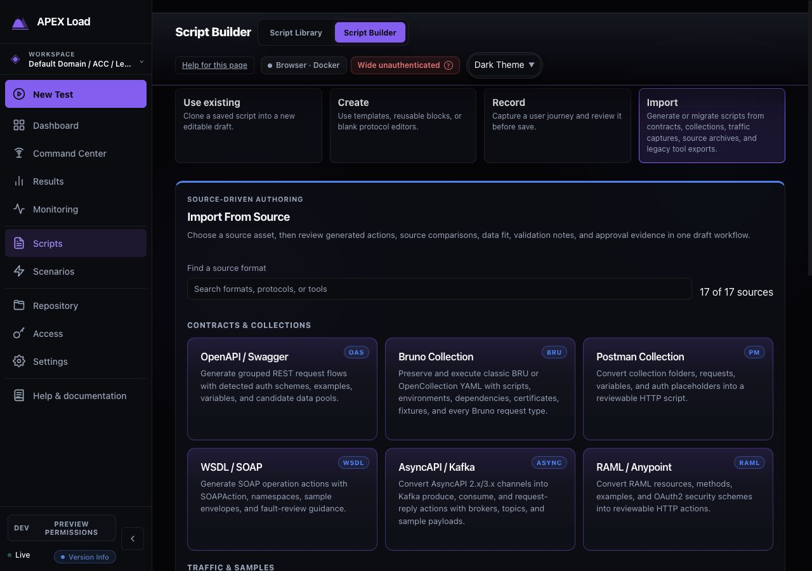
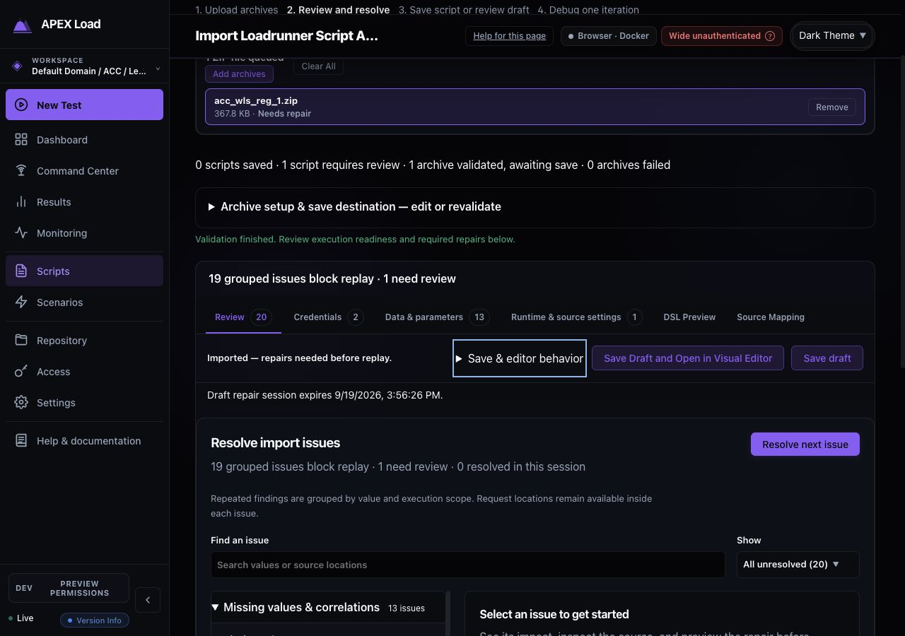
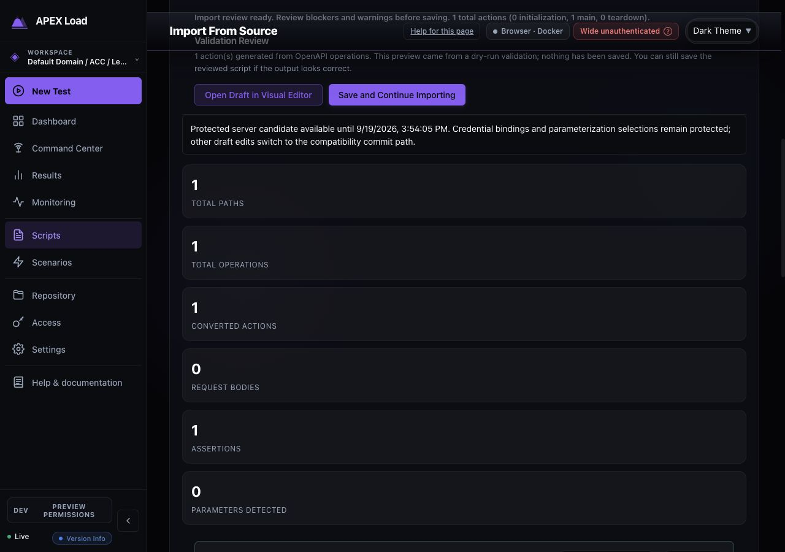
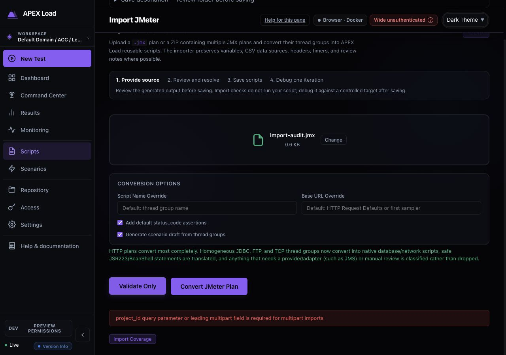
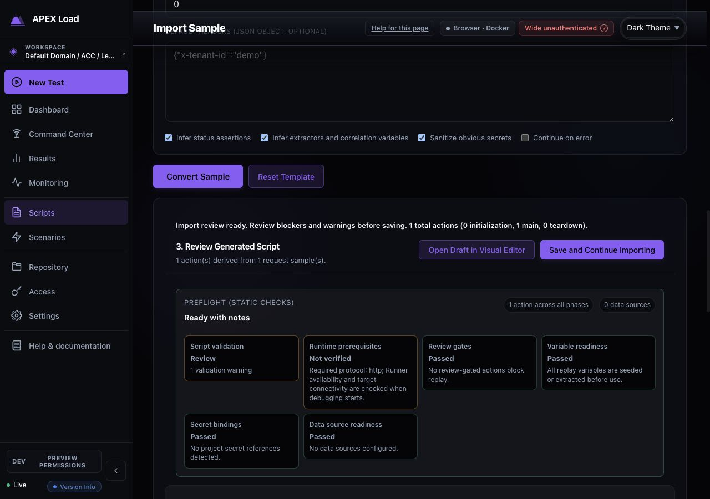
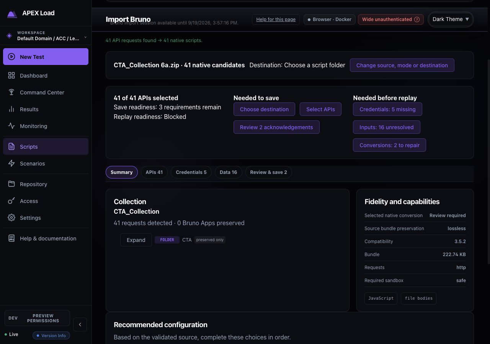

# Import reviews — completed (September 2026)

Status: Complete (historical). Bruno, import-consistency and early LoadRunner review records with no open items.

The `import-consistency-2026-09-19/` folder next to this file holds the captures for the import design consistency review. Reviews that still have open items are in [../../qa/reviews/import-reviews-2026-09.md](../../qa/reviews/import-reviews-2026-09.md).

## Bruno import design review

Date: 2026-09-19. Status: Complete (implemented; see the implementation record that follows)

Overall health: **Needs significant improvement.** The importer exposes useful safeguards and detailed provenance, but the operator must reconcile conflicting readiness messages, technical diagnostics, and disconnected repair surfaces.

### Scope and evidence

Reviewed the running Docker dashboard at localhost:8080 in Chrome, using a fresh inspection of `CTA_Collection 6a.zip`. Covered source entry plus all five native import tabs. The archive contains 41 HTTP request YAML files, two collection/folder metadata YAML files, and one ignore file. The UI found 41 requests and generated 41 native candidates: no request-count loss was observed. This is inventory validation, not proof of payload or replay equivalence.

The fresh inspection reported five unconfigured project-secret bindings, 16 unresolved runtime variables, and two review-gated conversions. These categories overlap in affected scripts and must not be added together as unique blocked-script counts. The two review findings concern an after-response hook in `InquireCPNIContactInformation_224.yml` and the composed sensitive header in `InquireAccountProfile_312.yml`. The former source contains response access and `bru.setGlobalEnvVar` constructs; it is not merely an empty hook marker. No source hooks or requests were executed, credentials supplied, findings acknowledged, folders created, or scripts saved.

Screenshots are local, unmodified captures. The normal browser capture is wide; a temporary viewport override produced unreliable scaling and was reset. Responsive compliance is therefore not asserted. This audit evaluates the deployed build, which can differ from current repository source.

### 1. Source entry — Needs improvement (P2)

**Observed:** Before a source is inspected, canonical execution controls expose sandbox, selection, paths, execution settings, tags, delays, and other runtime options. Uploading this YAML archive selects native mode. After inspection, source and execution-profile forms remain above every review tab and consume substantial vertical space.

**Change:** Make source selection the first decision. After detection, show a concise mode recommendation with output consequences: “41 editable native HTTP scripts; 2 conversions need review.” Keep an explicit canonical alternative and explain its runner requirements. Collapse advanced canonical settings. Once inspected, replace the setup forms with a compact source/mode/destination summary and Change controls. Warn clearly when changing source or mode invalidates reviewed work.

**Acceptance:** An operator reaches the next unresolved task without scrolling past the full source form. Both modes remain discoverable; source detection never implies complete native fidelity. Preserve the existing session-expiration notice and explain recovery without suggesting that unsaved work is durable.

### 2. Summary — Poor (P1)

**Observed:** “Fidelity: lossless” and “41 executable items” appear alongside review-gated conversions and missing values. “Credential review is complete” is followed by five unconfigured secrets. Completed sanitization events and required repairs appear together under Security findings, using raw diagnostic identifiers. Long identifiers visibly overlap the adjacent descriptions in the captured build.

**Evidence in code:** `pkg/convert/bruno/inspect.go` initializes the bundle fidelity status to `lossless`. `dashboard/src/components/BrunoImport.tsx` displays that status in the native Summary. Native candidates separately carry fidelity states such as `review_required` in `pkg/convert/bruno/native.go`. Bundle preservation is being presented where operators need conversion readiness.

**Change:** Lead with separate, authoritative statuses for **Save readiness** and **Replay readiness**, plus generated/selected request counts. Label bundle preservation explicitly and use native candidate diagnostics for native conversion fidelity. Rename “executable items” to “requests detected” in this context. Replace the dump with three groups: **Needed to save**, **Needed before replay**, and **Automatically handled**. Every actionable group needs a count and a link that opens the relevant tab and focuses its unresolved item. Collapse handled sanitization details; retain diagnostic codes in expandable technical detail. Use wrapping layouts without fixed code-column collisions.

**Acceptance:** The same unresolved requirement has the same status on every tab. Acknowledgement never changes replay readiness. The supplied archive cannot receive an unqualified native “lossless” claim while its hook remains untranslated.

### 3. Source APIs — Needs improvement (P2)

**Observed:** Pagination, selection, naming, Inspect, and Review are present. The Request column contains only an Inspect button; the visible table does not immediately show method/target. Every visible row says Execution blocked without showing why. Repeated inherited paths dominate rows. The default visible ordering is Source ascending while explanatory copy emphasizes Bruno sequence/path order.

**Change:** Rename to **APIs**. Add search and filters for readiness and review requirements. Show method, redacted target, and short reason/count beside status. Keep naming as an explicit edit action. Collapse inheritance into the request detail view. Provide an explicit Bruno sequence sort and distinguish displayed order from saved ordering. Unify Inspect and Review into one details surface with request, provenance, conversion changes, and linked requirements. Retain selected count across pagination and filtering; state whether Select all covers all candidates or only filtered results.

**Acceptance:** Operators can find either affected API directly, understand its blocking reason without opening every row, and return from details without losing selection, search, or page position.

### 4. Credentials — Fair (P2)

**Observed:** This is the strongest existing organization: credentials are grouped, unresolved bindings appear first, source variables and affected-file counts are visible, and preserved values remain protected. However, the header alternates between groups and “protected occurrences”; individual groups can cover 40 request locations. Provider identifiers such as `encrypted_database,environment_read_only` leak into primary presentation. Long generated reference names and cramped value inputs compete with explanatory copy.

**Change:** Preserve server-verified grouping and redaction. Use clear groups **5 need values before replay** and **19 preserved**; collapse preserved entries by default. Distinguish unique bindings from request occurrences. Offer readable existing-secret selection where supported, with advanced reference editing. Label deferred entry “Configure later — blocks replay.” Replace provider identifiers with human-readable capability guidance only where it affects the available action. Add a direct destination for later secret configuration. Do not merge same-named credentials unless server evidence permits it.

**Acceptance:** The five unresolved bindings can be completed or deliberately deferred without traversing preserved entries. Review-complete and value-configured remain separate states. Standard input sizing, labels, spacing, and visible keyboard focus apply to every binding control.

### 5. Data — Poor (P1)

**Observed:** Required variables and optional repeated values form a long undifferentiated list. A second Preflight requirements list repeats missing names. `$isoTimestamp` appears there but has no matching editable row above, although the instruction says to supply these values above. The archive contains that token in `ManageAutomaticPayments_v234.yml`. The deployed copy claims values apply to every script even when a row reports use in only one or 25 scripts. Inputs and unlabeled-looking selection boxes are visually cramped.

**Change:** Separate **Required runtime inputs** from **Optional substitutions**. Add search, unresolved-only filtering, affected-API links, scope, and value-source choices supported by the engine. Every preflight requirement must lead to a real repair action or a precise explanation of why it cannot be repaired here. Investigate `$isoTimestamp` as a source dynamic-value classification/translation case before asking the operator to enter a static timestamp; do not silently invent equivalent behavior. Consolidate duplicate requirement lists into one authoritative queue. Clearly identify whether a value applies only to detected occurrences or to all selected scripts.

**Repository caveat:** `SharedImportValues.tsx` already contains newer scope copy and optional-substitution guidance than the deployed screen. Reuse applicable improvements, but make them mode-aware: sending Bruno operators to a nonexistent “Review queue” is not a complete integration.

**Acceptance:** All 16 currently reported requirements have a reachable resolution or explicit supported fallback. Required and optional counts remain independent. Setting a value updates readiness immediately, and partial selection recalculates affected scripts. Verify dynamic-value semantics separately before removing any blocker.

### 6. Import APIs — Needs improvement (P1)

**Observed:** The individual review cards explain what was found, why replay is blocked, and what is required. They correctly state that acknowledgement only allows saving an incomplete draft. However, remedies are prose instructions, with no direct repair navigation. Destination selection lives far above. The final action foregrounds five secrets while unresolved variables and conversion limitations also remain.

**Change:** Rename to **Review & save**. Group review findings by required action and link to the exact source/request or credential control. Preserve the explicit distinction between acknowledgement and repair. Put destination, selected count, save blockers, and replay blockers in one final checklist with direct links. Use a stable primary label such as **Save 41 drafts**, with separate readiness text rather than putting only one blocker category into the button label. Explain whether Continue importing resets this collection and what happens after saving. Provide a post-save route to the saved batch and guided single-iteration debug when ready.

**Acceptance:** The operator can resolve every save prerequisite from this screen without hunting. Acknowledged incomplete drafts remain blocked from replay. Selection changes recalculate the checklist; save success provides a durable batch destination and remaining requirements. Save and post-save behavior were not exercised in this audit.

### Cross-tab implementation priorities

1. **P1 — Trust and correctness:** Separate bundle/native fidelity and save/replay readiness; reconcile variable requirements with editable controls, especially `$isoTimestamp`; use one source of truth for counts and statuses.
2. **P1 — Connected repair:** Link Summary, API details, credentials, data, and final review to the same requirement. Keep acknowledgements distinct from repairs.
3. **P2 — Reduce navigation cost:** Collapse inspected setup, persist review navigation, add actionable tab counts, and keep a compact readiness summary visible.
4. **P2 — Scannability and accessibility:** Repair diagnostic overlap, normalize form sizing, constrain text measures, add useful filtering, and group required versus preserved/optional content.

Keyboard ArrowRight successfully moved selection from Summary to Source APIs and updated roving tab stops. Retain this behavior. Remaining accessibility verification should include input labels/descriptions, focus arrival after linked repairs, focus visibility, status announcements after edits, screen-reader reading order, contrast measurement, and narrow-layout testing. Screenshots establish overlap and density risks; they do not establish a complete WCAG result.

### Screenshot evidence

#### Source entry

#### Summary: conflicting fidelity and readiness; overlapping diagnostic labels

#### Source APIs: selection and opaque blocking status

#### Credentials: grouped bindings and cramped form controls

#### Data: required values and optional substitutions

#### Import APIs: explanatory review gates without connected repairs

## Bruno import implementation record

Date: 2026-09-19. Status: Complete

Date: 2026-09-19

Implemented the recommendations in [the design review](#bruno-import-design-review) across source setup, Summary, APIs, Credentials, Data, and Review & save.

### Delivered behavior

- Source setup collapses after inspection, with a compact source/mode/destination summary and a reset warning. Canonical execution controls use progressive disclosure.
- A linked readiness summary separates prerequisites for saving drafts from requirements before replay. Native conversion fidelity is distinct from source-bundle preservation.
- APIs support search, readiness filtering, Bruno sequence sorting, persistent collection-wide selection, request method/target, provenance, and one details entry point with repair navigation.
- Credentials reuse the existing grouped, redacted binding controls and readable provider guidance. Replay counts reflect valid configured destinations and pending secret creation, including validation conflicts.
- Data separates required runtime inputs from optional substitutions. Search, unresolved filtering, affected API links, selected-request scope, and immediate pending-value readiness updates replace duplicate lists.
- Review & save groups conversion findings, links to affected source and repairs, shows the final save/replay checklist, and uses a stable draft-save action. Acknowledgement does not remove a replay gate.
- Form sizing, wrapping, keyboard focus, tab navigation, and narrow layouts were checked. Wide API tables scroll inside a labeled, keyboard-focusable region.

### Code review findings fixed

1. Partial imports invalidated location-derived shared-value IDs when the backend re-detected candidates against only selected scripts. Commit now derives trusted candidates from the immutable, masked inspection and rebases server-owned locations onto the selected batch. Client-provided locations remain untrusted. Tests cover selected subsets, deselected no-ops, unknown-ID rejection, immutable source descriptors, atomic saving, and retries.
2. Credential readiness could remain stale after a valid destination was configured. Shared review state now exposes execution readiness separately from destination validity, and invalid/conflicting secret configurations do not clear missing-secret counts.
3. API details could show an input as missing after it was supplied in Data. Details now use the same pending-value calculation as the readiness summary. Original diagnostics are explicitly labeled as inspection evidence.
4. Narrow API columns compressed long targets and status text. Fixed column sizing and contained horizontal scrolling preserve readable content without page overflow.
5. The new local-auth browser test needed to refresh workspace hierarchy after API fixture creation. It now follows the existing authenticated workflow fixture pattern.

### Acceptance archive

Used `CTA_Collection 6a.zip` locally, without executing hooks or making target requests. Inspection retained 41 HTTP APIs and 41 native candidates. The initial review exposes 5 missing secret bindings, 16 unresolved runtime inputs, and 2 conversion-review gates. Entering a synthetic pending `env` value reduces the input count to 15 and removes it from affected API missing-variable lists. No actual archive drafts or credentials were saved during manual validation.

`$isoTimestamp` remains an explicit migration requirement with source navigation and a saved-draft repair fallback. Bruno documents ISO output with milliseconds; the existing APEX timestamp shortcut uses second precision. An unverified substitution would not establish parity. See [Bruno dynamic variables](https://raw.githubusercontent.com/usebruno/bruno-docs/main/v2/testing/script/dynamic-variables.mdx).

### Validation

- Full dashboard cycle: typecheck, lint, all 4,322 unit tests, and embedded build passed. Browser profiles completed: dev-admin 112 passed / 8 failed / 4 skipped; local-auth 38 passed / 1 failed / 1 skipped.
- The nine broader browser failures are outside Bruno: command-center details, initial dev-admin workspace, live metrics, two run lifecycle workflows, workspace creation, authoring scope/history, guided setup scope, and the general local-auth launch workflow. They match the previously recorded suite failures; the full cycle is not green.
- Focused final component tests: 140 passed across Bruno import, Data review, readiness helpers, and shared credentials.
- Bruno inspect/edit/acknowledge/atomic-save browser workflow passed independently in both dev-admin and local-auth profiles using disposable fixtures.
- Targeted backend selection/shared-value regression tests passed.
- Manual browser validation used the rebuilt embedded frontend, the actual archive, all review panels, linked repair navigation, search/selection, live input counts, and 1280px/768px layouts. Neither viewport produced page-level horizontal overflow. Browser viewport overrides were reset.
- Full `go test ./...` passed after the backend fix (exit 0).

### Evidence and rollout

Local visual evidence:

- [API layout at 1280px](/Users/jasonczech/.codex/visualizations/2026/09/19/01a0b9de-7e8c-7221-a5ac-e2ae5f564188/bruno-import-audit/implementation/apis-1280.png)
- [Review layout at 768px](/Users/jasonczech/.codex/visualizations/2026/09/19/01a0b9de-7e8c-7221-a5ac-e2ae5f564188/bruno-import-audit/implementation/review-768.png)
- [Data layout at 1280px](/Users/jasonczech/.codex/visualizations/2026/09/19/01a0b9de-7e8c-7221-a5ac-e2ae5f564188/bruno-import-audit/implementation/data-1280.png)

The embedded dashboard assets were rebuilt. The existing running controller was not restarted as part of this implementation. Live credentialed replay and Bruno baseline comparison remain separate validation steps.

## Script import consistency audit

Date: 2026-09-19. Status: Complete (implemented; code review corrections recorded)

Date: 2026-09-19. Reference: current LoadRunner import design.

### Verdict

The import catalog is coherent, but review navigation is not. Adopt LoadRunner's six-tab review structure across script importers. Preserve format-specific capabilities inside that structure rather than preserving each importer's separate page architecture. The initial audit below is followed by implementation and verification notes.

### Evidence and scope

Inspected the current rebuilt frontend on port 4021 against the running local controller. Captured fresh browser evidence for catalog, LoadRunner, OpenAPI, JMeter, request samples, Oracle/Siebel review, and Bruno. In-app browser captures were clipped, so accepted evidence was recaptured in Chrome at the desktop test breakpoint. Rejected captures were replaced. Source inspection maps these representative experiences to all 17 catalog entries; it does not establish converter correctness for every format.

No scripts were saved, target requests replayed, source hooks executed, or credentials supplied. OpenAPI used the repository's orders fixture; JMeter, samples, and Oracle review used synthetic example.invalid data. LoadRunner and Bruno used the previously supplied archives. Save success, expiration recovery, large multi-script batches, live authentication, and full accessibility compliance were not exercised.

### Captured steps

| Step | Surface | Health | Main observation |
|---|---|---|---|
| 1 | Import catalog | Good | Search and source families orient the operator; output type is buried in descriptive copy. |
| 2 | LoadRunner validation/review | Reference | Six stable tabs, grouped issues, linked repair, collapsed setup, source evidence, and explicit replay blockers. ArrowRight moved Review to Credentials. |
| 3 | OpenAPI validation/review | Needs improvement | Saveable validation preview, two competing entry actions, large statistics, and a long mixed review page without the reference tabs. |
| 4 | JMeter validation | Blocked | Selected workspace still produces a raw multipart project-context error; no recovery action. Result review could not be visually inspected. |
| 5 | Request/response sample review | Needs improvement | Useful preflight states, but runtime setup and multiple review sections remain stacked. Save action precedes most evidence. |
| 6 | Oracle/Siebel review | Needs improvement | Correctly states review-only; raw state identifiers, oversized statistics, and prose-only next actions weaken the handoff. |
| 7 | Bruno native review | Mostly good, inconsistent tabs | Linked save/replay readiness and scoped inputs are useful; its five-tab taxonomy differs from LoadRunner. |

### Required common tab contract

Keep these exact labels and order. Use the same tab styling, roving keyboard focus, issue-count badges, panel spacing, and source-linked navigation as LoadRunner.

| Tab | Responsibility | Format-specific content |
|---|---|---|
| Review | Outcome, save readiness, replay readiness, grouped actionable findings, next required action, save controls | Conversion losses, unsupported hooks, CloudTest fixture evidence, browser replay evidence, batch summaries |
| Credentials | Unique unresolved bindings first, preserved values collapsed, supported secret choices, explicit deferred state | Collection auth, SOAP security, OAuth, broker identities, certificates; do not merge solely by source name |
| Data & parameters | Required producers/values first; optional substitutions separately; affected script scope and allocation where supported | JMeter CSV/variables/extractors, sample correlations, OpenAPI examples, messaging payloads, Bruno inputs |
| Runtime & source settings | Imported-to-effective behavior, migration decisions, preserved-only settings, runner requirements | JMeter thread groups and scenario draft, browser replay settings, Kafka/Event Hubs modes, Bruno canonical settings |
| DSL Preview | Redacted generated draft with script selector, section/action search, focus mode, clear read-only status | Multiple generated scripts and protocol-specific DSL |
| Source Mapping | Source-to-generated comparison, mapping search, source location and coverage | Schema operations, source lines, archive files, request provenance; explain unavailable mapping without implying success |

Keep batch/API selection ABOVE the tabs as a searchable selector with selected/total count and explicit selection scope. Within each tab, retain current script and findings filter when navigating. Do not turn every generated script into a competing top-level review tab.

For a tab with no applicable content, show a short explicit empty state. For review-only imports, explain that there is no executable DSL or binding workflow; never invent a generated script, save button, mapping, or executable status just to fill the layout.

### Findings and priorities

#### P1 — Shared importers do not use the reference review structure

Evidence: steps 3 and 5; `ProtocolAssetImport.tsx`, `SampleScriptImport.tsx`, and `JMeterImport.tsx` render the general `ScriptImportReview` as a stacked page. LoadRunner selectively renders compact review sections behind six tabs. This makes operators relearn where credentials, data, runtime decisions, and evidence live.

Change: extract a shared tabbed review shell from LoadRunner and reuse existing review/credential/data/source components. Keep conversion APIs and format-specific controls separate. Put optional source setup in a collapsed disclosure after inspection. Use one readiness authority rather than independently counting warnings in every tab.

Acceptance: the same task appears under the same label in every importer; a finding links to the exact tab/control/source and returning preserves selection and edits.

#### P1 — Save readiness, static readiness, and verified replay need a common presentation

Evidence: OpenAPI's "Ready with notes" plus "Runtime prerequisites: Not verified", sample preflight cards, LoadRunner repair posture, and Bruno's separate save/replay summary. These contain useful distinctions but express them differently.

Change: retain three explicit states: can this draft be saved; what still blocks replay; has a controlled replay actually passed. Never use conversion completion or acknowledgement as evidence of replay success. Review is the default landing tab and contains grouped blockers before secondary statistics.

Acceptance: operators can identify the next required action without opening diagnostics. Acknowledging a finding never clears an execution blocker. Runtime/target checks remain visibly unverified until performed.

#### P1 — JMeter validation is blocked and gives no usable recovery

Evidence: step 4 shows `project_id query parameter or leading multipart field is required for multipart imports` with a selected workspace. `useScriptApi.ts` appends the file before project_id in validateJMeterImport, consistent with the server's complaint about multipart ordering. This is a likely request-contract cause, not a verified fix.

Change: verify project scope in both JMeter validation and conversion requests before upload; test required multipart ordering against the active API. Translate the error into actionable workspace/retry guidance, retaining source and options. Do not ask users to edit a transport field.

Acceptance: selected-workspace validation reaches review; missing scope prevents upload with a workspace action; server failure retains inputs and permits a safe retry.

#### P2 — Entry and save verbs describe internal processing rather than user progress

Evidence: OpenAPI and JMeter offer "Validate Only" and "Convert", while validation already yields a saveable draft. Samples use "Convert Sample", Bruno "Inspect source", and LoadRunner "Validate Script(s)". Save labels vary among "Save draft", "Save and Continue Importing", and batch-specific wording.

Change: use one primary "Inspect & review" entry action where both routes have the same user outcome. Preserve a genuinely distinct validation mode only if its difference is explained. Use "Save draft" / "Save N drafts" with separate explanatory readiness text; retain an explicit "Save and open in editor" secondary path when required. Surface destination and create-versus-replace impact beside final save controls. Show saved assets and remaining replay requirements after success.

#### P2 — Low-value statistics dominate useful decisions

Evidence: steps 3 and 6 show counts each taking a full row at a 1280px viewport. `SampleScriptImport.css` collapses the stats grid at a 980px container threshold; the sidebar makes that threshold relevant on a normal laptop.

Change: use a compact wrapping summary for counts; reserve cards for actionable states. Collapse byte counts, capability inventories, and technical diagnostic codes. Translate `review_then_executable` and `needs_correlation_review` into plain task language. Replace protected-session implementation language such as "compatibility commit path" with the consequence and required action.

#### P2 — Review-only recommendations need a usable handoff

Evidence: Oracle/Siebel correctly says it does not save a script, then lists four prose next actions. There is no direct route in the result to perform or associate those tasks.

Change: retain review-only status and add supported destination links for correlation/data review, applicable importer/editor, and evidence attachment. Where no action exists, explain the exact manual handoff and required artifact. Avoid presenting capabilities that the backend does not support.

#### P2 — Bruno still has a separate information architecture

Evidence: step 7 and `BrunoImport.tsx`: Summary, APIs, Credentials, Data, Review & save. The recent improvements should be preserved while adopting the user's LoadRunner reference.

Change: combine Summary and Review & save into Review; move APIs to the batch selector; rename Data to Data & parameters; give runtime/source settings, DSL Preview, and Source Mapping dedicated reference tabs. Keep native-conversion versus bundle-preservation fidelity distinct. Do not resolve unsupported dynamic expressions by substituting static values.

### Coverage of all 17 formats

| Format | Current implementation family | Specific content to preserve in common shell | Evidence level |
|---|---|---|---|
| LoadRunner archive | EnterpriseArchiveImport | Guided repairs, parameters/allocation, runtime parity, protocol detection | Actual archive validation and reference review |
| Bruno | BrunoImport | Native/canonical mode, API selection, scoped bindings, runner controls | Actual native archive inspection; canonical path source review |
| OpenAPI/Swagger | ProtocolAssetImport | Operation/auth/data selection, create/replace target | Fixture validated in browser |
| Postman | ProtocolAssetImport | Collection variables/auth, hooks, create/replace | Source-reviewed shared shell and branches |
| WSDL/SOAP | ProtocolAssetImport | SOAP actions, envelopes, namespaces, faults | Source-reviewed shared shell |
| AsyncAPI/Kafka | ProtocolAssetImport | Multi-script scope, broker bindings, replay review, safe batch saving | Source-reviewed shared shell and branches |
| RAML/Anypoint | ProtocolAssetImport | Includes, OAuth, policy review | Source-reviewed shared shell and branches |
| HAR | ProtocolAssetImport | Artifact redaction, Salesforce/Agentforce conversion, correlations | Source-reviewed shared shell and branches |
| Recorder/Playwright | ProtocolAssetImport | Selector review, replay evidence, draft exception | Source-reviewed shared shell and branches |
| Request/response sample | SampleScriptImport | Input profiles, correlation inference, supplemental assets | Synthetic sample converted in browser |
| JMeter | JMeterImport + ScriptImportReview | Thread groups, scenario draft, CSV/extractors, unsupported elements | Browser validation blocked; result layout source-reviewed |
| DevWeb | ProtocolAssetImport | Supported requests and unsupported source code | Source-reviewed shared shell |
| k6 | ProtocolAssetImport | HTTP subset, JavaScript limitations | Source-reviewed shared shell |
| CloudTest | ProtocolAssetImport | Clip selection, composition drafts, fixture gates | Source-reviewed shared shell and branches |
| Event Hubs Capture | ProtocolAssetImport | Avro input, producer draft, explicit mock/native mode | Source-reviewed shared shell |
| Broker Config | ProtocolAssetImport | MQ/JNDI topology and provider requirements | Source-reviewed shared shell |
| Oracle E-Business/Siebel | OracleEBusinessReviewImport | Review-only posture, correlation/evidence handoff | Synthetic source reviewed in browser |

### Implementation sequence and acceptance

1. Fix JMeter request-context handling and recovery; add a browser regression for selected workspace.
2. Extract the LoadRunner review shell with stable tab IDs and shared status vocabulary. Migrate the 12 ProtocolAssetImport formats first, then JMeter and samples.
3. Align Bruno and the review-only Oracle/Siebel flow without losing their distinct execution contracts.
4. Verify small/large inputs, multi-script selection, missing credentials/data, unsupported source, expired candidates, failed save/retry, create/replace, and post-save navigation.
5. Check 1280px and narrow layouts, keyboard tab/arrow navigation, focus after repair, label associations, status announcements, and measured contrast. Keep active findings and focused controls clear of sticky headers. Screenshots alone do not establish WCAG compliance.

Use existing tokens, TabList behavior, SecretBindingReview, SourceMappingReview, protected candidate sessions, and save paths. Shared layout must not bypass format-specific blockers or change converter semantics.

### Captured evidence

#### 1 — Catalog

#### 2 — LoadRunner reference

#### 3 — OpenAPI review

#### 4 — JMeter validation failure

#### 5 — Sample review

#### 6 — Enterprise review-only result

#### 7 — Bruno comparison

### Implementation and verification

Implemented the shared six-tab review layout in the 12 protocol asset importers, JMeter, samples, both Bruno output modes, and the Oracle/Siebel review-only flow. LoadRunner remains the reference implementation. API/batch selection stays above the tabs. Credential and data controls retain state while hidden; source and DSL evidence are loaded on demand. Setup collapses after inspection, required values and optional substitutions are separated, and save labels are stable.

Code review corrected the JMeter leading multipart project field in both upload paths, added missing-project recovery, fixed empty Data panels and obsolete guidance, preserved deferred credential handling and protected retry identities, and extended credential-path redaction to multi-script preview/export. For multi-script imports, the complete review JSON now includes all previewed scripts rather than only the primary script. LoadRunner retains its established `script` export wrapper. Browser regression testing also caught and fixed hidden LoadRunner section controls when compact review supplied a preview object, and legacy Bruno pill styles that overrode the shared tab design. New canonical Bruno inspections return to Review instead of inheriting the prior candidate’s evidence tab.

Browser verification against the running local API confirmed OpenAPI runtime edits survive navigation and appear in the draft; source comparison remains available. A synthetic JMeter plan now reaches review and displays its scenario settings. The supplied Bruno archive still produces 41 native candidates with five missing credentials, 16 unresolved inputs, and two conversion repairs. No source hook or target replay was executed, and these local archive drafts were not saved.

Fresh implementation screenshots:

- [OpenAPI review](import-consistency-2026-09-19/08-openapi-implemented.png)
- [JMeter runtime review](import-consistency-2026-09-19/09-jmeter-implemented.png)
- [Bruno review](import-consistency-2026-09-19/10-bruno-implemented.png)
- [JMeter at 760px](import-consistency-2026-09-19/11-jmeter-narrow.png)

Validation on the final implementation:

| Check | Result |
|---|---|
| Type checking and ESLint | Passed |
| Dashboard unit tests | 4,331 passed across 403 files |
| Fresh embedded dashboard build | Passed; existing large-chunk advisory remains |
| Focused dev-admin import workflows | 13 standard checks passed |
| Focused local-auth import workflows | 12 passed; optional private archive check skipped in this profile |
| Full private LoadRunner archive | Passed separately with temporary encrypted import storage: all 492 requests, grouped findings, repair controls, source navigation, and narrow layout |
| OpenAPI error recovery and prerequisite save workflow | Passed in the broader focused authoring/usability run |
| `git diff --check` | Passed |

The private archive check requires operator-managed encrypted import storage. The first attempt on the default disposable controller correctly exposed unavailable protected repair controls. Re-running with a temporary artifact directory and an ephemeral `APEXLOAD_WRAPPING_MASTER_KEY` passed. The key was not printed or persisted; the temporary store was removed after the run. No change to the running controller’s encryption configuration was required.

`npm run test:cycle` exercised both full browser profiles. That initial run reported 105 passed / 16 failed / 4 skipped in dev-admin, and 35 passed / 6 failed / 1 skipped in local-auth. Seven dev-admin and five local-auth failures involved import navigation or the shared LoadRunner preview; those were corrected and passed the final focused runs above. The remaining failures concern Command Center details, dev-admin workspace landing, live run metrics/lifecycle, workspace creation and scoping, guided workspace setup, and the author Problems dialog. The local-auth end-to-end journey stops in workspace creation before reaching import. These are outside the changed import code; the complete workflow suite is not claimed green.

Final execution logs are local at `/tmp/import-consistency-all-unit-final.log`, `/tmp/import-consistency-build-final.log`, `/tmp/import-consistency-verified-dev.log`, `/tmp/import-consistency-verified-auth.log`, `/tmp/import-consistency-protected-acceptance.log`, and `/tmp/import-consistency-cycle.log`. Browser artifacts are under `/tmp/import-consistency-verified-e2e` and `/tmp/import-consistency-protected-e2e`.

This frontend change does not establish converter parity or controlled target replay success for all 17 source formats. No Go implementation or generated DSL/API/protobuf contract changed.

## LoadRunner import review redesign

Date: 2026-09-19. Status: Complete

The Review tab now presents a task queue after archive validation. Completed setup
and original diagnostics remain available in disclosures. The existing APEX shell,
project authorization, protected candidate API, and save paths remain in use.

### Operator experience

- Current readiness leads the page. Saving a draft does not assert replay parity.
- Findings are grouped into missing values/correlations, protected bodies,
  credentials, transport/runtime, and review decisions. Repeated consumers share
  a queue entry; each source location and consumer remains individually selectable.
- Search and status filters support unresolved, blocking, review-only, and resolved
  issues. Resolution is recorded only when refreshed findings remove the issue.
- Repair choices follow the finding type. A missing value cannot select body
  restoration; an opaque construct does not get an invented repair.
- Response-extractor configuration selects an actual preceding request. Source
  navigation returns to the retained issue selection.
- A redacted preview binds the operation and exact consumer before applying it.
  Input changes discard the preview. Expired candidates remain inspectable but
  cannot be mutated. Late responses cannot update an abandoned project/candidate.
- Allocation preview lives in Data & parameters, with explicit duration/iteration
  modes and planned VUsers. It does not launch a run or modify allocation state.
- The queue has bounded scrolling. Narrow layouts put the selected issue before
  the queue. Forms retain visible labels, keyboard focus, and textual statuses.

### Review corrections

Self-review corrected traversal of parallel branches, stale original validation
messages overriding current protected findings, late-response scope handling,
and a failure message that incorrectly guaranteed an interrupted apply had not
changed server state. Existing credential preparation and atomic batch-save tests
were retained and updated for the new labels and collapsed setup.

### Acceptance and limits

The local private `acc_wls_reg_1.zip` acceptance test checks 492 primary requests,
one `c_transaction1` queue entry with multiple consumers, searchable `tstamp`,
contextual repair choices, source evidence, and tablet overflow. The observed
`tstamp` group contains 64 affected locations; `c_transaction1` contains two.
The archive and its payloads are not committed. Local acceptance is opt-in with
`APEXLOAD_LR_ACCEPTANCE_ARCHIVE`; encrypted import storage must be configured for
repair controls. Normal CI uses sanitized archives.

No source correlations were invented, commented producers reactivated, saved
scripts rewritten, or Salesforce target traffic executed by this UI work.

### Validation

- Dashboard type checking, lint, and fresh embedded build passed.
- The full unit run passed 400 files / 4,307 tests. After the remaining focused
  additions and review fixes, all 136 affected unit tests passed.
- Final dedicated browser run: all nine tests passed, including the private
  archive, all seven LoadRunner review/save/repair workflows, and the separate
  transaction-label persistence regression.
- The authenticated profile passed all seven LoadRunner workflows.
- `npm run test:cycle` completed both profiles and remains unsuccessful due to
  broader failures. Local-auth finished with 38 passed, one failed, and one
  opt-in private-archive test skipped; its failure is the previously documented
  `workflow-local-auth.spec.ts` workspace journey.
- `git diff --check` passed. This redesign changed no Go implementation.

The first full dev-admin browser run had 110 passing, ten failing, and four
skipped tests. One failure was the old transaction-label test expecting the
removed preflight wording; its updated final run passed. Eight failures match
the workspace/run-control failures already documented in
[the import repair validation note](../../IMPORT_FIDELITY_AND_REPAIRS.md#loadrunner-import-fidelity-and-guided-repair).
`workflow-author-experience.spec.ts` also timed out in dev-admin but passed in
local-auth. These other screens were not changed by this redesign.

Screenshots are retained locally outside the repository; they include private
archive source locations. The existing Docker controller was not restarted and
its open import draft was not replaced. Rebuild/restart the application to use
the new embedded dashboard in that running instance.

## LoadRunner six-tab import review

Date: 2026-09-19. Status: Complete

### Scope

Implemented the accepted Product Design review across Review, Credentials, Data & parameters, Runtime & source settings, DSL Preview, and Source Mapping. Existing protected candidate, secret-binding, save, and execution-readiness contracts remain authoritative.

| Surface | Change |
| --- | --- |
| Shared shell / Review | Compact archive context, shared grouped readiness, actionable tab counts, save/editor explanation disclosed on demand, source-to-issue navigation. |
| Credentials | Distinct group/requirement/location language; setup, preserved, and configured filters; readable provider names; optional-value guidance without implying replay readiness. |
| Data & parameters | Imported parameter inventory, source row counts, allocation rules, retained capacity results, run assumptions, per-VUser row ranges and unused rows. Optional environment substitutions and advanced repeated values have a redacted preview. Missing source variables stay in the guided repair queue. |
| Runtime & source settings | Grouped mapped, decision-required, preserved-only, and non-applicable behavior; source evidence disclosures; relevant settings-file and editor links; mapping is explicitly not replay proof. |
| DSL Preview | Section selection, action search/jump, wrap and focus controls; bounded on-screen preview distinguished from the complete protected review download. Explicit credential paths remain redacted in individual-action previews. |
| Source Mapping | Previous/next review mapping, contextual repair handoff, retained selection across tabs, code pane measurement on visibility/resize, reset stale full-document viewport when rendering mapped excerpts. |

### Review findings corrected

- Repeated candidate inspections under React StrictMode could compete for the protected candidate lease and falsely report an unavailable candidate. One inspection promise is shared for the same candidate/project scope.
- Allocation results were cleared on tab changes. They now survive tab changes and invalidate when inputs, project, or candidate change.
- Runtime source links previously landed on an unrelated selected file. They now focus the referenced file, including files without request mappings.
- Source comparison selection was lost on tab switches. The visited workspace remains mounted but hidden, including its shortcut visibility guards.
- DSL action preview needed credential-path rebasing, and its search/section controls needed consistent selected-action state.
- Expired/disabled credential review must also disable the new state filter.
- Removed duplicate credential guidance inside a reuse button and distinguished credential requirements from affected locations.
- Missing source variables were incorrectly grouped with environment overrides. Guided review routes them through the issue queue instead of optional substitutions.
- Restored save/editor guidance and existing editor navigation used by other enterprise import types.

### Local archive check

Validated `acc_wls_reg_1.zip` in an isolated development tab, without saving scripts, supplying credentials, or launching target traffic. The existing operator tab was left unchanged.

The archive retained 492 primary requests, 25 transactions, 940 LR markers, and 58 extractors. All six tabs were inspected. The protected inspection completed successfully after the StrictMode fix. The current server findings showed 19 grouped replay blockers and one review issue; the UI did not clear any blocker by acknowledgement. The credential view distinguished 12 groups, 967 requirements, 11 preserved groups, and one group needing setup.

The two-VUser duration preview reported, for example, 3,995 usable email rows from start row 6, 1,997 rows per VUser, and one unused row. The first user's range was 6–2,002. The Once username parameter reserved one row per VUser. Results persisted through other tabs. Runtime source navigation selected `default.cfg`; next-review navigation selected the legacy TLS source and rendered the corresponding destination code. Its repair link selected the TLS issue in Review.

Desktop screenshots and a 768×1024 Source Mapping check are local-only under the Codex artifact directory `import-tabs-implemented`; the tablet page had no horizontal document overflow. Private archive content and screenshots are not committed.

### Validation

- `go test ./...`: passed.
- Final dashboard typecheck, lint, and embedded build: passed.
- Full unit suite: 400 files / 4,316 tests passed. The additional final credential-filter test passed in the 63-test credential suite.
- Final dev-admin browser profile: 112 passed, 8 failed, 4 skipped. All seven LoadRunner workflows passed, as did the transaction-label persistence test and Source Mapping layout/review workflows.
- Final authenticated browser profile: 38 passed, 1 failed, 1 skipped. All seven LoadRunner workflows passed. The failure is the previously documented `workflow-local-auth.spec.ts` workspace journey.
- `npm run test:cycle` completed both profiles and remains non-green because of those nine failures outside import review.
- Final additional-test typecheck and `git diff --check`: passed.

The eight dev-admin failures are outside the modified import surfaces: Command Center details, development-role navigation, live-run identity, pause/resume/scale/stop, abort, workspace creation, authoring workspace/history, and guided workspace setup. The private archive automation remains opt-in; the original archive was checked manually in the browser during this pass.

The broader navigation/run-control failures were already documented in [the preceding review validation](#loadrunner-import-review-redesign). Their screens and navigation implementations are unchanged by this work.

Target replay and comparison with a LoadRunner baseline remain separate from import/UI validation.

### Running preview

The updated development preview is available at `http://127.0.0.1:4019`. The embedded dashboard was rebuilt. The existing Docker controller on port 8080 was not restarted, and the operator’s original import tab was not reloaded.

## LoadRunner NEXT31 import coverage

Date: 2026-09-19. Status: Complete

Evaluated `NEXT31_iPhone14_SS_BC_UPGRADE.zip` on 2026-09-19 using the archive
converter. The original archive and its parameter data are not checked into the
repository; regression tests use synthetic data and a local HTTP server.

### Findings and repairs

1. **False malformed-URL gates.** All 61 requests received
   `credential_url_malformed` because `metadata.original_url` retained
   LoadRunner's `{server_url}` syntax while executable request fields used APEX
   templates. Credential validation interpreted the source token as an invalid
   literal hostname. URL provenance now uses the same template conversion and
   known-parameter binding as request fields. Source review retains the C source
   and line mappings. Recorded resource URL entries receive the same conversion.
   Invalid escapes and literal spaces still produce malformed-URL findings.
2. **False missing-transaction evidence.** `[Transactions]` quotes names with
   spaces. Those quotes were being retained, creating three extra declarations
   that did not match the imported runtime calls. Quoted keys now decode and
   deduplicate against `[TransactionsOrder]` correctly.
3. **URL-prefix destination corruption.** Base URL removal accepted any string
   prefix, including a longer hostname, another port, or a userinfo prefix.
   Removal now requires a URL component boundary, preserving those distinct
   destinations. This adjacent defect is covered with synthetic cases.

### Result on the supplied archive

| Check | Result |
| --- | --- |
| Active source calls | 303 converted; zero skipped |
| HTTP requests | 61, retained across 71 top-level actions |
| Transaction starts | 31 |
| Extractors | 60 |
| Parameters | 51 expected and converted |
| Data sources | 5 |
| Malformed-URL execution blockers | 61 before; zero after |
| DSL validation issues after conversion | Zero |
| Converter promotion status after fixes | `promotable` |
| Request provenance | All 61 target paths resolve to the matching request name, source file, and source line |

For the reported `actions[23].params.requests` group, child 0 maps to
`web_url` at `Action.c:345`; child 1 maps to `web_submit_form` at
`Action.c:366`. Both now pass URL credential validation.

Re-import the archive with the updated controller to obtain these corrections.
Previously saved imports are not rewritten by these converter changes.

### Verification and limits

The synthetic archive regression replays a grouped GET/form POST against a
local server, checks response correlation, repeated form fields, encoding, and
source mappings. Additional cases cover host/port/query templates, embedded
host parameters, resource URL provenance, malformed URLs, distinct origins,
and quoted transaction declarations.

The supplied business script was converted and inspected, not executed against
its target services. `promotable` describes the converter's execution gates;
it does not establish LoadRunner-equivalent replay. The report retains three
compatibility-only categories: run-logic block scheduling, action sequencing,
and unmapped runtime settings (32 active source settings). Review those before
relying on equivalent load behavior. Form destinations inferred from recorded
step names/page context also need validation against actual application HTML.

### Check results

- Final `go test ./...`: passed, including importer regressions and the API suite.
- Dashboard type checking, lint, all 399 unit-test files (4,301 tests), and the
  fresh embedded build: passed.
- Dev-admin browser profile: 112 passed, eight failed, three skipped. All seven
  LoadRunner review/save/repair workflows passed. The failures are the workspace
  and run-control cases already documented in `docs/IMPORT_FIDELITY_AND_REPAIRS.md`.
- Local-auth browser profile: 38 passed, one failed. All seven LoadRunner
  workflows passed. The failure is the previously documented end-to-end
  workspace case in `workflow-local-auth.spec.ts`. Consequently the complete
  `npm run test:cycle` exits unsuccessfully despite the importer checks passing.
- `python3 scripts/check-docs.py`: failed on 30 existing local-link checks in
  other QA reports and two existing missing documentation-index entries. None
  of the diagnostics names this evaluation note.
- `git diff --check`: passed.
