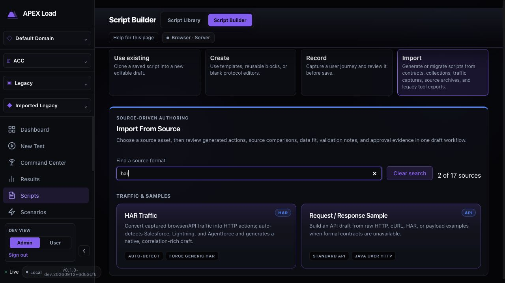
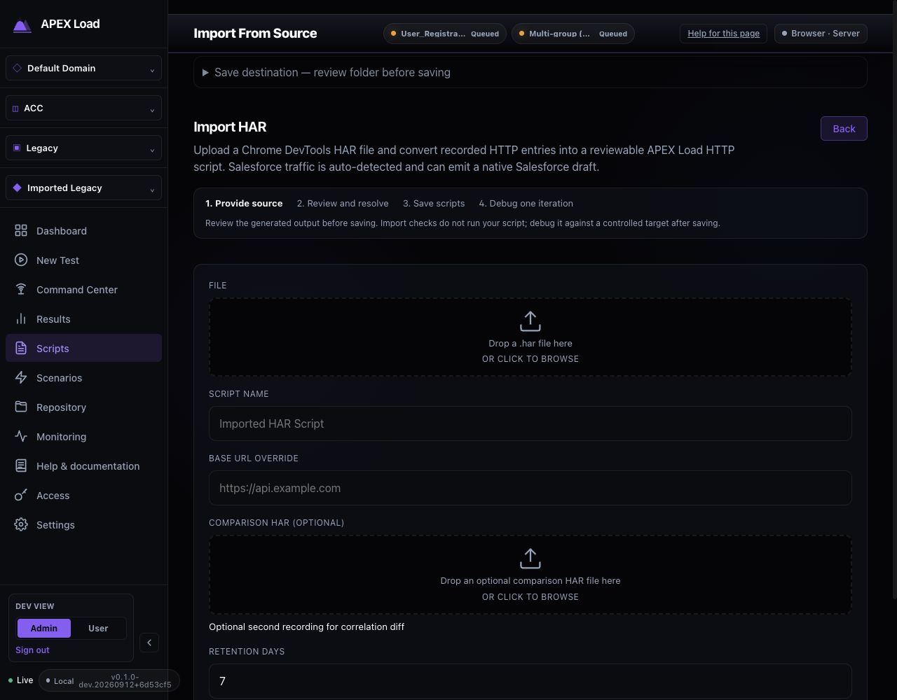
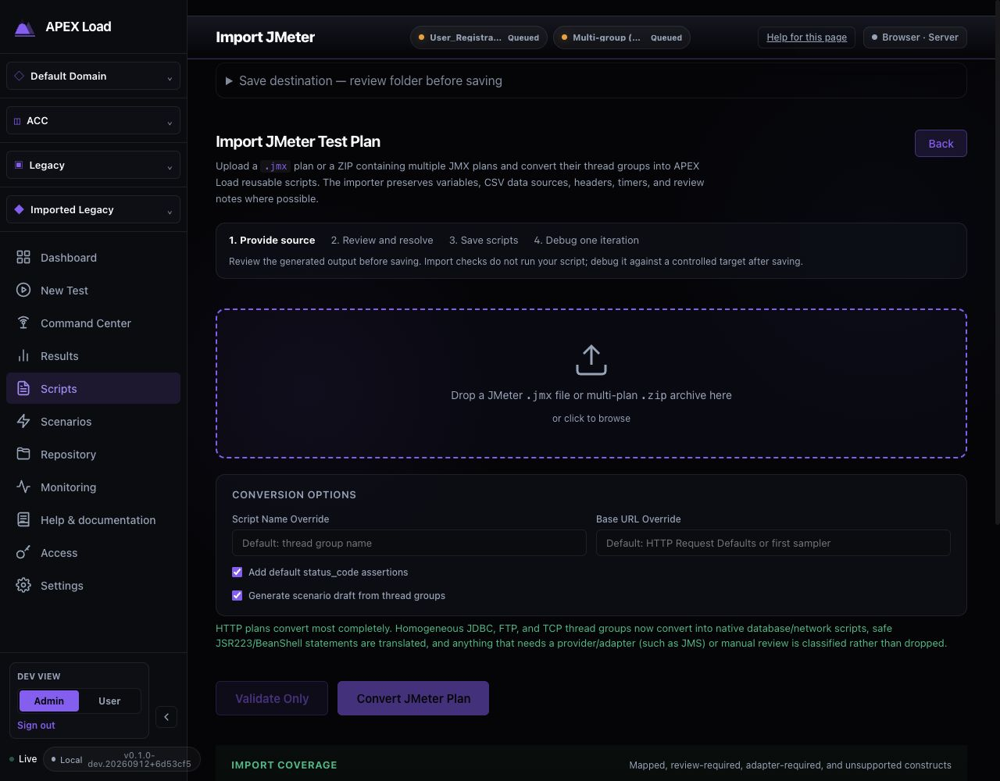
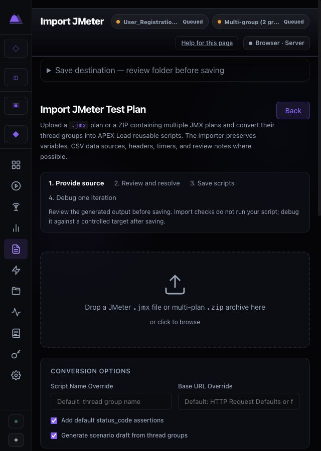
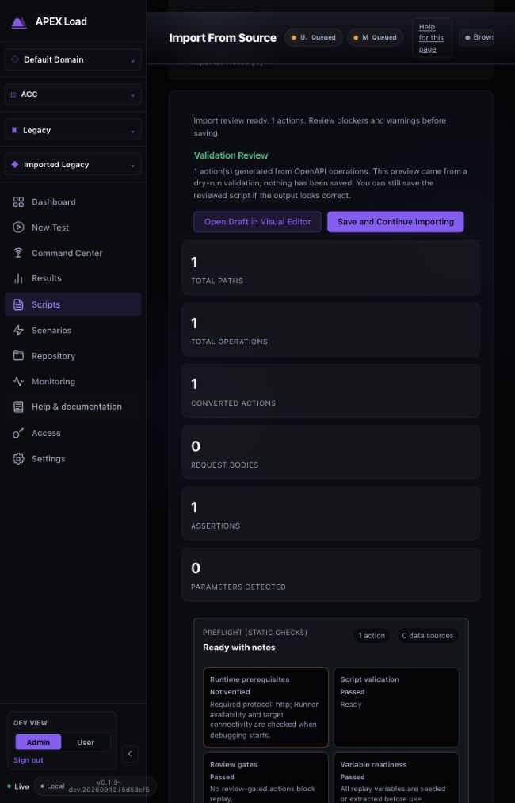
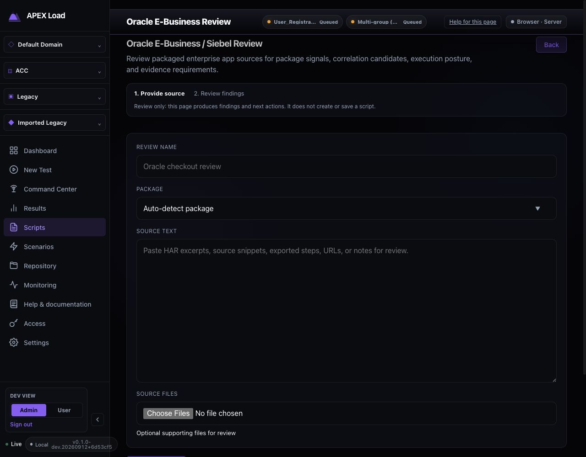

# Import From Source audit (2026-09-12)

Status: Complete. Findings were implemented and validated; the follow-up priority (representative customer-fixture matrix) is tracked in the open import fixture matrix review in ../../../qa/reviews/import-reviews-2026-09.md.

Merged from the original per-topic files of this review. Each section below was one file; the screenshots and evidence next to this README are unchanged.

## Script Builder — Import From Source audit

Date: 2026-09-12. Scope: the 17 source entries exposed by the local controller, their six importer families, and the path from source selection to review, save, and replay readiness. Reviewed the running dashboard in the Codex in-app browser and checked the implementation and regression tests.

### Verdict

The import surface has substantial functionality: format-specific options, coverage disclosures, source comparison, review gates, credential handling, and explicit persistence. It is not a universal lossless converter. Supported subsets, review-only sources, and external runner requirements remain material distinctions.

The largest usability gaps were inconsistent workflow orientation, a catalog that required scanning 17 cards, JMeter actions buried below coverage documentation, and stale Oracle/Siebel review evidence. These were addressed in this pass. Existing format-specific behavior was retained.

### Flow and findings

| Step | User task | Assessment after changes |
| --- | --- | --- |
| 1 | Script Builder → Import → choose source | Improved: searchable by format, tool, protocol, description, and mode; result count, clear control, and no-match recovery. |
| 2 | Provide files or sample text and configure options | Improved: common workflow guidance; HAR comparison uses the same file picker as its primary source; Change preserves the current selection if the picker is cancelled; Remove explicitly clears it. Sample text areas have accessible names. |
| 3 | Validate, convert, or inspect | Improved: JMeter actions and errors precede coverage details; common import errors announce themselves as alerts. Format-specific verbs remain because inspection and conversion have different outputs. |
| 4 | Review generated actions or source findings | Strong shared script review. Oracle/Siebel findings now clear after name, package, source, or file changes; pending operations lock inputs and stale responses cannot repopulate a different project's review. |
| 5 | Choose destination and save | Shared script importers retain existing save/replace/batch behavior. Oracle/Siebel no longer exposes a destination picker or suggests that this review page saves a script. |
| 6 | Open saved script and debug | The common guidance explicitly separates import checks from execution. Actual runtime readiness still requires a controlled replay and any necessary runner configuration. |

#### Fixed findings

| Priority | Finding and evidence | Change |
| --- | --- | --- |
| P1 | Oracle review continued to show `oracle_web` findings after replacing the source with unrelated text. See [before](06-oracle-stale-review-before.png) and the [verified current-source state](24-oracle-invalidated-after.txt). | Invalidate the review on every input change, guard asynchronous file reads and project changes, and lock source controls while work is pending. |
| P2 | A save destination appeared above Oracle/Siebel, although its only output is a review pack. See [before](05-oracle-before.png). | Remove the destination and use a two-step review workflow that explicitly explains the output. |
| P2 | The catalog offered 17 cards without a search control. See [before](01-source-catalog-before.png). | Add accessible source search, matching counts, clear search, and an informative empty state. Policy-filtered sources remain the source of truth. |
| P2 | JMeter placed Validate/Convert after a lengthy coverage panel, unlike the shared protocol importer. See [before](03-jmeter-before.png). | Place the actions and their error feedback directly after input options, with independent spacing styles. |
| P2 | The shared picker nested a Change button inside a button role; Change discarded the selection before browsing, and Space did not prevent page scrolling. HAR comparison used a separate native input without a remove control. | Use a group for selected files, explicit Change and Remove buttons, preserve selection on picker cancellation, prevent Space scrolling, and reuse the picker for comparison HAR. |
| P2 | Primary/response sample text areas were unnamed in the browser accessibility tree; common import error messages lacked alert semantics. | Add accessible text-area names and alert roles. |
| P3 | LoadRunner had a visible four-step workflow, while other families offered different or no orientation. | Add a shared source → review → save → debug guide to protocol, sample, JMeter, and Bruno flows; Oracle gets source → findings. Preserve LoadRunner's existing specialized four-step guide. |

#### Screenshots after changes

1. Search and source discovery:



2. Consistent source and comparison upload controls:



3. JMeter actions before coverage documentation:



Narrow layout, also verified at 640 px:



4. Generated script review, including static checks and runtime limits:



5. Review-only enterprise source entry:



### Functional coverage by source

This table describes the current UI and implementation contracts. It does not claim that every possible file in each format was imported or replayed during this audit.

| Source | Input and output | Necessary differences retained |
| --- | --- | --- |
| OpenAPI / Swagger | JSON/YAML → grouped HTTP actions | Auth/data review and create/replace selection. |
| Bruno | Requests, collections, directories, and archives → native API scripts or canonical collection | Native YAML and full Bruno runtime modes, dependency inspection, credential binding, synchronization, and governed runner requirements. |
| Postman | Collection JSON plus optional environment → HTTP draft | Collection values, sensitive-field scrubbing, assertions, parameter data, and create/replace controls. |
| WSDL / SOAP | WSDL/XML → SOAP actions | SOAP version and envelope/fault review. |
| AsyncAPI / Kafka | JSON/YAML → messaging actions | Broker/channel selection, serialization/schema settings, mock broker, and per-script review/save. Convert supplies the review; there is no separate Validate Only button. |
| RAML / Anypoint | RAML/JSON/YAML or ZIP with includes → HTTP actions | Include resolution and policy/auth review. |
| HAR | Traffic recording plus optional second recording → HTTP or detected Salesforce draft | Correlation comparison, artifact retention, scrubbing, static assets, and Salesforce mode handling. |
| Recorder Export / Playwright Codegen | Recorder JSON or JS/TS → browser draft | Selector candidates and browser replay requirements. |
| Request / Response Sample | Paste or upload REST JSON, raw HTTP, cURL, or HAR → protocol draft | Response samples, inference, runtime defaults, and a bounded Java-over-HTTP profile. |
| LoadRunner archive | ZIPs → scripts or governed review drafts | Multi-archive queue, required dependencies, runtime coverage, unsupported-source preservation, and runner/approval gates. |
| JMeter | JMX or multi-plan ZIP → reusable scripts and scenario context | Thread groups, assertions, data sources, and explicit review/adapter/unsupported classifications. |
| DevWeb | JS or ZIP → supported HTTP/WebSocket/gRPC actions | Source-subset conversion and review notes. |
| k6 | JS/TS → supported HTTP subset | Unsupported JavaScript remains a review concern; this is not a general JS runtime. |
| Akamai CloudTest | XML or ZIP → Clip/Composition review artifacts | Fixture-gated output remains execution-blocked until the required evidence exists. |
| Event Hubs Capture | Avro → native producer draft | Mock-mode seed data; live service configuration remains a later task. |
| Broker Config | MQSC/properties/text → JMS topology draft | Broker-specific setup and runtime requirements. |
| Oracle E-Business / Siebel | Source text and supporting files → review pack | Review only on this page; correlation/evidence tasks guide subsequent work through an executable importer/editor. |

### Evidence and limits

Validation passed: type checking, lint, 4,175 unit tests, the embedded dashboard build, 104 dev-admin browser tests, and 25 local-auth browser tests. One authorization test is intentionally skipped in dev-admin and passes in local-auth.

- Current-run browser observations cover all 17 catalog entries. The eleven shared protocol pages also have saved DOM inventories (`09`–`19` text files). Transient blank screenshot captures were rejected and removed; they are not audit evidence.
- A repository OpenAPI fixture was uploaded and validated against the running controller. Its generated action, source mapping, validation summary, and save controls were inspected. A synthetic Oracle source was reviewed, then edited to verify obsolete findings disappeared.
- Automated workflows use disposable controllers/databases and cover persistence without changing the user's project library. See [validation record](#validation-record--import-from-source) for the actual run outcome.
- Tested accessibility improvements are names, roles, keyboard picker behavior, error announcements, and relevant disabled states. This is not a full WCAG compliance assessment or a screen-reader certification. Contrast, all zoom combinations, and every editor/modal state were not exhaustively audited.
- The final JMeter source page was also checked at 640 × 900: workflow steps wrapped and document width remained 640 px without horizontal page overflow.
- Initial captures used the existing compact browser panel. Final source-entry captures use a fresh normal-scale desktop preview. A temporary desktop viewport was used for visual inspection; screenshot pairs are evidence of behavior/layout, not pixel-diff comparisons.
- No live load was sent to third-party targets, and no external runner was enabled. Import coverage and saved drafts do not establish runtime equivalence. Complex customer archives, broker/provider integration, and replay parity need representative fixtures and controlled execution.

### Follow-up priorities

Preserve these common controls as formats evolve. The next useful functional validation is a representative customer-fixture matrix for conversion fidelity and replay, especially canonical Bruno, messaging providers, and the explicitly gated enterprise formats. Dense advanced options remain a potential usability improvement, but should be reorganized only with workflow evidence from those users.

## Validation record — Import From Source

Date: 2026-09-12. Local shared working tree; unrelated work was already present. This audit changed dashboard components and tests, with no Go implementation changes.

### Automated checks

The required `cd dashboard && npm run test:cycle` was run, using isolated workflow ports and output directories to avoid other local validation jobs.

| Check | Result |
| --- | --- |
| TypeScript type check | Passed |
| ESLint | Passed |
| Vitest | 386 files, 4,175 tests passed |
| Dashboard / embedded asset build | Passed |
| Full browser workflows, dev-admin | 104 passed; 1 profile-specific authorization test skipped |
| Full browser workflows, local-auth | 25 passed |
| Focused importer browser tests, dev-admin | 3 passed |
| Focused importer browser tests, local-auth | 3 passed |
| Whitespace/error check (`git diff --check`) | Passed |

The first cycle stopped on an unchanged credential-scanning test exceeding its 5-second timeout while multiple validation jobs were active. The next complete unit run passed all tests. Initial browser runs exposed test setup errors: a source-card locator matched two legitimate HAR-related search results, and the authenticated setup used a separate API client without the browser session. The tests now select the exact source card and seed through the authenticated browser context, refreshing the workspace hierarchy afterward. An overlapping edit briefly duplicated that context declaration; it was removed before the final run.

The final browser command exited successfully: 129 tests passed across both profiles. The one dev-admin skip requires a restricted local-auth persona and passed in that profile.

Final browser command (from `dashboard`):

```sh
APEXLOAD_E2E_PORT=18124 APEXLOAD_E2E_AUTH_PORT=18125 APEXLOAD_E2E_OUTPUT_ROOT=/tmp/apex-import-final-workflows npm run test:workflows
```

### Added regression coverage

- Shared workflow orientation at source, review, and saved stages, plus the review-only variant.
- File picker Change/Remove behavior, preserving selection on cancel, keyboard Space behavior, and error recovery.
- Oracle input changes invalidate findings; empty input cannot run; pending controls lock; old project responses are discarded; errors are announced.
- Browser navigation across 15 common-guide source entries, search/no-match/clear, accessible sample inputs, JMeter action ordering, and optional HAR comparison.
- Real-controller Oracle review invalidation and HAR validation without persistence in both authentication profiles.

The existing workflows additionally exercise actual OpenAPI and Bruno saves, malformed upload recovery, LoadRunner review/batch behavior, and other authoring paths. Passing tests establish the covered contracts; they do not establish lossless conversion or runtime equivalence for all source formats.

### Manual browser verification

Used the running dashboard in the Codex browser. Captured and inspected the catalog and all 17 source entries; validated a repository OpenAPI fixture; reviewed a synthetic Oracle source and changed it to confirm the findings cleared. Checked JMeter at desktop size and 640 × 900 with no horizontal page overflow. Screenshots and saved DOM evidence accompany the [audit](#script-builder--import-from-source-audit).

No scripts were saved to the user's project as part of the manual audit. Persistence tests used disposable controllers/databases. No live third-party load or external runner enablement was performed.
