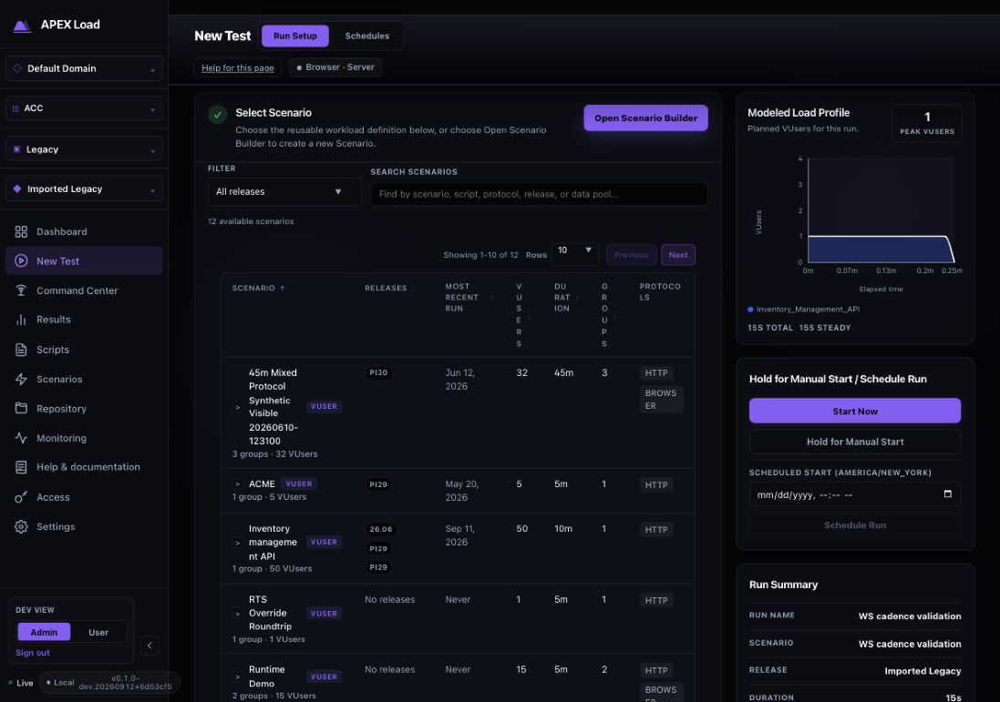
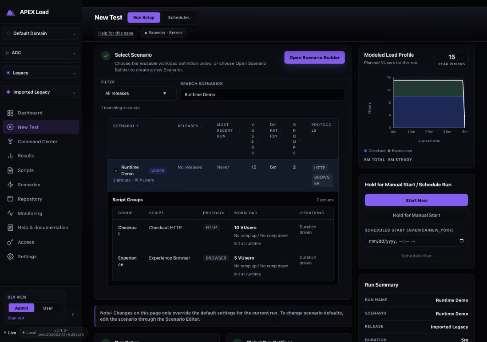
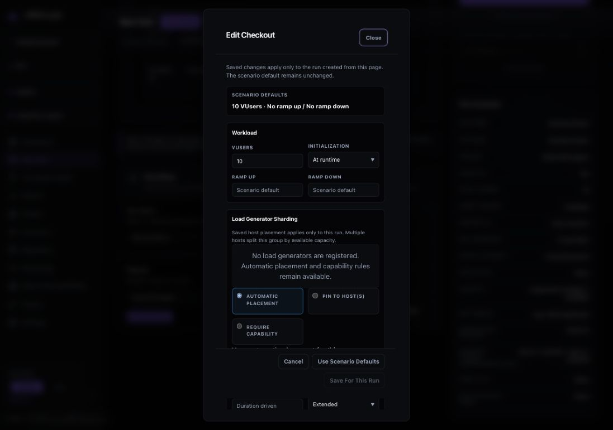
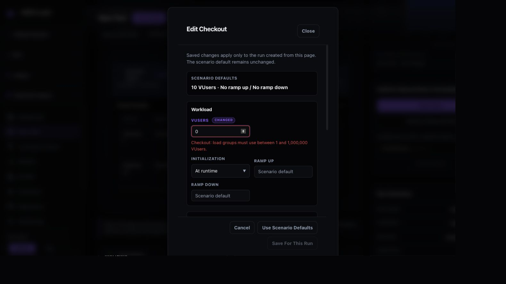
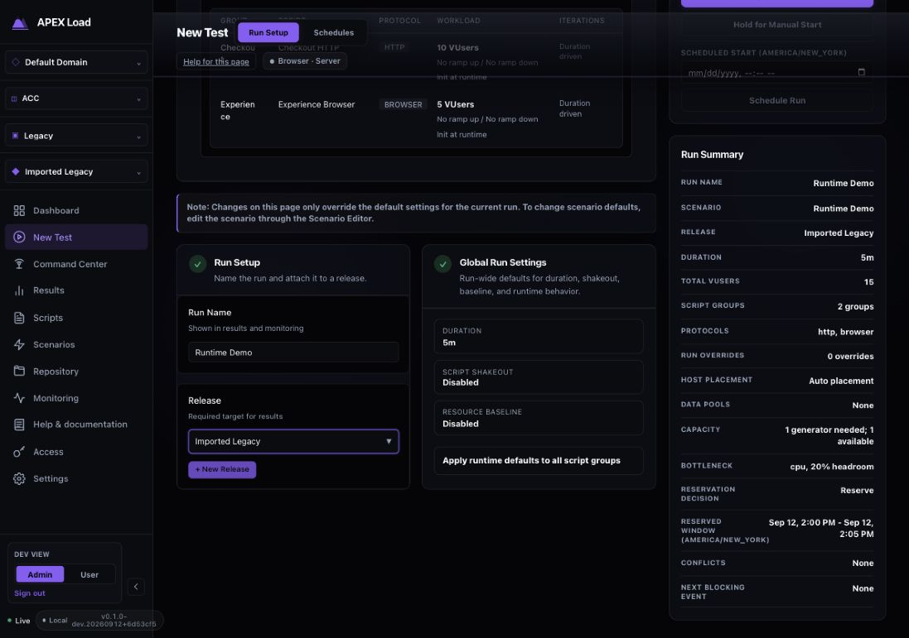
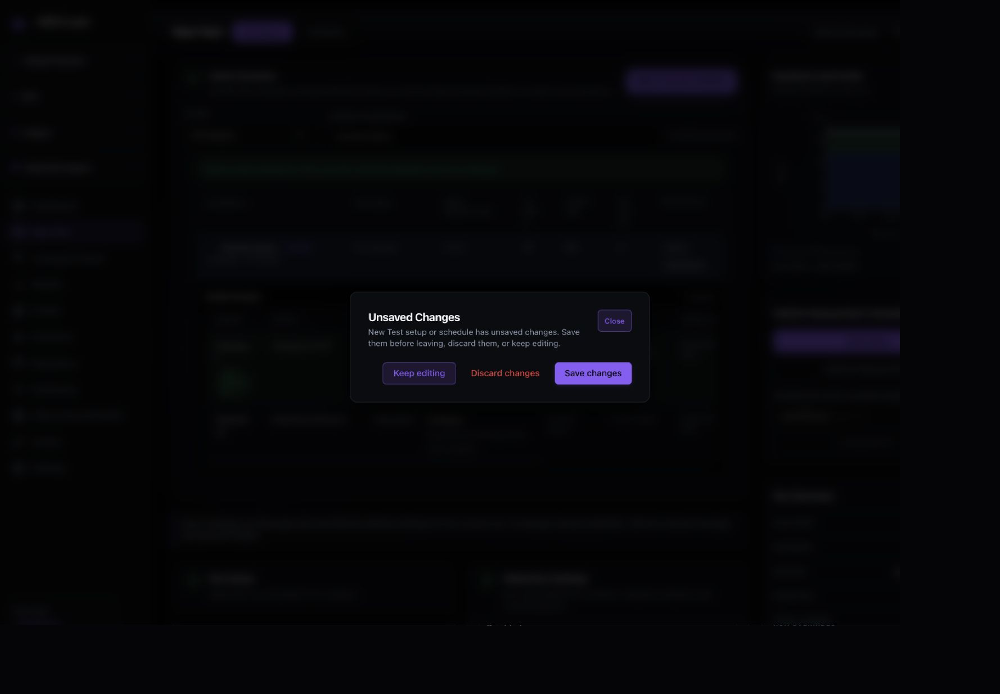
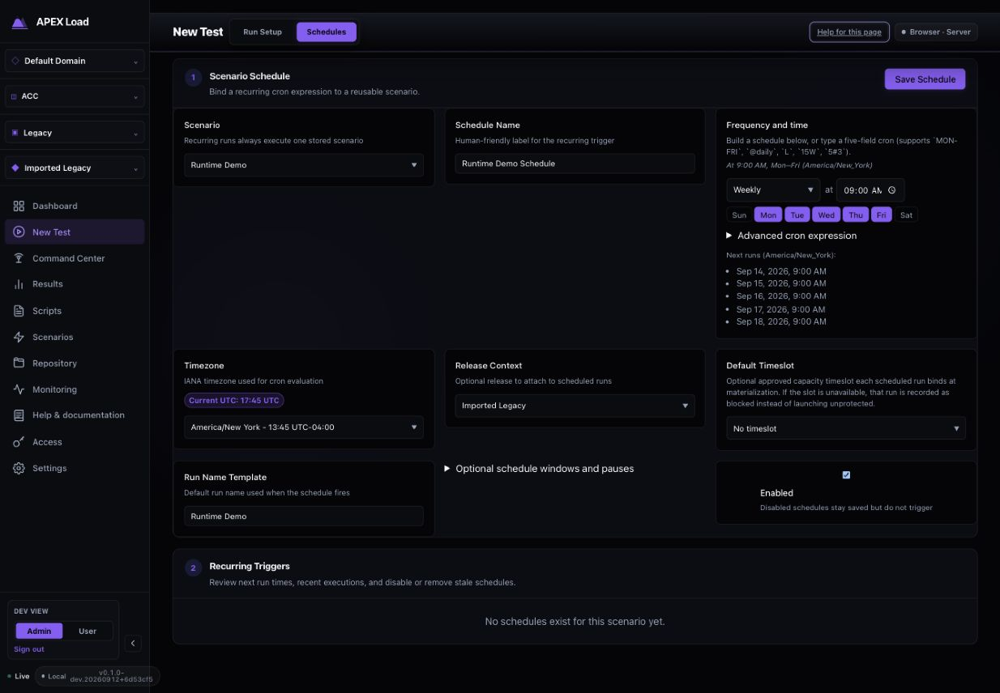
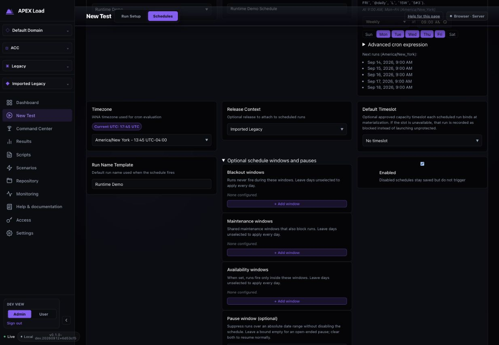
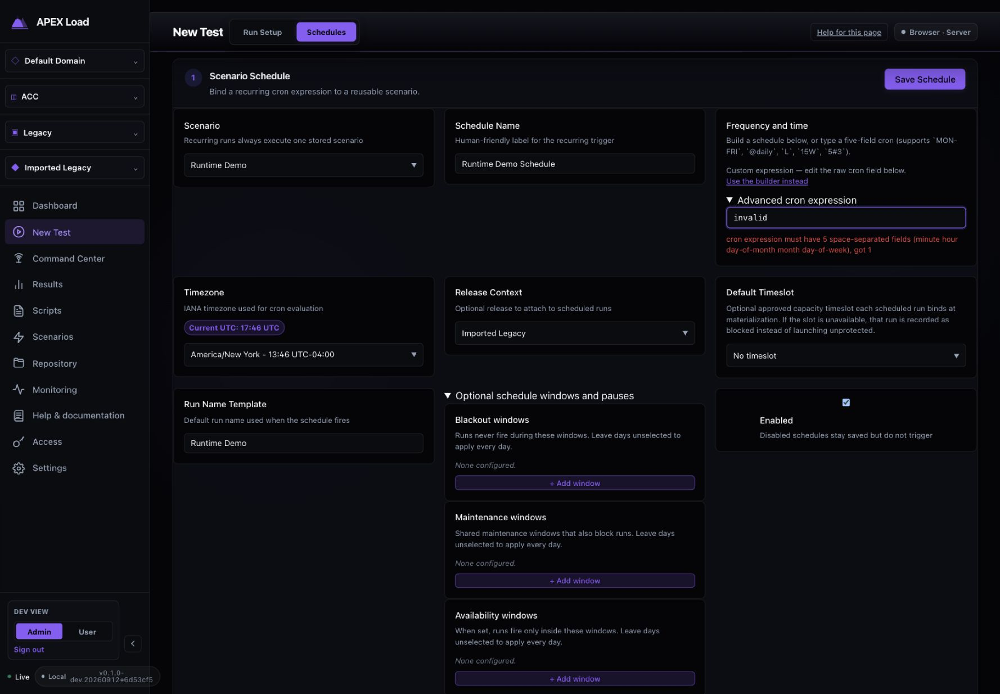

# New Test / run setup audit (2026-09-12)

Status: Complete. Findings remediated 2026-09-12 (see Implementation).

Merged from the original per-topic files of this review. Each section below was one file; the screenshots and evidence next to this README are unchanged.

## New Test usability and functional completeness audit

Evaluated September 12, 2026 against the running local APEX Load dashboard, build `v0.1.0-dev.20260912+6d53cf5`, with supporting inspection of the current workspace. Context: Default Domain → ACC → Legacy → Imported Legacy, development admin view. Both Run Setup and Schedules were exercised in the in-app browser. This is an evaluation; product code was not changed.

**Verdict:** Broad configuration coverage, but the flow is not yet dependable enough for an operator to confidently save, review, and schedule a workload. The highest-risk defect is that the navigation dialog's **Save changes** action can initiate a test. Fix that and automatic hidden scenario selection before adding more controls.

### Prioritized findings

| Priority | Finding and evidence | Recommended behavior |
|---|---|---|
| P1 | **“Save changes” can start a run.** After saving a run-only VUser override, switching to Schedules opens a generic Unsaved Changes dialog. Its Save action invokes `createRun('queue', { navigate: false })`; the queue path creates a test and calls `api.startTest`. The wording does not disclose execution. Observed dialog: step 5. Execution consequence: source-confirmed, deliberately not triggered against the running service. | Preserve the draft when switching tabs. A true Save draft action must never call the start API. If an execution action is offered, explicitly name it “Create and start/queue run” and show the workload and target. |
| P1 | **A fresh entry silently selects a scenario that may be on another table page.** The browser showed rows 1–10 of 12, while the active run was “WS cadence validation,” absent from those visible rows. Start Now was enabled and Select Scenario had a green check. Source selects `next[0]` before the table's name sorting/pagination. Search can further hide the active selection without clearing it. Step 1. | Start unselected unless arriving through an explicit scenario link, or pin a conspicuous “Selected scenario” card above the list. Keep name, reference key, workload and release context visible beside the start action. |
| P2 | **The tables sacrifice readability and hide editing.** At 1280px, “VUsers” and “Groups” wrap into single letters. The nested 11-column group table requires horizontal scrolling; group names break across lines and there is no visible Edit action. Keyboard Enter works, but a clickable row is difficult to discover visually. Steps 1–3. | Keep numeric headers intact, reduce the scenario list to essential columns, and put secondary metadata in expansion content. Give each group an explicit Edit settings button; use a wider editor or grouped sections for advanced settings. |
| P2 | **Capacity messages conflict, and a preview is labeled as a reservation.** The Checkout placement editor says “No load generators are registered” while the summary says “1 generator needed; 1 available.” The source uses separate inventory and advisory responses, so this does not prove missing execution capacity. Before any reservation is created, the summary already labels the candidate interval “Reserved Window.” Steps 3–4. | Explain configured/estimated capacity versus live registered inventory, include freshness and an actionable refresh/recovery link, and say “Proposed launch window” until a reservation has actually been created. |
| P2 | **Recurring schedule identity and scope are weaker than Run Setup.** Schedules uses an unsorted, name-only scenario dropdown; two “WS cadence validation” and two “User_Registration_Flow” entries are indistinguishable. The trigger list only covers the selected scenario. Step 6; DOM observation confirms duplicate labels. | Reuse a searchable scenario picker with reference keys and workload metadata. Label the list “Schedules for [scenario]”; add an all-scenarios management view with next run, status and required action. |
| P2 | **Approval and missed-run behavior are invisible before saving.** The draft and submission include `approval_policy` and `missed_run_policy`, but the create form exposes neither a selector nor a read-only effective value. Existing trigger rows render these policies afterward. Recurring runs use the stored scenario rather than the run-only overrides just configured in the other tab. Steps 5–7. | Show effective policies and their source before save, with controls only where the operator is allowed to change them. Explicitly state that recurring runs use stored scenario settings and summarize that workload beside the schedule. |
| P2 | **Known invalid cron still leaves Save Schedule enabled.** Entering `invalid` produces an inline error after the preview request, yet Save Schedule remains enabled. Source only disables it for missing scenario, submission, or access denial. Step 7. | Disable save for known invalid input, connect errors to the field, and visibly mark next-run previews as refreshing while inputs change. Preserve server-side validation. |
| P2 | **The final review describes load, but not enough of what determines a meaningful result.** The summary includes VUsers, duration, groups, protocols, placement and data-pool names. It does not expose target endpoints, effective response-time SLAs, or an explicit “no acceptance criteria configured” state. The scenario model supports group `transaction_response_time_sla_ms`, which this page does not display. Step 4 plus source inspection. | Add a compact, read-only readiness review for targets, acceptance criteria, data requirements and relevant monitoring readiness, with links to the owning editor. Treat unavailable information as unknown rather than ready. |

### Flow walkthrough and captured evidence

#### 1. Enter Run Setup — needs correction

Search, release filtering, sorting and pagination exist. However, an automatically chosen scenario is off the first page while launch is already available. The green selection check overstates how explicitly the user has configured the run. The narrow headers are a confirmed product layout issue.

#### 2. Select a scenario and inspect its groups — functional, difficult to scan

Searching for Runtime Demo returned the expected mixed HTTP/browser scenario. Selection expanded the groups, refreshed the chart, and populated run details. Enter activated the scenario row. The nested table exposes useful runtime information but only part of it fits at once; an explicit editing affordance is missing.

#### 3. Edit and validate group settings — functional with presentation issues

The editor includes VUsers, initialization, ramps, placement, iterations, pacing, think time, error handling and browser settings. Setting Checkout to zero VUsers showed an inline alert and disabled Save For This Run. Setting it to 12 and saving updated the effective total from 15 to 17, added an override indicator, and showed a success message. Scenario defaults remained distinct. Audit-only changes were later discarded.

The dialog is narrow and scroll-heavy despite the desktop space available. Browser-specific fields also appear in the HTTP group's editor. Enter opened the editor; Escape closed it and restored focus to its originating group row.

#### 4. Review global settings and launch readiness — partially complete

Run name and release have programmatic labels. Duration opens a focused editor; shakeout and resource baseline controls exist. Expanding runtime defaults reveals iterations, logging, transactions, pacing, think time and error options. The chart and summary reflect effective VUser changes. Start Now, Hold for Manual Start and one-time Schedule Run are present; preflight temporarily disables actions while checking.

The summary's capacity contradiction and “Reserved Window” wording need correction. The launch card's heading also emphasizes hold/schedule even though its primary action is Start Now. “Run timing” with Now / Later / Recurring choices would clarify the relationship between this card and the Schedules tab.

#### 5. Switch tabs with changes — high-risk save semantics

Switching to Schedules after a run-only override triggered the Unsaved Changes dialog. Keep editing, Discard changes and Save changes are available. Discard successfully cleared the audit draft and switched tabs. The save path was traced in source instead of executed because it calls the start API. A normal transition between setup and timing should not require creating or starting a run.

#### 6. Configure a recurring schedule — functional, scope and hierarchy need work

The default weekly weekday schedule displays a human-readable description, timezone offsets, and five upcoming occurrences. Changing Weekly to Daily changed the raw cron and refreshed the preview to include Sunday. The advanced cron field is progressively disclosed. Release context, an optional approved timeslot, run name and enabled state are present.

The three-column form leaves large blank areas below short fields because the occurrence preview determines the row height. Timezone is separated from frequency. Save sits above an enabled-by-default form without a concise final policy/workload review. No schedules existed for the selected Runtime Demo scenario, so populated trigger management was not exercised live.

#### 7. Inspect policies and invalid schedule recovery — implemented, incomplete review

Blackout, maintenance, availability and absolute pause windows are available under a disclosure. Approval and missed-run policies are absent from this form even though the payload includes them. Invalid cron produces a helpful inline error, but Save remains enabled. The repeated “+ Add window” buttons also deserve more specific accessible names so each action identifies its window type.

### Functional coverage

| Capability | Evaluation |
|---|---|
| Scenario discovery and selection | Exercised: search, selection, expansion and keyboard activation; sort/filter/page controls inspected. Automatic selection and duplicate identity remain issues. |
| Run name and release | Controls inspected; release remains required for one-time runs and optional in recurring setup. New Release creation was not submitted. |
| Per-group overrides | Exercised: invalid VUsers, valid save, derived total and override feedback. Advanced runtime controls inspected. |
| Global overrides | Duration dialog and runtime-default disclosure exercised. Not every runtime combination was submitted. |
| Capacity and preflight | Live estimate and preflight states observed. Pinning unavailable hosts and real conflict scenarios were not executed. |
| Start, hold and one-time schedule | Controls and source paths inspected; existing unit coverage passed. No workload was launched, held or scheduled during this audit. |
| Recurring scheduling | Frequency changes, production-backed preview, policy disclosure and invalid cron exercised. Persistence and actual firing were not tested live. |
| Trigger history, approval and management | Source and existing tests cover history/approval/state actions. Selected scenario had no saved triggers; no schedule was created, changed or deleted. |
| Draft safety | Navigation guard exercised. True save-without-execution is missing from the observed run guard behavior. |
| Pre-run acceptance review | Workload and capacity are summarized; target/SLA/readiness review needs additional presentation. This is not a claim those capabilities are absent elsewhere. |

### Accessibility and evidence limits

Confirmed strengths: programmatic labels for major form inputs, inline VUser alerts, disabled invalid workload save, selected row state, keyboard Enter activation, visible focus, Escape dismissal and focus restoration. Risks include fragmented table headers, very dense horizontal tables, small muted helper text, repeated generic window-action names, and discoverability of row-based editing. Contrast ratios, screen-reader announcements, full focus trapping, touch behavior and WCAG conformance were not independently certified.

Captures were made in this audit run, saved and inspected. Explicit 1280×900 and 1440×1000 desktop viewport settings were used for layout checks and reset afterward. Some early viewport captures cropped the right edge inconsistently; these are not evidence of page overflow. DOM geometry showed the launch card inside the content bounds, and later full-page-mode captures show it intact. The actual scrolling container can still leave lower content outside a capture. Images 01, 02, 03, 05 and 06 are retained as working captures but superseded for the conclusions above; image 06 does not establish past-date validation because the native input did not retain a stable date value.

Validation: `npm test -- src/components/NewTestPage.test.tsx` passed **61 tests** in this workspace. This is supporting implementation evidence, not proof that live launch or recurring execution succeeded. The running embedded build and the working tree may differ; source-only consequences are identified above. No product files were edited and no real test or recurring trigger was created.

### Source pointers and acceptance checks

- `dashboard/src/components/NewTestPage.tsx:1659`: guard save invokes queued run creation; `:1523` invokes `api.startTest`. Fix acceptance: changing tabs or saving a draft makes zero create/start calls.
- `dashboard/src/components/NewTestPage.tsx:759`: first-response scenario auto-selection. Fix acceptance: an off-page/filtered selection is always clearly identified before launch, or no selection is made implicitly.
- `dashboard/src/components/Pages.css:6192`: fixed-width table with `overflow-wrap: anywhere`. Fix acceptance: readable headers and discoverable group editing at 1280px and zoomed desktop layouts.
- `dashboard/src/components/NewTestPage.tsx:1159`: capacity/summary projection; `:3543`: empty-inventory message. Fix acceptance: estimates and registered inventory have explicit, consistent meanings; proposed versus booked windows are distinguished.
- `dashboard/src/components/NewTestPage.tsx:2530`: recurring scenario picker and create form; `:2235`: policy submission; `:2744`: policy display on existing rows. Fix acceptance: duplicate names can be distinguished and effective governance is visible before save.
- `dashboard/src/components/NewTestPage.tsx:934`: asynchronous cron preview; `:2529`: Save Schedule gating. Fix acceptance: known invalid cron cannot submit and stale occurrences are marked as refreshing.
- `dashboard/src/types/storedContent.ts:40`: stored scenario contract, including group response-time SLA. Fix acceptance: the run review identifies configured acceptance criteria or explicitly states that none are configured/available.

Recommended next step: address save/start semantics and visible scenario selection first, then simplify the scenario/group table and add the effective policy/readiness review.

## New Test audit remediation — September 12, 2026

The eight findings in [the audit](#new-test-usability-and-functional-completeness-audit) are addressed in the working tree. Existing launch, reservation, recurring-schedule CRUD, approval, and occurrence workflows remain in place.

| Audit finding | Implemented behavior |
| --- | --- |
| Saving during navigation could start a test | Save changes and Save draft store a tab-local draft. Neither calls test creation, start, or schedule creation. Both tabs retain edits. Saved drafts can be restored after navigation/reload. |
| Selected scenario could be outside the visible list | A persistent selection panel shows workload name, unique reference, VUsers, duration, and release. The launch controls repeat the identity. Show selected scenario reveals its exact row regardless of filtering/pagination. |
| Dense tables and hard-to-discover group editing | Scenario details move into the expanded row; all sort choices remain available. Groups use three readable columns, expandable runtime details, and explicit Edit settings buttons. The wider editor only shows browser settings for browser groups. |
| Capacity and host availability appeared contradictory | Capacity is labeled an estimate, proposed windows are distinguished from reservations, live-host inventory has a check time and refresh controls, and empty inventory explains the distinction. |
| Duplicate recurring scenario names and no cross-scenario overview | Searchable, sorted scenario choices include unique references. A project-wide catalog shows upcoming schedules, status, required actions, and access to management. Partial load failures remain visible. |
| Hidden policies and ambiguous override scope | The form displays effective approval/missed-run policies and their source before saving. It explicitly identifies the stored workload and states that run-only overrides do not apply. Unavailable system defaults block new trigger submission with a retry action. |
| Invalid cron could be submitted; preview could be stale | Save remains disabled while the authoritative preview is pending or invalid. Errors are associated with the raw cron field. A change to scenario, timezone, cron, or scheduling windows invalidates the previous preview immediately. |
| Insufficient readiness context | A review panel exposes safe target origins, nested assertion counts, group response-time SLAs, data-pool requirements, and links to owning workspaces. Missing data and unverified monitoring coverage remain explicit. |

### Review corrections

- A saved, unchanged draft no longer prompts again on navigation; subsequent edits still do.
- A missing saved capacity reservation stays attached and blocks launch until the user reviews it. Restoring a draft never silently removes the reservation.
- New recurring drafts use current system policies when restored; existing schedule revisions retain their saved policy and concurrency contract.
- Drafts are scoped to project/application and checked against the scenario revision. Malformed storage is rejected and failed writes are reported.
- Target presentation strips credentials, paths, query strings, and fragments. Dynamic/unsupported targets remain unknown rather than appearing verified.
- Readiness refresh hides stale results. Schedule catalog timestamps use the timezone named beside them.
- Scenario metadata and sorting remain accessible after reducing the visible table columns.
- The scheduling form uses aligned controls and collapses to a single column on narrower screens. Wide schedule tables scroll within their container rather than splitting action labels.
- Full-suite validation exposed an unrelated shared-checkout Bruno import regression: the review dialog referenced parent-only variables. Its guide now uses the review stage, and the main guide preserves the credential-review card's required placement. Existing Bruno tests cover both behaviors.

### Validation

- New Test unit coverage: 78 tests across New Test, draft persistence, and schedule catalog tests, included in the passing full suite.
- Browser journeys cover navigation-guard saving without execution, both-tab restoration, duplicate scenario identity, invalid cron, explicit group editing, effective policies, paused schedule persistence, and narrow-screen alignment.
- Full unit suite: **4,176 tests passed in 386 files**. Type checking, ESLint, and a fresh embedded dashboard build passed.
- Dev-admin browser profile: **104 passed, 1 intentional profile-specific skip**.
- Local-auth browser profile: **25 passed**, including both New Test journeys and the full authenticated create/launch/stop/results journey.
- The required `npm run test:cycle` was run with `VITEST_MAX_WORKERS=2` and isolated browser-test ports/output directories. It passed the unit/build/dev-admin stages, then exited during local-auth bootstrap before any tests began. Rerunning the complete local-auth profile on port 19247 passed. Logs: [dashboard cycle](dashboard-cycle.log), [local-auth retry](local-auth.log).
- Earlier full-suite runs surfaced the corrected import regression and large-import test timeouts during concurrent validation load. Worker concurrency was reduced for the passing full-suite run; no assertions or timeout limits were weakened.
- Final source whitespace validation: `git diff --check` passed. No Go source was changed for this remediation.

Browser captures: [selected workload](after-run-setup.png), [group editor](after-group-editor.png), [scheduling form](after-schedules.png), [narrow scheduling form](after-schedules-narrow.png), [readiness review](after-readiness.png).

Draft storage is local to the current browser tab. Readiness is an advisory inventory, not a live target-health or monitoring-coverage certification. The audit's baseline captures remain unchanged.
