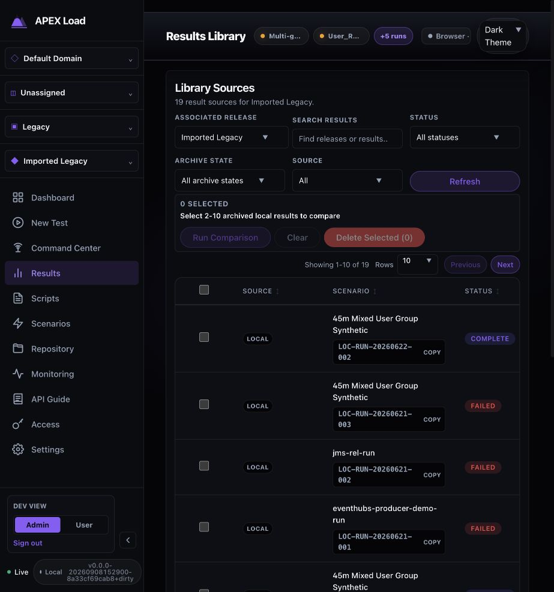
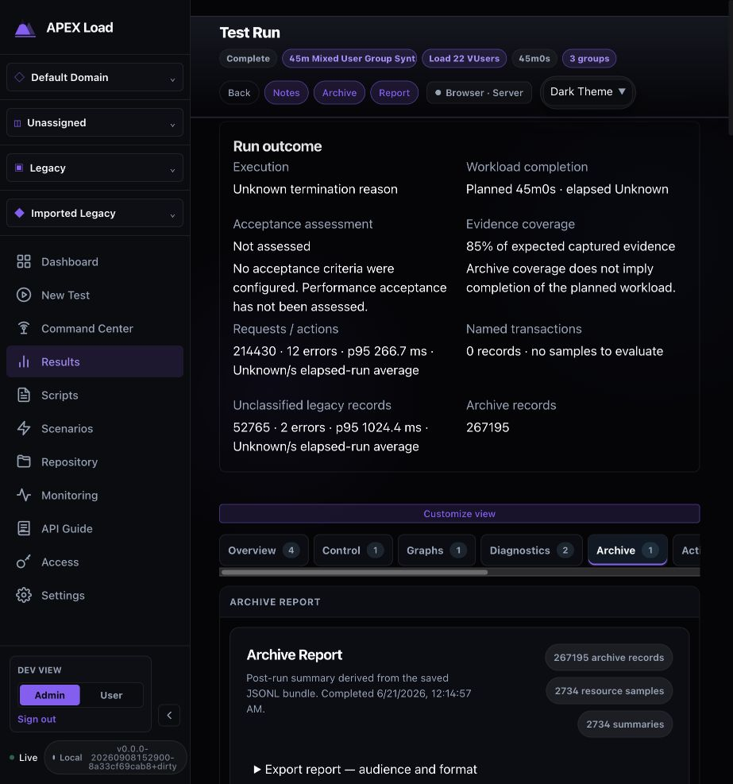
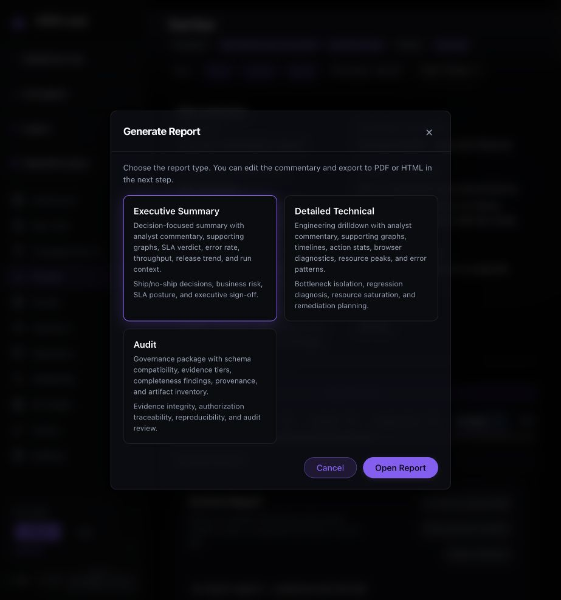
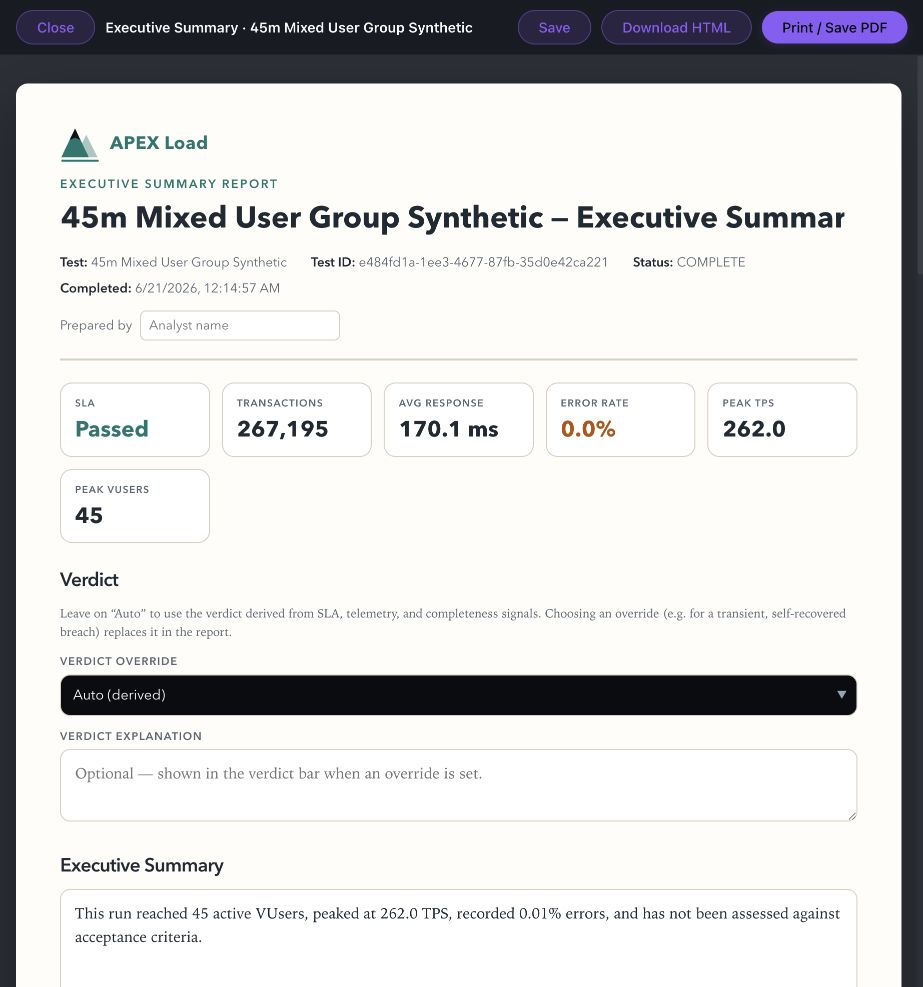
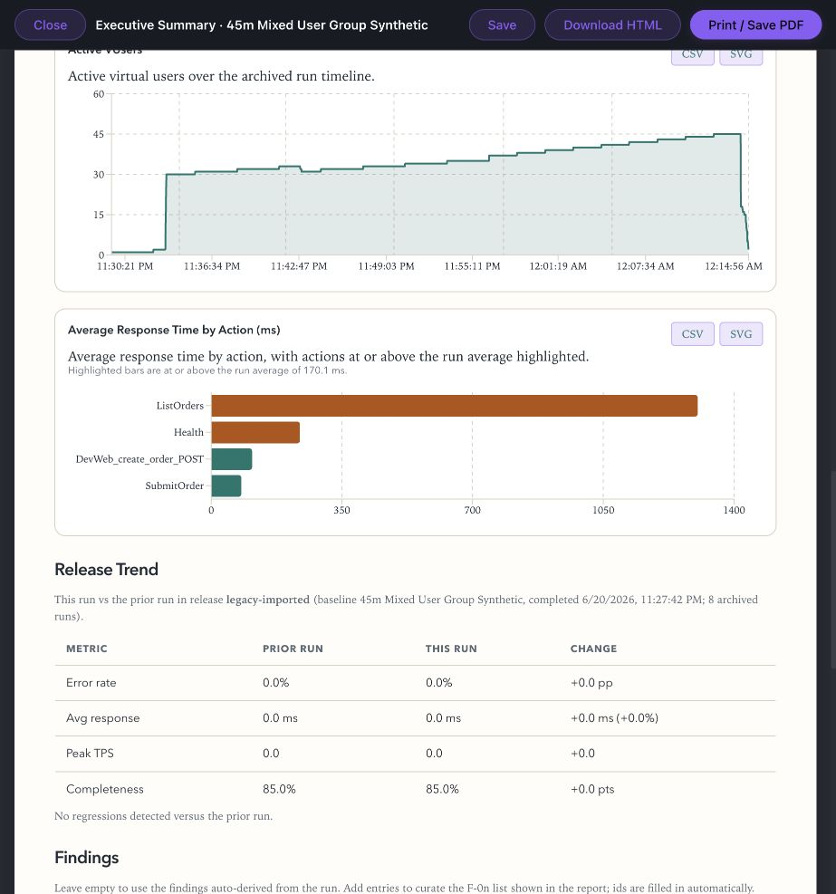
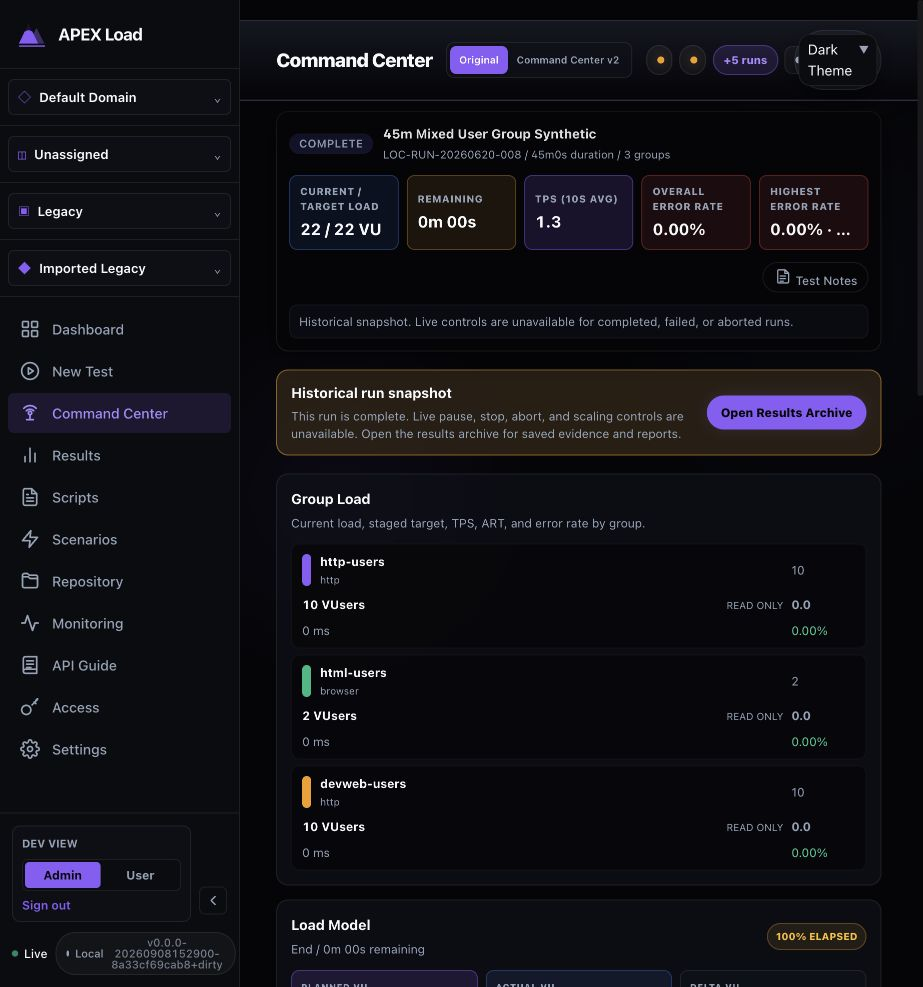
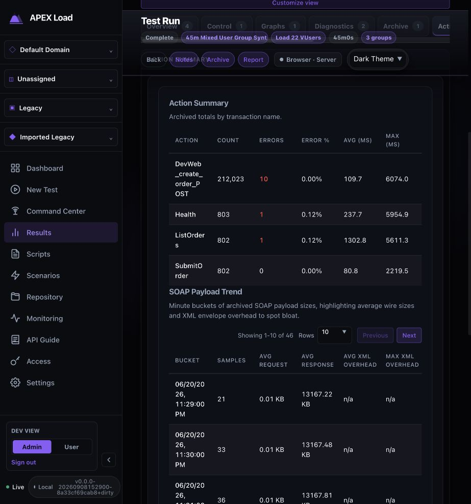
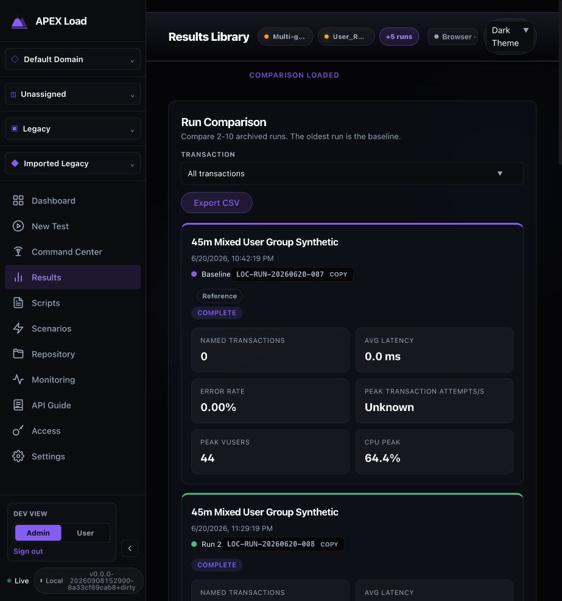

# Post-test reporting review (2026-09-08)

Status: Complete. The audit findings were implemented and reviewed (see Implementation).

Merged from the original per-topic files of this review. Each section below was one file; the screenshots and evidence next to this README are unchanged.

## Post-test reporting audit — 8 September 2026

[Open the Figma audit board](https://www.figma.com/design/tdwRI2YObUKDQOPiiNtRt4?node-id=2-2). It contains all eight captured screenshots, editable findings, the proposed reporting structure, delivery priorities, and evidence limits. Screenshot placement and board layout were visually verified.

The reporting experience has substantial analytical capability, but it lacks one authoritative result, one consistent metric vocabulary, and one clear operator journey. Correct the contradictory conclusions before reorganizing the screens.

### Scope and evidence

Current local application at localhost:8080, development Admin view, dark theme, default in-app browser viewport approximately 923 × 987. Build displayed v0.0.0-20260908152900-8a33cf69cab8+dirty. This was an evaluation, with no application code or run data changed. Existing workspace changes were preserved.

Primary run: 45m Mixed User Group Synthetic, LOC-RUN-20260620-008, ID e484fd1a-1ee3-4677-87fb-35d0e42ca221. Prior run LOC-RUN-20260620-007 was used for comparison. Both belong to Imported Legacy. Findings about these historical records must not be generalized to every newly created run without further testing.

Operator goal: establish whether the workload completed, whether performance met expectations, whether the evidence is trustworthy, what changed, what needs investigation, and what to communicate.

### Captured journey

1. **Results Library — needs restructuring.** Search, release filtering, reference IDs and archive availability help find runs. The table provides lifecycle status and archive record counts, but no acceptance assessment, latency, or error-rate summary. Run Archive and Run Dashboard divide the next step. Source and archive-management controls compete with analysis. At the captured width, the action columns require horizontal navigation.

2. **Run Archive — useful evidence, weak hierarchy.** The Run outcome component correctly distinguishes execution, workload completion, acceptance and evidence coverage. It explicitly says Not assessed and explains why. Below it, eight execution-oriented tabs, a second Archive control, nested Archive Report headings, export controls, completeness, schema compatibility, evidence tiers, provenance, errors, waterfall, timeline and analysis compete for attention. Keep the honest outcome model and organize the supporting evidence around it.

3. **Report audience selection — understandable but redundant.** Executive Summary, Detailed Technical and Audit have useful descriptions. However, this choice repeats the audience/profile controls already available within Archive. “Report” opens “Generate Report,” followed by “Open Report,” before the operator reaches the composer. Audience should be a presentation choice inside one report/export workflow.

4. **Executive report composer — critical trust issue.** Its headline SLA tile says Passed while the same screen's summary says acceptance has not been assessed. Transactions shows 267,195, which the outcome component identifies as all archive records: 214,430 requests/actions plus 52,765 unclassified legacy records, with zero named transaction records. Error rate rounds to 0.0% even though the narrative says 0.01%. Editing controls dominate the opening page, and the title is clipped in a single-line input.

5. **Release Trend inside the report — high-priority inconsistency.** This-run average response and peak TPS both display 0.0, despite the report's headline values of 170.1 ms and 262.0. “No regressions detected” follows those zeros. The compared metric populations or data availability are not explained; the operator cannot reconcile the apparent contradiction. This is a presentation/data-contract investigation, not proof of a storage defect.

6. **Run Dashboard — avoidable detour.** This opens Command Center, prominently displaying Current / Target Load, Remaining and TPS (10s avg) for a completed run. It correctly labels the page a historical snapshot and disables live controls, but then tells the operator to Open Results Archive. The Results Library currently treats this detour as a primary-styled action in source.

7. **Action Summary — useful detail with unclear categories.** The table offers action counts, errors, averages and maxima, but calls them archived totals by transaction name. A request with 10 errors displays 0.00%. Action names wrap into fragments. SOAP Payload Trend appears immediately below the general action table, although the inspected run groups are HTTP/browser. The screenshot confirms the label/content placement; whether this is a protocol-classification defect requires separate data investigation. The sticky top bar also visibly overlaps content during scrolling.

8. **Multi-run comparison — useful capability, disconnected workflow.** Comparison loads in Results Library with the oldest selected run automatically designated baseline. Run identity and baseline are explicit, which is good. It introduces another metric vocabulary: Named transactions, Avg latency and Peak transaction attempts/s. With zero named transactions, latency nevertheless displays 0.0 ms. Comparison's automatic oldest baseline differs from the report's prior-release-run convention and from Pin Baseline. These modes need a shared visible comparison context.

### Prioritized findings

| Priority | Problem | Required change |
|---|---|---|
| P1 | An unassessed run is labeled SLA Passed (2, 4). | Share one acceptance state across in-app results, preview and exports. No criteria must remain Not assessed. Keep execution completion separate. |
| P1 | Different populations and missing/empty values look comparable (2, 4, 5, 8). | Explicitly distinguish requests/actions, named transactions and legacy records. Carry metric population, time window, sample count and availability through every renderer. Use Not available/No samples instead of misleading zeros. |
| P1 | Post-run entry leads into multiple overlapping destinations (1, 2, 6). | Make View results the primary completed-run action everywhere. Retain the historical operations snapshot as secondary context. |
| P2 | Export choices repeat in several locations (2, 3, 4). | One Export action with audience, format and commentary options; place raw evidence downloads under Evidence. |
| P2 | Comparison conventions differ (5, 8). | Use one explicit baseline picker and show why the baseline was selected. Distinguish chosen baseline, prior run and multi-run exploration. |
| P2 | Analysis and governance material share one long archive surface (2, 7). | Put findings and performance first; progressively disclose schema, provenance and raw artifacts. Show protocol details where relevant. |
| P2 | Dense tables, fragmented labels, clipped title and sticky overlap impede reading (1, 4, 7). | Keep run identity and the primary action visible at this width, wrap titles appropriately, protect content from the sticky header, and use responsive diagnostic layouts. |

### Proposed information architecture

One completed-run results workspace, opening with the run name, release, execution status and acceptance assessment. Preserve evidence limitations prominently. Keep Compare and Export available in the report header.

| Area | Operator question | Existing content to consolidate |
|---|---|---|
| Summary (default) | Did it finish, did it meet criteria, and can I trust the result? | Run outcome, acceptance/SLA assessment, population-specific KPIs, planned/achieved load, evidence warning, top findings and next investigation links |
| Performance | Where and when did behavior change? | Synchronized graphs, action/transaction performance, Load Impact, selected-action drill-down |
| Diagnostics | What explains the failures or slowdown? | Error patterns, transaction details, browser waterfall, resource correlation and relevant protocol diagnostics |
| Evidence | What was captured, and can I reproduce it? | Telemetry health, completeness, schema, provenance, artifact integrity, raw downloads |

Comparison should be a mode of this workspace: pick a baseline, retain selected population/action and time-window semantics, and show deltas beside the same metrics. Multi-run exploration can still start in the library, but should use the same comparison model.

Executive, Technical and Audit should be output presets over the same evidence and acceptance model. Show the report read-only by default; enter an explicit Edit commentary mode for narrative and overrides. Overrides should show the derived assessment alongside the analyst assessment and explanation, subject to existing permissions. This preserves capability while reducing separate destinations.

In the library, prioritize run name/reference, date, execution status, assessment and a compact performance summary. Use one View results action. Keep storage/source filters available, and put transfer/delete functions in secondary controls.

### Implementation grounding

- `dashboard/src/components/ReportComposer.tsx:217` defaults missing `manifest.sla_breached` to false; line 359 maps that boolean to Breached/Passed. This explains the absence of a Not assessed state in the headline tile.
- `ReportComposer.tsx:358` uses aggregate overview metrics for the headline scorecard. The newer outcome component uses explicit populations. Unify those contracts before changing visual layout.
- `ReportComposer.tsx:760` renders the separate release-trend summary. `signedDelta` at line 793 converts undefined/NaN to +0.0; `formatNum` also merits missing-value review. Do not infer from this that every observed zero was missing: inspect the payload as part of the fix.
- `dashboard/src/components/TestExecutionArchive.tsx:982` exposes profile-format export controls; line 1279 begins another report-download group. `TestExecution.tsx` separately opens GenerateReportModal and ReportComposer.
- `dashboard/src/components/ResultsPage.tsx` styles Run Dashboard as primary and directs it to Command Center. Its comparison uses a separate report/summary pipeline.
- `dashboard/src/components/RunReportPage.tsx` already contains a completed-run report with audience lenses, KPIs, synchronized timeline, SLA scoreboard, diagnostics, comparison and export components. `dashboard/src/utils/featureFlags.ts` defaults this route's feature flag to false. It was source-inspected, not browser-audited or enabled. Evaluate it as a consolidation starting point; merely enabling it would not prove consistency or resolve the duplicated models.

### Accessibility and limits

Observed strengths: explicit field labels, named controls, selected tabs, modal labels and text accompanying lifecycle statuses. Risks: muted small text, small action controls, very long horizontal tab navigation, fragmented table labels, clipping and sticky-header overlap. No measured contrast ratios, keyboard-only journey, screen-reader test, zoom/reflow matrix or WCAG compliance assessment was performed.

Screenshots and accessibility-tree observations were captured fresh in this audit. The initial loading screenshot was replaced once the archive summary loaded. Archive Analysis was initially loading; its completed deep-analysis output was not independently verified. PDF/HTML files were not generated or inspected, annotations were not saved, and failed-run/no-archive paths were not completed. Findings about the composer are not claims that every downloadable format has the same defect. The optional RunReportPage remains a source-only observation.

### Suggested delivery order and acceptance checks

1. Repair acceptance and metric consistency. Exercise unassessed, pass, breach, missing data, zero samples, small nonzero error rates and mixed legacy populations. Confirm identical assessment and population definitions across the result, comparison, preview and generated outputs.
2. Establish one completed-run entry and one export workflow. Every terminal-run entry should reach the same result workspace; historical execution data remains available without becoming the default.
3. Consolidate analysis navigation and baseline selection. A selected action and baseline should remain recognizable across Summary, Performance and Diagnostics. Explicitly identify incompatible comparisons.
4. Verify representative successful, failed, interrupted, incomplete-evidence and browser runs, including the captured viewport and normal wide desktop use. Test keyboard traversal, modal return focus, readable small nonzero errors and unclipped run identity.

Any ensuing code changes must follow repository test policy, including relevant unit tests, `go test ./...` for Go changes, and the full dashboard `npm run test:cycle` for frontend/workflow changes.

## Post-test reporting implementation and review

The audit's seven findings are addressed in the completed-run workspace. Summary, Performance, Diagnostics and Evidence replace the competing primary destinations. Compare and Export remain header actions; the execution snapshot is secondary. Explicit feature-flag opt-out and old deep links remain compatible.

| Audit finding | Implemented change |
|---|---|
| Contradictory acceptance | Shared computed assessment in results and preview; analyst commentary cannot replace it. No criteria remains Not assessed. |
| Mixed populations and false zeros | Explicit action, named-transaction and legacy populations; sample counts and whole-run scope; absent percentiles and empty baselines remain unavailable; tiny errors retain nonzero notation; no fabricated sparklines. Generated narratives and document percentages follow the same distinction. |
| Competing completed-run destinations | View results is the primary library/dashboard action; completed-run selection opens the consolidated workspace by default. |
| Repeated exports | One audience/format workflow with read-only preview and explicit Edit commentary; raw evidence lives under Evidence. |
| Inconsistent comparison | Explicit completed baseline picker, no automatic pinned selection, context warnings, elapsed-time alignment and filter-preserving diagnostic comparison. Multi-run exploration identifies its baseline; release-trend output is identified separately as prior-run comparison. |
| Analysis mixed with governance | Four operator-oriented areas; metadata and raw files progressively disclosed; generic HTTP payload sizes no longer produce SOAP diagnostics. |
| Clipped/dense presentation | Wrapped preview title and toolbar; modal portal above the application header; retained table styles and contained horizontal scrolling; library action remains visible. |

### Review fixes

The implementation review additionally fixed missing-data sparklines, baseline curves extending beyond their interval range, stale report/baseline state, lost diagnostic filters, preview download persistence after switching back from editing, preview toolbar interception, missing diagnostic stylesheet imports, overflowing filter/table layouts, and hidden baseline context when the comparison controls are collapsed.

### Verification

- `go test ./...`: passed on the final backend changes (`/tmp/report-go-complete.log`).
- Dashboard unit, type, lint, embedded build and browser workflow checks are recorded in the final QA entry in [`design-qa.md`](../ux-reviews-2026-09.md#execution-results-design-qa).
- Browser evidence: `09-implemented-summary.jpg`, `10-implemented-preview.jpg`, `11-implemented-no-samples.jpg`, `12-implemented-diagnostics.jpg`, `13-implemented-evidence.jpg`.
- Existing unrelated workspace edits were retained.

### Runtime boundary

The port 4000 preview uses the revised frontend with the already-running controller on port 8080. That controller was not interrupted because it contains existing runs. The backend changes were tested with freshly built isolated workflow controllers. Rebuild/restart the normal controller to activate the revised generated-export narratives, SOAP detection and optional release-trend omission there. Existing saved annotations are preserved.
