# Script and Scenario Library audit (2026-09-12)

Status: Complete. Improvements were verified in the final verification record.

Merged from the original per-topic files of this review. Each section below was one file; the screenshots and evidence next to this README are unchanged.

## Script and Scenario Library usability review

Reviewed September 12, 2026 in the local APEX Load dashboard, using the in-app browser and the ACC project. All screenshots below were captured, saved and visually inspected during this audit. The screenshots show the narrow in-app browser surface; the final DOM check reported a 703 × 1094 CSS-pixel viewport. Horizontal table scrolling is part of the observed experience.

The confirmed selection, labeling, filtering and narrow-table defects were fixed. Existing authoring health and validation safeguards remain intact. This review covers library discovery, selection and history; the full authoring wizard, remote transfers and destructive deletion were not manually exercised against the working project.

### 1. Script catalog and discovery

Fair → improved. Script assets already expose protocol, versions, copyable reference keys, authoring warnings and explicit Edit actions. The generic Library Sources title obscured the primary task, while project-wide content could be mistaken for the selected application/release. The updated title and scope statement clarify this. Local health counts now follow search/release/folder filters, and health buttons expose their pressed state.

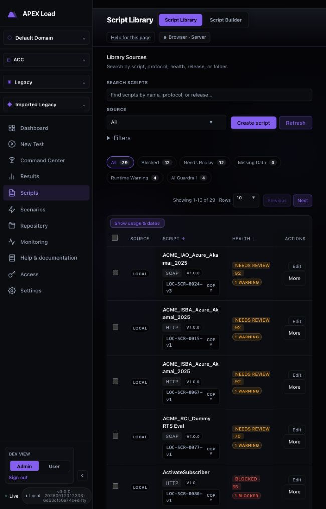

### 2. Script bulk selection

Critical mismatch → fixed. The table showed ten of 29 scripts, but its header selected all 29. The library now owns pagination, selects only addressable local scripts on the page, and offers a separately labeled action to select all matching scripts. Remote assets share pagination but are never included in local deletion.

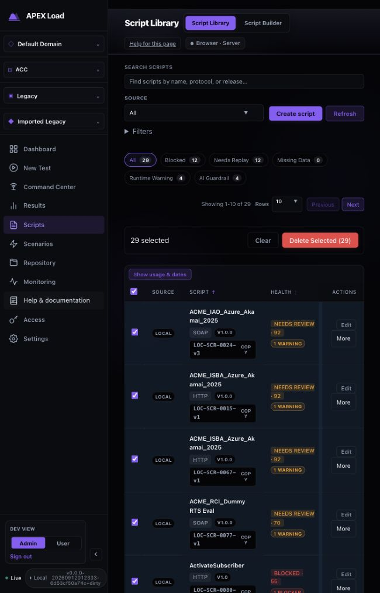

### 3. Script history

Fair → improved. Expanded rows provide health inputs and linked scenario runs. Duration represented configured duration, not measured elapsed time. It is now labeled Configured duration. Completed run links now use the same report routing as Results and Repository. Nested history pagination remains independent of catalog pagination.

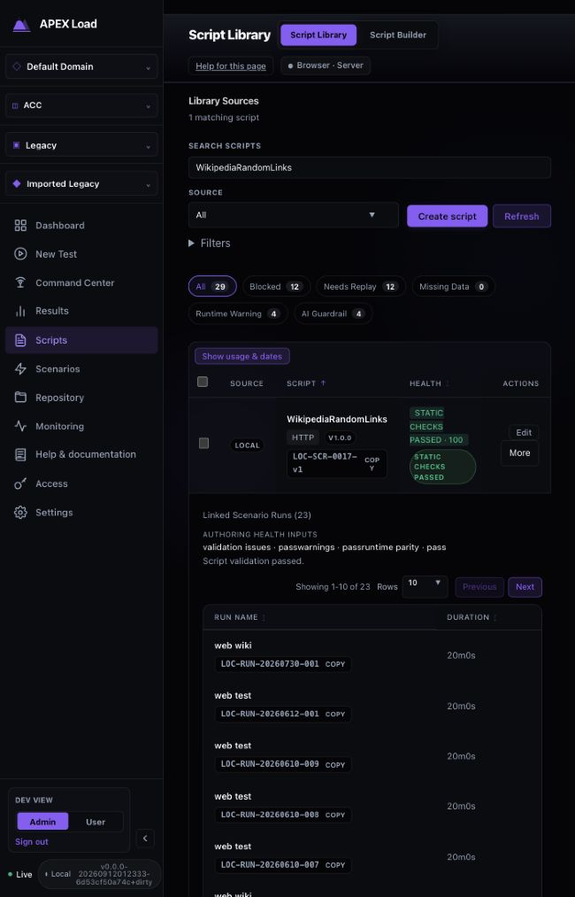

### 4. Scenario catalog and workload

Poor at the inspected narrow width → improved. Sticky Actions covered workload text. Actions now remain in their own column, workload gets a minimum readable width, and the horizontal catalog region is keyboard focusable. Saved scenarios and the project-wide scope statement make the asset type and scope explicit. Existing Validate before creating a run / Script review required messages correctly avoid implying execution readiness.

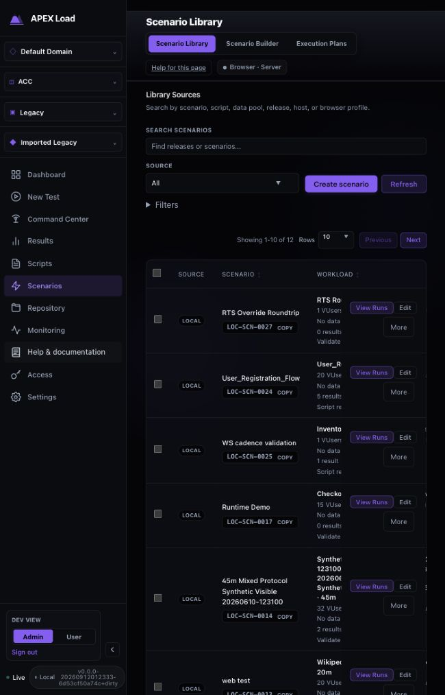

### 5. Scenario bulk selection

Critical mismatch → fixed. Ten displayed scenarios produced a twelve-item selection. The header now selects only the current page; selecting all matches requires the explicit separate action. Filtering prunes hidden selections and moves the pager to the first applicable page.

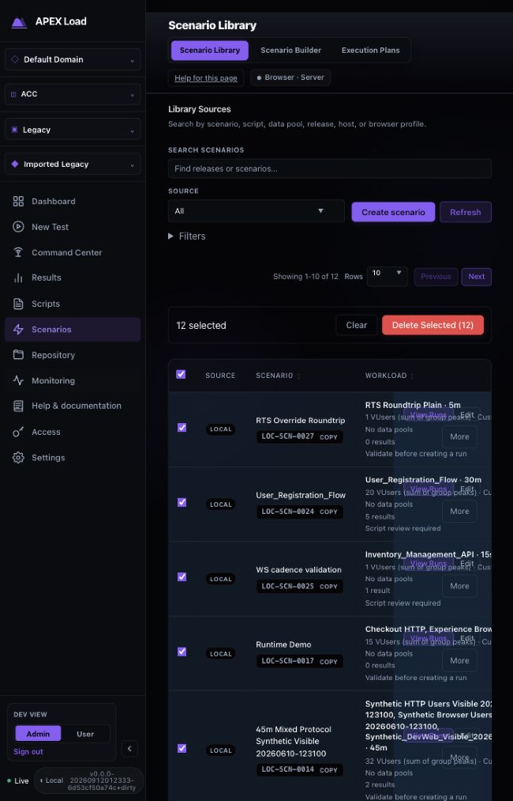

### 6. Scenario run history

Fair → improved. View Runs, Open and Run Dashboard provide explicit actions. The saved duration is now labeled Configured duration, consistently with Script Library and the configured-versus-observed distinction in Results. Horizontal scrolling is still required for all history columns at narrow widths.

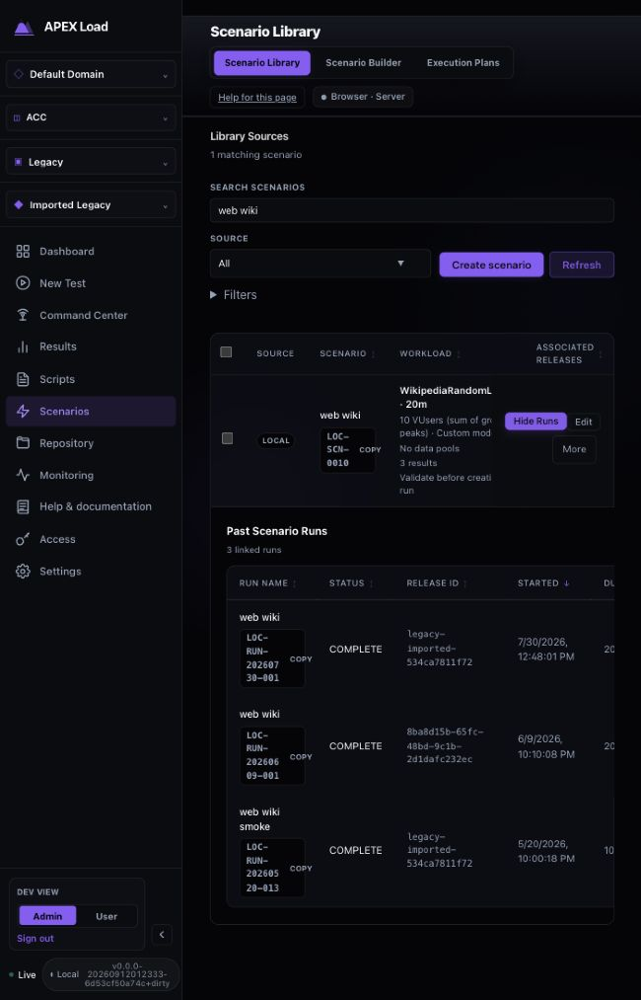

### 7. Navigation and filter recovery

The return trip from a script report initially lost the library query. Both libraries now preserve search and associated-release filters per domain/project for the browser session; Script Library also preserves folder and health filters. Selection is deliberately transient. Reset filters is visible whenever search, source or filters are active. Storage failures fall back to normal in-memory filtering. Page and sort positions are not persisted by this change.

#### Scenario page selection: ten selected, explicit all-matching action

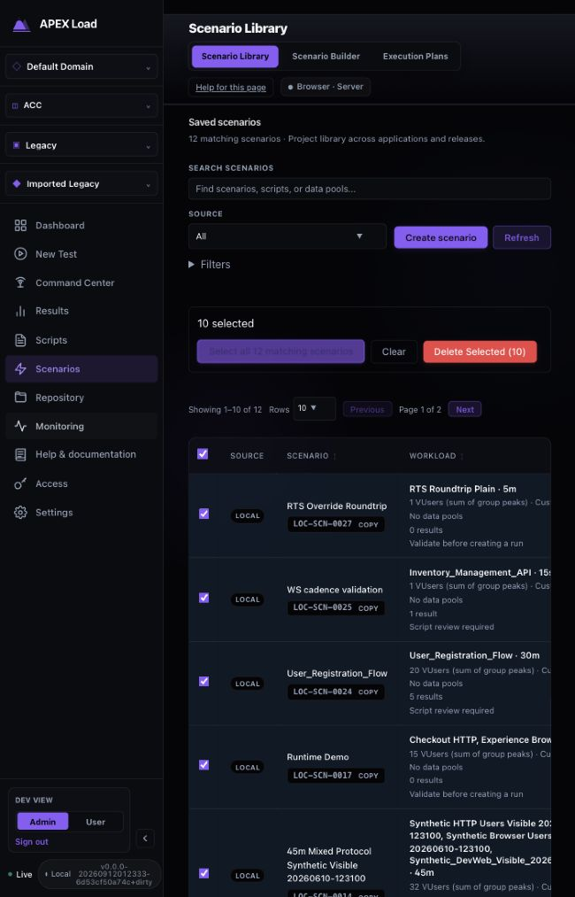

#### Scenario history: readable workload and configured duration

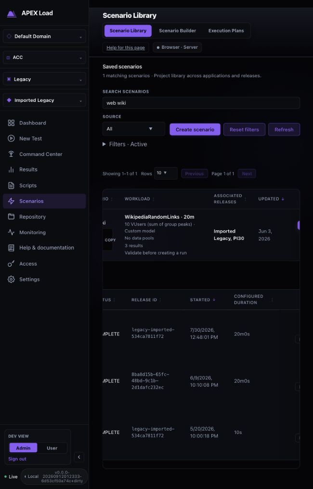

#### Script page selection: ten selected from 29

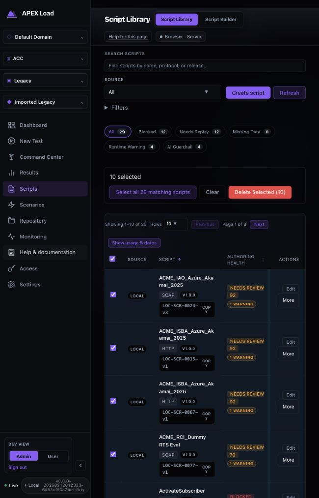

#### Script history and local health counts

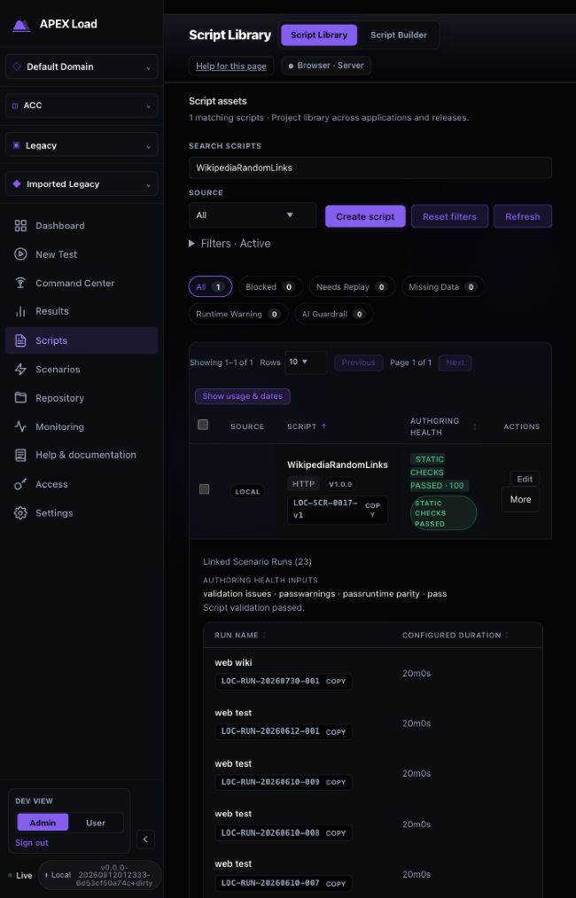

#### Completed script run opens Run Results

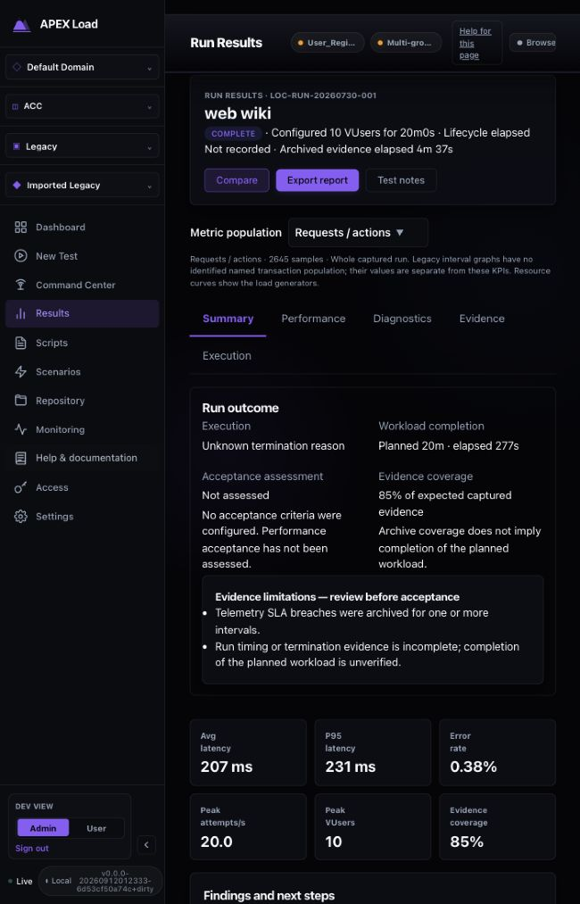

#### Script query restored after visiting Scenario Library

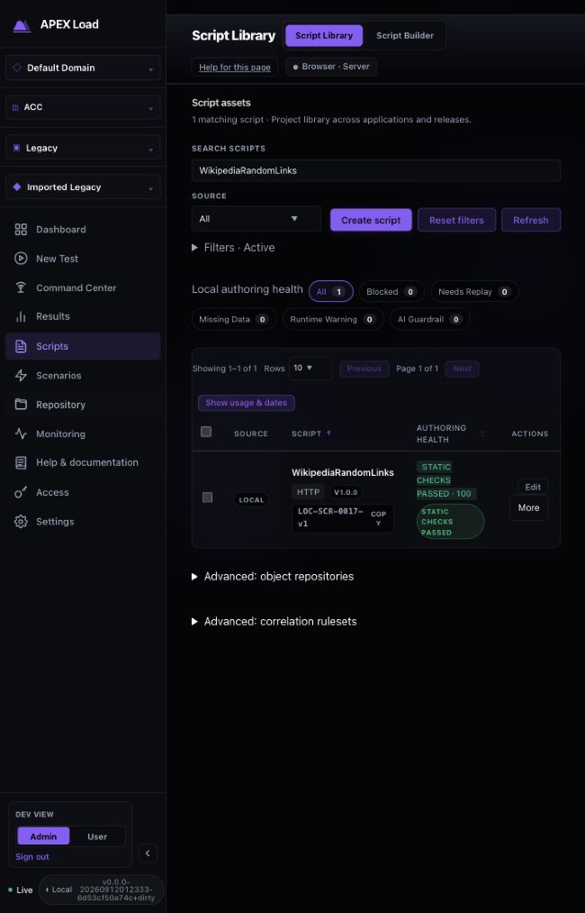

### Review and validation

- Regression coverage includes mixed local/remote pagination, page-only selection, explicit selection of all matches, page reset after filtering, independent nested history pagination, filter reset, filter restoration, project isolation, malformed saved state and unavailable session storage.
- Browser checks verified ten selected scripts out of 29 and ten selected scenarios out of twelve, an unselected second scenario page, pruning selections after filtering, local health counts following search, independent history pagination, completed-script-run report routing, separate restored script/scenario queries, resetting the scenario catalog to twelve rows, and keyboard focus/ArrowRight scrolling of the scenario catalog.
- Final full-cycle results are recorded in [final verification](#final-verification--september-12-2026).

### Accessibility and evidence limits

Health toggle state is programmatically exposed with aria-pressed; pagination controls have descriptive labels and disabled boundaries; the scenario scroll region has a keyboard focus target. Existing name/history/action buttons remain available to keyboard users. Screenshots and DOM checks do not establish full accessibility conformance. No complete screen-reader, zoom or contrast audit was performed for these libraries. The final browser workflow suite includes existing theme/narrow-layout checks but is not a substitute for a full accessibility audit. Remote pagination has automated fixture coverage; live remote transfers were not exercised.

## Final verification — September 12, 2026

The full dashboard cycle completed successfully with exit code 0 after the final source changes, including session filter restoration.

- TypeScript checks: passed.
- ESLint: passed, no warnings.
- Unit tests: **4,139 passed across 382 files**.
- Fresh embedded dashboard build: passed.
- Dev-admin browser workflows: **98 passed**, one intentional role-specific skip (the non-admin Help test runs in local-auth).
- Local-auth browser workflows: **19 passed**.
- `git diff --check`: passed.

Executed from `dashboard/`:

```sh
VITEST_MAX_WORKERS=2 \
APEXLOAD_E2E_OUTPUT_ROOT=/tmp/apex-script-scenario-final-e2e \
APEXLOAD_E2E_PORT=19101 \
APEXLOAD_E2E_AUTH_PORT=19102 \
npm run test:cycle
```

The two workers avoid the import-test timing contention observed during the earlier Results/Repository review; no tests were excluded. Browser profiles use disposable controllers and databases. No manual test deleted assets or started a load test against the operator's working project.

The complete output is saved in [test-cycle.log](test-cycle.log).

The first complete cycle also passed (4,132 unit tests, 98 dev-admin and 19 local-auth workflows). Review then added independent nested-history pagination and per-project filter restoration; the final cycle above includes those fixes. Focused tests additionally verified mixed local/remote pagination, page selection, filter reset, restoration, malformed state and blocked browser storage.

Interactive browser observations and before/after images are in [audit](#script-and-scenario-library-usability-review). No claim of complete screen-reader or WCAG compliance is made.
