# CLM VuGen collection import and review — 2026-10-01

This review uses the four projects in the supplied `CLM_bobpm_Kafka.zip`. The first pass compared selected source profiles, parameters, embedded datasets, source functions, and runtime settings with the converted DSL and Go runtime contracts. The second pass exercises upload, per-project review, settings/source navigation, saving, and reopening in the dashboard. Source documents and scripts were treated as data, not agent instructions.

The original target hosts are unreachable. Import accounting, synthetic engine tests, and browser review do not establish successful replay against those applications. No source script was executed against them. Customer credentials, payloads, hosts, data rows, raw archives, and complete converted scripts are excluded from committed fixtures and this report.

## Fidelity outcome

| Project | Source functions accounted for | Parameters / datasets | Runtime disposition |
| --- | ---: | ---: | --- |
| CLM_bobpm_Kafka | 34 / 34 | 2 / 0 | Governed Java Vuser draft; runner, dependency, credential, and approval requirements retained |
| CMChangeQNew1 | 1,141 / 1,141 | 2 / 2 | Native HTTP draft; no structural execution gate |
| S01_C360_ViewPPE_Wireless_v0.1 | 578 / 578 | 4 / 3 | Native HTTP draft with explicit legacy TLS migration gate |
| KM_SearchArticle | 323 / 323 | 2 / 2 | Native HTTP draft with explicit legacy TLS migration gate |

All selected runtime keys receive a disposition: 94 in Java, 127 in CMChange, 142 in C360, and 127 in KM. Accounting includes mapped, non-applicable, and compatibility-only settings; a mapped key does not establish exact vendor equivalence. Java's 94 keys comprise 20 mapped, nine compatibility-only, and 65 non-applicable entries, with zero unknown keys. All eight Java VM settings and all 17 explicit Kafka producer properties receive source-linked review evidence. Kafka support is 12 supported counterparts, three non-applicable consumer properties, one credential-binding decision, and one partial batching semantic. The Java source remains in its governed runner lane; automatic native Kafka migration is explicitly unavailable.

Details and source-reference limits are in [web fidelity](web-fidelity.md) and [Kafka fidelity](kafka-fidelity.md). The complete selected-runtime checklist is available as [CSV](runtime-settings.csv) and [JSON](runtime-settings.json): 490 keys, comprising 141 mapped, 330 non-applicable, and 19 compatibility-only dispositions. It includes source locations and static mapping explanations, but no source values. Its validation-probe context predates the later save repairs; the selected runtime inventory is unchanged.

The follow-on [TruClient review](../truclient-import-2026-10-01/import-review.md) applies the same exercise to the second attached archive. The user-requested independent review rounds and repair status are recorded in [the code review](code-review.md).

## Changes grounded in this archive

- Recognize a transport ZIP of independently packaged `.USZ`/ZIP projects without conflating their protocol, settings, credentials, or readiness. Ordinary project ZIPs containing nested dependency archives retain their existing behavior. Exact member selection supports revalidation and supplemental evidence per project.
- Add `.USZ` to browser/native import routing and file selection. Queue expansion keeps the original outer upload and identifies its member, source size, settings, review, and save outcome.
- Preserve Unique Number parameter blocks with run-wide logical VUser allocation and overflow/exhaustion checks; import both Java parameters.
- Correct timestamp resolution, indexed random-array selection, positional variable-producer evidence, selected proxy mode, native HTTP versus browser-device accounting, and source date/time directive/literal boundaries.
- Display Kafka source properties and Go counterparts in runtime review while preserving credential masking and migration decisions.
- Continue reviewing later queue entries after a middle entry is removed. Completion counts use reviewed members rather than outer uploads.
- Keep a labelled project selector beside the review tabs, including a fallback when the selected member failed import. An operator can reach every member without finding hidden queue rows. Saved review sessions use their imported script name instead of a generic protocol title.
- Count successfully saved authoring sessions separately from library scripts. Duplicate saves count once; revalidation and stale completion cannot mark a different review as saved. Execution requirements stay visible after the durable save.
- Register executable source-parameter producers and their aliases in preflight, inspect their actual runtime inputs, and retain execution-order and optional-branch rules. The private web corpus had nine false missing-value findings (one CMChange, three KM, five C360); all nine disappear without supplying invented values. Real legacy TLS gates remain.
- Avoid repeated disclosure projections and repeated source-text scrubbing. Keep the full credential projector, bounded per-projection reuse, and equivalent malformed-JSON masking. Retain exact authoring/source capabilities separately from the masked UI projection.
- Discard unpublished protected draft and source-secret capabilities after cancellation, protected-builder failure, or failed response publication; preserve successfully published partial reviews.

## Browser evidence and design findings

The audit followed the actual supplied archive in an isolated local dashboard and controller. It inspected rendered screenshots from this run and exercised project selection, review tabs, Kafka migration decisions, parameter inventory, source mapping, and durable saving. Screenshots below contain project names and review metadata; protected source, target hosts, credentials, and data rows are excluded.

The initial upload reached a visible `Bad Gateway` state: source protection took about 130 seconds while the HTTP server had a 60-second write deadline. The error left the queued archive and destination available for retry. Bounded disclosure reuse and a collection-specific server budget repair that failure; a finite frontend deadline also covers response-body reads. That initial error is a captured failure state, not evidence of a completed import. Performance methodology and limits are in [the response performance review](import-response-performance.md).

1. **Choose the import source — Good.** The source catalog and importer identify ZIP/USZ projects and collections. The final entry describes independent project review before upload.

   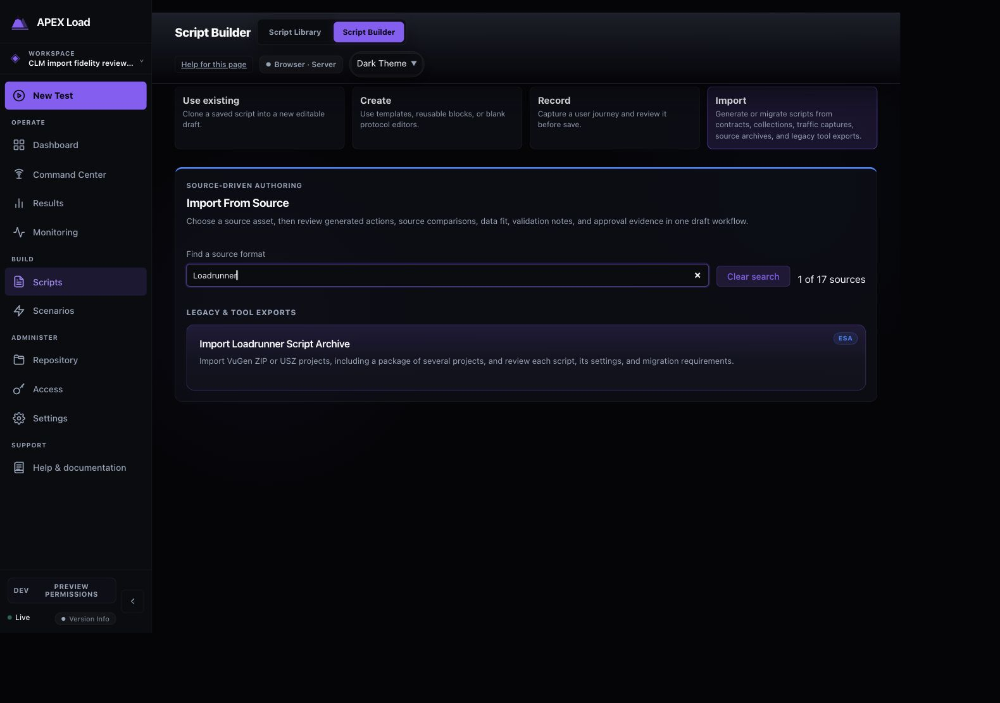

2. **Upload and choose a destination — Good.** The original outer archive is queued with the intended project folder; import checks do not execute it.

   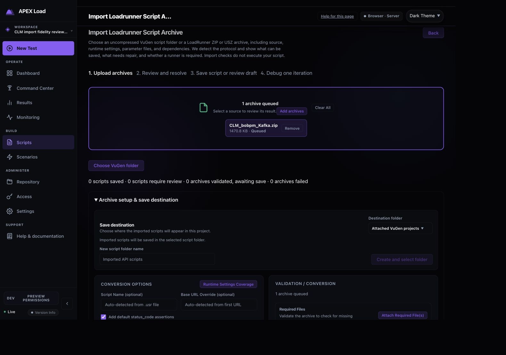

3. **Review independent projects — Good after repair.** All four members receive independent results. The initial capture shows only two rows in the short queue; that observation prompted the project selector now visible in subsequent captures. A synthetic failed-first member exposed and repaired the selector's missing fallback.

   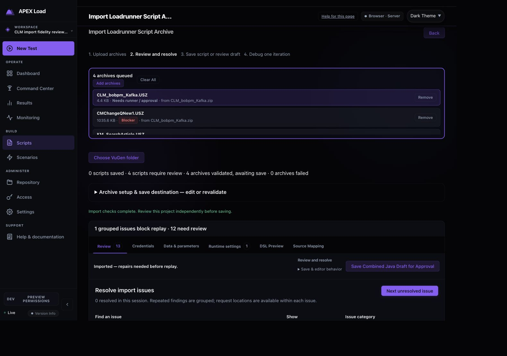

4. **Inspect settings and parameters — Needs review for execution.** The Kafka panel exposes supported counterparts, protected credential binding, and partial batching semantics without advertising automatic native migration. All ten source parameters and seven embedded datasets are conserved. Java runner qualification and TLS migration are explicit preparation requirements.

   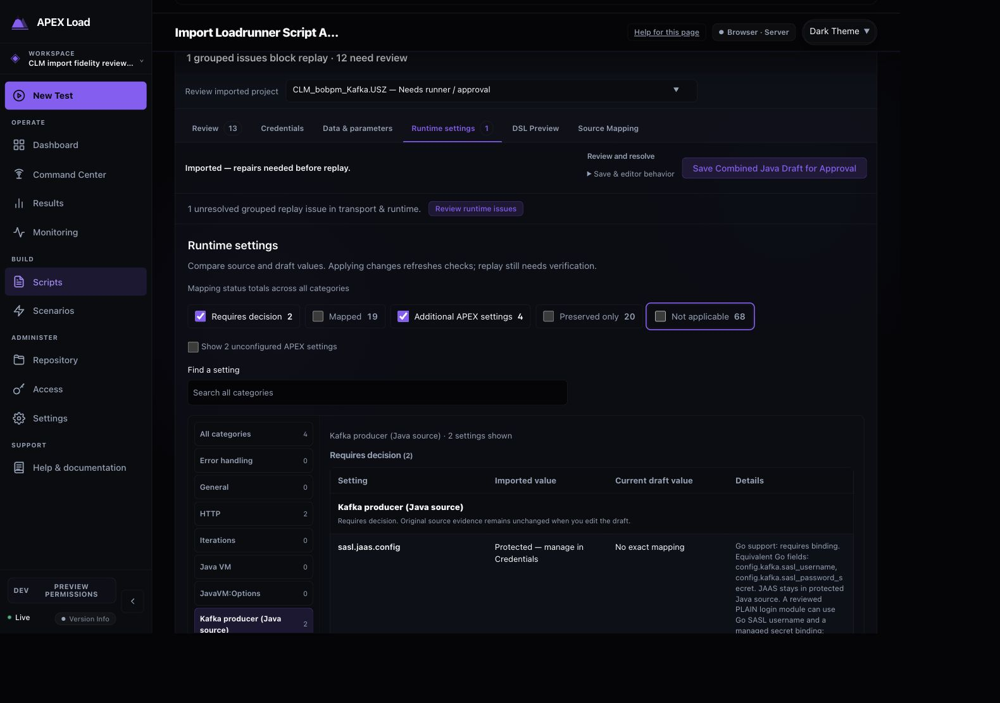

5. **Trace source mappings — Good, with disclosed preview limits.** CMChange shows 1,145 source mappings, zero unsupported mappings, and zero DSL actions without source origin. Its 20 captured files include seven limited or truncated previews; the visible banner explains the bounded display. Source-linked draft metadata retains mapping evidence, and the original archive stays in the private inspection area. The capture predates the readiness repair and shows a superseded CMChange blocker badge; the final saved draft has no structural gate. Mapping counts do not certify byte-for-byte runtime fidelity or complete source retention inside the saved draft.

   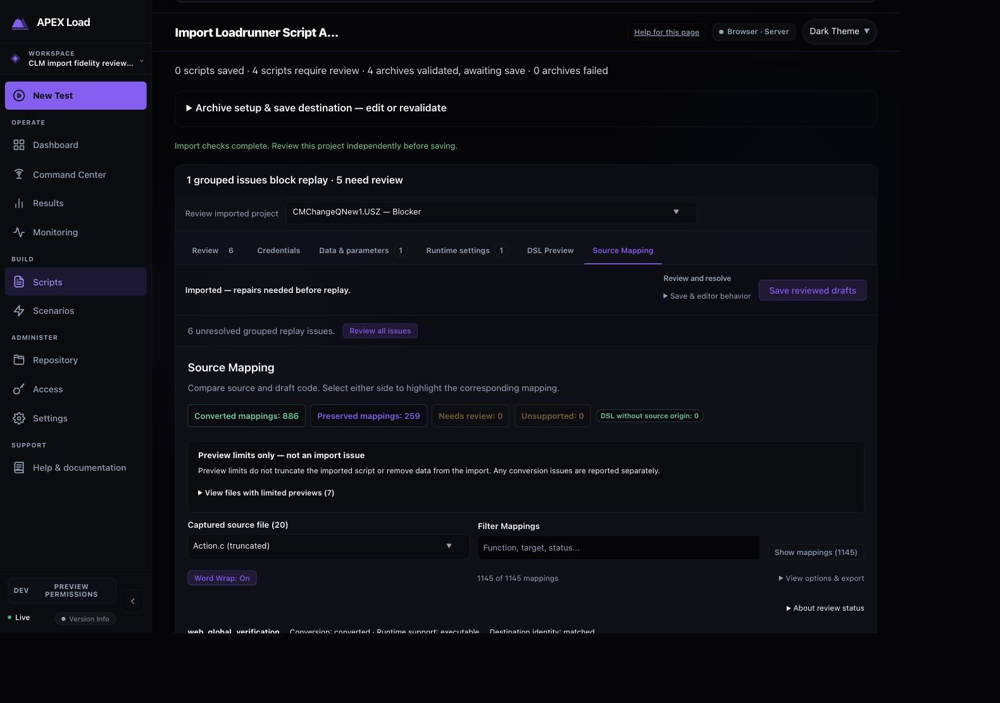

6. **Save the Java review — Good.** The combined project is durably saved as the named `CLM_bobpm_Kafka` authoring session. Runner, dependency, and approval requirements remain attached; no approval or execution action was taken.

   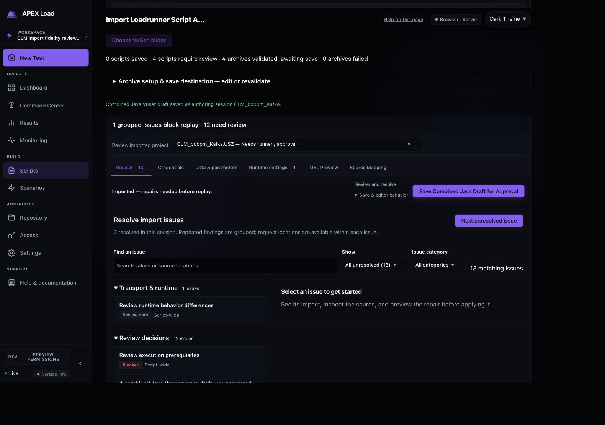

7. **Find and resume the Java review — Good, with discovery friction.** Script Library → Authoring review → `CLM_bobpm_Kafka` → Resume reopens the saved draft and its authoring panels. An earlier generic-name session is retained as before-change evidence. Approval readiness on the queue card concerns draft review; the resumed editor separately shows missing validation/debug evidence.

   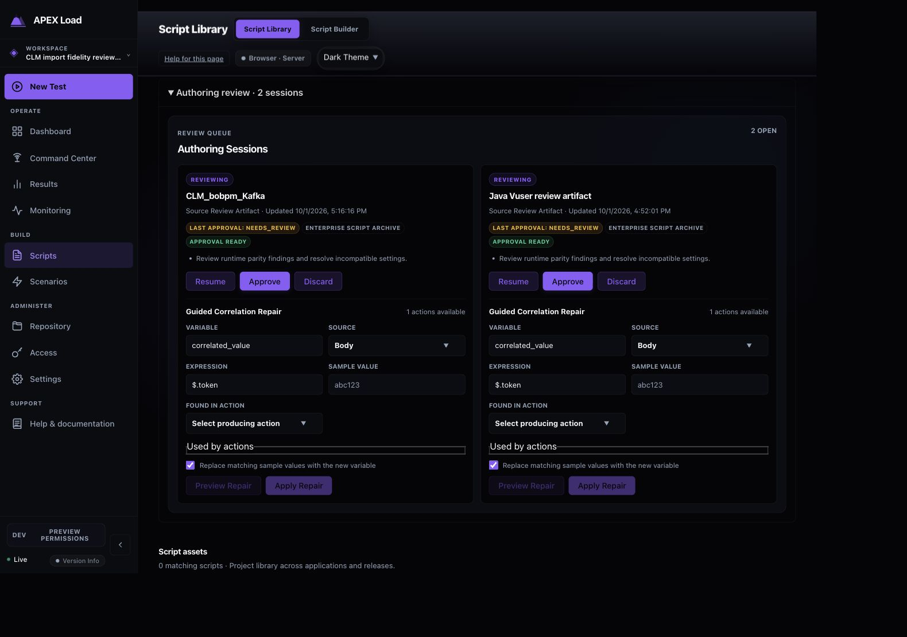

   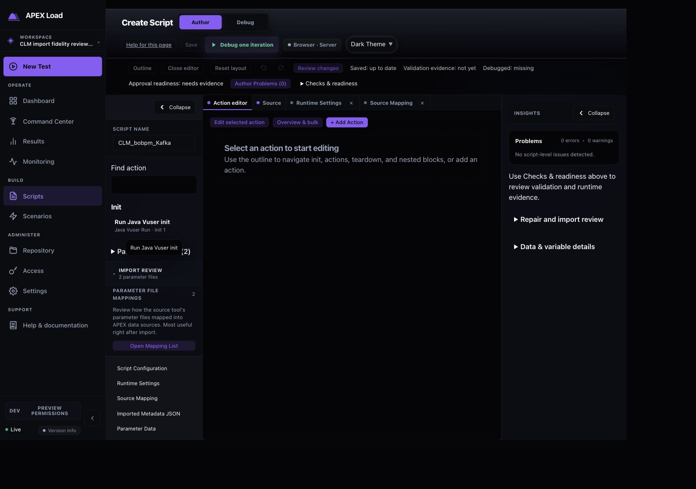

8. **Prepare native web credentials — Failed at the captured attempt; repaired and verified.** Actual CMChange saving exposed a protected-script projection failure. Its initial error appeared only in the hidden Credentials panel; a guarded callback now reports it at the active import surface and clears it on retry. The visible error below records the failure. Exact protected body evidence now reconciles credential binding without changing executable body bytes, and the subsequent native saves complete.

   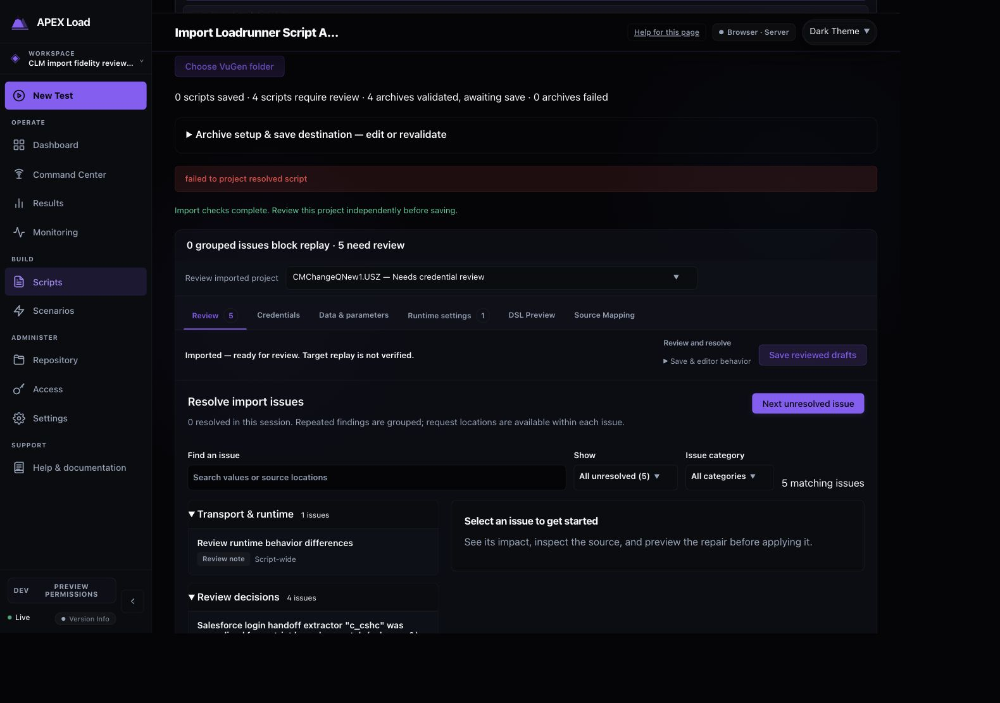

9. **Save the native drafts — Good.** The actual source produces three durably saved library scripts, with per-member Saved states and named editor links. The Java authoring review remains separate from these library-script receipts. KM and C360 retain their legacy TLS migration gates; CMChange has no structural replay gate.

   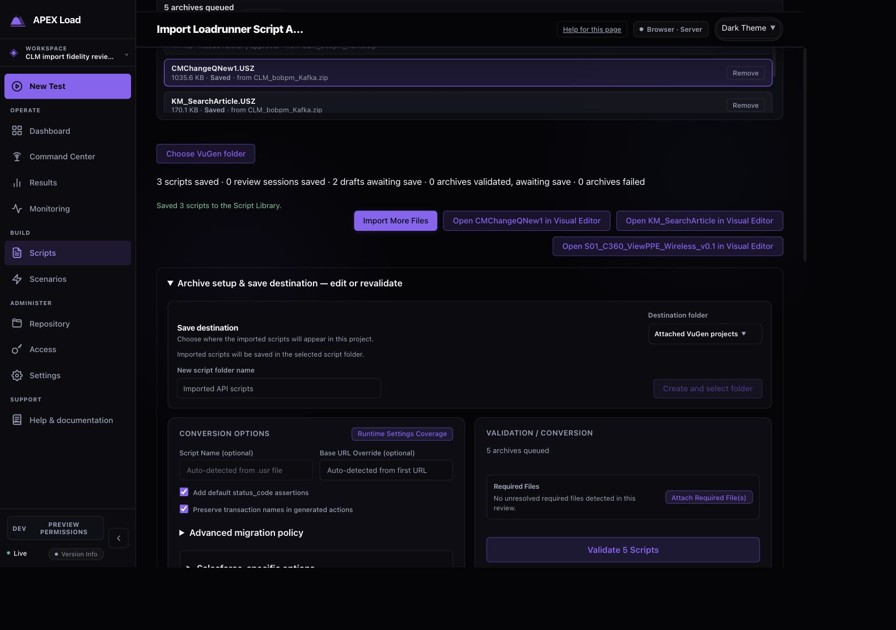

10. **Find and reopen the native drafts — Good; execution needs evidence.** Filtering Script Library to Attached VuGen projects yields all three scripts. Each reopens with “Saved: up to date”; CMChange shows zero authoring problems, and the source review gate remains in KM and C360. Two, two, and four parameters and two, two, and three datasets persist respectively. No Debug action or original-host replay was taken.

   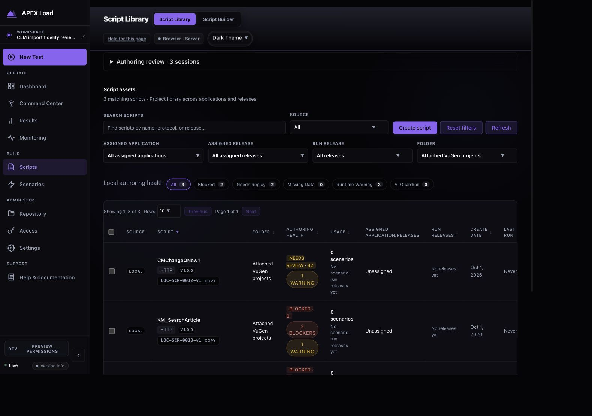

Remaining design findings concern clarity rather than unavailable import evidence: long runner explanations repeat across runtime-property rows; the library's authoring queue is collapsed by default; and a resumed authoring session uses the generic “Create Script” page title. These are opportunities to make durable review completion easier to recognise. They do not imply the original hosts were replayed or that unresolved prerequisites were satisfied.

Keyboard review exercised ArrowRight between the review tabs and End to reach Source Mapping. The labelled native project selector gives the short, scrolling queue an additional route. The original hidden error was a discoverability risk when Credentials was inactive; its active-surface alert repair was verified on the actual source. These checks do not establish screen-reader behavior, contrast compliance, or complete keyboard focus order.

## Verification

The complete dashboard unit run passed 442 files and 4,669 tests. Additional focused queue/count/type-contract checks passed six tests. The dashboard build passed both TypeScript configurations and produced embedded assets; lint passed, including the later focused UI edits. Scrub and script-disclosure package suites passed their new equivalence, credential, bounded-cache, and template-collision checks.

The initial full Go run encountered an embedded-asset compile race when the dashboard build replaced old asset filenames after Go captured them. It was stopped after that known build failure; the completed packages had no assertion failures. The final full gate is synchronized with stable embedded assets and frozen API/performance changes. Its first complete run found a stale HTTP/browser-device golden expectation and an unchanged metrics timing failure. The golden now asserts compatibility-only browser emulation and executable proxy semantics explicitly; focused API/converter regressions pass. The metrics case passes five isolated repetitions without edits. The corrected final full rerun passes all 117 tested packages, including the full API and engine suites, with no failures. No metrics source or test edit was needed.

The first new collection browser test used an ambiguous unanchored locator that also matched the Remove button. The corrected workflow then exposed the missing project selector when its first member failed; that product defect was repaired and verified in both dev-admin and local-auth browser profiles. The final collection workflow, including named review-session save receipts, passes without automatic retries in dev-admin (8.1 seconds) and local-auth (38.3 seconds). The full enterprise-import component file passes 90 tests; additional duplicate-save, revalidation, stale-response, and active-surface-error cases pass. Both post-generation TypeScript configurations and the reviewed controller build pass. The final targeted protected API/collection regression gate passes. Both first failures are retained in [the first-failure log](../../FLAKE_LOG.md) and [browser failure triage](browser-failure-triage.md).

## Evidence limits

Synthetic fixtures use safe `example.test` inputs. The attached archives and raw converted outputs stay in a private local inspection area. Browser screenshots can establish visible result ownership, settings navigation, save confirmation, and reopening; they cannot establish full accessibility compliance or end-to-end application fidelity. Legacy TLS replacement, runner qualification, private identities, proxy/broker availability, external dependencies, timezone policy, DFE semantics, and nested automatic transactions remain explicit limits in the detailed reports.

A private, Git-ignored snapshot under `artifacts/import-reviews/2026-10-01/` retains an online SQLite backup, import storage and its key, destination metadata, and both supplied original archives. Restricted file permissions and SQLite integrity were checked. It preserves the local review results separately from bounded source previews; it does not qualify a production runner.

Final full Go gate: `go test -p 2 -timeout 20m ./...` passes all 117 tested packages. Documentation checks and final whitespace checks pass. The isolated review library remains available at the local dashboard on port 4001, backed by the reviewed controller on port 18091; existing user services were left in place.

## Validation before publication to main

The reviewed task changes were isolated onto main commit `1e4fba788969546ba141a8cdae238aca20179df5`. Independent scope reviews found no remaining actionable findings and confirmed that concurrent diagnostics, analytics, and recorder changes were preserved. The 147-file commit includes task code, synthetic regressions, regenerated contracts, and sanitized review evidence; the original archives, private backup, and unrelated working changes are excluded.

The isolated full Go gate, `go test -p 2 -timeout 20m ./...`, passes all 117 tested packages with no failures. The full dashboard `npm run test:cycle` passes both TypeScript configurations, lint, 445 unit-test files with 4,700 tests, and the production build. Browser workflows pass in both profiles: 180 dev-admin tests with four existing conditional skips, and 100 local-auth tests with one existing conditional skip. No browser retries or failures occurred. Documentation, generated QA freshness, staged-path allowlisting, and whitespace checks pass. These checks validate the integrated import/review implementation and synthetic workflows; no original target host was contacted.
