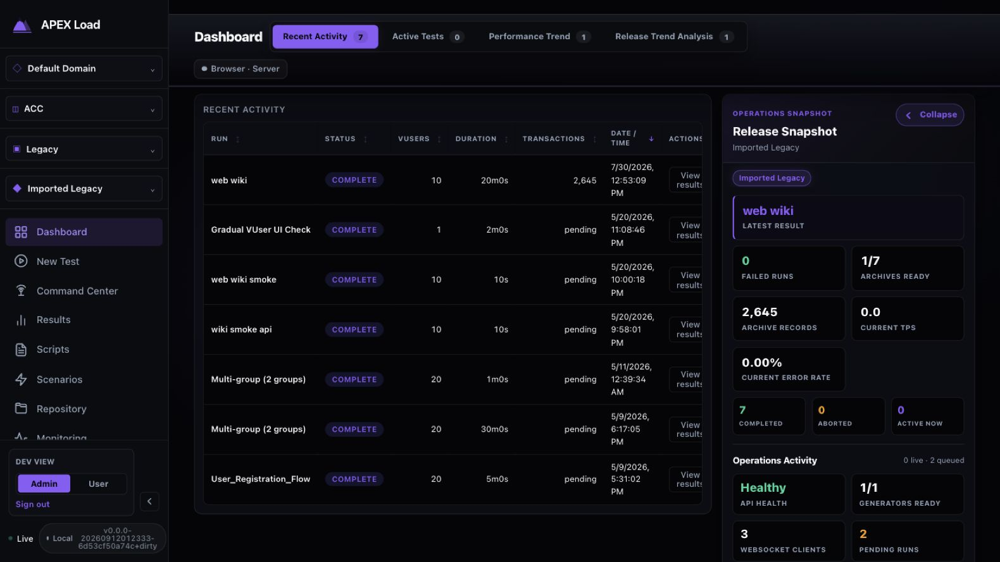
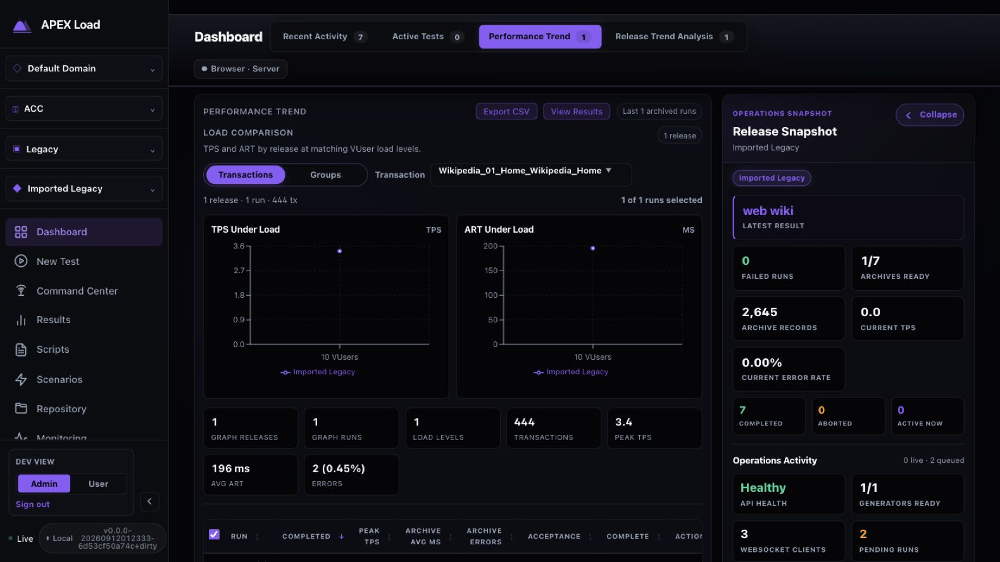
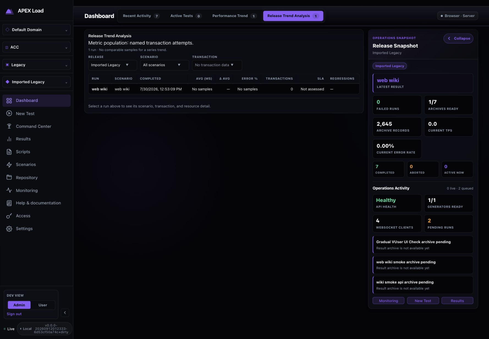
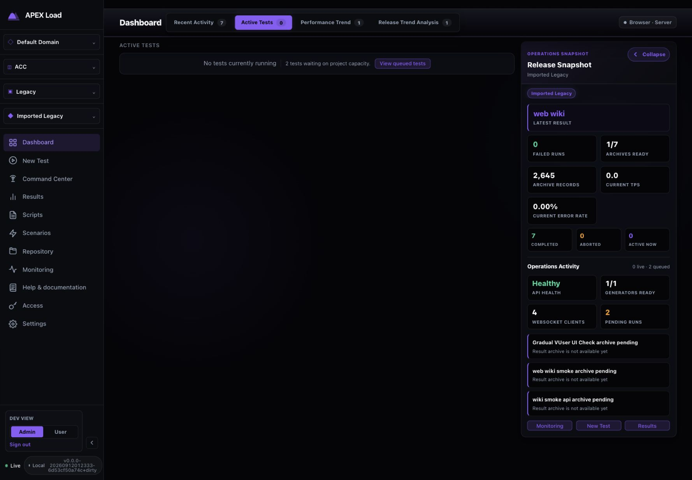
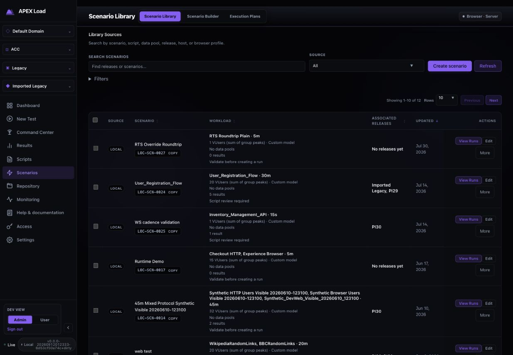
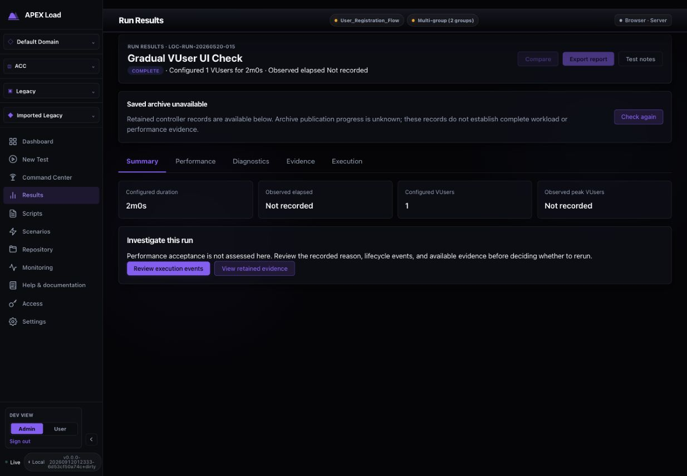
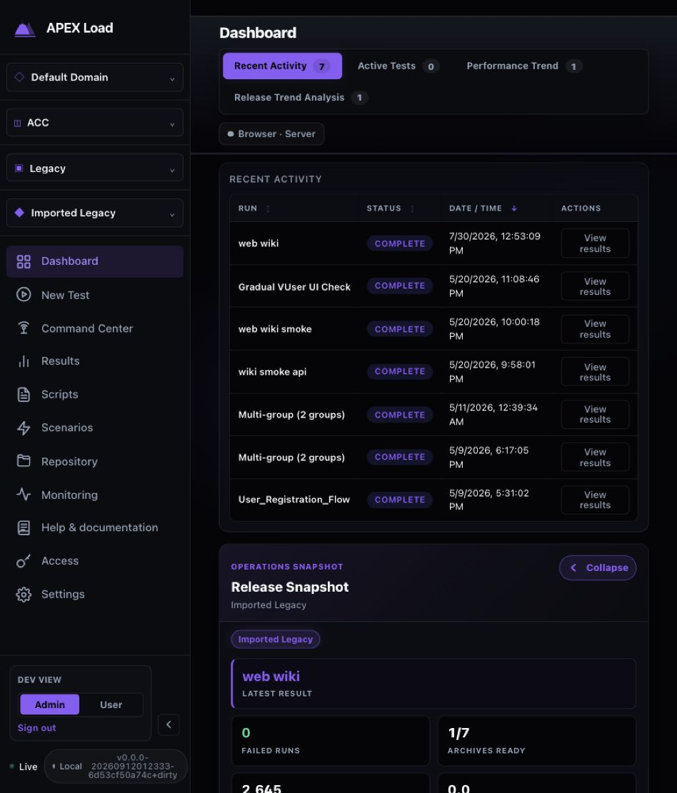

# Dashboard usability and functionality audit

Reviewed September 12, 2026. Scope: the main Dashboard landing page, its four tabs, and immediate navigation to queued work and unavailable results. This is an expert inspection, not a user study or a complete platform validation.

The findings below describe the original inspection. See the [implementation and validation follow-up](IMPLEMENTATION.md) for the subsequent fixes and updated screenshots.

**Verdict: substantial functionality, but only partially effective as an operational landing page.** The page is useful for finding previous runs and entering analysis. It does not yet reliably answer “What needs my attention?”, “Can I trust these results?”, and “What should I do next?” One queue-navigation defect was confirmed.

The evaluation used the running local application in the Codex in-app browser: Default Domain → ACC → Legacy → Imported Legacy, development Admin view. The observed build identified itself as `v0.0.0-20260912012333-6d53cf50a74c+dirty`. Data contained seven completed runs, one archive, no live runs, and two queued runs. Existing legacy data was retained; no runs were started or modified.

## User goals and utility coverage

| User goal | Coverage in this audit | Assessment |
|---|---|---|
| Understand current project/application/release | Four persistent context selectors; selected release repeated in snapshot | Good orientation, but repeated context consumes space. Application versus release scope of individual totals needs clearer labeling. |
| Find a previous run | Sortable history, run-name buttons, explicit result actions | Useful; no local name/status/date filter was visible. Duplicate run names lack a visible distinguishing run ID. |
| Know whether a release is acceptable | Completion status and archive readiness on landing; acceptance and completeness in Performance Trend | Partial. Execution completion is prominent while performance acceptance requires investigation. |
| Respond to queued work | Queue count, empty-state CTA, pending-run card | Partial with a confirmed broken destination from “View queued tests.” |
| Monitor running work | Active Tests tab and live summary metrics | Entry points present. No actual live runs were available to validate charts, updates, or control handoff. |
| Compare performance | Transaction/group selection, load charts, run selection, archive table, release/scenario filters | Substantial functionality; population differences and missing comparison evidence are difficult to interpret. |
| Recover from missing results | Dashboard result links reach retained-record guidance | Good destination, misleading Dashboard wording. |
| Start new work | Persistent New Test navigation and a snapshot shortcut | Present. Creation and execution were outside this read-only audit. |
| Export analysis | Export CSV control visible | Presence verified; download contents and selection scope were not tested. |

## Prioritized findings

### 1. High — “View queued tests” opens Scenario Library

**Evidence:** Steps 4–5. Active Tests said “2 tests waiting on project capacity.” Clicking “View queued tests” opened Scenario Library, showing scenario definitions and editing actions rather than queued runs or capacity reasons.

**Impact:** A user investigating why execution has not begun loses the context of the queue precisely when they need it.

**Recommendation:** Route to a queue view in Command Center with project/application context preserved. Display the two pending runs, wait reason, queue position or reservation state, and relevant capacity information. Use the same destination contract for the empty-state CTA and Pending Runs card.

**Acceptance:** From a Dashboard with queued runs, the CTA opens a view containing those queued run IDs and their current state; it does not land on scenario definitions.

**Source corroboration:** `DashboardPage.tsx` routes the queued empty-state button through `navigateToTests`, which invokes `onNavigate('tests')` (around lines 1260 and 1565). The dedicated `navigateToPendingRun` helper already has Command Center routing.

### 2. High — Attention prioritization hides the actionable queue behind old missing archives

**Evidence:** Steps 1 and 4. All three visible attention entries were archive-pending messages for May runs, while two tests were waiting on capacity. The queue count appeared lower in the operations section. In the narrow view, that section followed the history table below the initial viewport.

**Impact:** Operators must scan history and many statistics before finding work that is blocked now. “Active Tests 0” also gives no indication of the two waiting runs until the tab is opened.

**Recommendation:** Put a concise “Needs attention” block near the top. Prioritize current execution failures, breached acceptance criteria, capacity blockers, and stale telemetry. Group historical evidence gaps into one “6 runs missing archives” item. Provide “View all” when items are truncated, and include queued work in the tab badge or label.

**Acceptance:** With this dataset, the two queued runs are visible without scrolling through archive statistics; six historical gaps appear as one expandable item with an accurate count.

**Source corroboration:** Attention items are appended in sequence, then truncated twice; the snapshot renders only the first three. Historical missing archives are appended before pending-run entries (`DashboardPage.tsx`, around lines 485 and 1207–1245).

### 3. High — “Pending” claims publication progress the product does not know

**Evidence:** Steps 1 and 6. Six completed May runs showed `pending` in Transactions and “Result archive is not available yet” in the snapshot. Opening one of them correctly explained: saved archive unavailable, publication progress unknown, retained controller records available.

**Impact:** Users may wait for evidence that is not known to be publishing. A missing count also occupies a quantitative column without explaining what is missing.

**Recommendation:** Reuse the result page's evidence-state model on the Dashboard. Distinguish Publishing, Available, Unavailable, Publication failed, and Unknown only when backed by recorded state. Show “—” for unavailable counts plus an explicit evidence badge and “Investigate” action. Keep access to retained records.

**Acceptance:** Missing archive metadata alone never produces “pending.” The landing page and result page describe the same run consistently.

### 4. Medium — The landing page emphasizes completion without summarizing acceptance

**Evidence:** Steps 1–3. The landing page shows seven COMPLETE runs, zero Failed Runs, and one of seven Archives Ready. Performance Trend contains an acceptance value of “Not assessed” and completeness of 85% for the archived run, but those qualifiers are not part of the landing summary in the observed Admin view.

**Impact:** “The test finished” is easy to read as “the release performed acceptably.” Users cannot quickly decide whether the release has sufficient evidence for a readiness decision.

**Recommendation:** Add a compact quality summary shared by operational and user views: Passed / Failed / Not assessed, evidence coverage, latest meaningful result, and significant regression against an explicit comparable baseline. Keep execution state separate. For the observed state, use “Acceptance not assessed · archive evidence available for 1 of 7 completed runs.” Do not infer release readiness from missing criteria or incomplete coverage.

**Acceptance:** A run without acceptance criteria is visibly Not assessed on landing; COMPLETE is never presented as an acceptance outcome. Coverage denominators are visible.

### 5. Medium — The trend tabs do not explain why their numbers differ

**Evidence:** Step 2 shows transaction choices and a selected series with 444 transactions, 196 ms ART, and 0.45% errors. Step 3, for the same archived run, states “Metric population: named transaction attempts,” but shows no transaction data, no samples, and zero transactions. The archive table in Performance Trend also reports whole-archive values distinct from the selected series.

**Impact:** Users cannot tell whether the difference is expected population semantics, legacy compatibility, missing instrumentation, or a defect. A single point under “Performance Trend” does little to explain trend direction.

**Recommendation:** Name each population near the numbers: action/request samples, named transaction attempts, group totals, or whole-run archive. Label the first tab “Load Comparison” if that is its principal function. Explain why a run is excluded from a trend and how to collect comparable evidence. When only one comparable run exists, say that a baseline is still needed. Do not silently combine populations.

**Acceptance:** Users can explain the difference between chart totals and run totals from the screen alone. An unavailable named-transaction series includes a specific reason or clearly labeled unknown, plus a next step.

**Limit:** The audit confirms inconsistent user-facing interpretation, not that backend metrics are mathematically wrong. Legacy archives and named transaction evidence may legitimately differ.

### 6. Medium — “Recent Activity” is a completed-run table with limited retrieval tools

**Evidence:** Step 1. The table contains completed runs spanning May–July, without a visible period selector, search, or status filter. Two rows have identical “Multi-group (2 groups)” names. Active and waiting work are elsewhere.

**Impact:** The label suggests a broader activity feed; as history grows, users must sort and scan to locate a specific execution.

**Recommendation:** Either rename it “Recent completed runs” or include lifecycle events with explicit type/status. Offer a compact period and name filter, failure/acceptance/evidence filters, and a link to full Results. Show a short run reference or scenario/release context for duplicate names. Preserve the Dashboard's lightweight role rather than duplicating every Results control.

**Acceptance:** Users can identify a same-named run and narrow results to a chosen period or failure state without manually scanning the full table.

### 7. Medium — Narrow layouts preserve navigation but hide important run facts

**Evidence:** Step 7. At the tested narrow viewport (853 CSS pixels wide under existing browser zoom), VUsers, Duration, and Transactions were hidden. The snapshot moved below history. The expanded navigation used a large share of horizontal space. Tabs reflowed and result actions remained available.

**Impact:** Users lose load context and evidence-gap visibility when the window narrows. Operational urgency moves farther down the page.

**Recommendation:** Preserve a small top summary across breakpoints. Move secondary row metrics into an expandable row or compact details line instead of removing them without a local reveal. Make sidebar collapse easy to discover. Keep result and queue actions in the first useful viewport.

**Acceptance:** All run facts remain discoverable from the row at narrow widths; critical queue/evidence information is available before a long table.

### 8. Medium — Idle, healthy, fresh, and unknown need distinct presentation

**Evidence:** Steps 1 and 4. Current TPS is 0.0 and Current Error Rate is 0.00% while no tests are running. API Health is Healthy, while two runs await project capacity. These states can all be correct, but the page does not explain their relationship or show a visible last-updated timestamp next to them.

**Recommendation:** Use “Idle — no active runs” for live workload cards. Separate API reachability, generator readiness, project capacity, and workload health. Add freshness timestamps and a stale state to individual data sources.

**Source-only follow-up:** Health polling catches errors without visibly invalidating the last health response (`DashboardPage.tsx`, around lines 798–810). Simulate a health-endpoint failure while WebSocket remains connected to verify whether Healthy can remain stale. Also verify scope labels across multiple releases: several counters derive from the application catalog, whereas archive metrics derive from the selected release. This was not confirmed with multi-release data during the browser audit.

## Accessibility and interaction observations

- **Confirmed strength:** The four Dashboard tabs expose selected state; ArrowRight moved keyboard focus and selection from Recent Activity to Active Tests. Run-name actions and sort controls are real buttons, with sort direction in their accessible names. Status includes text rather than color alone.
- **Observed risk:** Small muted labels and purple secondary actions are harder to scan against dark surfaces. This is a visual risk, not a measured contrast-compliance finding. A sampled result button used 12px text and measured approximately 86 × 37 CSS pixels at the narrow viewport.
- **Observed risk:** Repeated “View results” buttons are distinguishable through their table rows but offer weak context in an assistive-technology button list. Include the run name/reference in their accessible names.
- **Observed risk:** Hiding three columns at the narrow breakpoint removes them from the accessibility tree too. Provide an accessible way to reveal those facts locally.
- **Not assessed:** Full screen-reader use, all keyboard paths, chart interaction, tooltip accessibility, all themes, 200%/400% zoom, phone-size reflow, measured contrast ratios, reduced-motion behavior, and live-update announcement frequency. No full accessibility conformance claim is made.

## Captured walkthrough

Every image below was captured during this audit, saved locally, reopened, and inspected. Full-page captures can still contain independently scrolling regions; no screenshot is claimed to expose all content in such regions.

### Step 1 — Open the landing page — mixed

Useful scoped history and result shortcuts. Main issues: status interpretation, old pending labels, and low-priority statistics preceding actionable work.

### Step 2 — Open Performance Trend — useful, interpretation needs work

Load comparison, transaction/group selection, run selection, archive metrics, and CSV entry point are present. A single run cannot establish a trend; chart and archive populations need clearer labels.

### Step 3 — Open Release Trend Analysis — limited by evidence

Filters and explicit no-sample language are useful. The relationship to the populated prior tab and the path to obtaining comparable data are unclear.

### Step 4 — Open Active Tests — partially useful

Correctly reports no running tests and two queued tests; gives a clear CTA. Keyboard tab navigation also worked. Attention prioritization remains weak.

### Step 5 — Follow View queued tests — broken destination

The action lands on Scenario Library rather than showing the queue.

### Step 6 — Follow a result with a missing archive — good recovery

The result page accurately explains unknown publication progress, retained records, and available investigation actions. This is a useful existing pattern to adopt on Dashboard.

### Step 7 — Inspect a narrow landing page — partial reflow

Navigation and actions remain usable, but three run columns disappear and the operational snapshot follows the full table.

## Evidence limits and implementation follow-up

This audit did not create, launch, stop, edit, or delete tests. Live execution, a fresh empty account, other real permission roles, multiple populated releases, outage recovery, CSV contents, and comparison baselines were not exercised. The development User/Admin selector is not evidence of real role enforcement.

Current source and existing tests were read to corroborate behavior and identify follow-up risks. They were not executed. The working tree already contained unrelated changes, and the served build may differ from current source; screenshots establish observed behavior, while source notes identify likely implementation locations. No application source was changed and no build/test cycle was required for this report-only task.

Recommended sequence: fix queue routing and evidence-state wording; elevate queue/quality attention; clarify metric populations; then refine retrieval and narrow-screen presentation. Each functional fix should include browser workflow coverage under the repository's testing policy.
