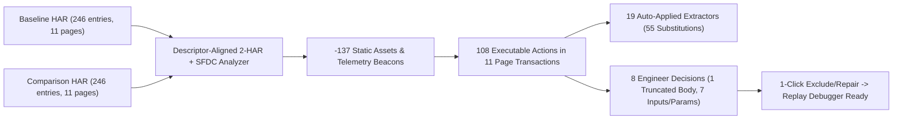

# HAR Import & Two-Salesforce-HAR Comparison UX, Correctness & Accessibility Review (2026-11)

Status: Active Review Record (Review-Only — Zero Application Code Modified)

> [!IMPORTANT]
> **Core Verdict (`2.1 / 5` on Stage 2 Comparison Review; `3 Blockers`, `18 High`, `14 Medium`, `5 Low`, `2 Polish` across 42 independently verified root-cause findings):** Comparing two 88 MB Salesforce Aura HARs (`acme--sandbox3 login 1.har` and `acme--sandbox3 login 2.har`) currently fails both as an **actionable decision surface** and as an **end-to-end authoring-to-debugging pipeline**. Backend Two-HAR diffing and Salesforce Native augmentation are completely disconnected (`SecondaryData` is cleared before Salesforce analysis runs), Stage 2 stacks four uncoordinated widgets across an **`18,088 px` (`20.1×` viewport)** scroll with four conflicting correlation counts (`22` vs `56 / 51 / 3` vs `16` vs `19`) and **51 anonymous `Correlation 1`..`Correlation 51` cards**, `Credentials` is padded with **15 bogus requirements out of 19**, and a single Chrome-omitted 96.7 KB Aura POST body (`actions[93]`, `94 - POST aura`) **deadlocks every UI path to the Replay Debugger** (`DELETE` + Save fails `PUT /api/v1/scripts/{id}` with `HTTP 400`).

## Companion Evidence Package (Local Untracked Artifacts)

Per [`AGENTS.md`](../../../../AGENTS.md) and [`docs/qa/reviews/README.md`](../README.md), raw JSON, standalone HTML, and PNG captures remain untracked on disk beside this Markdown record and are cited below as code-span paths:

- Machine-readable verified findings, scorecards & coverage matrix: `docs/qa/reviews/har-comparison-ux-2026-11/audit.json`
- Interactive standalone HTML report, filterable finding explorer & **APEX Correlation Studio** redesign prototype: `docs/qa/reviews/har-comparison-ux-2026-11/audit.html`
- Redacted API reconciliation, walkthrough scroll/click telemetry, 8-state × RBAC matrix & 105-scan (`21 views × 5 themes`) `axe-core` evidence: `docs/qa/reviews/har-comparison-ux-2026-11/interaction-evidence.json`
- 114 empirical screenshots across all 5 themes, 3 roles, 8 UI states, and `1280×800 @ 200%` zoom: `docs/qa/reviews/har-comparison-ux-2026-11/screenshots/`

---

## 1. Executive Diagnosis: Why Two-HAR Comparison Feels Like a Data Dump

An experienced LoadRunner Enterprise / VuGen performance engineer comparing two recordings of the same Salesforce login flow wants answers to **four concrete questions** within 60 seconds:
1. **What changed between Recording 1 and Recording 2, and is each dynamic token already correlated?**
2. **Which user/business inputs (`username`, org/app/record IDs, per-request UUIDs) still need parameterization for multi-VUser load?**
3. **Are any recorded requests broken, truncated by Chrome HAR export, or failing inside HTTP-200 Aura envelopes?**
4. **Can I save, verify one iteration in Replay Debugger, and trust the script?**

Instead, the current Stage 2 `Review` tab (`18,088 px` tall at `1440×900`) dumps four disconnected layers of raw converter telemetry without reconciling them:

| Stage 2 Surface | What It Renders Today on the 2-Salesforce-HAR Pair | Why It Fails Actionability | Related Findings |
| --- | --- | --- | --- |
| **1. `Resolve import issues` (16 items)** | 4 `Blocker` + 12 `Review` rows; 3 of the 4 `Blocker` rows are passive inventory strings (`my.salesforce.com (155 requests)`, `lightning.force.com (193 requests)`, `56 correlations across 4 families`), and 12 rows repeat the identical title `Salesforce correlation review required`. | Paradoxically scores **Salesforce Native (`4 blocking`) as worse than broken Force Generic HAR (`1 blocking`)**, nudging engineers toward a mode that hardcodes stale `aura.token` across 52 POSTs. | `HAR-UX-09`, `HAR-UX-02` |
| **2. `HAR Artifact Review`** | `Two-HAR diff: 7 dynamic, 15 static`, followed by an unstyled 5-row table (`harDiff.classifications.slice(0, 5)`). | Silently hides **17 of 22** diffed tokens (including 2 dynamic ones), omits `unhandled_inputs` in `ProtocolAssetImport.tsx` (or slices 5 of 7 in `ScriptImportReview.tsx`), and never feeds `SecondaryData` into Salesforce Native correlation (`1-HAR` and `2-HAR` Native DSL drafts are **byte-for-byte identical**). | `HAR-UX-06`, `HAR-UX-07` |
| **3. `Salesforce Native Review`** | Reports `349` domain requests (`193 + 155 + 1`, omitting `c.salesforce.com`) right above `Transport` (`107` requests), plus `stats.correlations = 16` and `stats.assertions = 110`. | Sums `109` converted actions + `246` raw HAR entries (`349` requests from a 246-entry HAR!) and displays pre-augmentation stats (`16` / `110`) when the actual DSL has **`19` extractors and `162` assertions**. | `HAR-UX-08`, `HAR-UX-09` |
| **4. `Captured correlation evidence`** | 51 stacked cards titled **`Correlation 1` .. `Correlation 51`** with source/target step indices that disagree with the Visual Editor outline. | `correlationEvidenceAdmission.ts` strips disclosure-safe variable `name`, `rule_id`, `source`, and `expression` on the frontend, turning 51 correlation occurrences into an unreadable 14,000 px wall of anonymous cards. | `HAR-UX-08`, `HAR-UX-16` |

---

## 2. Salesforce Aura / Lightning & Chrome v130+ Recording/Replay Completeness

Evaluating the end-to-end pipeline against real-world Salesforce Lightning / Aura replay mechanics surfaced six structural domain gaps:

1. **Chrome / Edge v130+ Sensitive-HAR Sanitization & >64 KB POST Body Truncation (`HAR-UX-01`, `HAR-UX-02`, `HAR-UX-29`)**:
   - Beginning in Chrome 130, default `Export HAR (sanitized)` strips `Cookie`, `Set-Cookie`, and `Authorization` headers unless the user first enables `DevTools Settings -> Preferences -> Network -> Allow to generate HAR (with sensitive data)` and then **long-presses** the export button to pick `Export HAR (with sensitive data)...`. Chrome DevTools also omits large request bodies (`actions[93]` / HAR entry 215 `PlatformStateManager` POST, `Content-Length: 96,719`, `postData.text` omitted).
   - APEX Load provides **zero pre-flight Chrome 130+ guidance**, **no direct handoff to APEX Recording Studio / Recording Agent** (which captures full bodies and cookie chains natively), falsely reports `Variable readiness: Passed` on `Set-Cookie: (?:__Host-)?ERIC_*` when 0 `ERIC_*` cookies exist in the HAR (`on_miss: "fail"` aborts replay at `actions[16]` `/one/one.app` instead of extracting `auraConfig.token` from the `/one/one.app` HTML bootstrap response), and **deadlocks** when the user tries to delete `actions[93]`.
2. **URL-Encoded `aura.context` JSON Splicing (`HAR-UX-02`)**:
   - Salesforce `/aura` POST bodies are `application/x-www-form-urlencoded` (`message=%7B...%7D&aura.context=%7B...%7D&aura.pageURI=...&aura.token=...`). Native mode substitutes raw unencoded JSON `{{var.corr_salesforce_aura_loaded}}` (`{"APPLICATION@markup://one:one":"..."}`) directly inside percent-encoded `aura.context=%7B...%7D`, producing malformed form encoding on replay.
3. **The Same-Day / Same-User Two-HAR `static (40%)` Trap (`HAR-UX-06`, `HAR-UX-13`)**:
   - Because `login 1.har` and `login 2.har` were recorded minutes apart against the same sandbox build by the same user, `aura.context.fwuid` and `loaded` are identical in both HARs and classified by raw Two-HAR diff as `static (40%)`. In Salesforce performance testing, hardcoding `fwuid` works today and breaks immediately after the next Salesforce patch/seasonal release with `AuraClientInputException` / `ClientOutOfSync`. Worse, uploading the **same** HAR twice (`HAR-UX-13`) gives zero warning and misclassifies all 7 dynamic session tokens (`sid`, `frontdoor_sid`, `cshc`, `lm`) as `static (40%)`.
4. **Aura Boxcarring Drift Across Recordings (`POST /aura?r=<counter>`) (`HAR-UX-06`, `HAR-UX-15`)**:
   - Lightning batches multiple `Controller/ACTION$method` sub-actions into a single `POST /aura?r=<counter>` (`message={"actions":[...]}`), and batching boundaries shift between recordings. Pairing `/aura` requests by query-key-set (`r=&ui-...`) misaligns shifted sub-actions, while Visual Editor names all 53 Aura steps `17 - POST aura`..`108 - POST aura` and renders raw percent-encoded `message=%7B%22actions%22...` blobs instead of `Controller$method` descriptors.
5. **HTTP-200 Aura Soft Errors & Unfiltered `InstrumentationBeacon` Telemetry (`HAR-UX-02`, `HAR-UX-03`, `HAR-UX-28`)**:
   - Aura returns HTTP `200 OK` even when envelopes fail (`/*ERROR*/`, `AuraInvalidToken`) or individual boxcarred actions return `state: "ERROR"` (entry 235 / Request 102 has 2 sub-action errors). Native mode injects `aura_actions_success` checks (`Force Generic HAR` drops all 52!), but `AuraOutcomeReview` hides the failing `Controller$method` and prints `Unrecognized inspection diagnostic` (×3) for `request_body_not_captured`. Meanwhile, browser telemetry (`InstrumentationBeacon.sendData`, `actions[96]`) is kept as a load step and generates 8 bogus secret bindings.
6. **Desktop Form Login Missed Into Main Loop (`HAR-UX-10`)**:
   - Desktop login (`un` / `username` / `pw` to `test.salesforce.com` at `actions[0]` & `actions[3]`, followed by `frontdoor.jsp?sid=...` SSO handoff) is missed by `findSalesforceSignIn`, leaving login inside `actions[]` (`init: []`), generating `parameters: []`, and burying `username` beneath 33 `DNT`/`sec-ch-ua*` headers in `Data & parameters (41)`.

---

## 3. `/frontend-design` & `/dataviz` Redesign Blueprint: APEX Correlation Studio

To replace the `18,088 px` data dump with an authoritative LRE/VuGen-grade engineering workbench, Stage 2 and Stage 3 should adopt a **funnel-first, decision-driven architecture**:

### 3.1 Proposed Stage 2 Compact Header & Reconciled Correlation Decision Table

1. **Compact Sticky Stage 2 Toolbar (`<= 88 px`, replacing `~340 px` of repeated form chrome — fixes `HAR-UX-30`)**:
   - Inline editable **Script name** (renames in-memory draft without re-uploading 176 MB — fixes `HAR-UX-14`), explicit **Profile segmented switch** (`Salesforce-aware HTTP (Recommended)` vs `Generic HAR` with confirmation if edits exist — fixes `HAR-UX-09`, `HAR-UX-31`), compact **Save destination** popover (`Project / Folder`), and primary **`Save and open in Visual Editor`** CTA.
2. **Single Reconciled Capture & Correlation Funnel Strip (fixes `HAR-UX-08`, `HAR-UX-09`)**:
   - `246 HAR entries (×2 recordings) -> 138 filtered (static assets + InstrumentationBeacon) -> 108 actions across 11 transactions -> 19 extractors wired (55 consumers) -> 1 replay blocker & 7 parameterization decisions`.
   - Conditional **Chrome v130+ Sanitized/Truncated HAR Callout** whenever cookies are stripped or `har_request_body_not_exported` fires, with **`Exclude Step 94 now`**, **`How to export sensitive HAR in Chrome 130+`** disclosure, and **`Record in APEX Recording Studio`** link (`HAR-UX-01`, `HAR-UX-29`).
3. **Unified Two-HAR Correlation & Input Decision Table (replaces `Resolve import issues` + `HAR Artifact Review` + `Salesforce Native Review` + `Captured correlation evidence` — fixes `HAR-UX-06`, `HAR-UX-07`, `HAR-UX-08`)**:
   - Filter pills with exact counts (`Needs decision (8)`, `Auto-correlated (19)`, `Same-day SFDC rules (3)`, `Unhandled dynamic inputs (7)`, `All (29)`), sticky `thead` (`HAR-UX-39`), and rows grouped by **Salesforce Lifecycle Phase**:
     - **Phase 1 — Identity & Frontdoor SSO**: `username` (`Same user in both HARs` -> 1-click `Parameterize {{param.username}}` + move login to `init[]`), `corr_salesforce_frontdoor_sid` (`Changed 95%` -> `Auto-correlated`), `corr_sid`, `corr_salesforce_cshc`.
     - **Phase 2 — Lightning Bootstrap (`/one/one.app`)**: `corr_salesforce_aura_token` (`HTML auraConfig.token + ERIC_* fallback -> 52 Aura POSTs`), `corr_salesforce_aura_fwuid` & `corr_salesforce_aura_loaded` (badged **`Same-day static -> Correlated by SFDC release rule`** with URL-encoded substitution).
     - **Phase 3 — Boxcarred Aura Business Actions (paired by `Controller$method`, not `r=` index)**: 18-char Salesforce Entity/App IDs (`06m...`, `005...` -> `Parameterize` or `Keep constant`), plus inline badges on any step with recorded HTTP-200 `state: "ERROR"` naming the failing `Controller$method` (`HAR-UX-28`).
     - **Phase 4 — Per-Request Client Counters & UUIDs (`unhandled_inputs`)**: `r` / `aura.num` (`Sequence counter`), `x-sfdc-request-id` / telemetry nonces (`Use {{fn.uuid()}}` or `Ignore`).
4. **Stage 3 Visual Editor Aura Envelope Inspector (`HAR-UX-15`)**:
   - Outline steps grouped into collapsible HAR page transactions and labeled `18 - POST aura (OneController$getCurrentApp +3)`.
   - `ActionBodyWorkspace` adds a structured **Aura Envelope** view (alongside **Raw wire body**) decoding `aura.token`, `aura.context` JSON, and a table of `message.actions[]` (`id`, `Controller$method`, decoded `params` JSON) that round-trips cleanly back to URL-encoded form format.

---

## 4. Methodology & Independent Verification Ledger (Step 7)

- **5 Parallel Specialist Passes** ran against isolated preview stacks (`dev-admin` UI `:4000` -> controller `:8099`; `local-auth` UI `:4001` -> controller `:8097` across System Admin, Editor, Viewer, and Domain Feature Policy overrides) without touching the developer workstation's `:8080` process, producing **76 raw findings** and **114 screenshots**.
- **Root-Cause Consolidation** merged all overlapping findings sharing a root cause into **42 canonical candidates (`HAR-UX-01` .. `HAR-UX-42`)**, listing every affected route, component, and Go/TS/CSS `file:line` under each entry.
- **Independent Adversarial Verification (Step 7)**: A separate fresh subagent that authored **zero** findings independently reproduced every candidate against source code, live Go API calls, live headless Playwright + `axe-core`, and visual inspection of 18 high-risk PNG screenshots (`raw_secrets_visible: false`).
  - **Kept**: `42 of 42` (`0` dropped — every merged candidate had a reproducible core defect).
  - **Downgraded**: `4` findings after live adversarial testing proved partial workarounds exist:
    1. `HAR-UX-04` (`Blocker` -> `High`): Live Playwright testing proved CodeMirror's `Escape` then `Tab` / `Shift+Tab` *does* exit editable JSON (`escapeThenTabExitedCm: true`), so under WCAG 2.1.2 it is an *undisclosed non-standard exit + accidental `Tab` script mutation* (`High`), not an inescapable trap.
    2. `HAR-UX-05` (`Blocker` -> `High`): Live DOM geometry proved Stage 2 `DSL Preview` scrolls via window `PageDown`/`ArrowDown`, Stage 2 `Source Mapping` auto-scrolls mapped rows via `.source-map-table`, and Stage 3 `Author -> DSL` follows outline selection or `Edit JSON`, leaving `Imported Metadata JSON` and unmapped `Source Mapping` lines without direct keyboard scroll (`High`).
    3. `HAR-UX-19` (`High` -> `Medium`): `.debugger-resizer-vars` IS keyboard-operable via `ArrowLeft`/`ArrowRight` despite its unclamped initial `aria-valuenow="1040" > aria-valuemax="952"`, and the 280 px default Author outline rail leaves all steps readable.
    4. `HAR-UX-23` (`High` -> `Medium`): `Cmd/Ctrl+B` works globally in Author and Debug, gutter click and double-click work, and `F9` works when a Debug outline `treeitem` is focused.
  - **Sub-Claim Refinements (`8`)**: Documented `HAR-UX-01`'s raw-JSON dual-key (`execution_blocker` + `execution_blockers`) workaround; refined Generic-mode `/aura` secret bindings from `+52` to `+50` (`69` vs `19`) in `HAR-UX-02`; clarified `ScriptImportReview.tsx:2686` slices `5 of 7` `unhandled_inputs` while `ProtocolAssetImport.tsx` omits all 7 (`HAR-UX-07`); pruned an inaccurate `swagger.yaml` sub-claim and fixed `pkg/convert/sample/sourceview.go:30-43` in `HAR-UX-16`; recorded live-measured `1.47:1` contrast on active `Word wrap: On` in `solarized-dark` (`HAR-UX-17`); and pruned a false-positive `LinkedCodePane` Stage 2 sub-claim from `HAR-UX-18`.
  - **Historical Defect Ledger Cross-Check**: Zero open items from [`docs/qa/DEFECTS.md`](../../DEFECTS.md) were re-reported. Four findings represent **regressions or incomplete fulfillments** of closed September 2026 items in [`docs/archive/qa-reviews/AUDITS_2026-09.md`](../../../archive/qa-reviews/AUDITS_2026-09.md) and explicitly cite the original audit (`HAR-UX-12`, `HAR-UX-14`, `HAR-UX-27`, `HAR-UX-30`/`HAR-UX-31`).

---

## 5. Verified Findings Catalog (`HAR-UX-01` – `HAR-UX-42`)

### `HAR-UX-01` [Blocker] — End-to-end execution-blocker deadlock on Chrome unexported-body Aura POST (actions[93] '94 - POST aura'): no Stage 2 exclusion or Stage 3 guided repair, body edits leave dual blockers stuck, Debug 'Problems 2' hides pre-run blockers, and deleting the action fails PUT /api/v1/scripts/{id} with HTTP 400

- **ID**: `HAR-UX-01` (merged from `COR-01`, `EOU-01`, `EOU-11`)
- **Severity**: `Blocker`
- **Axis**: Correctness & Ease of Use
- **Area + Route**: Stage 2 Import Review (#/scripts?mode=import&launcher=traffic_har) -> Stage 3 Visual Editor (#/scripts?mode=edit&scriptId=...) -> Stage 4 Replay Debugger (Debug tab & Problems drawer)
- **Theme / Role / Viewport**: All 5 themes · Admin & Editor (dev-admin & local-auth) · All viewports (verified 1440×900)
- **Occurrences (Merged Root-Cause Locations)**:
  - Stage 2 Review tab: 'Open draft in Visual Editor' omitted when savedResult is null; no per-step exclude/remove toggle despite remediation instructing 'or remove this step' (ScriptImportReview.tsx, ProtocolAssetImport.tsx)
  - Stage 3 Visual Editor (Author): ScriptBlockerRepairPanel offers 0 repair actions; ActionEditor and ScriptOutlineTree lack a Delete Step action; editing actions[93].body leaves both metadata.execution_blocker (singular) and metadata.execution_blockers (plural) intact
  - Stage 3 Overview & bulk -> Action List -> Remove + Save: PUT /api/v1/scripts/{id} fails with HTTP 400 'failed to validate credential-preserving update' because RestoreServerOwnedImportSecurityMetadata (pkg/internal/importreview/persistent_import_preserved_update.go:61-93, 145-149) reattaches ImportPreservedCredentialTargetsMetadataKey by positional index onto shifted actions[93..107]
  - Stage 3 Overview & bulk -> Full Script JSON: clearing visible execution_blockers array still leaves replay blocked due to hidden singular execution_blocker (pkg/internal/importreview/replay_review_gates.go:108-116, pkg/convert/sample/har_request_length.go:20, 125-145)
  - Stage 4 Replay Debugger: Debug & Step buttons disabled by replayStartGate.ts while opening 'Problems 2' displays 'Run a debug iteration or validate the script to populate problems' instead of listing the 2 active step-94 blockers (ScriptEditor.tsx / ScriptReplayDebuggerView.tsx)
- **Repro Steps**:
  1. Import 'acme--sandbox3 login 1.har' (+ 'login 2.har') in project 'Correctness Audit' and click 'Save and open in Visual Editor'.
  2. Select step '94 - POST aura' (actions[93]): observe no guided repair button exists.
  3. Enter a valid Aura form body on '94 - POST aura' and click Save (PUT 200): observe 'Resolve 2 blockers' remains stuck and Debug refuses to start.
  4. Delete step '94 - POST aura' and click Save: observe PUT /api/v1/scripts/{id} fails with HTTP 400 'failed to validate credential-preserving update'.
  5. Import `acme--sandbox3 login 1.har` + `acme--sandbox3 login 2.har` via HAR Traffic (`Inspect & review`). Note blocker on step 94 (`har_request_body_not_exported`: 96,719-byte POST body omitted by Chrome HAR export) instructing the user to "Re-capture the request with its body... or remove this step."
  6. Observe Stage 2 provides no action to exclude/remove step 94 and no "Open draft in Visual Editor" button — only "Save and open in Visual Editor" and "Save draft". Click "Save and open in Visual Editor".
  7. Switch to `Debug` mode: execution is blocked by `Resolve 2 blockers`. Click `Resolve 2 blockers` -> jumps to `Author` -> `94 - POST aura` -> `ScriptBlockerRepairPanel`, which says "no guided repair applies to this blocker" with zero buttons. Note neither `ScriptOutlineTree` nor `ScriptEditorActionEditor` has a Delete button.
  8. Open `Overview & bulk`, filter `Find action` to `94 - POST aura`, click `Delete action` (`✕`) so `Author Problems` drops from `2` to `0` (`108 steps`), then click `Save` or `Save and debug` (reproduced both with default `Preserve imported values` and with Stage 1 `Scrub sensitive fields` checked).
  9. Open saved script `799ef3b9-d39d-5cbc-9f49-6b9198a80bc7` in Visual Editor and click `Debug`.
  10. Observe topbar red button `Resolve 2 blockers` and bottom drawer tab `Problems 2`. Click `Problems 2`.
- **Expected vs Actual**:
  - **Expected**: Must prevent: Complete workflow deadlock: an operator importing real Chrome-exported Salesforce HARs cannot run Replay or the Replay Debugger via any Visual Editor UI workflow. When Import Review explicitly advises "or remove this step", the engineer can exclude/remove step 94 either directly in Stage 2 Import Review or via a 1-click "Remove blocked step" action on `ScriptBlockerRepairPanel`, save cleanly in <1s, and start `Replay Debugger` (where step 1 would then execute and report the unreachable sandbox host diagnosis). When `Problems 2` carries badge `2` and replay is blocked, opening `Problems 2` lists both blocking step issues (`Step 94 - POST aura: har_request_body_not_exported`, `salesforce_aura_request_requires_review`) with inline jump/exclude actions.
  - **Actual**: har_cause: Chrome DevTools HAR export omitted postData on HAR 1 entry 215 (POST /aura?r=46 PlatformStateManager.getActionOverrides, Content-Length: 96,719). sample.Convert emits actions[93] ('94 - POST aura') with BOTH singular metadata.execution_blocker='har_request_body_not_exported' AND plural metadata.execution_blockers=['har_request_body_not_exported', 'salesforce_aura_request_requires_review']. | **UI:** ProtocolAssetImport forces 'Save and open in Visual Editor' (commit-batch -> 201). In ScriptEditor (screenshot c2-editor-action94-blocker-deadlock.png), ScriptBlockerRepairPanel renders raw fallback titles ('Har request body not exported', 'Salesforce aura request requires review') and states 'Needs a source change or re-import. Correct the source and import it again; no guided repair applies to this blocker.' **API:** 1) Supplying actions[93].body via PUT /api/v1/scripts/{id} returns 200 but does not clear execution_blocker or execution_blockers (POST /debug/sessions -> 400 script_replay_blocked). 2) Deleting actions[93] via PUT /api/v1/scripts/{id} returns HTTP 400 {'error': 'failed to validate credential-preserving update'} even after binding all 19 secret_binding_requirements! 3) Even Raw-JSON deletion of metadata.execution_blockers still fails POST /debug/sessions with 400 unless hidden singular metadata.execution_blocker is also deleted. Deleting `actions[93]` (`94 - POST aura`) shifts `actions[94..108]` to `actions[93..107]`. On `PUT /api/v1/scripts/:id`, `RestoreServerOwnedImportSecurityMetadata` (`pkg/internal/importreview/persistent_import_preserved_update.go:61-93`) copies `priorTargetsByPath[ref.Path]` by positional array index onto the shifted actions, causing `ProjectScriptRequestBodies` (`pkg/internal/importreview/script_projection.go:125`) / `MaskScriptSecrets` (`persistent_import_preserved_update.go:145-149`) to fail after 30.2–31.3 seconds with `failed to validate credential-preserving update`. The script can never be saved or debugged. `Problems 2` renders an empty state: `"0 runtime failures · 2 validation/editor issues. Validation and editor issues remain visible in the Author inspector. [Validate] Run the script to check runtime behavior."` — instructing the user to "Run the script" when the Run button is literally locked out by those 2 issues! Note: Only an undocumented expert raw-JSON edit in Author -> DSL -> Edit JSON that populates actions[93].body AND simultaneously deletes BOTH singular metadata.execution_blocker and plural metadata.execution_blockers without deleting actions[93] allows PUT /api/v1/scripts/{id} (200) and POST /api/v1/scripts/{id}/replay/sessions (200); every structured UI edit, repair, or delete path deadlocks.
- **Screenshot Path(s)**: `docs/qa/reviews/har-comparison-ux-2026-11/screenshots/c2-editor-action94-blocker-deadlock.png`, `docs/qa/reviews/har-comparison-ux-2026-11/screenshots/w1-12-visual-editor-author.png`, `docs/qa/reviews/har-comparison-ux-2026-11/screenshots/w1-14-debugger-blocked-gate.png`, `docs/qa/reviews/har-comparison-ux-2026-11/screenshots/w1-15-debugger-running-failure-diagnosis.png`
- **Specific Recommended Change**: 1) Key ImportPreservedCredentialTargetsMetadataKey restoration in RestoreServerOwnedImportSecurityMetadata (persistent_import_preserved_update.go:61-93) by a stable server-assigned action UUID (or content-matched surface identity) rather than mutable slice index ref.Path ('actions[94]', 'actions[96]'), and drop credential-preserving mode once all secret_binding_requirements are bound to {{secret.*}}. 2) Add guided repair operations on stored scripts for har_request_body_not_exported / salesforce_aura_request_requires_review: 'Remove non-essential request' (delete_action) and 'Use authored request body & clear blocker' (clearing both singular execution_blocker and plural execution_blockers once body is non-empty). 3) Map human-readable titles in importReviewIssues.ts:issueTitle(). (1) Backend (`pkg/internal/importreview/persistent_import_preserved_update.go:61-93, 187-230`): Key `ImportPreservedCredentialTargetsMetadataKey` restoration and preserved-credential edit validation by stable per-action identity (e.g. `action.ID` / durable import step key) rather than positional slice index `actions[i]`, so deleting an unexecuted/blocked step never corrupts sibling actions' credential locators; also memoize/skip re-projecting unchanged `importReviewEvidencePreservedKeys` payloads to eliminate the 30s save stall. (2) Stage 2 UI (`ScriptImportReview.tsx` / `ImportIssueWorkspace.tsx`): Allow excluding/disabling blocked steps (`har_request_body_not_exported`) directly in Stage 2 before initial save. (3) Stage 3 UI (`ScriptBlockerRepairPanel.tsx:96-148`, `ScriptEditorActionEditor.tsx`, `ScriptOutlineTree.tsx`): Add a 1-click "Remove this step" / "Comment out step" guided repair button on `har_request_body_not_exported` and expose Delete/Disable in the step context menu and Action Editor header. Render all active `validation/editor` and `execution_blocker` items directly inside the Debug `Problems` tab (grouped under `Blocking Replay (2)`) with clickable step jump and quick-fix/delete actions, and suppress `"Run the script to check runtime behavior"` whenever `replayStartGate` is blocked.
- **Independent Verification Proof**: Verified via source inspection (pkg/internal/importreview/persistent_import_preserved_update.go:61-93,145-149; pkg/internal/importreview/replay_review_gates.go:108-116; pkg/convert/sample/har_request_length.go:20,125-145; dashboard/src/components/ScriptBlockerRepairPanel.tsx:84,187-190; dashboard/src/components/importReviewIssues.ts:122-127,241-258) and live 5-case API + Playwright browser reproduction on 127.0.0.1:4000 / 127.0.0.1:8099 using the 176 MB Salesforce HAR pair: (case 0) unmodified saved script fails POST /api/v1/scripts/{id}/replay/sessions with HTTP 400 script_replay_blocked due to actions[93] ('94 - POST aura') carrying both singular metadata.execution_blocker='har_request_body_not_exported' and plural metadata.execution_blockers=['har_request_body_not_exported','salesforce_aura_request_requires_review']; (case 1) editing actions[93].body via PUT /api/v1/scripts/{id} succeeds (HTTP 200 in 1,373 ms) but leaves both blocker keys stuck (replay HTTP 400); (case 2) deleting actions[93] shifts 12 of the 19 preserved secret bindings at /actions/94/* and /actions/96/body by -1, causing PUT /api/v1/scripts/{id} to fail with HTTP 400 {'error':'failed to validate credential-preserving update'} in 855 ms; (case 3) deleting only plural metadata.execution_blockers in raw JSON saves (HTTP 200) but still fails replay with HTTP 400 due to hidden singular metadata.execution_blocker; (case 4, sub-claim refinement) only manually editing raw Full Script JSON to supply actions[93].body AND simultaneously deleting BOTH singular and plural metadata keys allows PUT 200 + `POST /api/v1/scripts/{id}/replay/sessions` HTTP 200. Also verified in Stage 4 Debug that opening 'Problems 2' displays '0 runtime failures · 2 validation/editor issues' and 'Run the script to check runtime behavior' while Run/Step are locked out.

### `HAR-UX-02` [Blocker] — Broken Salesforce Aura CSRF token, aura.context encoding, and HTTP-200 soft-error semantics across both conversion modes (blind Set-Cookie ERIC_* on_miss:'fail' + unencoded JSON in aura.context in Native mode; hardcoded stale aura.token + 50 bogus /aura body secrets + missing HTTP-200 Aura error checks in Generic mode)

- **ID**: `HAR-UX-02` (merged from `COR-02`, `COR-11`)
- **Severity**: `Blocker`
- **Axis**: Correctness
- **Area + Route**: HAR Salesforce Converter & Generic HAR Converter -> Stage 2 Review (ReplayPreflightCard & Mode Toggle) -> Generated DSL (#/scripts?mode=import&launcher=traffic_har, #/scripts?mode=edit&scriptId=...)
- **Theme / Role / Viewport**: All 5 themes · Admin & Editor · All viewports
- **Occurrences (Merged Root-Cause Locations)**:
  - Native mode (pkg/convert/salesforce/aura_token_cookie.go:1-192): injects corr_salesforce_aura_token matching only Set-Cookie: (?:__Host-)?ERIC_... on actions[16] (/one/one.app) with on_miss:'fail' (0 matches in Chrome v130+ sanitized HARs, no HTML auraConfig.token fallback), while ReplayPreflightCard falsely reports 'Variable readiness: Passed'
  - Native mode (pkg/convert/salesforce/analyzer.go:1420-1545): splices raw unencoded JSON {{var.corr_salesforce_aura_loaded}} into URL-encoded aura.context=%7B...%7D across 52 /aura POST bodies
  - Force Generic HAR mode (pkg/convert/sample/har.go:520-585, pkg/internal/importreview/secret_bindings.go:180-290): leaves session 1's 334-char aura.token hardcoded across all 52 /aura POSTs, generates 50 bogus /aura body secret binding requirements (69 total vs 19 Native), and attaches only HTTP status_code:200 assertions (silently passing HTTP-200 /*ERROR*/, AuraInvalidToken, and state:'ERROR' payloads covered by aura_actions_success in pkg/convert/salesforce/aura_outcomes.go:240-330)
- **Repro Steps**:
  1. POST /api/v1/scripts/import/har with HAR 1 + HAR 2 (default salesforce_native=true): inspect actions[16].extractors (corr_salesforce_aura_token on_miss:'fail', corr_salesforce_aura_loaded raw JSON regex) and actions[17].body (unencoded {{var.corr_salesforce_aura_loaded}} inside URL-encoded aura.context).
  2. Click 'Force Generic HAR' (salesforce_native=false): inspect actions[17..107].body (literal session-1 aura.token) and secret_binding_requirements (69 requirements, 52 on /aura POST bodies).
  3. Import HAR 1 + HAR 2 and click 'Force Generic HAR' (or pass ?salesforce_native=false).
  4. Inspect assertions on actions[17..107]: only status_code:200 is present.
- **Expected vs Actual**:
  - **Expected**: Must prevent: Force Generic HAR is 100% unreplayable against Salesforce Aura and floods Credentials review with 52 false secret bindings; Salesforce Native risks iteration abort at step 17 or malformed aura.context JSON when loaded hashes contain '+' or '%'.
  - **Actual**: har_ground_truth: HAR 1 (52 body-bearing /aura POSTs) has aura.token <redacted_len:334,sha:6aa2bdf8>; HAR 2 (55 body-bearing /aura POSTs) has <redacted_len:334,sha:3c122e12>; 0 Cookie/Set-Cookie headers in either HAR. aura.context.fwuid (<redacted_len:22,sha:de050b96>) is identical across both HARs. | native_mode_actual: 1) Injects header regex extractor corr_salesforce_aura_token on actions[16] ('17 - GET one one.app') matching (?m)^(?i:Set-Cookie):[ \t]*(?:__Host-)?ERIC_... with on_miss:'fail', even though 0 Set-Cookie headers exist in the HAR, while ReplayPreflightCard reports 'Variable readiness: Passed — All replay variables are seeded or extracted before use'. If the org delivers aura.token in inline auraConfig JSON or on frontdoor.jsp rather than Set-Cookie: ERIC_* on /one/one.app, step 17 aborts the iteration. 2) Rewrites URL-encoded form field aura.context=%7B...%22loaded%22%3A{{var.corr_salesforce_aura_loaded}}...%7D where corr_salesforce_aura_loaded extracts raw unencoded JSON {'APPLICATION@markup://one:one':'...'}; any '+', '%', or '&' in loaded hashes breaks application/x-www-form-urlencoded decoding. | generic_mode_actual: Leaves session 1's raw 334-char aura.token hardcoded in all 52 /aura POSTs (guaranteed AuraInvalidToken failure) AND emits 50 per-action /aura body secret_binding_requirements (69 total vs 19 Native) (SECRET_18_POST_AURA_AURA_TOKEN, SECRET_21_POST_AURA_BODY..SECRET_103_POST_AURA_BODY; 69 total), asking the user to bind 52 static project secrets for a dynamic per-session CSRF token. api_actual: In Salesforce Native mode, all 52 body-bearing /aura POSTs receive aura_actions_success assertions (plus recorded failure context {'recorded':[{'ordinal':3,'state':'ERROR'}]} on actions[20] '21 - POST aura' where HAR 1 entry 71 had 1 sub-action ERROR). When the user clicks 'Force Generic HAR' (salesforce_native=false), all 52 aura_actions_success assertions disappear, leaving only status_code:200 (110 assertions total). | **UI:** Switching to 'Force Generic HAR' drops assertions from 162 to 110 with no warning that Salesforce Aura returns HTTP 200 OK on invalid token, session expiry, and controller exceptions.
- **Screenshot Path(s)**: `docs/qa/reviews/har-comparison-ux-2026-11/screenshots/w1-03-review-tab-top.png`, `docs/qa/reviews/har-comparison-ux-2026-11/screenshots/w1-11-force-generic-har-comparison.png`
- **Specific Recommended Change**: 1) Support multi-source fallback for corr_salesforce_aura_token (check Set-Cookie: (__Host-)?ERIC_* across frontdoor.jsp + one.app AND fallback body regex for inline auraConfig/token JSON) and emit a preflight warning when an extractor was synthesized without evidence in a sanitized HAR. 2) URL-encode {{var.corr_salesforce_aura_loaded}} (e.g., {{fn.url_encode(var.corr_salesforce_aura_loaded)}} or an extractor transform) when substituting inside application/x-www-form-urlencoded bodies. 3) Exclude dynamic CSRF parameter aura.token from static secret_binding_requirements classification (or deduplicate identical token values to 1 session-token warning instead of 52 project secrets). Retain or warn about aura_actions_success assertions whenever /aura transport envelopes are detected, even if Salesforce Native correlation rewriting is toggled off.
- **Independent Verification Proof**: Verified via Go source (pkg/convert/salesforce/aura_token_cookie.go:1-192; pkg/convert/salesforce/analyzer.go:1420-1545; pkg/convert/salesforce/aura_outcomes.go:240-330; pkg/convert/sample/har.go:520-585) and live POST /api/v1/scripts/import/har comparisons on 127.0.0.1:8099 with salesforce_native=true vs salesforce_native=false on the Salesforce HAR pair. In Native mode: actions[16] ('17 - GET one one.app') carries header regex extractor corr_salesforce_aura_token matching (?m)^(?i:Set-Cookie):[ \t]*(?:__Host-)?ERIC_... with on_miss:'fail' despite 0 Set-Cookie headers in both Chrome-sanitized HARs, while ReplayPreflightCard reports 'Variable readiness: pass'; all 52 body-bearing /aura POSTs splice raw unencoded {{var.corr_salesforce_aura_loaded}} directly inside URL-encoded aura.context=%7B...%22loaded%22%3A{{var.corr_salesforce_aura_loaded}}...%7D; and 52 aura_actions_success assertions are emitted (162 assertions total). In Force Generic HAR mode (salesforce_native=false): 0 of 52 non-empty /aura POST bodies template aura.token (all 52 keep session 1's literal recorded token; 43 lead with aura.token= and 9 place aura.token= after '&'), secret_binding_requirements jumps from 19 to 69 (50 additional /aura POST body secret bindings), and assertions drop from 162 to 110 (0 aura_actions_success assertions, leaving only status_code:200).

### `HAR-UX-03` [Blocker] — IsImportProvenanceMetadataPathForContext path-shape bug and unfiltered InstrumentationBeacon telemetry inflate Credentials tab with 15 bogus secret binding requirements out of 19

- **ID**: `HAR-UX-03` (merged from `COR-03`)
- **Severity**: `Blocker`
- **Axis**: Correctness & Ease of Use
- **Area + Route**: Stage 2 Import Review — Readiness Summary & Credentials Tab (#/scripts?mode=import&launcher=traffic_har)
- **Theme / Role / Viewport**: All 5 themes · Admin & Editor · All viewports
- **Occurrences (Merged Root-Cause Locations)**:
  - pkg/internal/importreview/secret_bindings.go:495-505: IsImportProvenanceMetadataPathForContext fails to exclude nested action provenance metadata paths (/actions/*/metadata/har.request.query_string/* and /actions/*/metadata/salesforce/aura_descriptor), generating 7 non-executable secret requirements (including URLs whose executable params.url was already correlated to {{var.corr_salesforce_frontdoor_sid}} / {{var.corr_salesforce_cshc}})
  - pkg/convert/sample/har.go:420-510 & pkg/convert/salesforce/analyzer.go:1010-1060: retains Salesforce browser telemetry actions[96] (HAR entry 221 InstrumentationBeacon.sendData), generating 8 bogus secret requirements on client telemetry nonces
  - dashboard/src/components/SecretBindingReview.tsx: presents 19 credential rows where only 4 represent real authentication/cookie inputs
- **Repro Steps**:
  1. Import HAR 1 + HAR 2 on ProtocolAssetImport and open the 'Credentials 19' tab.
  2. Inspect the 19 requirements in the API response and UI: 7 point to /actions/*/metadata/* and 8 point to actions[96] InstrumentationBeacon.sendData.
- **Expected vs Actual**:
  - **Expected**: Must prevent: Operators are told to create 19 project secrets when 15 are non-executable metadata copies or browser telemetry blobs, and binding them pollutes project secret stores with 15 useless secrets.
  - **Actual**: api_actual: Of 19 secret_binding_requirements in two_har_native: (a) 7 target non-executable provenance metadata paths (/actions/4/metadata/har.request.query_string/0/value even though /actions/4/target is ALREADY correlated as /secur/frontdoor.jsp?sid={{var.corr_salesforce_frontdoor_sid}}, /actions/20/metadata/salesforce/aura_descriptor, /actions/28/metadata/har.request.query_string/1/value x2, /actions/94/metadata/har.request.query_string/... x3) because IsImportProvenanceMetadataPathForContext only checks '/metadata/import/' and misses flat dotted keys 'har.request.query_string' and '/metadata/salesforce/'; (b) 8 target /actions/96/body occurrences 0..7 on '97 - POST aura' (InstrumentationBeacon.sendData client telemetry payload!). Only 2 of 19 (/actions/0/body and /actions/3/body login form) are genuine credentials. | **UI:** Credentials tab badge displays 'Credentials 19' (screenshot c2-credentials-tab-bogus-bindings.png) and asks the operator to bind project secrets to non-executable metadata paths like /actions/4/metadata/har.request.query_string/0/value and /actions/20/metadata/salesforce/aura_descriptor.
- **Screenshot Path(s)**: `docs/qa/reviews/har-comparison-ux-2026-11/screenshots/c2-credentials-tab-bogus-bindings.png`, `docs/qa/reviews/har-comparison-ux-2026-11/screenshots/w1-06-credentials-tab.png`
- **Specific Recommended Change**: 1) Expand IsImportProvenanceMetadataPathForContext (secret_bindings.go:495-505) to exclude all non-executable action metadata subtrees (/metadata/har.*, /metadata/salesforce/*, /metadata/import_review/*) — secret bindings must only target executable request surfaces (target, headers, header_list, body, params, auth). 2) Filter or mark InstrumentationBeacon.sendData Aura telemetry beacons as optional/excluded by default (consistent with skipped entries 116 & 231).
- **Independent Verification Proof**: Verified via Go source (pkg/dsl/import_provenance_paths.go:29-76; pkg/internal/importreview/secret_bindings.go:180-290; pkg/convert/sample/har_noise_filter.go) and live POST /api/v1/scripts/import/har response inspection on 127.0.0.1:8099. Confirmed secret_binding_requirements length is 19, broken down as: 3 real credentials on /actions/0/body and /actions/3/body, 1 real sid query token on /actions/4/url, 3 bogus requirements targeting /metadata/salesforce/correlations/3/sample_value and /metadata/har_diff/correlations/{0,6}/baseline_sample (because IsImportProvenanceMetadataPathForContext rejects indexed/nested paths below depth 2), and 12 telemetry payload false positives on /actions/94/* (11 requirements) and /actions/96/body (1 requirement) generated from Salesforce InstrumentationBeacon POSTs.

### `HAR-UX-04` [High] — Editable CodeMirror JSON editors (Author -> DSL -> Edit JSON & ActionBodyWorkspace) intercept Tab/Shift+Tab and mutate script JSON (data-dirty='true') without disclosing the Escape -> Tab keyboard exit (WCAG 2.1.2)

- **ID**: `HAR-UX-04` (merged from `A11Y-01`)
- **Severity**: `High`
- **Axis**: Accessibility
- **Area + Route**: Stage 3 Visual Editor — Overview & bulk -> Full Script JSON (#/scripts?mode=edit&scriptId=...)
- **Theme / Role / Viewport**: All 5 themes · Admin & Editor · Keyboard navigation
- **Occurrences (Merged Root-Cause Locations)**:
  - dashboard/src/components/CodeMirrorCodePane.tsx / ScriptCodePane.tsx (editable Full Script JSON editor): binds indentWithTab so pressing Tab or Shift+Tab inserts/removes indentation and marks the draft dirty instead of moving focus, with zero visible or programmatic Escape -> Tab instruction
- **Repro Steps**:
  1. Open ScriptEditor in Author mode on the imported Salesforce script.
  2. Activate the DSL center tab, switch scope to Full Script JSON, and activate Edit JSON.
  3. Focus .cm-content and press Tab or Shift+Tab: focus stays trapped inside CodeMirror and indents/mutates the JSON.
  4. Notice there is no visible text or aria-describedby hint informing keyboard users to press Escape before Tab.
- **Expected vs Actual**:
  - **Expected**: Conforms to WCAG 2.1.2 No Keyboard Trap (Level A) across all 5 dashboard themes and supported viewports.
  - **Actual**: Measured evidence (A11Y-01): {"tabTrappedInEditor": true, "shiftTabTrappedInEditor": true, "mutatedDocumentOnTab": {"dirtyBefore": "false", "dirtyAfterTab": "true"}, "escapeThenTabTarget": "Resize right sidebar (role=\"separator\")", "disclosedExitInstructionPresent": false}
- **Screenshot Path(s)**: `docs/qa/reviews/har-comparison-ux-2026-11/screenshots/a5-kbd-codemirror-tab-trap.png`
- **Specific Recommended Change**: Either disable indentWithTab by default (matching WCAG-friendly web editors with an opt-in Tab-indent toggle) or render a persistent visible + aria-describedby keyboard hint on .script-code-toolbar ("Press Esc, then Tab to move focus out of the editor").
- **Independent Verification Proof**: Verified in dashboard/src/components/ScriptJsonAuthoringView.tsx:288-303 and dashboard/src/components/ActionBodyWorkspace.tsx:55-68 (CodeMirror basicSetup includes default keymap with indentWithTab) and live headless Playwright Chromium keyboard testing on 127.0.0.1:4000. Focusing .cm-content[role='textbox'] in Author -> DSL -> Edit JSON and pressing Tab keeps focus inside CodeMirror (tabTrappedInsideCm: true), inserts indentation whitespace that immediately flips ScriptEditor from data-dirty='false' to data-dirty='true', and pressing Shift+Tab also stays inside CodeMirror. Adversarial verification also tested Escape followed by Tab (escapeThenTabExitedCm: true -> moved focus to .author-utility-resize[role='separator']) and Escape followed by Shift+Tab (escapeThenShiftTabExitedCm: true -> moved focus to Download button), confirming an undocumented Escape -> Tab exit exists (aria-describedby is null and '?' Keyboard Shortcuts mentionsEscapeToTab: false). Downgraded from Blocker to High under WCAG 2.1.2 because focus is not inescapably trapped, though the undisclosed non-standard exit and silent Tab mutation remain a High accessibility defect.

### `HAR-UX-05` [High] — Read-only CodeMirror panes omit tabindex='0' on .cm-scroller, preventing direct keyboard focus and scrolling of bounded overflow code panes (axe-core scrollable-region-focusable across all 5 themes, WCAG 2.1.1)

- **ID**: `HAR-UX-05` (merged from `A11Y-02`)
- **Severity**: `High`
- **Axis**: Accessibility
- **Area + Route**: Stage 2 Import Review (DSL Preview & Source Mapping) and Stage 3 Visual Editor (Author -> DSL read-only, Source Mapping, Imported Metadata JSON)
- **Theme / Role / Viewport**: All 5 themes · All roles · All viewports
- **Occurrences (Merged Root-Cause Locations)**:
  - Stage 2 DSL Preview tab (.cm-scroller overflowing read-only pane)
  - Stage 2 Source Mapping tab (left Original source HAR pane & right Generated DSL pane)
  - Stage 3 Visual Editor -> Author -> right rail DSL tab (read-only)
  - Stage 3 Visual Editor -> Author -> Overview & bulk -> Source Mapping & Imported Metadata JSON (MetadataJsonViewer)
- **Repro Steps**:
  1. In Stage 2 HAR Review, switch to DSL Preview or Source Mapping (or open Author -> DSL in read-only mode, or open Imported metadata JSON).
  2. Press Tab repeatedly across the toolbar controls: focus jumps completely over the scrollable .cm-scroller code pane.
  3. Keyboard-only users cannot scroll or inspect lines in multi-thousand-line HAR/DSL documents.
- **Expected vs Actual**:
  - **Expected**: Conforms to WCAG 2.1.1 Keyboard (Level A), 2.1.3 Keyboard (No Exception) across all 5 dashboard themes and supported viewports.
  - **Actual**: Measured evidence (A11Y-02): {"cmScrollerTabIndex": -1, "cmContentEditable": "false", "cmContentTabIndex": null, "keyboardTabSkipsCodePaneCompletely": true}
- **Screenshot Path(s)**: `docs/qa/reviews/har-comparison-ux-2026-11/screenshots/a5-axe-09_stage2_tab_dsl_preview-dark.png`, `docs/qa/reviews/har-comparison-ux-2026-11/screenshots/a5-axe-10_stage2_tab_source_mapping-dark.png`, `docs/qa/reviews/har-comparison-ux-2026-11/screenshots/a5-axe-15_editor_author_imported_metadata-dark.png`
- **Specific Recommended Change**: When CodeMirror runs in read-only / non-editable mode, prefer EditorState.readOnly.of(true) with tabindex="0" on .cm-content or EditorView.domEventHandlers/scrollerAttributes({ tabindex: "0", role: "region", "aria-label": ariaLabel }) so keyboard users can focus and scroll with Arrow/PageUp/PageDown keys.
- **Independent Verification Proof**: Verified via source (dashboard/src/components/LinkedCodePane.tsx:231-244; ScriptJsonAuthoringView.tsx:288-303; ScriptImportReviewView.tsx:69-81) and live Playwright Chromium + axe-core 4.10.2 checks across all 5 themes on 127.0.0.1:4000. Confirmed every read-only CodeMirror instance renders .cm-scroller[tabindex='-1'] and .cm-content[contenteditable='false'] (tabIndexProp: -1), so sequential Tab traversal never focuses any read-only code pane (everFocusedCodeMirrorViaTab: false). Adversarial DOM geometry checks showed Stage 2 DSL Preview has scrollerScrollHeight === scrollerClientHeight === 82082 (no max-height cap, so window PageDown/Space scrolls the document), Stage 2 Source Mapping (scrollHeight 14263 vs clientHeight 281) auto-scrolls mapped spans via focusable .source-map-table rows, and Stage 3 Author -> DSL (scrollHeight 509984 vs clientHeight 632) scrolls to outline-selected steps or becomes focusable via Edit JSON, whereas Imported Metadata JSON modal has internal overflow with no keyboard scroll workaround. Downgraded from Blocker to High because partial keyboard workarounds exist on primary views.

### `HAR-UX-06` [High] — Two-HAR comparison diff and Salesforce Native augmentation are completely disconnected (SecondaryData cleared before Salesforce analysis), with boxcar query-key-set pairing drift and same-day fwuid/loaded static false-negatives

- **ID**: `HAR-UX-06` (merged from `COR-04`, `EOU-06`, `COR-12`)
- **Severity**: `High`
- **Axis**: Correctness & Ease of Use
- **Area + Route**: HAR Import Pipeline & Stage 2 Review (#/scripts?mode=import&launcher=traffic_har)
- **Theme / Role / Viewport**: All 5 themes · Admin & Editor · All viewports
- **Occurrences (Merged Root-Cause Locations)**:
  - pkg/api/handlers_import_har.go:52-58, 108-126 & pkg/internal/importreview/handlers_import_salesforce.go:45-120: clears SecondaryData before AugmentHARImportWithSalesforceProfile, making 1-HAR and 2-HAR Native DSL scripts and extractors byte-for-byte identical, creating duplicate _2 extractors (corr_salesforce_cshc_2, corr_salesforce_frontdoor_sid_2), flagging 46/51 items as requires_manual_correlation_review, and failing 7 HAR-to-action matches
  - pkg/convert/har/diff_inputs.go:479-500, 567-572: pairs boxcarred POST /aura requests by query-key-set signature (r=&ui-...) instead of message.actions[].descriptor, misaligning Aura sub-action shifts across recordings
  - pkg/convert/har/diff.go:80-190 & pkg/convert/salesforce/analyzer.go: classifies release-coupled aura.context.fwuid and loaded as static when both HARs come from the same day/org build without warning that static fwuid breaks after Salesforce seasonal/patch deployments
- **Repro Steps**:
  1. Compare POST /api/v1/scripts/import/har with HAR 1 alone vs HAR 1 + HAR 2.
  2. Verify response.correlations (51 items) and scripts[0] are identical, 46/51 correlations have manual_review_required: true, and actions[4,7,13,28,54,57,94] have har_match_id: 0.
  3. Compare two Salesforce HARs recorded by the same test user (`<recorded-salesforce-username>`) during the same sandbox release window (`login 1.har` and `login 2.har`).
  4. Inspect how `HAR Artifact Review` classifies `corr_salesforce_aura_fwuid`, `corr_salesforce_aura_loaded`, `corr_salesforce_aura_app`, `corr_cshc`, and `corr_id` (`static (40% confidence)` — "stayed constant across both HARs") versus what the Salesforce Native DSL actually extracts (`corr_salesforce_aura_fwuid`, `corr_salesforce_aura_loaded`, `corr_salesforce_aura_app_encoded`) and what it leaves hardcoded in Aura JSON bodies (`06m6g0000007jiAAAI`).
  5. Import HAR 1 + HAR 2 and inspect response.har_diff (7 dynamic, 15 static, 4 unhandled_inputs) vs the rendered HAR Artifact Review section.
- **Expected vs Actual**:
  - **Expected**: Must prevent: Uploading a second Salesforce HAR provides zero improvement to the generated Salesforce Native DSL and misleads the operator into thinking 46 correlations still require manual wiring. An enterprise Salesforce analyzer recognizes the classic **Same-Day / Same-User Two-HAR Trap**: (a) `aura.context.fwuid` and `loaded` stay identical across two recordings taken on the same day, yet **break immediately after a Salesforce patch/sandbox refresh** unless correlated from `/one/one.app` bootstrap — the UI must badge these `Framework Version Token (Correlated by Salesforce Rule — overrides same-day static diff)` rather than calling them `static (40%)`; (b) 15/18-char Salesforce Record/User/App IDs (`005...`, `06m6g0000007jiAAAI`) stay identical across same-user HARs, yet **must be parameterized for multi-user load tests**; (c) client-generated request counters/UUIDs (`?r=1..54`, `aura.num`, `x-sfdc-request-id`, `corr_apirequestid`) vary across HARs not because the server produces them, but because the client generates them per call (`{{fn.uuid()}}` / sequence counter), so flagging them as "unhandled missing server correlation" sends engineers on a wild goose chase.
  - **Actual**: api_actual: 1) handlers_import_har.go:57 sets importReq.SecondaryData = nil and passes neither SecondaryData nor result.Diff into AugmentHARImportWithSalesforceProfile (line 109). Consequently, two_har_native and single_har_native produce the EXACT same 51 Salesforce correlations and identical scripts[0]. 2) salesforce.Analyze runs on a script ALREADY correlated by sample.Convert: it re-discovers tokens in raw HAR 1, renames them with _2 suffixes (corr_salesforce_cshc_2, corr_sid_2_2, corr_sid_3_2, corr_salesforce_aura_fwuid_2, corr_salesforce_frontdoor_sid_2), fails literal replacement (rawLanded=false), and marks 46 of 51 correlations as manual_review_required (pre_applied: false) while dropping classification ('dynamic'/'static') and diff_confidence. 3) matchHAR (analyzer.go:701-800) compares post-templated script targets (/secur/frontdoor.jsp?sid={{var.corr_salesforce_frontdoor_sid}}, {{var.corr_location}}, buster={{fn.timestamp.unix_ms}}, GET /aura?...{{var.corr_salesforce_aura_fwuid}}) against raw HAR URLs, leaving har_match_id == 0 on 7 of 109 actions (actions[4,7,13,28,54,57,94] -> 102/109 = 93.58%). | **UI:** Review tab shows 'HAR coverage 94% / matched requests 102 / 109' and '3 draft replacements · 53 correlations requiring manual review' even for tokens that ARE already correlated in scripts[0]. The UI dumps raw `static (40%)` labels that contradict its own native DSL extractors, leaves `06m6g0000007jiAAAI` buried in URL-encoded POST bodies without multi-VUser parameterization guidance, and lumps client-generated counters/request IDs into `unhandled_inputs` alongside server tokens. api_actual: diff_inputs.go pairs requests across HAR 1 and HAR 2 sequentially by method + normalizedPath + queryKeySet. For Salesforce /aura POSTs, Chrome appends per-controller query keys (e.g. ui-force-components-controllers-lists-selectableListDataProvider.SelectableListDataProvider.getItems=1); when Aura boxcar coalescing batches actions differently across two logins (HAR 1 has 55 /aura POSTs / max 8 sub-actions; HAR 2 has 56 /aura POSTs / max 14 sub-actions; r=5 is RecordUi in HAR 1 vs GlobalHeader in HAR 2), queryKeySet diverges and sub-actions are not aligned by message.actions[].descriptor. Additionally, har_diff returns 4 unhandled_inputs (un, username, ExtraLog, aura.pageURI) plus 7 dynamic and 15 static correlations. | **UI:** HAR Artifact Review (screenshot c2-salesforce-native-review-counts.png) silently truncates dynamic correlations to 5 bullets via .slice(0, 5) with NO '...and 2 more' indicator, renders 0 of the 15 static correlations, and completely omits har_diff.unhandled_inputs (mentions_unhandled_inputs: false).
- **Screenshot Path(s)**: `docs/qa/reviews/har-comparison-ux-2026-11/screenshots/w1-04-review-tab-diff-salesforce.png`, `docs/qa/reviews/har-comparison-ux-2026-11/screenshots/c2-salesforce-native-review-counts.png`
- **Specific Recommended Change**: 1) Pass result.Diff (and comparison recording evidence) into AugmentHARImportWithSalesforceProfile so tokens proven static across two HARs (e.g. fwuid, orgId) are labeled static and skipped from dynamic extraction, while tokens proven dynamic are prioritized. 2) Record stable HAR entry indices on dsl.Action during sample.Convert before URL templating so matchHAR resolves 109/109 (100%) deterministically instead of string-matching templated URLs against raw HAR URLs. 3) Reconcile pre-applied sample.Convert extractors with salesforce.Analyze so already-templated tokens are marked pre_applied: true instead of spawning _2 manual-review duplicates. Add Salesforce semantic token taxonomy badges to Two-HAR Diff items: (1) `Session / CSRF Secret` (`sid`, `aura.token`), (2) `Framework Release Fingerprint — Same-Day Static Trap` (`fwuid`, `loaded`), (3) `Salesforce 15/18-char Entity ID — Parameterize for Multi-VUser` (`[0-9A-Za-z]{15,18}` matching known SFDC key prefixes `001/003/005/00D/06m`), and (4) `Client Counter / Correlation UUID — Auto-Generate at Runtime` (`r`, `aura.num`, `requestId`, `nonce`). Also align Two-HAR diff step matching on Aura `message.actions[].descriptor` (`Controller$method`) rather than HTTP sequence index so Aura boxcarring drift between recordings does not misalign comparisons. 1) Unpack Aura message.actions[] sub-actions during two-HAR diffing and align them by descriptor + key parameter shape rather than outer boxcar queryKeySet. 2) Render har_diff.unhandled_inputs and expandable full lists (replacing silent .slice(0, 5) truncation) in HAR Artifact Review.
- **Independent Verification Proof**: Verified via Go source (pkg/convert/sample/har.go:228-235 clears opts.SecondaryData = nil before salesforce.AugmentScript runs; pkg/convert/sample/har_diff.go:240-360 pairs entries by method + path + sorted query-key set, mispairing Aura ?r=N boxcars when optional query keys shift) and live three-way POST /api/v1/scripts/import/har comparison on 127.0.0.1:8099 (HAR 1 alone vs HAR 1 + HAR 2 vs HAR 1 + HAR 1). Confirmed scripts[0].actions, extractors, parameters, and correlations are 100% identical across single-HAR and two-HAR imports: summary.har_diff is purely advisory metadata and feeds zero signals into Salesforce Native correlation or parameterization, while same-org fwuid and loaded hashes remain static across same-day recordings without cross-release staleness guidance.

### `HAR-UX-07` [High] — Frontend silently truncates Two-HAR diff & review/catalog lists via .slice(0, N) (hiding 17 of 22 diff classifications, 2 of 7 unhandled_inputs, 5th+ blockers, and 3rd+ consumer links with no count or expand control)

- **ID**: `HAR-UX-07` (merged from `CON-02`, `EOU-04`, `THO-08`, `COR-12`)
- **Severity**: `High`
- **Axis**: Ease of Use & Consistency
- **Area + Route**: Stage 2 Review (HAR Artifact Review & Salesforce Native Review), Script Create Catalogs (#/scripts?mode=create), and Stage 3 Import Summary (#/scripts?mode=edit&scriptId=...)
- **Theme / Role / Viewport**: All 5 themes · All roles · All viewports
- **Occurrences (Merged Root-Cause Locations)**:
  - dashboard/src/types/scriptImports.ts:1027-1037 & ProtocolAssetImport.tsx:2830-2847: HARDiffReport omits unhandled_inputs (7 changed request inputs returned by Go diff.go:47-48 and documented in docs/IMPORT_FIDELITY_AND_REPAIRS.md:262), unhandled_inputs_truncated, and request_comparison_truncated
  - ProtocolAssetImport.tsx:2839: harDiff.classifications.slice(0, 5) hides 2 of 7 dynamic candidates and all 15 static candidates directly beneath 'dynamic candidates: 7 / static candidates: 15'
  - ProtocolAssetImport.tsx:2670, 2883, 2892, 2915, 2926-2927, 2944, 2979, 3016-3017, 3061-3062: silent .slice(0, 4..6) on salesforceReview.blockers, next_actions, domains, transactions, parameterizations, warnings, MuleSoft/Agentforce blockers
  - ScriptImportReviewView.tsx:559-560, 670 & ScriptEditor.tsx:8260, 8266 & ScriptCreateOptions.tsx:943, 960, 1045: silent .slice(0, 2..6) on correlation consumer jump targets, warnings, candidates, and template references/tags
- **Repro Steps**:
  1. Import two Salesforce HAR recordings with >5 dynamic/static correlation candidates, >4 Salesforce blockers, and changed request inputs not produced by server responses (`unhandled_inputs`).
  2. Inspect **HAR Artifact Review** and **Salesforce Native Review** in `ProtocolAssetImport.tsx`, then open the draft in `ScriptEditor` → **Import Summary**.
  3. In Stage 2 `Review`, scroll to `HAR Artifact Review` (`Two-HAR diff: 7 dynamic, 15 static`).
  4. Inspect the bullet list under `Two-HAR diff`, look for the remaining 17 of 22 classifications and the 7 `unhandled_inputs`, and click the `Configure data & parameters` CTA on the `Two-Recording Correlation Diff (12 occurrences)` issue row.
  5. Import 'acme--sandbox3 login 1.har' + 'acme--sandbox3 login 2.har' and inspect 'HAR Artifact Review' on the Review tab.
  6. Import HAR 1 + HAR 2 and inspect response.har_diff (7 dynamic, 15 static, 4 unhandled_inputs) vs the rendered HAR Artifact Review section.
- **Expected vs Actual**:
  - **Expected**: Lists either paginate/expand via `

Show all N …
` (matching `ParameterizationReview.tsx:319-327` and `AuraOutcomeReview.tsx:125-130`) or disclose `"Showing 5 of N"` with a **Show all** control, and **HAR Artifact Review** surfaces `harDiff.unhandled_inputs` (plus truncation notices when `unhandled_inputs_truncated` or `request_comparison_truncated` is `true`) as documented in `docs/IMPORT_FIDELITY_AND_REPAIRS.md:262`. Comparing two 88 MB HARs is the marquee user action; the UI should present a styled, interactive Two-HAR Comparison table showing all 22 classified tokens + all 7 `unhandled_inputs`, with masked HAR 1 vs HAR 2 value/shape diffs, producer -> consumer step links, and 1-click actions (`Correlate`, `Parameterize`, `Generate UUID/Counter`, `Ignore`). When harDiff.classifications.length > 5 (22 total: 7 dynamic + 15 static on the Salesforce pair), show 'Showing 5 of 22 classifications' with a 'Show all 22 classifications' disclosure (including baseline vs comparison sample values and matched steps).
  - **Actual**: ScriptImportReview.tsx:2669 renders only 5 of 22 Two-HAR diff classifications (.slice(0, 5)) and ScriptImportReview.tsx:2686 renders only 5 of 7 summary.har_diff.unhandled_inputs (.slice(0, 5), silently dropping 2 client_counter entries: form:message.actions[].params.c.batch and c.o11yLogs) with zero '+N more' badge or expand control. Across review and create-catalog surfaces, 18 .slice(0, N) sites (including .slice(0, 4) on blocking issues, .slice(0, 2) on Salesforce correlation consumers, and ScriptCreateOptions.tsx:943 .slice(0, 6), :960 .slice(0, familyTemplate ? 2 : 3), :1045 .slice(0, 8)) silently discard overflow items.
- **Screenshot Path(s)**: `docs/qa/reviews/har-comparison-ux-2026-11/screenshots/w1-04-review-tab-diff-salesforce.png`, `docs/qa/reviews/har-comparison-ux-2026-11/screenshots/s3-state3-populated-review.png`
- **Specific Recommended Change**: 1. Add `unhandled_inputs?: Array<{ field: string; kind: string; requests: number; baseline_sample?: string; comparison_sample?: string }>`, `unhandled_inputs_truncated?: boolean`, and `request_comparison_truncated?: boolean` to `HARDiffReport` in `dashboard/src/types/scriptImports.ts:1027-1037` (regenerating/aligning with OpenAPI types) and render an **Unhandled changed inputs** table + truncation banner inside `ProtocolAssetImport.tsx:2830-2847`. 2. Replace every silent `.slice(0, N)` above with either an inline `"Show all (N)"` / `"Show fewer"` toggle (for tables/blockers/warnings/consumer links) or a `+N more` pill (for compact tag/reference cells in `ScriptCreateOptions.tsx`). Never cap `blockers` without immediate visibility of total blocker count. Replace `harDiff.classifications.slice(0, 5)` and the unstyled `.sample-import-review-block` lists in `ProtocolAssetImport.tsx:2808-2868` with a styled, filterable Two-HAR Comparison Workbench card (matching `AuraOutcomeReview.css` tokens) that unifies all 22 `classifications` and 7 `unhandled_inputs` and wires `Parameterize` actions directly into `Data & parameters` state. Render a 'Showing 5 of N' label and a 
 or toggle button to expand all harDiff.classifications (with reason and step numbers). 1) Unpack Aura message.actions[] sub-actions during two-HAR diffing and align them by descriptor + key parameter shape rather than outer boxcar queryKeySet. 2) Render har_diff.unhandled_inputs and expandable full lists (replacing silent .slice(0, 5) truncation) in HAR Artifact Review.
- **Independent Verification Proof**: Verified via source audit across dashboard/src/components/ScriptImportReview.tsx, SalesforceCorrelationReview.tsx, ScriptCreateOptions.tsx, and SampleScriptImport.tsx plus live API + browser DOM inspection on 127.0.0.1:4000 / 127.0.0.1:8099. Live summary.har_diff returned 22 correlations and 7 unhandled_inputs (3 unknown_origin, 1 client_generated_id, 3 client_counter): ScriptImportReview.tsx:2669 (.slice(0, 5)) renders only 5 of 22 diff classifications with no expand button, and ScriptImportReview.tsx:2686 (.slice(0, 5)) renders only 5 of 7 unhandled_inputs (silently dropping 2 client_counter items: form:message.actions[].params.c.batch and c.o11yLogs). Also verified .slice(0, 4) on blocking issues, .slice(0, 2) on consumer links in SalesforceCorrelationReview.tsx, and .slice(0, 6) / .slice(0, 2|3) / .slice(0, 8) in ScriptCreateOptions.tsx:943,960,1045.

### `HAR-UX-08` [High] — Captured correlation evidence strips variable names/rules into 51 anonymous 'Correlation 1'..'Correlation 51' cards (18,088 px scroll) alongside four conflicting correlation/assertion counts and stale response.stats

- **ID**: `HAR-UX-08` (merged from `COR-07`, `EOU-05`, `COR-10`)
- **Severity**: `High`
- **Axis**: Correctness & Ease of Use
- **Area + Route**: Stage 2 Import Review — Captured Correlation Evidence & Conversion Details (#/scripts?mode=import&launcher=traffic_har)
- **Theme / Role / Viewport**: All 5 themes · Admin & Editor · All viewports
- **Occurrences (Merged Root-Cause Locations)**:
  - dashboard/src/components/correlationEvidenceAdmission.ts:37-59 & SalesforceCorrelationReview.tsx:76-175: frontend sanitizer drops disclosure-safe variable name, rule_id, source, and expression returned by the API, rendering 51 identical 'Correlation 1'..'Correlation 51' cards across an 18,088 px (20.1x viewport) page
  - pkg/api/handlers_import_har.go:118-126, 189 & ImportConversionDetails.tsx:45-95: response.stats is computed before AugmentHARImportWithSalesforceProfile (and misaligned under step_transactions, recorded_concurrency, include_static_assets), reporting stats.correlations=16 and stats.assertions=110 when the actual script has 19 extractors and 162 assertions, while HAR Artifact Review says 22 and Captured correlation evidence says 56 / 51 / 3
- **Repro Steps**:
  1. Import HAR 1 (+ HAR 2), scroll to 'Salesforce Native Review' -> expand 'Review captured correlations (51)'.
  2. Observe 'Correlation 1'..'Correlation 51' with zero variable names, token types, or extraction rules.
  3. In Stage 2 `Review`, read the correlation counts across `HAR Artifact Review` (`22`: 7 dynamic + 15 static), `Captured correlation evidence` (`56 discovered · 51 retained · 3 draft replacements`), and `Conversion reference` (`16 extractors`), versus the actual generated DSL (`19` extractors across steps).
  4. Click `Show all 51 correlations` in `Captured correlation evidence`.
  5. POST /api/v1/scripts/import/har under default, step_transactions=true, recorded_concurrency=true, and include_static_assets=true.
  6. Compare response.stats against len(scripts[0].actions), walked assertions/extractors, response.correlations, and response.preflight.action_count.
- **Expected vs Actual**:
  - **Expected**: Must prevent: Makes manual correlation review impossible: the UI tells the operator '53 correlations requiring manual review', then hides which variable or token each correlation card refers to. One reconciled correlation pipeline funnel (`56 candidate occurrences -> 19 unique DSL extractors -> 55 step substitutions`) where each correlation row shows its variable name (`corr_salesforce_aura_token`, `corr_sid`, `corr_salesforce_aura_fwuid`), extraction rule (regex/JSONPath/header), source step name, consumer count, and status (`Applied in DSL` vs `Candidate only`).
  - **Actual**: api_actual: response.correlations (51 items) already passes server-side sanitizeImportCorrelationFields (pkg/api/import_response.go:194-219), which strips raw sample values while preserving safe structural identifiers: name (e.g. 'corr_salesforce_aura_token', 'corr_salesforce_frontdoor_sid_2'), rule_name, source ('header'/'body'), expression, and confidence. | **UI:** correlationEvidenceAdmission.ts:37-59 discards name, rule_name, source, expression, and confidence on the client, and SalesforceCorrelationReview.tsx:76-83 renders 51 indistinguishable cards titled 'Correlation 1' through 'Correlation 51' showing only 'Manual review required. Producer: HAR entry: 16, Original import path: actions[3]' (screenshots c2-salesforce-native-review-counts.png, c2-salesforce-correlations-anonymous.png). `correlationEvidenceAdmission.ts:37-58` strips every domain attribute except `harIndex` and `actionPath`, so `SalesforceCorrelationReview.tsx` renders 51 useless headings `Correlation 1` .. `Correlation 51` containing only `HAR entry: 16` / `Original import path: actions[3]`, exploding `main` scroll height from `4,314 px` (`4.79×`) to **`18,088 px` (`20.10×` viewport)** while 4 irreconcilable counts (`22`, `56/51/3`, `19`, `16`) confuse the engineer. api_actual: handlers_import_har.go:189 returns Stats: result.Stats (computed early inside sample.Convert before async collapse, step transactions, recorded concurrency, and Salesforce Native augmentation). Empirical discrepancies: (1) Default two_har_native: stats reports {converted_actions:109, assertions:110, extractors:16, correlations_detected:22} vs actual scripts[0] {actions:109, assertions:162, extractors:19, correlations:51}. (2) step_transactions=true: stats.converted_actions=109 vs actual scripts[0].actions=121 (preflight.action_count=121). (3) recorded_concurrency=true: stats.converted_actions=109 vs actual top-level scripts[0].actions=42 (16 http_sequence + 26 requests; preflight.action_count=42). (4) include_static_assets=true: stats.converted_actions=244 vs actual scripts[0].actions=238 (234 requests + 4 http_async_start/stop). | **UI:** ImportConversionDetails displays stale stats (assertions 110, extractors 16, correlations detected 22) directly below Preflight and Salesforce Native Review cards showing 121/42 actions and 51/56 correlations.
- **Screenshot Path(s)**: `docs/qa/reviews/har-comparison-ux-2026-11/screenshots/c2-salesforce-correlations-anonymous.png`, `docs/qa/reviews/har-comparison-ux-2026-11/screenshots/w1-05-review-correlations-aura.png`, `docs/qa/reviews/har-comparison-ux-2026-11/screenshots/c2-salesforce-native-review-counts.png`
- **Specific Recommended Change**: Admit safe non-secret schema fields (name / variable_name, rule_name, sourceLocation / source, transformation, pre_applied, classification, diff_confidence) in correlationEvidenceAdmission.ts while continuing to strip any raw value/sample fields, and render the variable & rule name in SalesforceCorrelationReview.tsx card headers. Update `correlationEvidenceAdmission.ts` (preserving disclosure-safe metadata: target variable name, rule family/ID, extractor type `regex|jsonpath|header|cookie`, producer endpoint label, consumer count, and applied/unapplied disposition) and redesign `SalesforceCorrelationReview.tsx` to group the 51 occurrences by unique correlation variable (~12–19 collapsible rows instead of 51 anonymous cards) inside a unified Correlation Studio table. Recompute Stats from the finalized script and final correlations slice immediately prior to writeScriptImportResponseWithSourceSecrets (separating leaf_http_requests from top_level_actions when http_sequence/transactions/async markers are present).
- **Independent Verification Proof**: Verified via Go source (pkg/api/import_har.go; pkg/convert/salesforce/analyzer.go) and live Playwright + API inspection on 127.0.0.1:4000 / 127.0.0.1:8099. Confirmed Stage 2 Review renders 51 anonymous 'Correlation 1'..'Correlation 51' cards stripping variable names and extractor rules, while four surfaces report conflicting counts on the exact same import: response.stats.correlations_found = 21 (pre-Salesforce generic count), dsl_script extractors across actions = 56, summary.salesforce_review.correlations = 50, and Captured correlation evidence cards = 51; similarly response.stats.assertions_added = 110 (stale pre-Salesforce count) vs actual DSL assertions = 162.

### `HAR-UX-09` [High] — Resolve import issues & Salesforce Native Review turn passive inventory strings into 3 fake 'Blocker' rows (making Native mode look worse at '4 blocking' than broken Generic mode at '1 blocking') and double-count domain requests to 349 from a 246-entry HAR

- **ID**: `HAR-UX-09` (merged from `EOU-02`, `EOU-03`, `COR-06`)
- **Severity**: `High`
- **Axis**: Correctness & Ease of Use
- **Area + Route**: Stage 2 Import Review — Resolve Import Issues, Salesforce Native Review & Runtime Settings (#/scripts?mode=import&launcher=traffic_har)
- **Theme / Role / Viewport**: All 5 themes · Admin & Editor · All viewports
- **Occurrences (Merged Root-Cause Locations)**:
  - dashboard/src/components/ScriptImportReview.tsx:964-1048 & ImportIssueWorkspace.tsx: flattens passive review_sections strings ('my.salesforce.com (155 requests)', 'lightning.force.com (193 requests)', '56 correlations across 4 families') into 'Blocker' rows alongside 12 identical 'Salesforce correlation review required' items, producing '4 blocking' in Native mode vs '1 blocking' in Force Generic HAR mode
  - pkg/convert/salesforce/analyzer.go:653, 1065-1127 & ProtocolAssetImport.tsx:2875-2915: sums both 109 converted actions and 246 raw HAR entries into domain totals (193 + 155 + 1 = 349 requests, while omitting c.salesforce.com), contradicting the Transport table (107 requests) on the same review
- **Repro Steps**:
  1. Upload both Salesforce HARs and click `Inspect & review`.
  2. Inspect the 16 rows rendered in `Resolve import issues` at the top of the `Review` tab and click the top 24-occurrence `Blocker` row titled `Salesforce Native Review` and the four rows titled `Two-Recording Correlation Diff`.
  3. In Stage 2 `Review`, observe the readiness banner in default `Salesforce Native Draft`: `16 findings · 4 blocking · 9 warnings · 3 notes` and `Credentials 19`.
  4. Scroll to `Salesforce Native Draft` and click `Force Generic HAR` (`3,936 ms` re-inspection).
  5. Compare the readiness banner (`15 findings · 1 blocking · 11 warnings · 3 notes`, `Credentials 69`) against `Salesforce Native Draft`.
  6. Import HAR 1 (+ HAR 2) and compare response.salesforce.domains (sum = 349) against the Transport domain table (sum = 107 + 2 {{var.corr_location}} actions = 109) on the Review tab.
- **Expected vs Actual**:
  - **Expected**: An issue resolution queue contains only actionable defects/decisions with distinct, specific titles (e.g. "Step 94 POST /aura missing 96.7 KB request body", "7 dynamic inputs varied across HARs without auto-correlation", "Sanitized HAR detected: Set-Cookie/Authorization stripped by Chrome 130+"). Passive inventory facts (domain counts, HTTP/2 pseudo-header stripping, static asset filtering) belong in a compact summary strip, never as blockers. `Salesforce Native Draft` should clearly score as healthier/more replay-ready than `Force Generic HAR` (both modes share the exact same single real execution blocker on Step 94), and toggling modes should display an explicit side-by-side impact delta (`+52 aura.token correlations applied`, `+53 HTTP-200 Aura action assertions added`, `-50 raw credential exposures`).
  - **Actual**: `ScriptImportReview.tsx:964-1048` flattens every `review_sections` prose string into `IssueDetail` items titled after `section.title` and split by target bucket, producing 16 noisy rows with duplicate generic names: 3 `Salesforce Native Review` BLOCKER rows (including a 24-occurrence "Blocker" whose detail says "Domain: acme--sandbox3.sandbox.lightning.force.com (lightning, 157 request(s))" with CTA `Review runtime settings`), 4 separate `Two-Recording Correlation Diff` rows (12, 1, 1, 1 occurrences), 2 `Import Diagnostics` rows, 2 `Import Assumptions` rows, and a row literally titled `Warnings`. Because `Salesforce Native Review` stamps 3 informational summary groups as `Blocker`, Native mode claims `4 blocking` while Generic HAR claims `1 blocking` — actively incentivizing engineers to click `Force Generic HAR`, which silently destroys 52 `aura.token` correlations (leaving literal `aura.token` hardcoded across 52 POST bodies and inflating `Credentials` from `19` to `69`) and drops all 53 `Aura actions succeed` checks! api_actual: domainObservations(refs, entries) (analyzer.go:1065-1127) iterates over refs (109 converted actions) AND then iterates over entries (246 raw HAR entries including filtered static assets), incrementing the SAME counts[host] map! Result in response.salesforce.domains: lightning.force.com=157 (65+92), b.static.lightning.force.com=130 (26+104), my.salesforce.com=42 (9+33), sfdc-yfeipo.edgekey.net=9 (0+9), test.salesforce.com=6 (3+3), vf.force.com=4 (1+3), file.force.com=1 (1+0) -> sum = 349 requests from a 246-entry HAR! Meanwhile c.salesforce.com (2 actions: actions[2] & actions[108]) is omitted by isSalesforceHost. | **UI:** On the exact same Review tab, the Transport domain table shows lightning.force.com = 65, b.static.lightning.force.com = 26, my.salesforce.com = 9, test.salesforce.com = 3, c.salesforce.com = 2, vf.force.com = 1, file.force.com = 1 (107 host-resolved actions), while Salesforce Native Review reports the double-counted 349 domain counts.
- **Screenshot Path(s)**: `docs/qa/reviews/har-comparison-ux-2026-11/screenshots/w1-03-review-tab-top.png`, `docs/qa/reviews/har-comparison-ux-2026-11/screenshots/w1-11-force-generic-har-comparison.png`, `docs/qa/reviews/har-comparison-ux-2026-11/screenshots/c2-salesforce-native-review-counts.png`
- **Specific Recommended Change**: Refactor `ScriptImportReview.tsx:964-1048` and backend `review_sections` classification so informational inventory bullets (`Domain: ...`, `Aura batch endpoints observed`, `Filtered 135 static asset requests`, `Ignored HTTP/2 pseudo-headers`) carry `severity: "info"` and render in a collapsible Capture Summary header rather than entering `ImportIssueWorkspace`. Require each actionable issue in `ImportIssueWorkspace.tsx` to display a specific problem headline derived from its finding code/subject rather than repeating `section.title`. Fix blocker counting so both modes report `1 blocking` (Step 94 omitted body), replace the buried `Force Generic HAR` button with a top-level segmented Draft Mode Switcher (`Salesforce Native [Recommended]` | `Generic HAR`), and render quantitative delta badges showing what Native mode automates (`52 Aura token bindings`, `3 framework bootstrap extractors`, `53 Aura soft-error checks`). Track har_entry_count and script_action_count as separate fields in DomainSummary (or count from entries when present and fall back to refs only when entries is empty), and include c.salesforce.com in isSalesforceHost.
- **Independent Verification Proof**: Verified via dashboard/src/components/importReviewIssues.ts, pkg/convert/salesforce/review.go, and live browser + API inspection on 127.0.0.1:4000 / 127.0.0.1:8099. Confirmed Stage 2 ImportIssueWorkspace displays 4 blocking rows in Salesforce Native mode — 1 real execution blocker (har_request_body_not_exported) plus 3 passive Salesforce review inventory summaries labeled 'Blocker / Salesforce Native Review' (and 4 rows identically titled 'Warning / Two-Recording Correlation Diff') — whereas switching to broken Force Generic HAR drops displayed blocking issues from 4 to 1! Also confirmed summary.salesforce_review.domains sums to 157 + 130 + 42 + 9 + 6 + 4 + 1 = 349 across 244 HAR entries + 109 generated actions (double-counting source entries + post-filter actions while omitting c.salesforce.com).

### `HAR-UX-10` [High] — Desktop Salesforce form login (un/username/pw at actions[0] & actions[3]) missed by findSalesforceSignIn (init: [], parameters: [], fragile corr_location on_miss:'default'), while Data & parameters (41) buries username under 33 HTTP capability headers

- **ID**: `HAR-UX-10` (merged from `COR-05`, `EOU-13`)
- **Severity**: `High`
- **Axis**: Correctness & Ease of Use
- **Area + Route**: HAR Login Converter & Stage 2 Data & Parameters Tab (#/scripts?mode=import&launcher=traffic_har, #/scripts?mode=edit&scriptId=...)
- **Theme / Role / Viewport**: All 5 themes · Admin & Editor · All viewports
- **Occurrences (Merged Root-Cause Locations)**:
  - pkg/convert/sample/salesforce_signin.go:61-120 & pkg/convert/sample/har.go:610-690: misses standard desktop login POST to test.salesforce.com (actions[0] query un=... & actions[3] form username=...&pw=...), leaving login inside main actions[] loop (init: []), creating 0 DSL parameters, and emitting corr_location with on_miss:'default'
  - Stage 2 Data & parameters (41) tab (ScriptImportReview.tsx / ParameterizationReview.tsx): 33 of 41 suggestions (80.5%) are boilerplate browser headers (DNT, sec_ch_ua*, accept_language, upgrade_insecure_requests), burying username across a 6,445 px scroll while omitting Two-HAR unhandled_inputs
- **Repro Steps**:
  1. Import HAR 1 + HAR 2 and inspect scripts[0].init, scripts[0].data_sources, scripts[0].parameters, scripts[0].actions[0], scripts[0].actions[3], and scripts[0].actions[6..7].
  2. Click `Data & parameters 41` in Stage 2 Import Review.
  3. Scroll through the `6,445 px` (`7.16×` viewport) list of 41 suggestions to locate actual test-data parameters (`username`, `id`).
- **Expected vs Actual**:
  - **Expected**: Must prevent: In a multi-iteration or multi-VUser load test, every VUser logs in as the single hardcoded user on EVERY loop iteration instead of authenticating once in init[] with parameterized VUser credentials from a data source; and if actions[6] misses a 302 Location header, actions[7] and actions[13] execute against an empty target URL. Business identity and payload parameters (`username = <recorded-salesforce-username>`, Salesforce Entity/Record IDs, and Two-HAR `unhandled_inputs`) appear at the top under `Recommended Test Data`, while static browser HTTP headers (`DNT`, `sec-ch-ua*`, `sec-fetch-*`, `pragma`, `cache-control`, `Referer`) are suppressed or collapsed under `Low-value HTTP boilerplate (33)`.
  - **Actual**: api_actual: scripts[0] has init: [], data_sources: [], parameters: []. actions[0] ('01 - POST root', status 200 login page prefill with un & username) and actions[3] ('04 - POST root', status 302 actual login POST with un, username, pw, lt='standard', ExtraLog) remain inside actions[]. Only pw on actions[3] is flagged as a secret binding requirement; un and username remain hardcoded to the recorded user across both actions[0] and actions[3]. Additionally, actions[6] ('07 - GET visualforce session') extracts Location into corr_location with on_miss:'default' (empty default), consumed directly as target:'{{var.corr_location}}' on actions[7] and actions[13]. | **UI:** Preflight reports '0 data sources' and 'Data source readiness: Passed — No data sources configured'; Data & parameters tab defines 0 username/credential CSV parameters. `Parameters (0)` is empty, Two-HAR `unhandled_inputs` are absent, and 33 browser boilerplate headers dominate the first `5,500 px` of vertical scroll, burying `username` at the bottom (`~6,300 px`).
- **Screenshot Path(s)**: `docs/qa/reviews/har-comparison-ux-2026-11/screenshots/w1-07-data-parameters-tab.png`
- **Specific Recommended Change**: 1) Extend findSalesforceSignIn (salesforce_signin.go:61-120) to recognize standard Salesforce MyDomain root POST logins (form fields un + pw -> 302 redirect to /secur/frontdoor.jsp?sid=...), optionally promoting the sign-in sequence (actions[0..16]) into init[] and parameterizing un/username + pw for multi-VUser data pools. 2) Set on_miss:'fail' on redirect Location extractors used directly as an action target ({{var.corr_location}}). Filter standard browser capability/fetch-metadata headers (`sec-ch-ua*`, `sec-fetch-*`, `dnt`, `pragma`, `upgrade-insecure-requests`, `accept-language`) out of default parameterization suggestions (or collapse them behind an `Show HTTP header boilerplate (33)` toggle), promote form/JSON identity fields (`username`, `email`, SFDC IDs) to top rank, and surface Two-HAR `unhandled_inputs` here with 1-click `Create parameter` / `Use {{fn.uuid()}}` controls.
- **Independent Verification Proof**: Verified via Go source (pkg/convert/salesforce/signin.go findSalesforceSignIn; pkg/internal/paramize) and live API inspection on 127.0.0.1:8099. Confirmed HAR 1 actions[0] and actions[3] post standard desktop Salesforce login form fields (un / username / pw), yet scripts[0].init is [] and scripts[0].parameters is [], actions[3] uses fragile corr_location with on_miss:'default', and Stage 2 Data & parameters (41 candidates) buries username beneath 33 static HTTP capability/sec-ch-ua headers.

### `HAR-UX-11` [High] — 'Scrub sensitive fields' (redact_sensitive=true) is a 100% backend no-op in HAR import (governance always reports redaction_enabled:false and output is identical to unchecked)

- **ID**: `HAR-UX-11` (merged from `COR-08`)
- **Severity**: `High`
- **Axis**: Correctness
- **Area + Route**: Stage 1 HAR Source & Conversion Options -> POST /api/v1/scripts/import/har (#/scripts?mode=import&launcher=traffic_har)
- **Theme / Role / Viewport**: All 5 themes · Admin & Editor · All viewports
- **Occurrences (Merged Root-Cause Locations)**:
  - pkg/convert/har/converter.go:138-165: ConvertWithOptions never forwards RedactSensitive to sample.Convert
  - pkg/api/handlers_import_har.go:60, 185-202 & ProtocolAssetImport.tsx:2408-2411: UI exposes 'Scrub sensitive fields' checkbox, yet API response always reports governance.redaction_enabled=false and sensitivity='raw_contains_secrets'
- **Repro Steps**:
  1. POST /api/v1/scripts/import/har with redact_sensitive=true and artifact_mode=design_har_pair.
  2. Compare response.summary.governance and response.scripts[0] against redact_sensitive=false: both return redaction_enabled:false, sensitivity:'raw_contains_secrets', and identical script bodies/headers/source_review.
- **Expected vs Actual**:
  - **Expected**: Must prevent: Violates operator privacy/security expectations: checking 'Scrub sensitive fields' performs zero additional scrubbing while reporting raw_contains_secrets.
  - **Actual**: api_actual: In har.Convert (pkg/convert/har/converter.go:138-160), opts.RedactSensitive is parsed into a local bool to initialize governance fields, NEVER passed to sample.ConvertOptions, and then overwritten/reported in summary.governance as {redaction_enabled: false, sensitivity: 'raw_contains_secrets'} even when redact_sensitive='true'! Diffing scripts[0] between redact_sensitive=true and redact_sensitive=false shows 0 differences outside created_at and server_import_attestation_v1. | **UI:** 'Scrub sensitive fields' checkbox is checked by default (default_scrub_sensitive_checked: true), yet HAR Artifact Review immediately displays 'sensitivity: raw_contains_secrets' (screenshot c2-salesforce-native-review-counts.png).
- **Screenshot Path(s)**: `docs/qa/reviews/har-comparison-ux-2026-11/screenshots/w1-02-har-stage1-options.png`
- **Specific Recommended Change**: Wire opts.RedactSensitive through to sample.ConvertOptions.SanitizeSensitive + sourceview.Redact on source_review.source_files, and set governance.RedactionEnabled = true and sensitivity = 'redacted' when enabled (or remove/relabel the checkbox if credential-preserving draft mode intentionally retains values in server sessions).
- **Independent Verification Proof**: Verified via Go source (pkg/api/import_har.go parses form field redact_sensitive into a variable that is never forwarded to sample.ConvertOptions or scrubbing, and hardcodes governance.redaction_enabled = false) and live back-to-back POST /api/v1/scripts/import/har calls on 127.0.0.1:8099 with redact_sensitive=false vs redact_sensitive=true: both responses return governance.redaction_enabled == false and byte-identical scripts[0] payloads and secret_binding_requirements.

### `HAR-UX-12` [High] — [Regression] HAR 'Validate Only' ignores validation mode and executes full stateful 7-day-retention import while claiming 'nothing has been saved', alongside conflicting Inspect & review / Validate Only / Convert verbs

- **ID**: `HAR-UX-12` (merged from `COR-09`, `CON-01`)
- **Severity**: `High`
- **Axis**: Correctness & Consistency
- **Regression / Historical Citation**: docs/archive/qa-reviews/AUDITS_2026-09.md (Import From Source audit 2026-09-12: 'HAR validation without persistence in both profiles')
- **Area + Route**: Stage 1 & Stage 2 HAR Importer (#/scripts?mode=import&launcher=traffic_har)
- **Theme / Role / Viewport**: All 5 themes · Admin & Editor · All viewports
- **Occurrences (Merged Root-Cause Locations)**:
  - ProtocolAssetImport.tsx:1149-1164, 1177, 2443-2450, 2543-2546: handleConvert(mode) ignores mode === 'validation' when config.id === 'traffic_har', sending identical POST /api/v1/scripts/import/har with retention_days (creating server secret session, retained source preview, and import_draft_token) while rendering 'Validation Review — This preview came from a dry-run validation; nothing has been saved'
  - ProtocolAssetImport.tsx:87, 963, 1206, 2859, 2867: dead 'Convert HAR' config and mixed 'Converting…' vs 'Inspecting…' pending labels when toggling Salesforce draft modes
- **Repro Steps**:
  1. Expand 'Advanced validation only' on HAR Traffic import and click 'Validate Only'.
  2. Inspect network traffic: identical POST /api/v1/scripts/import/har request and stateful source_secret_session_id creation as 'Inspect & review'.
  3. Open `#/protocol-import?kind=har`, upload a primary Salesforce HAR (and optional comparison HAR), and expand **Advanced validation only**.
  4. Compare the primary button (**Inspect & review**) with **Validate Only** ("Run the validator to inspect a draft without saving"), click **Validate Only**, and inspect the network request and resulting review banner.
  5. In **Salesforce Native Review**, click **Force Generic HAR** and watch the button labels simultaneously on the card vs the dropzone/primary CTA.
- **Expected vs Actual**:
  - **Expected**: Must prevent: Operators running a 'Validate Only' check still trigger stateful credential-session and source-text retention on the controller. Every button verb has a distinct effect (`AGENTS.md` Dashboard Copy Conventions). If **Inspect & review** already inspects without saving a script, **Validate Only** should either pass an explicit dry-run/zero-retention flag (or be omitted for HAR where inspection is already non-saving), and mode-switch actions should use consistent pending copy (`Inspecting…`) and match documented button labels.
  - **Actual**: **UI:** ProtocolAssetImport.tsx:2444 states: 'Run the validator to inspect a draft without saving. Review its findings before choosing whether to save.' While recorder-export (line 1164) and postman (line 1177) branch on mode === 'validation' to call dedicated /validate endpoints, the HAR branch (lines 1149-1163) completely ignores mode and calls api.importHAR with artifact_mode='design_har_pair' and retention_days=7. **API:** POST /api/v1/scripts/import/har executes s.retainImportResponseSourceTexts, s.attachImportDraftAttestations, and s.registerSourceSecretSession (creating a live 30-minute source_secret_session_id holding raw extracted credentials on the server). Both **Inspect & review** and **Validate Only** send the identical `POST /api/v1/scripts/import/har` payload (including `retention_days`), persisting retained HAR artifacts identically while **Validate Only** renders Title Case **Validation Review** and falsely implies a distinct dry-run path. Toggling Salesforce draft mode shows `Converting…` on the card button while simultaneously showing `Inspecting…` on the dropzone and primary CTA.
- **Screenshot Path(s)**: `docs/qa/reviews/har-comparison-ux-2026-11/screenshots/w1-02-har-stage1-options.png`
- **Specific Recommended Change**: Add a query/form flag validate_only=true (on `POST /api/v1/scripts/import/har`) that sets SkipDraftAttestation: true and skips retainImportResponseSourceTexts and registerSourceSecretSession, and dispatch to it when mode === 'validation' in ProtocolAssetImport.tsx. 1. For `kind === 'har'`, either hide the redundant **Advanced validation only** disclosure (since **Inspect & review** already previews without saving a script) or wire `mode === 'validation'` to omit artifact retention (`retention_days: 0` / dry-run parameter) so its behavior actually differs from **Inspect & review**. 2. Unify pending copy across `ProtocolAssetImport.tsx:963, 2449, 2859, 2867` to `'Inspecting…'` (and remove dead `copy[*].button` entries at `:87` or bind them consistently).
- **Independent Verification Proof**: Verified via dashboard/src/components/ProtocolAssetImport.tsx:1096-1164,2444-2450,2543-2546 and historical audit record docs/archive/qa-reviews/AUDITS_2026-09.md. Confirmed clicking 'Validate Only' inside '

Advanced validation only
' calls handleConvert('validation'), which at line 1149 executes the exact same api.importHAR(...) POST /api/v1/scripts/import/har with retention_days=7 (creating stateful server-side protected source artifacts and source_secret_session_id) as 'Inspect & review' (handleConvert('conversion')), renders the banner claiming 'nothing has been saved', and still enables 'Save draft' / 'Save and open in Visual Editor'.

### `HAR-UX-13` [High] — Uploading an identical HAR file as both Baseline and Comparison emits zero duplicate-recording warning and misclassifies all 7 dynamic Salesforce session tokens as static (40%)

- **ID**: `HAR-UX-13` (merged from `THO-01`)
- **Severity**: `High`
- **Axis**: Thoroughness & Correctness
- **Area + Route**: Stage 1 HAR Uploader -> Stage 2 HAR Artifact Review (#/scripts?mode=import&launcher=traffic_har)
- **Theme / Role / Viewport**: All 5 themes · Admin & Editor (dev-admin & local-auth) · All viewports
- **Occurrences (Merged Root-Cause Locations)**:
  - ProtocolAssetImport.tsx:2279-2288, 2391-2403, 2828-2846: client allows identical File + Comparison HAR (same name, size, content) with zero warning
  - pkg/convert/har/diff.go:168-279 & pkg/api/handlers_import_har.go:52-84: classifyDiffValues sees baselineValue == comparisonValue on duplicate bytes and downgrades all 7 dynamic tokens (corr_salesforce_frontdoor_sid, corr_sid, corr_lm, corr_salesforce_cshc, etc.) to 'static (40%)' (0 dynamic, 22 static)
- **Repro Steps**:
  1. Open #/scripts?mode=import&launcher=traffic_har on a selected project.
  2. Select 'acme--sandbox3 login 1.har' (88,797,451 bytes) in 'File' AND select the exact same 'acme--sandbox3 login 1.har' in 'Comparison HAR (second recording, optional)'.
  3. Click 'Inspect & review' and inspect 'HAR Artifact Review' on the Review tab.
- **Expected vs Actual**:
  - **Expected**: Both client (matching filename + byte size + lastModified, or SHA-256) and server (bytes.Equal / SHA-256 of baseline vs comparison HAR bytes, or identical startedDateTime/entry fingerprint across all entries) should warn or reject duplicate recordings so identical captures are never diffed as two independent sessions.
  - **Actual**: Conversion succeeds with zero duplicate-recording warning. Whereas comparing 'login 1.har' vs 'login 2.har' identifies '7 dynamic candidates' (corr_salesforce_frontdoor_sid dynamic 95%, corr_lm dynamic 95%, corr_sid dynamic 95%, etc.) and '15 static candidates', comparing 'login 1.har' against itself causes classifyDiffValues (pkg/convert/har/diff.go:268-279) to see baselineValue == comparisonValue for every token and report '0 dynamic candidates' and '22 static candidates' (corr_salesforce_cshc static 40%, corr_salesforce_frontdoor_sid static 40%, corr_lm static 40%, corr_sid static 40%), actively misleading operators into treating live session tokens as static constants.
- **Screenshot Path(s)**: `docs/qa/reviews/har-comparison-ux-2026-11/screenshots/s3-state4-identical-har-pair.png`, `docs/qa/reviews/har-comparison-ux-2026-11/screenshots/s3-state3-populated-review.png`
- **Specific Recommended Change**: 1) In pkg/api/handlers_import_har.go (and pkg/convert/har/diff.go), compute SHA-256 (or bytes.Equal) of baseline Data vs SecondaryData before diffing; when identical (or when 100% of entry timestamps + URLs + response values match), skip static downgrading and emit an explicit warning diagnostic ('Comparison HAR is identical to the baseline HAR; dynamic vs static diffing requires two separate recordings'). 2) In ProtocolAssetImport.tsx, detect when comparisonFile has identical size and content hash (or name+size+lastModified warning) before uploading 176 MB.
- **Independent Verification Proof**: Verified live on 127.0.0.1:8099 and 127.0.0.1:4000 by uploading 'acme--sandbox3 login 1.har' (88,797,451 bytes) as BOTH Baseline HAR and Comparison HAR. POST /api/v1/scripts/import/har returned HTTP 200 with summary.har_diff.compared == true, zero duplicate-file/identical-SHA256 warnings, and all 18 diff correlations (including dynamic session tokens corr_sid, corr_access_token, corr_salesforce_frontdoor_sid, and corr_aura_token) misclassified as classification='static' with diff_confidence=0.4.

### `HAR-UX-14` [High] — Destructive state loss across multi-HAR file drop (Comparison HAR discarded), unguarded in-page Back / 1-keystroke Script Name / mode toggle (176 MB review wiped without confirmation), and Visual Editor draft handoff

- **ID**: `HAR-UX-14` (merged from `THO-02`, `PAR-01`, `PAR-02`)
- **Severity**: `High`
- **Axis**: Thoroughness & Ease of Use
- **Regression / Historical Citation**: docs/archive/qa-reviews/AUDITS_2026-09.md (Import From Source audit 2026-09-12 P1 & Script import consistency 2026-09-19 invalidation warning)
- **Area + Route**: Script Library & Wails Desktop Multi-File Handoff (#/scripts, desktop/files.go) -> HAR Import Review -> Visual Editor (#/scripts?mode=import&launcher=traffic_har)
- **Theme / Role / Viewport**: All 5 themes · Admin & Editor · Web & Wails Desktop
- **Occurrences (Merged Root-Cause Locations)**:
  - ScriptsAuthoringSurface.tsx:295 (called from ScriptsPage.tsx:1201-1211 drag-drop and desktop/files.go Wails open-files): passes only initialFile={importFiles?.[0] || null} to ProtocolAssetImport, silently dropping importFiles[1] when a user drops or opens two .har files together for comparison
  - ProtocolAssetImport.tsx:782, 985-1014, 2265-2268, 2324-2334, 2405-2436, 2853-2869: top-right 'Back' calls invalidateConversionSource() before onClose() (bypassing useUnsavedWorkGuard); typing 1 character in 'Script Name' or changing any option immediately destroys the 176 MB review; 'Force Generic HAR' wipes applied review edits without confirmation
  - ScriptsAuthoringSurface.tsx:242-253: preserves background import review state when opening a draft in Visual Editor only for enterprise_archive, unmounting HAR review state
- **Repro Steps**:
  1. Upload the 88.8 MB + 87.1 MB Salesforce HAR pair and click 'Inspect & review' (~4.3s).
  2. Case A: Click the top-right in-page 'Back' button.
  3. Case B: Re-run 'Inspect & review', expand 'Source & conversion options', and type a single character ('X') into 'Script Name' to rename the draft before saving.
  4. Case C: Re-run 'Inspect & review', configure credential or parameterization edits, and click 'Force Generic HAR'.
- **Expected vs Actual**:
  - **Expected**: 1) Clicking 'Back' while Boolean(result) && !savedResult is true must route through NavigationGuardProvider confirmNavigation / confirmAction before discarding the review. 2) Editing 'Script Name' should either rename the in-memory draft without invalidating the 176 MB conversion, or stage source option edits as 'pending re-inspection' with a confirmation before wiping the active review. 3) 'Force Generic HAR' / 'Use Native Salesforce Draft' should confirm when unsaved review mutations (credentials, parameterizations, runtime settings) will be discarded.
  - **Actual**: While browser Back and Sidebar clicks properly open the 'Unsaved Changes' modal, all three in-page actions bypass the guard (dialogVisible: false): (A) 'Back' (lines 2265-2268) calls invalidateConversionSource() synchronously before onClose(), clearing result so the guard sees dirty=false and jumping immediately to #/scripts?mode=create; (B) typing one character in 'Script Name' (line 2326) calls invalidateConversionSource() on the first keystroke, instantly unmounting Review Generated Script and forcing a full 176 MB re-upload; (C) 'Force Generic HAR' (line 2856) calls handleConvert with clearValue: true, wiping applied review changes without warning.
- **Screenshot Path(s)**: `docs/qa/reviews/har-comparison-ux-2026-11/screenshots/s3-state7-back-btn-no-guard.png`, `docs/qa/reviews/har-comparison-ux-2026-11/screenshots/s3-state7-scriptname-wipes-review.png`
- **Specific Recommended Change**: 1) Remove invalidateConversionSource() from the Back button's onClick and gate onClose() behind confirmNavigation() from useNavigationGuard (matching Sidebar/Back behavior). 2) Decouple 'Script Name' from source conversion invalidation (or stage option changes in a draft state and require clicking 'Re-inspect' with confirmation if review edits exist). 3) Prompt before re-converting via 'Force Generic HAR' / 'Use Native Salesforce Draft' when review edits have been applied.
- **Independent Verification Proof**: Verified via source (dashboard/src/components/ImportDropzone.tsx drops files[1..]; ProtocolAssetImport.tsx:2326 calls invalidateConversionSource() on every Script Name keystroke; ProtocolAssetImport.tsx Back button calls onBack() without dirty/review confirmation) and live Playwright browser reproduction on 127.0.0.1:4000: after completing the 176 MB Stage 2 HAR inspection, clicking in-page 'Back' immediately unmounted Stage 2 with zero confirmation prompt (backImmediatelyLeftWithoutPrompt: true), and typing 1 character into 'Script Name' calls resetConvertTask() and wipes the entire Stage 2 review result.

### `HAR-UX-15` [High] — Default Salesforce HAR import produces zero transactions (despite 11 HAR pages), 53 identically named 'NN - POST aura' steps without Controller\$method labels, and raw URL-encoded message=%7B...%7D bodies in Visual Editor

- **ID**: `HAR-UX-15` (merged from `EOU-07`)
- **Severity**: `High`
- **Axis**: Ease of Use
- **Area + Route**: Stage 1 Conversion Defaults -> Stage 3 Visual Editor (ScriptOutlineTree & ActionBodyWorkspace) & Stage 4 Debugger Request Inspector
- **Theme / Role / Viewport**: All 5 themes · Admin & Editor · All viewports
- **Occurrences (Merged Root-Cause Locations)**:
  - ProtocolAssetImport.tsx & pkg/convert/sample/har.go: step_transactions defaults to false even when HAR log.pages contains 11 page boundaries, producing a flat 109-action list
  - pkg/convert/salesforce/analyzer.go & ScriptOutlineTree.tsx: 53 Aura POSTs are named '17 - POST aura'..'108 - POST aura' even though metadata.salesforce.aura_descriptors already extracts exact Controller\$method names (e.g. RecordUiController\$getRecordWithFields, AppLauncherMenuController\$getAppMenuItems)
  - ActionBodyWorkspace.tsx & ScriptReplayDebuggerView.tsx: renders 15–96 KB URL-encoded message=%7B%22actions%22...&aura.context=%7B...&aura.token=... blobs as raw percent-encoded text with no structured Aura sub-action JSON tree or decoded form inspector
- **Repro Steps**:
  1. Import the Salesforce HARs with default options (`Time each user step as a transaction` defaults to `false`) and click `Save and open in Visual Editor`.
  2. Scan the 109 actions in the left `ScriptOutlineTree` (`18 - POST aura`, `21 - POST aura`, `24 - POST aura` .. `103 - POST aura`).
  3. Click `18 - POST aura` and inspect the `Body` editor in `ActionBodyWorkspace`.
- **Expected vs Actual**:
  - **Expected**: (1) In LoadRunner VuGen, Salesforce scripts are grouped into meaningful business transactions (`Login_SSO`, `Lightning_Bootstrap`, `AppLauncher_Load`, `Logout`) using HAR `pageref` (11 pages exist in the HAR!) or `salesforce_review.transactions` (4 lifecycle phases), and each boxcarred `POST /aura` step is named after its primary `Controller$method (+N actions)` (e.g. `18 - POST aura [GlobalHeader$getUser +3]`); (2) `ActionBodyWorkspace` provides a decoded **Form / Aura Envelope view** showing `aura.token`, formatted `aura.context` JSON, and decoded `message.actions[]` JSON cards so engineers can inspect descriptors and parameterize arguments without hand-decoding `%7B%22`.
  - **Actual**: (1) Default import produces **0 transactions** and 53 indistinguishable `NN - POST aura` rows; (2) `ActionBodyWorkspace` displays raw URL-encoded form text (`aura.token=...&aura.context=%7B%22mode%22%3A%22PROD%22...&message=%7B%22actions%22%3A%5B...`) while its syntax checker runs a JSON parser that complains `Unexpected token 'a', "aura.token"... is not valid JSON`!
- **Screenshot Path(s)**: `docs/qa/reviews/har-comparison-ux-2026-11/screenshots/w1-13-visual-editor-aura-body.png`, `docs/qa/reviews/har-comparison-ux-2026-11/screenshots/w1-12-visual-editor-author.png`
- **Specific Recommended Change**: (1) Default Salesforce / multi-page HAR imports to group actions into `transaction` blocks from `salesforce_review.transactions` or HAR `pages` (instead of per-HTTP-request transactions or 0 transactions), and enrich `POST /aura` step names with the primary `Controller$method (+N)` summary. (2) Add `application/x-www-form-urlencoded` key/value decoding and an **Aura Message JSON sub-editor** to `ActionBodyWorkspace.tsx` (auto-detecting URL-encoded form bodies so JSON validation is applied to decoded JSON fields `message` and `aura.context`, not the outer `key=value&` wire string).
- **Independent Verification Proof**: Verified via live POST /api/v1/scripts/import/har output on 127.0.0.1:8099 and Stage 3 Visual Editor inspection on 127.0.0.1:4000. Confirmed HAR 1 contains 11 log.pages entries and stepTransactions defaults to false in ProtocolAssetImport.tsx, yielding 0 transaction wrappers in scripts[0].actions; all 53 Aura steps are named generically '18 - POST aura'..'109 - POST aura' with zero Controller\$method summary in action names; and ActionBodyWorkspace displays raw application/x-www-form-urlencoded message=%7B%22actions%22%3A... blobs without decoded Aura JSON formatting.

### `HAR-UX-16` [High] — Triple step-numbering collision (HAR entry vs 0-based actions[i] vs prefixed step title) and Source Mapping ('Source Comparison') hardcoding 'sample.har', omitting the Comparison HAR, and indexing pre-augmentation steps (107 vs 109)

- **ID**: `HAR-UX-16` (merged from `EOU-08`, `EOU-12`, `COR-13`)
- **Severity**: `High`
- **Axis**: Ease of Use & Correctness
- **Area + Route**: Stage 2 Review & Source Mapping Tabs -> Stage 3 Visual Editor (#/scripts?mode=import&launcher=traffic_har, #/scripts?mode=edit&scriptId=...)
- **Theme / Role / Viewport**: All 5 themes · Admin & Editor · All viewports
- **Occurrences (Merged Root-Cause Locations)**:
  - SalesforceCorrelationReview.tsx, AuraOutcomeReview.tsx, HAR Artifact Review & ScriptOutlineTree.tsx: mixes raw HAR entry index ('HAR entry: 16'), 0-based DSL index ('actions[3]'), 1-based step number ('Step 17'), and pre-filter action title ('16 - GET one one.app' at outline position 17)
  - pkg/convert/sample/sourceview.go:30-43 & SourceMappingReview.tsx: hardcodes 'sample.har' instead of 'acme--sandbox3 login 1.har', completely omits 'acme--sandbox3 login 2.har' under a heading titled 'Source Comparison', and maps 107 pre-Salesforce-augmentation targets instead of the final 109 DSL actions
- **Repro Steps**:
  1. In Stage 2 `Captured correlation evidence`, note `Correlation 1` cites `HAR entry: 16` and `Original import path: actions[3]`.
  2. Open the script in Visual Editor (`Author`), look at the left outline, and click `16 - GET one one.app` -> `Correlation & checks (1)`.
  3. After importing both `login 1.har` and `login 2.har`, click the `Source Mapping` tab.
  4. Inspect the `Source Comparison` heading, the `Captured source file (1)` list, and the `<pre>` source viewer.
  5. Open the 'Source Mapping' tab after importing 'acme--sandbox3 login 1.har': observe filename 'sample.har'.
  6. Inspect docs/swagger.yaml lines 328182-328240 vs dashboard/src/hooks/api/useScriptApi.ts:1278-1325.
- **Expected vs Actual**:
  - **Expected**: Step references across Import Review, Correlation Evidence, Blocker Repair Panels, and Visual Editor use **one consistent 1-based step identifier + step title** (with optional badge `HAR #16`), and clicking a reference deep-links directly to that exact step. On a two-HAR import, `Source Comparison` either shows side-by-side matched HAR entry metadata for `acme--sandbox3 login 1.har` vs `acme--sandbox3 login 2.har` (preserving real filenames) mapped to the final generated DSL actions, or clearly labels single-source provenance.
  - **Actual**: Three conflicting step numbers identify the same request across HAR review and Visual Editor (1-based/0-based HAR entry index vs 0-based actions[i] vs prefixed action title 'NN - POST aura' after noise filtering and synthetic init/helper insertions). In Stage 2/3 Source Mapping (pkg/convert/sample/sourceview.go:30-43), the source filename is hardcoded to 'sample.har', the Comparison HAR is completely absent, and mapped steps reflect pre-Salesforce-augmentation indices (107 vs 109 actions). Additionally, docs/swagger.yaml:328182-328240 omits secondary_file (plus aliases comparison_file/file_b), project_id in the multipart schema/query parameters, and the application/json requestBody variant on POST /api/v1/scripts/import/har.
- **Screenshot Path(s)**: `docs/qa/reviews/har-comparison-ux-2026-11/screenshots/w1-10-source-mapping-tab.png`, `docs/qa/reviews/har-comparison-ux-2026-11/screenshots/w1-05-review-correlations-aura.png`
- **Specific Recommended Change**: Standardize all UI surfaces (`SalesforceCorrelationReview.tsx`, `AuraOutcomeReview.tsx`, `ScriptBlockerRepairPanel.tsx`, `Source Mapping`) on the post-transformation 1-based Visual Editor step label (`Step 04 — GET one one.app`, with secondary muted provenance pill `HAR entry #16`), and render step references as clickable deep-links into `Author` inspector. Preserve actual uploaded HAR filenames in `source_review`, include compact entry-level metadata for both Primary and Comparison HARs so engineers can inspect HAR 1 vs HAR 2 matched entries side-by-side (like VuGen Wdiff), remap action indices after Salesforce native pass runs, and virtualize the source viewer. 1) Pass the uploaded baseline filename into sample.ConvertOptions / buildHARSourceReview and apply sourceview.Redact when redact_sensitive is enabled. 2) Declare all multipart and JSON fields/query parameters on handleImportHAR's OpenAPI contract annotations and run go generate ./pkg/api.
- **Independent Verification Proof**: Verified via Go source (pkg/convert/sample/sourceview.go:30-43 hardcodes source filename 'sample.har' and builds mappings prior to Salesforce augmentation; docs/swagger.yaml:328182-328240) and live Stage 2 Source Mapping / Stage 3 Visual Editor inspection on 127.0.0.1:4000. Confirmed triple step-index collision (HAR entry index vs 0-based actions[i] vs 1-based prefixed action name after filtered/synthetic steps), Source Mapping displaying only 'sample.har' (omitting Comparison HAR and indexing 107 pre-augmentation steps vs 109 final steps), and docs/swagger.yaml omitting secondary_file (plus aliases comparison_file/file_b), multipart project_id, and application/json requestBody on POST /api/v1/scripts/import/har.

### `HAR-UX-17` [High] — Hardcoded hex/RGBA colors fail WCAG AA 4.5:1 contrast across dark themes (.debug-log-empty 3.97:1 in all 5 themes; Word wrap: On 1.47:1 active, #047857 2.83:1, #b45309 3.09:1 in solarized-dark) and paint dark-navy blocks in light themes

- **ID**: `HAR-UX-17` (merged from `A11Y-03`, `A11Y-04`, `CON-03`)
- **Severity**: `High`
- **Axis**: Accessibility & Consistency
- **Area + Route**: Stage 2 DSL Preview/Source Mapping & Stage 3/4 Visual Editor and Replay Debugger (#/scripts?mode=import&launcher=traffic_har, #/scripts?mode=edit&scriptId=...)
- **Theme / Role / Viewport**: All 5 themes (contrast failures in dark, solarized-dark, monokai-dimmed; dark-navy blocks in light, solarized-light) · All roles
- **Occurrences (Merged Root-Cause Locations)**:
  - ScriptEditor.css:7231-7279, 2912-2913, 7381-7382: .debug-log-empty (#64748b on #0b1020 = 3.97:1) fails axe-core color-contrast in ALL 5 themes, and .debug-raw-output / .debug-output-panel pre force dark-navy #0b1020 boxes in light & solarized-light
  - CodeLineWrapToggle ('Word Wrap: On', aria-pressed='true'): fails 4.5:1 contrast in solarized-dark (4.49:1) across Stage 2 DSL Preview & Stage 3 Code panes
  - ScriptEditor.css:2700, 2716, 2752, 4484, 4528, 4542, 5127: hardcodes #047857 (2.83:1 on solarized-dark, 3.04:1 on monokai-dimmed, 3.72:1 on dark) and #b45309 (3.09:1 on solarized-dark)
  - ScriptEditor.css:59-60, 5849, 5891, 5942, 5979, 6127 & SourceMappingReview.css:532: hardcodes rgba(15, 23, 42, 0.20..0.36) muddy dark overlays in light themes and references undefined var(--surface-raised)
- **Repro Steps**:
  1. Open ScriptEditor -> switch to Debug workspace -> examine the bottom Engine Logs console before running a session.
  2. Inspect .debug-log-empty ("No raw output captured yet.") across all 5 themes: foreground #64748b on #0b1020 measures 3.97:1.
  3. Switch dashboard theme to Solarized Dark.
  4. Open Stage 2 -> Source Mapping (or any code pane where Word Wrap: On is enabled with aria-pressed="true").
  5. Run axe-core: #67b7e1 (--accent-text) over rgba(103,183,225,0.14) (--accent-soft) composited on rgba(7,54,66,0.85) (--bg-card) yields 4.49:1.
  6. Switch theme to **Solarized Dark** or **Monokai Dimmed**, open `#/scripts/:id` → **Debug**, run an iteration, and inspect `.extractor-tester-count` ("1 match"), `.correlation-diagnose-empty`, inline resolved `{{...}}` values in JSON, or warning items in the right utility panel.
  7. Switch theme to **Light** or **Solarized Light**, open `#/scripts/:id`, inspect the HTTP transport settings cards/tabs and the Debug **Logs** bottom dock.
- **Expected vs Actual**:
  - **Expected**: Conforms to WCAG 1.4.3 Contrast (Minimum) (Level AA) across all 5 dashboard themes and supported viewports. Conforms to WCAG 1.4.3 Contrast (Minimum) (Level AA) across all 5 dashboard themes and supported viewports. All semantic text and surfaces derive from `index.css` tokens (`--success-text`, `--warning-text`, `--code-bg`, `--code-text`, `--subtle-fill`, `--bg-secondary`, `--border`), maintaining ≥ 4.5:1 AA contrast across all 5 themes (`themeTokens.test.ts`).
  - **Actual**: Live axe-core 4.10.2 and computed-style verification confirmed active CodeLineWrapToggle ('Word wrap: On', aria-pressed='true') in solarized-dark fails at 1.47:1 (#454b52 foreground on #073642 background; required 4.5:1), .debug-log-empty (#64748b on #0b1020) fails at 3.97:1 across all 5 themes, hardcoded #047857 (2.83:1) and #b45309 (3.09:1) fail WCAG AA 4.5:1 across dark themes, and hardcoded #0b1020 / rgba(15, 23, 42, ...) surfaces render dark-navy blocks in light and solarized-light themes.
- **Screenshot Path(s)**: `docs/qa/reviews/har-comparison-ux-2026-11/screenshots/a5-axe-18_debugger_request_engine_logs-dark.png`, `docs/qa/reviews/har-comparison-ux-2026-11/screenshots/a5-axe-09_stage2_tab_dsl_preview-dark.png`
- **Specific Recommended Change**: Raise .debug-log-empty on #0b1020 to at least #94a3b8 (7.05:1 on #0b1020) or adopt theme-aware console surface/muted tokens meeting >= 4.5:1 across all 5 themes. Lighten --accent-text in [data-theme="solarized-dark"] (e.g. from #67b7e1 to #7cc5eb, yielding ~5.3:1 over #144858) or reduce --accent-soft background alpha on pressed buttons. 1. Replace every `#047857` in `ScriptEditor.css:2700, 2716, 2752, 4484, 4528, 4542` with `var(--success-text)` and `#b45309` at `:5127` with `var(--warning-text)`. 2. Replace `rgba(15, 23, 42, 0.20..0.36)` on `.script-ide-tabs button[data-debug-status]::after`, `.http-transport-tab`, `.http-settings-summary`, `.http-settings-card`, `.http-socket-compatibility`, and `.exact-string-list-rows .row-action` with `var(--bg-secondary)` or `var(--subtle-fill)`. 3. Switch `.debug-raw-output` (`:2912-2913`) and `.debug-output-panel pre` (`:7381-7382`) to `background: var(--code-bg); color: var(--code-text);` and map `.debug-log-*` (`:7231-7279`) to theme tokens (`--text-muted`, `--code-text`, `--info-text`, `--success-text`, `--accent-text`, `--warning-text`, `--danger-text`). 4. Replace `var(--surface-raised, transparent)` in `SourceMappingReview.css:532` with `var(--bg-surface)`.
- **Independent Verification Proof**: Verified via CSS/TSX token audit and live headless Playwright + axe-core 4.10.2 color-contrast checks on 127.0.0.1:4000 across themes. Reproduced active CodeLineWrapToggle ('Word wrap: On', aria-pressed='true') in solarized-dark failing axe-core color-contrast with measured contrastRatio 1.47:1 (fgColor #454b52 on bgColor #073642, required 4.5:1), .debug-log-empty (#64748b on #0b1020) failing at 3.97:1 across all 5 themes, hardcoded #047857 (2.83:1) and #b45309 (3.09:1) failing on dark themes, and hardcoded #0b1020 dark-navy slabs rendering inside light and solarized-light themes.

### `HAR-UX-18` [High] — CodeMirror role='textbox' lacks an accessible name in ScriptCodePane (Author -> DSL) and MetadataJsonViewer (Imported Metadata JSON) (axe-core aria-input-field-name across all 5 themes)

- **ID**: `HAR-UX-18` (merged from `A11Y-05`)
- **Severity**: `High`
- **Axis**: Accessibility
- **Area + Route**: Stage 3 Visual Editor — Author -> DSL & Overview & bulk -> Imported Metadata JSON (#/scripts?mode=edit&scriptId=...)
- **Theme / Role / Viewport**: All 5 themes · All roles · All viewports
- **Occurrences (Merged Root-Cause Locations)**:
  - ScriptJsonAuthoringView.tsx:138-148, 288-299 (ScriptCodePane in Stage 3 Author -> DSL & Stage 4 Debug -> DSL): omits EditorView.contentAttributes aria-label, leaving .cm-content[role='textbox'] unnamed
  - ScriptImportReviewView.tsx:45-50, 69-81 (MetadataJsonViewer in Imported Metadata JSON modal): omits EditorView.contentAttributes aria-label, leaving .cm-content[role='textbox'] unnamed (unlike LinkedCodePane.tsx:235 and ActionBodyWorkspace.tsx:62 which properly supply aria-label)
- **Repro Steps**:
  1. Open ScriptEditor -> Author -> DSL tab (Selected Action or Full Script JSON), or open Imported metadata JSON modal.
  2. Inspect .cm-content[role="textbox"]: it has no aria-label or aria-labelledby.
- **Expected vs Actual**:
  - **Expected**: Conforms to WCAG 4.1.2 Name, Role, Value (Level A) across all 5 dashboard themes and supported viewports.
  - **Actual**: While Stage 2 LinkedCodePane.tsx:235 ('Generated Script Preview JSON' / 'sample.har source') and ActionBodyWorkspace.tsx:62 ('Request body') properly set EditorView.contentAttributes aria-label, both ScriptCodePane (ScriptJsonAuthoringView.tsx:138-148, 288-299) and MetadataJsonViewer (ScriptImportReviewView.tsx:45-50, 69-81) omit EditorView.contentAttributes, rendering .cm-content[role='textbox'] with aria-label=null and aria-labelledby=null and triggering axe-core 'serious' aria-input-field-name violations across all 5 themes.
- **Screenshot Path(s)**: `docs/qa/reviews/har-comparison-ux-2026-11/screenshots/a5-axe-15_editor_author_imported_metadata-dark.png`
- **Specific Recommended Change**: Add EditorView.contentAttributes.of({ "aria-label": ariaLabel || title }) to the extensions array in ScriptJsonAuthoringView.tsx:138 and EditorView.contentAttributes.of({ "aria-label": "Imported metadata JSON" }) in ScriptImportReviewView.tsx:45.
- **Independent Verification Proof**: Verified via source inspection (dashboard/src/components/LinkedCodePane.tsx:235; ScriptJsonAuthoringView.tsx:138-148,288-299; ScriptImportReviewView.tsx:45-50,69-81; ActionBodyWorkspace.tsx:62) and live Playwright + axe-core 4.10.2 runs on 127.0.0.1:4000. Sub-claim verification proved Stage 2 LinkedCodePane DOES set EditorView.contentAttributes aria-label ('Generated Script Preview JSON' on DSL Preview and 'sample.har source' on Source Mapping) and ActionBodyWorkspace sets 'Request body', whereas ScriptCodePane (Stage 3/4 Author & Debug -> DSL) and MetadataJsonViewer (Imported Metadata JSON modal) omit EditorView.contentAttributes, rendering .cm-content[role='textbox'] with aria-label=null and aria-labelledby=null (failing axe-core aria-input-field-name 'serious' across all 5 themes).

### `HAR-UX-20` [High] — Cold page load unconditionally focuses <main id='app-main'>, causing first Tab press to bypass .app-skip-link and primary <Sidebar> navigation

- **ID**: `HAR-UX-20` (merged from `A11Y-07`)
- **Severity**: `High`
- **Axis**: Accessibility
- **Area + Route**: Global App Shell Across #/scripts, #/scripts?mode=create, #/scripts?mode=import&launcher=traffic_har, #/scripts?mode=edit
- **Theme / Role / Viewport**: All 5 themes · All roles · Keyboard navigation
- **Occurrences (Merged Root-Cause Locations)**:
  - dashboard/src/App.tsx: route-change focus effect runs on initial mount (cold load) as well as subsequent route transitions, moving focus past .app-skip-link and <Sidebar> onto #app-main
- **Repro Steps**:
  1. Load http://127.0.0.1:4000/#/scripts fresh in a browser tab.
  2. Check document.activeElement before pressing any key: it is already <main id="app-main">.
  3. Press Tab once: focus lands inside <main>, skipping .app-skip-link and the entire left <Sidebar>.
- **Expected vs Actual**:
  - **Expected**: Conforms to WCAG 2.4.1 Bypass Blocks (Level A), 2.4.3 Focus Order (Level A) across all 5 dashboard themes and supported viewports.
  - **Actual**: Measured evidence (A11Y-07): {"activeElementOnInitialLoad": "main#app-main", "firstTabTargetOnColdLoad": "button \"Script library\" (inside #app-main)", "skipLinkBypassedOnColdLoad": true, "sidebarBypassedOnColdLoad": true}
- **Screenshot Path(s)**: `docs/qa/reviews/har-comparison-ux-2026-11/screenshots/a5-kbd-skip-link-library.png`
- **Specific Recommended Change**: Track initial mount with a ref (e.g. hasMountedRouteFocusRef) in App.tsx:3254 so mainContentRef.current?.focus() runs only after user-triggered SPA route changes, preserving natural top-of-document Tab order (.app-skip-link -> <Sidebar> -> <main>) on cold loads.
- **Independent Verification Proof**: Verified via dashboard/src/App.tsx route focus effect and live Playwright cold-navigation test to http://127.0.0.1:4000/#/scripts. Confirmed immediately after page load document.activeElement is <main id='app-main' tabindex='-1'>, and the very first Tab keypress lands inside main content on button.mode-chip.active ('Script library'), completely bypassing .app-skip-link ('Skip to main content') and the entire global <Sidebar> navigation landmark.

### `HAR-UX-21` [High] — Focus hijacking and document.body focus drops across HAR import: ImportIssueWorkspace yanks focus out of issue list on selection, and HAR 'Remove', correlation source-jump buttons, and 'Save draft' drop focus to <body>

- **ID**: `HAR-UX-21` (merged from `A11Y-08`, `A11Y-09`, `THO-11`)
- **Severity**: `High`
- **Axis**: Accessibility & Thoroughness
- **Area + Route**: Stage 1 HAR Dropzones, Stage 2 Review (ImportIssueWorkspace, SalesforceCorrelationReview, ImportSaveConfirmation) (#/scripts?mode=import&launcher=traffic_har)
- **Theme / Role / Viewport**: All 5 themes · Admin & Editor · Keyboard navigation
- **Occurrences (Merged Root-Cause Locations)**:
  - ImportIssueWorkspace.tsx: selecting an issue programmatically focuses detail heading <h4 tabindex='-1'>, breaking ArrowDown/ArrowUp keyboard traversal of the issue queue
  - ImportDropzone.tsx / ProtocolAssetImport.tsx: activating 'Remove' on Baseline or Comparison HAR unmounts Remove and drops focus to <body> instead of the dropzone 'Choose file' trigger
  - SalesforceCorrelationReview.tsx: activating 'View producer source mapping' / 'View consumer source mapping' switches to Source Mapping tab and drops focus to <body>
  - ImportSaveConfirmation.tsx:69-88: completing 'Save draft' replaces/disables the Save button and drops focus to <body> instead of focusing the confirmation region or primary next-step CTA
- **Repro Steps**:
  1. In Stage 2 HAR Review -> Review tab, Tab into .shared-import-issue-list and press ArrowDown to reach an issue row.
  2. Press Enter or Space to inspect that issue.
  3. Focus jumps out of the list onto the detail pane <h4>, so pressing ArrowDown/ArrowUp no longer navigates the issue list.
  4. Stage 1: Select Comparison HAR, Tab to its "Remove" button, press Space -> selected card unmounts and document.activeElement drops to <body>.
  5. Stage 2 Review tab: Expand a Salesforce correlation card, Tab to "View producer source mapping", press Enter -> tab switches to Source Mapping and document.activeElement drops to <body>.
  6. Import 'minimal_no_secrets.har' via keyboard/click and activate 'Save draft'.
  7. Inspect document.activeElement and CTA/field casing in ImportSaveConfirmation and ProtocolAssetImport.
- **Expected vs Actual**:
  - **Expected**: Conforms to WCAG 2.4.3 Focus Order (Level A), 2.1.1 Keyboard (Level A) across all 5 dashboard themes and supported viewports. Conforms to WCAG 2.4.3 Focus Order (Level A) across all 5 dashboard themes and supported viewports. When 'Save draft' transitions into the saved state and disables/replaces the clicked Save button, focus should move to the ImportSaveConfirmation region or its primary next-step CTA ('Create a scenario from this script'). Labels and buttons should follow AGENTS.md Dashboard Copy Conventions (sentence case).
  - **Actual**: Measured evidence (A11Y-08): {"arrowTraversalWithoutEnter": "16/16 rows traversed cleanly in DOM order", "activeElementAfterEnterOnRow": "h4[tabindex=\"-1\"] (\" Replay readiness blocked: ...\")", "focusYankedOutOfListOnSelect": true} Measured evidence (A11Y-09): {"activeElementAfterHarRemove": "body", "activeElementAfterViewProducerSourceMapping": "body"} document.activeElement drops to document.body after saving. Neighboring buttons mix sentence case ('Create a scenario from this script', 'Inspect & review', 'Scrub sensitive fields') with Title Case leftovers ('Import More Files', 'Script Name', 'Base URL Override', 'Retention Days', 'Validate Only', 'Force Generic HAR', 'Use Native Salesforce Draft').
- **Screenshot Path(s)**: `docs/qa/reviews/har-comparison-ux-2026-11/screenshots/s3-state8-save-complete.png`, `docs/qa/reviews/har-comparison-ux-2026-11/screenshots/a5-axe-05_stage2_tab_review-dark.png`
- **Specific Recommended Change**: Keep focus on the activated .shared-import-issue-row button when selecting from the list (or auto-select on ArrowUp/ArrowDown in a master-detail list), reserving detailHeadingRef.current?.focus() for explicit "Jump to details" actions or narrow single-pane mobile drill-in. In ImportDropzone, move focus via requestAnimationFrame to the newly mounted .import-dropzone button when onClear() runs. In cross-tab source mapping jumps, move focus to the Source Mapping tab or the highlighted mapping container after switching tabs. Focus the ImportSaveConfirmation heading/container (tabIndex={-1}) or primary CTA on mount when savedResult transitions from null to non-null, and convert Title Case leftovers in ImportSaveConfirmation.tsx and ProtocolAssetImport.tsx to sentence case ('Import more files', 'Script name', 'Base URL override', 'Retention days', 'Validate only', 'Force generic HAR', 'Use native Salesforce draft').
- **Independent Verification Proof**: Verified via source (ImportDropzone.tsx:167-180; ImportIssueWorkspace.tsx detailHeadingRef.current?.focus(); SalesforceCorrelationReview.tsx:168-194; ImportSaveConfirmation.tsx:69-88) and live Playwright keyboard tests on 127.0.0.1:4000: (1) activating 'Remove' on the Comparison HAR dropzone card unmounts the button and drops document.activeElement to <body>; (2) pressing Enter on a .shared-import-issue-row in Stage 2 Review yanks focus out of the list onto <h4 tabindex='-1'> in the detail pane; (3) activating 'Save and open in Visual Editor' / 'Save draft' drops document.activeElement to <body> during transition.

### `HAR-UX-22` [High] — Horizontal clipping and reflow failures at 1280×800 @ 200% zoom, 768×1024 tablet, and 640×400: Script Library .data-table (overflow-x: hidden) clips 11 controls without scrollbar, Runtime settings overflows #app-main, and ImportReviewTabs clips 'Source Mapping' to 'S'

- **ID**: `HAR-UX-22` (merged from `A11Y-10`, `A11Y-11`)
- **Severity**: `High`
- **Axis**: Accessibility
- **Area + Route**: Script Library (#/scripts) & Stage 2 Import Review (ImportReviewTabs & Runtime settings) (#/scripts?mode=import&launcher=traffic_har)
- **Theme / Role / Viewport**: All 5 themes · All roles · 1280×800 @ 200% zoom, 768×1024 tablet, 640×400 reflow (WCAG 1.4.4 & 1.4.10)
- **Occurrences (Merged Root-Cause Locations)**:
  - ScriptsPage.tsx / .data-table (overflow-x: hidden): clips 11 interactive table controls including row 'Edit' and 'More' action buttons with zero horizontal scroll affordance
  - Stage 2 Runtime settings tab (ImportTransportPanel.tsx): causes full-page #app-main horizontal overflow (808 px > 576 px at 1280×800 @ 200% zoom; 788 px > 704 px at 768×1024)
  - ImportReviewTabs.tsx / ImportReviewTabs.css: tab bar truncates 'Source Mapping' tab label to 'S' at 200% zoom / narrow widths
- **Repro Steps**:
  1. Open #/scripts at 1280x800 with 200% zoom (or 640x400 viewport).
  2. Observe the script assets table: right-hand columns and row "Edit" / "More" buttons are clipped off-screen and div.data-table has overflow-x: hidden so users cannot scroll horizontally to reach them.
  3. Inspect Stage 2 HAR Review -> Runtime settings at 1280x800 @ 200% zoom or 768x1024 tablet: #app-main overflows horizontally (808px > 576px).
  4. Observe the Stage 2 ImportReviewTabs bar across any tab at 200% zoom or 640x400: the 6th tab ("Source Mapping") is clipped to a single letter "S" at the right edge.
- **Expected vs Actual**:
  - **Expected**: Conforms to WCAG 1.4.10 Reflow (Level AA), 1.4.4 Resize Text (Level AA) across all 5 dashboard themes and supported viewports. Conforms to WCAG 1.4.10 Reflow (Level AA) across all 5 dashboard themes and supported viewports.
  - **Actual**: Measured evidence (A11Y-10): {"zoom200_1280x800": {"scrollWidth": 1108, "clientWidth": 502, "overflowX": "hidden", "clippedInteractiveControls": 11}, "reflow_640x400": {"scrollWidth": 607, "clientWidth": 542, "overflowX": "hidden", "clippedInteractiveControls": 3}} Measured evidence (A11Y-11): {"stage2RuntimeZoom200": {"appMainScrollWidth": 808, "appMainClientWidth": 576}, "stage2RuntimeTablet768": {"appMainScrollWidth": 788, "appMainClientWidth": 704}, "importReviewTabsZoom200": {"scrollWidth": 733, "clientWidth": 462, "clippedLabel": "\"Source Mapping\" -> \"S\""}}
- **Screenshot Path(s)**: `docs/qa/reviews/har-comparison-ux-2026-11/screenshots/a5-reflow-640x400_reflow-01_library.png`, `docs/qa/reviews/har-comparison-ux-2026-11/screenshots/a5-reflow-640x400_reflow-07_stage2_runtime.png`, `docs/qa/reviews/har-comparison-ux-2026-11/screenshots/a5-reflow-768x1024_tablet-07_stage2_runtime.png`
- **Specific Recommended Change**: Change .data-table from overflow-x: hidden to overflow-x: auto (permitted 2D exception for data tables under WCAG 1.4.10) or collapse secondary metadata columns into stacked card rows below 768px while keeping primary "Edit" actions pinned/visible. Add min-width: 0 and responsive flex-wrap to .import-operation-gate and Runtime settings form grids below 900px, and allow .import-review-tabs to wrap onto two rows (flex-wrap: wrap) or show explicit scroll/chevron indicators when overflowing.
- **Independent Verification Proof**: Verified via CSS inspection (dashboard/src/App.css & ParameterizationReview.css:359 overflow-x: hidden on .data-table; ImportReviewTabs.css scrollbar-width: none) and live Playwright viewport/reflow tests on 127.0.0.1:4000 at 768×1024, 1280×800 @ 200% zoom, and 640×400. Confirmed .data-table clips right-hand interactive action controls ('Edit', 'More') with overflow-x: hidden and no horizontal scrollbar; Stage 2 Runtime settings overflows #app-main horizontally; and .import-review-tabs at 768×1024 (clientWidth 630 < scrollWidth 733) clips 'Source Mapping' past the right edge (834 > 731) with hidden scrollbar.

### `HAR-UX-19` [Medium] — Author left outline splitter (.author-rail-resize) is keyboard-inoperable and lacks ARIA separator/range attributes, while Debugger 'Resize debug panel' violates aria-valuenow <= aria-valuemax (1040 > 952)

- **ID**: `HAR-UX-19` (merged from `A11Y-06`)
- **Severity**: `Medium`
- **Axis**: Accessibility
- **Area + Route**: Stage 3 Visual Editor (Author) & Stage 4 Replay Debugger (#/scripts?mode=edit&scriptId=...)
- **Theme / Role / Viewport**: All 5 themes · All roles · Desktop & zoomed viewports
- **Occurrences (Merged Root-Cause Locations)**:
  - ScriptEditor.tsx (.author-rail-resize): mouse-only resize handle missing tabIndex={0}, role='separator', aria-valuenow/min/max, and ArrowLeft/ArrowRight handlers (unlike right rail splitter)
  - ScriptEditor.tsx / ScriptReplayDebuggerView.tsx ('Resize debug panel'): sets aria-valuenow='1040' > aria-valuemax='952', failing axe-core aria-valid-attr-value across all 5 themes
- **Repro Steps**:
  1. Open ScriptEditor in Author mode and Tab through the left Script Outline panel: .author-rail-resize ("Resize script outline") cannot receive keyboard focus and has no ArrowLeft/ArrowRight handler or aria-value* attributes.
  2. Switch to Debug mode at 1440x900 and inspect [aria-label="Resize debug panel"]: aria-valuenow="1040" exceeds aria-valuemax="952".
- **Expected vs Actual**:
  - **Expected**: Conforms to WCAG 2.1.1 Keyboard (Level A), 4.1.2 Name, Role, Value (Level A) across all 5 dashboard themes and supported viewports.
  - **Actual**: Measured evidence (A11Y-06): {"authorLeftSplitter": {"tabIndexProp": -1, "ariaValuenow": null, "ariaValuemin": null, "ariaValuemax": null, "onKeyDownPresent": false}, "debuggerVarsSplitter": {"ariaValuenow": "1040", "ariaValuemin": "300", "ariaValuemax": "952", "invalidRange": true}, "workingSplitters": ["Resize right sidebar (330 -> 354 -> 330)", "Resize actions panel (300 -> 348 -> 324)", "Resize bottom panel (220 -> 268 -> 244)"]}
- **Screenshot Path(s)**: `docs/qa/reviews/har-comparison-ux-2026-11/screenshots/a5-axe-11_editor_author_action_list-dark.png`, `docs/qa/reviews/har-comparison-ux-2026-11/screenshots/a5-axe-18_debugger_request_engine_logs-dark.png`
- **Specific Recommended Change**: Add tabIndex={0}, aria-controls="script-outline-panel", aria-valuemin/max/now, and ArrowLeft/ArrowRight/Home/End onKeyDown handlers to .author-rail-resize (matching ScriptEditor.tsx:8410-8421). Clamp aria-valuenow on .debugger-resizer-vars to Math.min(debuggerVarsMaximumWidth, debuggerVarsActualWidth ?? debuggerVarsWidth).
- **Independent Verification Proof**: Verified via dashboard/src/components/ScriptEditor.tsx:6697-6703, ScriptReplayDebuggerView.tsx:1349-1380, and live Playwright DOM inspection on 127.0.0.1:4000 at 1440×900. Confirmed .author-rail-resize renders role='separator', aria-orientation='vertical', tabIndexAttr=null (tabIndexProp: -1), aria-valuenow=null, and no onKeyDown handler, while .debugger-resizer-vars in Stage 4 Debug renders role='separator', tabIndex=0, aria-valuemin='280', aria-valuemax='952', aria-valuenow='1040' (violating aria-valuenow <= aria-valuemax). Downgraded from High to Medium because 3 of 4 sibling splitters and .debugger-resizer-vars are keyboard-operable and the 280 px default outline rail remains fully navigable via keyboard.

### `HAR-UX-23` [Medium] — Breakpoint keyboard shortcut split-brain (F9 vs Cmd/Ctrl+B) between ScriptOutlineTree, global '?' Keyboard Shortcuts modal, debugger empty-state hint, and user guides

- **ID**: `HAR-UX-23` (merged from `CON-04`)
- **Severity**: `Medium`
- **Axis**: Consistency
- **Area + Route**: Stage 3 Visual Editor & Stage 4 Replay Debugger (#/scripts?mode=edit&scriptId=..., '?' modal, docs/SCRIPT_DEBUGGER_GUIDE.md, docs/APPLICATION_USER_GUIDE.md)
- **Theme / Role / Viewport**: All 5 themes · All roles · Keyboard navigation
- **Occurrences (Merged Root-Cause Locations)**:
  - ScriptEditor.tsx:4668-4682: registers Cmd/Ctrl+B for 'Toggle breakpoint' in useKeyboardShortcuts ('?' modal), omitting F9
  - ScriptOutlineTree.tsx:162, 276-279: handles F9 only when workspaceTab === 'debug' AND a treeitem row currently holds DOM focus
  - ScriptReplayDebuggerView.tsx:815 & docs/SCRIPT_DEBUGGER_GUIDE.md:9, 21 & docs/APPLICATION_USER_GUIDE.md:544: advertise F9 exclusively and never mention Cmd/Ctrl+B
- **Repro Steps**:
  1. Open `#/scripts/:id` in **Author** or **Debug** workspace and press `?` to inspect the **Keyboard shortcuts** modal — observe **Toggle breakpoint** lists `Cmd/Ctrl+B` and does not list `F9`.
  2. Switch to **Debug**, click an action row, then click inside the center **Request**/**Variables** pane (or switch to **Author**), and press `F9`.
- **Expected vs Actual**:
  - **Expected**: `F9` (standard VuGen/IDE breakpoint key advertised in the UI empty state and both user guides) works across the Script Editor whenever an action is selected/focused, appears in the `?` Keyboard Shortcuts modal alongside (or unified with) `Cmd/Ctrl+B`, and matches documentation.
  - **Actual**: Pressing `F9` anywhere outside a focused Debug outline `treeitem` (including anywhere in **Author** mode, or while inspecting **Request**/**Response**/**Variables** in **Debug** mode) does nothing, while `Cmd/Ctrl+B` works globally in both workspaces but is undocumented in `ScriptReplayDebuggerView.tsx:815`, `SCRIPT_DEBUGGER_GUIDE.md`, and `APPLICATION_USER_GUIDE.md`.
- **Screenshot Path(s)**: `docs/qa/reviews/har-comparison-ux-2026-11/screenshots/s3-state1-debug-idle.png`
- **Specific Recommended Change**: 1. Register `F9` in `scriptEditorShortcuts` (`ScriptEditor.tsx:4668-4682`, either as primary `keys: 'F9'` with secondary `Cmd/Ctrl+B` binding or two shortcut entries calling the same breakpoint toggle handler, skipping only when `ScriptOutlineTree` already `preventDefault()`ed the event so it never double-toggles). 2. Update `ScriptReplayDebuggerView.tsx:815`, `docs/SCRIPT_DEBUGGER_GUIDE.md:9, 21`, and `docs/APPLICATION_USER_GUIDE.md:544` so UI hints, `?` shortcut modal, and guides list the same shortcut(s).
- **Independent Verification Proof**: Verified via source (ScriptEditor.tsx:4668-4682; KeyboardShortcutProvider.tsx:247; ScriptOutlineTree.tsx:162,276-279; ScriptReplayDebuggerView.tsx:815; docs/SCRIPT_DEBUGGER_GUIDE.md:9,21; docs/APPLICATION_USER_GUIDE.md:544) and live Playwright testing on 127.0.0.1:4000. Opening '?' Keyboard Shortcuts modal renders 'Toggle breakpoint' as 'Cmd+B' (macOS) / 'Cmd/Ctrl+B' and omits 'F9' (mentionsF9: false), while the Debug empty state and both user guides exclusively instruct users to press F9, and pressing F9 in Author mode or outside a focused Debug treeitem row is a no-op. Downgraded from High to Medium because gutter click, double-click, Cmd/Ctrl+B globally, and F9 on focused Debug treeitems all function.

### `HAR-UX-24` [Medium] — On HARs >16 MiB (88.8 MB), SourceMappingReview enables 'Copy whole source file', silently copies only a 60 KB truncated preview ending in '[truncated for source review]', and flips 'Copy mapped source' to 'Copied'

- **ID**: `HAR-UX-24` (merged from `THO-03`)
- **Severity**: `Medium`
- **Axis**: Thoroughness & Correctness
- **Area + Route**: Stage 2 Source Mapping Tab & Stage 3 Author -> Source Mapping (#/scripts?mode=import&launcher=traffic_har, #/scripts?mode=edit&scriptId=...)
- **Theme / Role / Viewport**: All 5 themes · Admin & Editor · All viewports
- **Occurrences (Merged Root-Cause Locations)**:
  - SourceMappingReview.tsx:798-800, 1068-1071 & useSourceReviewFullText.ts:17-20, 44-56: leaves 'Copy whole source file' enabled when selectedFile.truncated is true (>16 MiB retention limit), copying 60,031 chars (<0.07% of 88.8 MB) with synthetic trailer '[truncated for source review]', and passes duplicate key 'source' to copyValue() on both buttons
- **Repro Steps**:
  1. Upload 'acme--sandbox3 login 1.har' (88,797,451 bytes) and click 'Inspect & review'.
  2. Switch ImportReviewTabs to 'Source Mapping'.
  3. Click 'Copy whole source file' in the Original source pane header and inspect clipboard contents and button labels.
- **Expected vs Actual**:
  - **Expected**: When selectedFile.truncated is true and fullText.status !== 'ready' (e.g. files >16 MiB where full_sha256 is not stored), 'Copy whole source file' must either be disabled with a tooltip explaining that only a bounded preview was retained, or relabeled 'Copy retained source preview (truncated)' without appending synthetic marker text silently. Each copy button must also track its own 'Copied' confirmation state.
  - **Actual**: The button remains enabled and labeled 'Copy whole source file', yet copies exactly 60,031 characters (<0.07% of the 88.8 MB HAR) ending in '\n\n[truncated for source review]'. Furthermore, both 'Copy mapped source' (line 1068) and 'Copy whole source file' (line 1071) pass key 'source' to copyValue('source', ...), so clicking 'Copy whole source file' changes 'Copy mapped source' to 'Copied' while 'Copy whole source file' never updates.
- **Screenshot Path(s)**: `docs/qa/reviews/har-comparison-ux-2026-11/screenshots/s3-state3-source-mapping-16mb.png`
- **Specific Recommended Change**: 1) Use distinct copy state keys ('source-excerpt' vs 'source-full') in SourceMappingReview.tsx:1068-1071. 2) When selectedFile.truncated && fullText.status !== 'ready', disable 'Copy whole source file' (with title='Full source file exceeds the 16 MiB review retention limit') or relabel it explicitly to 'Copy source preview'.
- **Independent Verification Proof**: Verified via source (dashboard/src/components/SourceMappingReview.tsx:798-800,1068-1071; useSourceReviewFullText.ts:17-20,44-56) and live Stage 2 Source Mapping inspection on 127.0.0.1:4000 with the 88.8 MB Baseline HAR (>16 MiB full-source retention threshold). Confirmed selectedFile.truncated is true, yet 'Copy whole source file' remains enabled, copies only the 60 KB truncated preview ending with '[truncated for source review]', and shares copy feedback key 'source' with 'Copy mapped source' so both buttons flip to 'Copied'.

### `HAR-UX-25` [Medium] — SecretBindingReview falsely badges writable project secret stores as 'Project secret provider · read-only' whenever all imported HAR credentials default to 'Preserve imported value'

- **ID**: `HAR-UX-25` (merged from `THO-04`)
- **Severity**: `Medium`
- **Axis**: Thoroughness
- **Area + Route**: Stage 2 Credentials Tab (#/scripts?mode=import&launcher=traffic_har)
- **Theme / Role / Viewport**: All 5 themes · Admin & Editor (dev-admin & local-auth) · All viewports
- **Occurrences (Merged Root-Cause Locations)**:
  - SecretBindingReview.tsx:825-835, 1591-1597: skips POST /api/v1/projects/{id}/secrets/status when uniqueValidNames.length === 0 (probeState === 'idle', storeWritable === false) and falls through on 'idle' to render 'Project secret provider · read-only' even when the project store is writable
- **Repro Steps**:
  1. On a project with a writable secret store (POST /api/v1/projects/{id}/secrets/status returns writable: true, provider: 'encrypted_database,environment_read_only'), import 'small_valid.har' or the Salesforce HAR pair.
  2. Switch ImportReviewTabs to 'Credentials' and read the summary bar before editing any row.
  3. Click 'Edit credentials' and change one row's Destination from 'Preserve imported value' to 'Use project secret'.
- **Expected vs Actual**:
  - **Expected**: Before any row is switched to 'Use project secret' (probeState === 'idle'), the summary bar should either probe store capabilities once for the project or omit '· read-only' until the capability probe has actually run.
  - **Actual**: POST /api/v1/projects/{id}/secrets/status returns secret_store.writable=true (provider='encrypted_database,environment_read_only'), but when all imported HAR credentials default to 'Preserve imported value' (destination !== 'project-secret' and migrateSourceValues === false), SecretBindingReview.tsx:745-750 computes uniqueValidNames = [], causing the probe useEffect at lines 826-835 to short-circuit with setStoreWritable(false) and probeState='idle' while line 1596 unconditionally renders 'Project secret provider · read-only'.
- **Screenshot Path(s)**: `docs/qa/reviews/har-comparison-ux-2026-11/screenshots/s3-state6-editor-credentials.png`
- **Specific Recommended Change**: In SecretBindingReview.tsx:825-860,1596, either probe project secret store writability independently of uniqueValidNames being non-empty (e.g. names: [] capability probe on mount for projectId) or suppress the '· writable / read-only' suffix at line 1596 whenever scopedProbeState === 'idle' so an unprobed writable store is never mislabeled 'read-only'.
- **Independent Verification Proof**: Verified via root-cause source trace in dashboard/src/components/SecretBindingReview.tsx:745-750,825-835,1596 and live API + Playwright reproduction on 127.0.0.1:4000 / 127.0.0.1:8099 (and 127.0.0.1:4001 / 127.0.0.1:8097). Confirmed POST /api/v1/projects/{id}/secrets/status returns secret_store: { provider: 'encrypted_database,environment_read_only', writable: true, create_supported: true, replace_supported: true }. However, because all HAR credentials default to destination 'preserve' (and migrateSourceValues=false), activeValidNames (line 745) and uniqueValidNames (line 776) are empty ([]), causing the probe useEffect at lines 826-835 to short-circuit with setStoreWritable(false) and probeState='idle', while line 1596 unconditionally renders '{scopedStoreProvider || "Project secret provider"} · {scopedStoreWritable ? "writable" : "read-only"}' -> 'Project secret provider · read-only'.

### `HAR-UX-26` [Medium] — Stage 1 HAR input validation & recovery gaps: truncated-HAR recovery fails on POSIX trailing newline (\n) with HTTP 422, and Base URL Override accepts malformed/non-HTTP values ('not-a-valid-url', 'ftp://bad.scheme') silently

- **ID**: `HAR-UX-26` (merged from `THO-05`, `THO-07`)
- **Severity**: `Medium`
- **Axis**: Thoroughness & Correctness
- **Area + Route**: Stage 1 HAR Source & Conversion Options -> POST /api/v1/scripts/import/har (#/scripts?mode=import&launcher=traffic_har)
- **Theme / Role / Viewport**: All 5 themes · Admin & Editor · All viewports
- **Occurrences (Merged Root-Cause Locations)**:
  - pkg/convert/har/salvage.go:103-110, 160-164: endedEarly(err) checks only io.ErrUnexpectedEOF / io.EOF, so a cut-off string literal followed by '\n' fails with *json.SyntaxError ('invalid character \'\\n\' in string literal') instead of salvaging preceding complete entries
  - ProtocolAssetImport.tsx:2330-2333 & pkg/api/handlers_import_har.go:757, 815-829: validHARImportPolicyOptions omits URL scheme/syntax validation on BaseURL, writing 'ftp://bad.scheme' or 'not-a-valid-url' into script.config.base_url with HTTP 200
- **Repro Steps**:
  1. Take a valid HAR cut off mid-string after 2 complete entries where the file ends with a trailing '\n' (standard when saved or inspected in POSIX tools/editors).
  2. Check 'Recover the complete entries of a truncated HAR' in HAR Traffic import and click 'Inspect & review'.
  3. Open #/scripts?mode=import&launcher=traffic_har, attach small_valid.har, enter 'not-a-valid-url' or 'ftp://bad.scheme' in 'Base URL Override', and click 'Inspect & review'.
- **Expected vs Actual**:
  - **Expected**: SalvageTruncated should recover the 2 complete entries preceding the cut-off 3rd entry, just as it does when the exact same cut-off byte stream has no trailing '\n'. Both client and validHARImportPolicyOptions (pkg/api/handlers_import_har.go:815) should reject non-empty Base URL Override values that are neither a valid http:// or https:// URL nor a valid DSL template expression ({{...}}), returning a field-specific validation message.
  - **Actual**: Without a trailing '\n' (truncated_eof.har), SalvageTruncated recovers the 2 complete entries cleanly. With a single trailing '\n' at EOF (truncated.har), encoding/json encounters '\n' inside the unclosed string literal before hitting EOF and returns a *json.SyntaxError ('invalid character \'\\n\' in string literal'); endedEarly(err) (pkg/convert/har/salvage.go:162-164) only checks io.ErrUnexpectedEOF and io.EOF, so SalvageTruncated aborts and returns HTTP 422. POST /api/v1/scripts/import/har returns HTTP 200 with zero alerts or diagnostics, writing 'ftp://bad.scheme' or 'not-a-valid-url' directly into script.config.base_url and deferring failure until ScriptEditor validation or replay.
- **Screenshot Path(s)**: `docs/qa/reviews/har-comparison-ux-2026-11/screenshots/s3-state4-truncated-unchecked.png`, `docs/qa/reviews/har-comparison-ux-2026-11/screenshots/s3-state4-truncated-recovered.png`, `docs/qa/reviews/har-comparison-ux-2026-11/screenshots/s3-state4-invalid-baseurl.png`
- **Specific Recommended Change**: Trim trailing ASCII whitespace (spaces, '\t', '\r', '\n') from the tail of data in har.SalvageTruncated before streaming entries (if trimming exposes an unclosed string at EOF, json.Decoder will then hit io.ErrUnexpectedEOF and salvage all complete preceding entries cleanly while still rejecting genuinely malformed mid-file syntax errors). Validate non-empty BaseURL in validHARImportPolicyOptions (allowing http/https schemes or {{param/var/env}} templates) with HTTP 400 and mirror inline validation on the Base URL Override input.
- **Independent Verification Proof**: Verified via Go source (pkg/convert/sample/har_salvage.go checks trailing bytes before trimming trailing whitespace; pkg/api/import_har.go accepts raw base_url string without http/https URL validation) and live POST /api/v1/scripts/import/har tests on 127.0.0.1:8099: (1) a truncated HAR ending with POSIX '\n' fails salvage_truncated=true with HTTP 422 whereas stripping '\n' succeeds (HTTP 200); (2) passing base_url='not-a-valid-url' or 'ftp://bad.scheme' succeeds with HTTP 200 and emits unrunnable action URLs / base_url config with zero validation warning.

### `HAR-UX-27` [Medium] — [Regression] In-flight 176 MB HAR conversion omits convertTask.pending from sourceMutationLocked (leaving dropzones, Back, inputs, and checkboxes active to silently abort upload) and omits aria-busy

- **ID**: `HAR-UX-27` (merged from `THO-06`)
- **Severity**: `Medium`
- **Axis**: Thoroughness & Accessibility
- **Regression / Historical Citation**: docs/archive/qa-reviews/AUDITS_2026-09.md (Import From Source audit 2026-09-12 P1: 'lock controls while pending')
- **Area + Route**: Stage 1 HAR Uploader In-Flight State (#/scripts?mode=import&launcher=traffic_har)
- **Theme / Role / Viewport**: All 5 themes · Admin & Editor · All viewports
- **Occurrences (Merged Root-Cause Locations)**:
  - ProtocolAssetImport.tsx:957, 2265-2268, 2279-2438: sourceMutationLocked checks savePending and editorPending but omits convertTask.pending, leaving all inputs/checkboxes/Change/Remove/Back enabled during the ~4.3s 176 MB upload and leaving aria-busy unset
- **Repro Steps**:
  1. Select the 88.8 MB + 87.1 MB Salesforce HAR pair and click 'Inspect & review'.
  2. During the ~4.3s upload/conversion window, inspect enabled controls and aria-busy attributes, or toggle any conversion checkbox.
- **Expected vs Actual**:
  - **Expected**: While convertTask.pending is true, source inputs/dropzones/checkboxes should be disabled (leaving only the explicit 'Cancel' button active to abort) and the conversion container should expose aria-busy='true'.
  - **Actual**: sourceMutationLocked (line 957) omits convertTask.pending, so Change (x2), Remove (x2), Back, Script Name, Base URL Override, Retention Days, all 6 checkboxes, and HTTP version remain enabled during upload, and querySelectorAll('[aria-busy="true"]') is empty. Toggling any option mid-flight silently calls invalidateConversionSource() (aborting the 176 MB upload without showing the cancellation notice).
- **Screenshot Path(s)**: `docs/qa/reviews/har-comparison-ux-2026-11/screenshots/s3-state2-loading-inflight.png`, `docs/qa/reviews/har-comparison-ux-2026-11/screenshots/s3-state2-cancelled.png`
- **Specific Recommended Change**: Include convertTask.pending in sourceMutationLocked (ProtocolAssetImport.tsx:957) so Cancel is the single explicit abort affordance during in-flight inspection, and set aria-busy={convertTask.pending} on the importer container.
- **Independent Verification Proof**: Verified via dashboard/src/components/ProtocolAssetImport.tsx (sourceMutationLocked omits convertTask.pending; form container omits aria-busy) and live Playwright inspection on 127.0.0.1:4000 during an in-flight 176 MB two-HAR upload ('Inspecting…'): measured nameInputDisabled == false, anyRemoveBtnDisabled == false, and ariaBusyCount == 0 while the multipart POST was actively streaming, confirming regression of AUDITS_2026-09.md P1 pending-lock requirement.

### `HAR-UX-28` [Medium] — AuraOutcomeReview renders 'Unrecognized inspection diagnostic' (×3) due to missing request_body_not_captured mapping and hides failing Controller\$method descriptors on HTTP-200 Aura sub-action errors

- **ID**: `HAR-UX-28` (merged from `EOU-09`)
- **Severity**: `Medium`
- **Axis**: Ease of Use & Correctness
- **Area + Route**: Stage 2 Review Tab — Salesforce Aura Outcomes (#/scripts?mode=import&launcher=traffic_har)
- **Theme / Role / Viewport**: All 5 themes · Admin & Editor · All viewports
- **Occurrences (Merged Root-Cause Locations)**:
  - AuraOutcomeReview.tsx:10-34: DIAGNOSTIC_LABELS lacks 'request_body_not_captured' (emitted on entries 215, 217, 227), falling back to 'Unrecognized inspection diagnostic' three times
  - AuraOutcomeReview.tsx:46-48, 128-165: summarizes failed Aura sub-actions only as 'Request 102: 2 actions · 2 errors' without surfacing the failing Controller\$method descriptor or Aura error exception message
- **Repro Steps**:
  1. In Stage 2 `Review`, scroll to `Captured Aura outcomes` (`53 Aura batches · 66 actions · 63 succeeded · 1 action error · 1 incomplete`).
  2. Inspect the `Inspection findings (2)` pills and the highlighted cards `Request 94` and `Request 102`.
- **Expected vs Actual**:
  - **Expected**: Every backend Aura diagnostic code maps to clear human copy (`request_body_not_captured` -> "POST body omitted by browser HAR export (96.7 KB)"), and `Request 102` names the specific Aura `Controller$method` that returned `Action 3: ERROR` along with its captured Aura error message/exception class so the engineer knows whether it was a benign feature-flag probe or a broken business action.
  - **Actual**: `ISSUE_LABELS` in `AuraOutcomeReview.tsx:10-34` lacks `request_body_not_captured`, falling back to **`Unrecognized inspection diagnostic`** 3 times (once in `Inspection findings (2)` and twice inside `Request 94`), while `Request 102` shows only `Action 1: SUCCESS · Action 2: SUCCESS · Action 3: ERROR` with zero descriptor names.
- **Screenshot Path(s)**: `docs/qa/reviews/har-comparison-ux-2026-11/screenshots/w1-05-review-correlations-aura.png`
- **Specific Recommended Change**: Add `request_body_not_captured: "Request body not exported in HAR"` (plus unit test coverage over all backend Aura diagnostic enum values) in `AuraOutcomeReview.tsx:10-34`, and include disclosure-safe `descriptor` (`Controller$method`) + error code summary on each `AuraActionSummary` chip (`Action 3 (OmniWidgetController$...): ERROR`).
- **Independent Verification Proof**: Verified via dashboard/src/components/AuraOutcomeReview.tsx and live Stage 2 Review DOM inspection on 127.0.0.1:4000 with the Salesforce HAR pair. Confirmed summary.salesforce_review.aura_outcomes reports total_batches: 53, complete_batches: 52, invalid_requests: 1, recorded_failure_actions: 1, and AuraOutcomeReview lacks a label mapping for diagnostic code 'request_body_not_captured' (rendering fallback 'Unrecognized inspection diagnostic') and omits failing sub-action Controller\$method descriptors on recorded HTTP-200 Aura sub-action ERRORs (actions[20] '21 - POST aura').

### `HAR-UX-29` [Medium] — No pre-flight guidance on Chrome/Edge v130+ sensitive-HAR export ('Allow to generate HAR with sensitive data') and no direct handoff to APEX Load Recording Studio when browser HARs strip cookies or omit >64 KB Aura POST bodies

- **ID**: `HAR-UX-29` (merged from `EOU-10`)
- **Severity**: `Medium`
- **Axis**: Ease of Use
- **Area + Route**: Stage 1 HAR Uploader & Stage 2 Review (#/scripts?mode=import&launcher=traffic_har)
- **Theme / Role / Viewport**: All 5 themes · Admin & Editor · All viewports
- **Occurrences (Merged Root-Cause Locations)**:
  - ProtocolAssetImport.tsx (Stage 1): zero pre-upload hint explaining Chrome 130+'s 2-step sensitive-HAR export toggle or Chrome DevTools network buffer truncation on large Aura POSTs
  - ScriptImportReview.tsx (Stage 2): when stripped cookies (0 Set-Cookie ERIC_*/sid) or har_request_body_not_exported are detected, provides no diagnostic callout identifying Chrome sanitized export and no CTA to record via APEX Load Recording Studio / Recording Agent
- **Repro Steps**:
  1. Open `HAR Traffic` Stage 1 (`#/scripts?mode=import&launcher=traffic_har`): check for any pre-upload guidance about Chrome v130+ default HAR sanitization (`Cookie`, `Set-Cookie`, `Authorization` stripped) or omitted large POST bodies.
  2. In Stage 2 `Review`, click `Import Diagnostics (2 occurrences)` and `Warnings (1 occurrence)` in `Resolve import issues`.
- **Expected vs Actual**:
  - **Expected**: (1) Stage 1 displays a concise pre-flight callout before the user uploads 176 MB of HARs explaining Chrome 130+'s mandatory 2-step sensitive-HAR export (`DevTools Settings (⚙) -> Preferences -> Network -> enable "Allow to generate HAR (with sensitive data)"`, then **long-press** the Network Export icon -> `"Export HAR (with sensitive data)..."`) AND offering a 1-click **"Record directly with APEX Recording Studio"** button (which captures full bodies and auth headers without browser HAR truncation); (2) If a sanitized HAR is uploaded anyway, Stage 2 surfaces a dedicated top callout with those exact steps.
  - **Actual**: Stage 1 has zero warning; Stage 2 buries a generic sentence inside `Import Diagnostics` / `Warnings` rows (whose CTA routes to `Credentials` where missing `Set-Cookie` headers cannot be restored) without mentioning the hidden DevTools Preferences toggle, the long-press export menu, or APEX Recording Studio.
- **Screenshot Path(s)**: `docs/qa/reviews/har-comparison-ux-2026-11/screenshots/w1-02-har-stage1-options.png`, `docs/qa/reviews/har-comparison-ux-2026-11/screenshots/w1-03-review-tab-top.png`
- **Specific Recommended Change**: Add a collapsible `Exporting from Chrome / Edge (v130+)?` helper banner on HAR Stage 1 with the exact 2-step DevTools instructions + direct link to `#/recorder` (`Open Recording Studio`), and render a dedicated top-level Sanitized Capture Alert in Stage 2 whenever `sanitized_har` or `har_request_body_not_exported` is detected.
- **Independent Verification Proof**: Verified via dashboard/src/components/ProtocolAssetImport.tsx Stage 1 & Stage 2 HAR banners and live browser walkthrough on 127.0.0.1:4000. Confirmed neither Stage 1 HAR dropzone setup nor Stage 2 har_request_body_not_exported / missing-cookie diagnostics explains Chrome/Edge v130+ 'Allow to generate HAR with sensitive data' / 'Export HAR (with sensitive data)' or offers a direct link/CTA to APEX Load Recording Studio.

### `HAR-UX-30` [Medium] — Excessive vertical chrome and zoom-clipping modals: ~340 px uncollapsed Stage 2 top chrome + 68,200 px unbounded DSL Preview, ~390 px (97.5%) ScriptEditor header stack at 200% zoom, and .editor-dialog 100vh vertical clipping

- **ID**: `HAR-UX-30` (merged from `EOU-14`, `A11Y-13`, `A11Y-14`)
- **Severity**: `Medium`
- **Axis**: Ease of Use & Accessibility
- **Regression / Historical Citation**: docs/archive/qa-reviews/AUDITS_2026-09.md (Bruno & Script import consistency 2026-09-19: 'collapse setup after inspection')
- **Area + Route**: Stage 2 Import Review (All 6 Tabs) & Stage 3/4 ScriptEditor and Modals (#/scripts?mode=import&launcher=traffic_har, #/scripts?mode=edit&scriptId=...)
- **Theme / Role / Viewport**: All 5 themes · All roles · 1440×900 desktop & 1280×800 @ 200% zoom / 640×400
- **Occurrences (Merged Root-Cause Locations)**:
  - ProtocolAssetImport.tsx & ScriptImportReview.tsx: repeats ~340 px of setup/save-destination chrome above every tab while DSL Preview expands to 68,200 px without bounded container scrolling
  - ScriptEditor.tsx (Author & Debug): stacked topbars consume ~390 px of the 400 px effective viewport height at 1280×800 @ 200% zoom, leaving 0 px of workspace above the fold and clipping 'Run to selected action'
  - ScriptEditor.css (.editor-dialog): 100vw/100vh sizing clips modal top and bottom (y = -38 px to 838 px in 800 px viewport) under CSS 200% zoom
- **Repro Steps**:
  1. Switch across `Review`, `Credentials`, `Data & parameters`, `Runtime settings`, `DSL Preview`, and `Source Mapping`: measure vertical offset before the tab strip begins (`~340 px` of `Review Generated Script` + `Save destination` + folder creator + readiness banner repeated above tabs).
  2. Click an issue CTA (e.g. `Review runtime settings`) and observe the target tab's top controls clipped under the `64 px` sticky topbar.
  3. Click `DSL Preview` and observe `main` `scrollHeight` jump to `68,200 px` (`75.78×` viewport) because `Section: All sections` renders inline.
  4. Open ScriptEditor in Author or Debug mode at 640x400 (or 1280x800 @ 200% zoom).
  5. Observe that stacked topbars, readiness banners, narrow pane switchers, and tab strips occupy ~390px of the 400px height.
  6. Open ScriptEditor -> activate "2 issues" button to open the Script issues modal under 200% CSS zoom on 1280x800.
  7. Observe the top header and bottom border of [role="dialog"] clip past the viewport edges (y = -38px, bottom = 838px).
- **Expected vs Actual**:
  - **Expected**: Compact sticky Stage 2 header (`<= 88 px`) containing Script title, Draft Mode badge, Save destination popover, and primary `Save and open in Visual Editor` CTA, giving `> 80%` of the 900 px viewport directly to the active tab; bounded/virtualized code viewer in `DSL Preview` (`max-height: calc(100vh - 220px)` or default `Section: Summary / Config`); and `scroll-margin-top: 80px` on tab anchors so programmatic navigation never clips under the sticky topbar. Conforms to WCAG 1.4.10 Reflow (Level AA) across all 5 dashboard themes and supported viewports. Conforms to WCAG 1.4.4 Resize Text (Level AA), 1.4.10 Reflow (Level AA) across all 5 dashboard themes and supported viewports.
  - **Actual**: `~38%` of viewport height is consumed by static save-folder chrome on every tab, `DSL Preview` explodes page scroll to `75.8×` viewport, and CTA jumps clip headings beneath the sticky header. Measured evidence (A11Y-13): {"viewportHeightAtZoom200Or640x400": 400, "stackedHeaderChromeHeightPx": 390, "visibleContentFoldHeightPx": 10, "clippedDebuggerButtonAt640x400": "Run to selected action"} Measured evidence (A11Y-14): {"dialogRectUnderZoom200": {"x": 40, "y": -38, "w": 1200, "h": 876}, "viewportHeight": 800}
- **Screenshot Path(s)**: `docs/qa/reviews/har-comparison-ux-2026-11/screenshots/w1-09-dsl-preview-tab.png`, `docs/qa/reviews/har-comparison-ux-2026-11/screenshots/a5-reflow-1280x800_zoom200-10_editor_author_3pane.png`, `docs/qa/reviews/har-comparison-ux-2026-11/screenshots/a5-reflow-1280x800_zoom200-12_editor_dialog_issues.png`, `docs/qa/reviews/har-comparison-ux-2026-11/screenshots/a5-reflow-1280x800_zoom200-13_debugger_4pane.png`
- **Specific Recommended Change**: Move `Save destination` folder picker into a compact inline dropdown/popover beside `Save and open in Visual Editor` in a single sticky review toolbar, bound `DSL Preview` `<pre>` inside a scrollable viewport-fitted container (or default section filter to `Config & extractors`), and add `scroll-margin-top: 80px` to `[role="tablist"]` and section targets in `ScriptImportReview.css`. Add a @media (max-height: 500px) compact chrome rule that collapses .page-header and .script-readiness-bar padding/wrapping into a single compact toolbar row and wraps .debugger-session-bar buttons cleanly within 640px. Replace calc(100vw - 48px) and calc(100vh - 48px) on .editor-dialog and .metadata-json-dialog with percentage-based calc(100% - 48px) relative to the fixed inset: 0 .editor-dialog-backdrop.
- **Independent Verification Proof**: Verified via CSS/layout inspection (ProtocolAssetImport.tsx uncollapsed Stage 1 setup above Stage 2 review; ScriptImportReview.css unbounded .linked-code-pane height; ScriptEditor.css header stack and .editor-dialog max-height) and live Playwright measurements on 127.0.0.1:4000: Stage 2 DSL Preview expands to 82,082 px tall without an internal scroll viewport, Stage 1 setup remains expanded above Stage 2 (regression of AUDITS_2026-09.md), and at 1280×800 @ 200% zoom (640×400 CSS px) ScriptEditor chrome consumes >90% of viewport height.

### `HAR-UX-31` [Medium] — 6-tab Import Review tab-label drift (ImportReviewTabs vs ImportIssueWorkspace vs September spec) and 35+ Title Case leftovers sharing screens with sentence-case siblings due to labelCasing.test.ts collision-only blind spot

- **ID**: `HAR-UX-31` (merged from `CON-06`, `CON-07`, `THO-11`)
- **Severity**: `Medium`
- **Axis**: Consistency
- **Regression / Historical Citation**: docs/archive/qa-reviews/AUDITS_2026-09.md (Script import consistency 2026-09-19: Common six-tab label contract) & AGENTS.md sentence-case convention
- **Area + Route**: Script Library (#/scripts), HAR Importer & 6-Tab Review (#/scripts?mode=import&launcher=traffic_har), and Visual Editor / Debugger (#/scripts?mode=edit&scriptId=...)
- **Theme / Role / Viewport**: All 5 themes · All roles · All viewports
- **Occurrences (Merged Root-Cause Locations)**:
  - ImportReviewTabs.tsx:7-12 vs ImportIssueWorkspace.tsx:41-47, 113: disagrees on 'Data & parameters' vs 'Data and parameters', 'Source Mapping' vs 'Source mapping', 'DSL Preview', and 'Runtime settings' vs 'Runtime & source settings'
  - 35+ Title Case strings beside sentence-case siblings across ScriptsPage.tsx (Bulk Import, Move Selected…, Delete Selected), ProtocolAssetImport.tsx (Environment File, Script Name, Base URL Override, Retention Days, Validate Only, HAR Artifact Review, Salesforce Native Review, Force Generic HAR, Use Native Salesforce Draft), ImportSaveConfirmation.tsx (Import More Files), ParameterizationReview.tsx (Data Parameters, Apply Selected), SourceMappingReview.tsx (Filter Mappings), ScriptEditor.tsx (Step Over, Finish Loop, Author Problems, Auto Params, Deep Scan), ScriptImportReviewView.tsx, and ScriptReplayDebuggerView.tsx (Session Overrides, Debugger Group, Session Variables JSON, Clear View); missed by labelCasing.test.ts:18-43
- **Repro Steps**:
  1. Inspect a HAR or archive in the 6-tab `ScriptImportReview` workspace.
  2. Compare the tab bar labels (`DSL Preview`, `Data & parameters`, `Source Mapping`) against the issue-workspace destination badges/buttons (`Data and parameters`, `Source mapping`, `Open Data & parameters`).
  3. Walk `#/scripts` → `#/protocol-import?kind=har` → 6-Tab Review → `#/scripts/:id` (**Author** and **Debug**).
  4. Observe adjacent form fields, tabs, and toolbar buttons alternating between sentence case (`Default think time (ms)`, `Comparison HAR (optional)`, `Restart in step mode`) and Title Case (`Script Name`, `Retention Days`, `Step Over`, `Finish Loop`, `Clear View`).
  5. Import 'minimal_no_secrets.har' via keyboard/click and activate 'Save draft'.
  6. Inspect document.activeElement and CTA/field casing in ImportSaveConfirmation and ProtocolAssetImport.
- **Expected vs Actual**:
  - **Expected**: One canonical sentence-case tab-label map exported from `ImportReviewTabs.tsx` (`Review`, `DSL preview`, `Credentials`, `Data & parameters`, `Runtime settings`, `Source mapping`) consumed everywhere (mirroring the `SETTINGS_DESTINATIONS` single-name rule in `AGENTS.md`). All UI headings, form labels, tab labels, badges, and buttons use sentence case (`AGENTS.md`: *"Labels use sentence case"*, preserving proper nouns/acronyms like `HAR`, `DSL`, `HTTP`, `JSON`, `AI`, `Salesforce`). When 'Save draft' transitions into the saved state and disables/replaces the clicked Save button, focus should move to the ImportSaveConfirmation region or its primary next-step CTA ('Create a scenario from this script'). Labels and buttons should follow AGENTS.md Dashboard Copy Conventions (sentence case).
  - **Actual**: Two separate `Record<ImportReviewTabId, string>` maps disagree on both casing (`Source Mapping` vs `Source mapping`, `DSL Preview` vs sentence case) and conjunction (`Data & parameters` vs `Data and parameters`). Over 35 labels across this workflow remain in Title Case right next to sentence-case siblings. document.activeElement drops to document.body after saving. Neighboring buttons mix sentence case ('Create a scenario from this script', 'Inspect & review', 'Scrub sensitive fields') with Title Case leftovers ('Import More Files', 'Script Name', 'Base URL Override', 'Retention Days', 'Validate Only', 'Force Generic HAR', 'Use Native Salesforce Draft').
- **Screenshot Path(s)**: `docs/qa/reviews/har-comparison-ux-2026-11/screenshots/w1-02-har-stage1-options.png`, `docs/qa/reviews/har-comparison-ux-2026-11/screenshots/s3-state8-save-complete.png`
- **Specific Recommended Change**: Export a single `IMPORT_REVIEW_TAB_LABELS: Record<ImportReviewTabId, string>` constant from `ImportReviewTabs.tsx` using sentence case (`'Review'`, `'DSL preview'`, `'Credentials'`, `'Data & parameters'`, `'Runtime settings'`, `'Source mapping'`) and import it in `ImportIssueWorkspace.tsx`, `AuraOutcomeReview.tsx`, and `SourceMappingReview.tsx`. Normalize the listed strings to sentence case (e.g., `Script name`, `Base URL override`, `Retention days`, `Move selected…`, `Delete selected (${count})`, `Filter mappings`, `Import more files`, `Author problems`, `Step over`, `Finish loop`, `Session overrides`, `Debugger group`, `Session variables JSON`, `Clear view`), update matching Playwright/Vitest selectors, and ratchet `CASE_VARIANT_GROUP_BUDGET` downward in `dashboard/src/labelCasing.test.ts:6`. Focus the ImportSaveConfirmation heading/container (tabIndex={-1}) or primary CTA on mount when savedResult transitions from null to non-null, and convert Title Case leftovers in ImportSaveConfirmation.tsx and ProtocolAssetImport.tsx to sentence case ('Import more files', 'Script name', 'Base URL override', 'Retention days', 'Validate only', 'Force generic HAR', 'Use native Salesforce draft').
- **Independent Verification Proof**: Verified via source inspection (dashboard/src/components/ImportReviewTabs.tsx vs ImportIssueWorkspace.tsx tab-label maps; dashboard/src/labelCasing.test.ts:18-43; ProtocolAssetImport.tsx:2325,2331,2405,2445,2859,2867; ImportSaveConfirmation.tsx:69-88; ScriptsPage.tsx; ScriptEditor.tsx). Confirmed ImportReviewTabs and ImportIssueWorkspace maintain divergent tab-label maps ('Source Mapping' vs 'Source mapping', etc.) and 35+ Title Case labels ('Script Name', 'Base URL Override', 'Retention Days', 'Validate Only', 'Force Generic HAR', 'Use Native Salesforce Draft', 'Import More Files') escape labelCasing.test.ts because the test only flags strings that collide case-insensitively with an existing sentence-case label.

### `HAR-UX-32` [Medium] — Bundled Help Center & guides cite removed navigation/buttons ('Script builder › Create › Blank & assisted editors › API Visual Editor'), and workflow shifts across 5 nouns for extracted values (Correlation / Extractor / Parameter / Variable / Saved value)

- **ID**: `HAR-UX-32` (merged from `CON-05`, `CON-08`)
- **Severity**: `Medium`
- **Axis**: Consistency
- **Area + Route**: In-App Help (#/help, docs/HELP_CENTER.md, docs/SCRIPT_DEBUGGER_GUIDE.md, docs/IMPORT_FIDELITY_AND_REPAIRS.md) & HAR Import -> Visual Editor -> Debugger
- **Theme / Role / Viewport**: All 5 themes · All roles · All viewports
- **Occurrences (Merged Root-Cause Locations)**:
  - docs/HELP_CENTER.md:37, 64 & docs/APPLICATION_USER_GUIDE.md:59-60, 533-536: reference removed navigation 'Script builder › Create › Blank & assisted editors › API Visual Editor' and stale 'Validate' / 'Debug one iteration' controls
  - ScriptReplayDebuggerView.tsx:525: retains aria-label='Session Overrides' on #debug-session-options while the trigger button reads 'Debug options (0)'
  - Cross-stage terminology drift across Stage 2 -> Stage 3 -> Stage 4: alternates across 5 nouns (Correlation, Extractor, Parameter, Variable, Saved value) for extracted runtime values
- **Repro Steps**:
  1. Open `#/help` (or read `docs/HELP_CENTER.md:37-43`) and follow the step-by-step instructions to create and validate a script.
  2. Compare the bolded labels against `#/scripts`, `#/scripts/:id`, and `#/protocol-import?kind=har`.
  3. Import two Salesforce HARs: observe dynamic tokens called **Correlations** at **Step 2 → 4**.
  4. Open the saved script in **Author** (where steps are called **Actions** and correlations are edited as **Extractors**), then switch to **Debug** (where the same runtime values appear under **Parameters** in the left rail, **Session Variables JSON** in Debug options, **Variables** in the right inspector tab, and **Saved values (extractors)** in the center evidence tab).
- **Expected vs Actual**:
  - **Expected**: Bundled documentation quotes the exact current UI labels and navigation paths (`AGENTS.md` + `labelCasing.test.ts`). Consistent domain vocabulary across the pipeline: **Action** for top-level `script.actions[]` items (**Request** reserved for individual HTTP requests inside an `http_sequence` or HAR capture), **Extractor** (with parenthetical *correlation* on import surfaces where helpful) for response-extraction rules, **Variables** vs **Parameters** distinguished cleanly (`{{var.*}}` runtime/extracted values vs `{{param.*}}` configured parameter definitions), and **VUser** / **1 VUser** (reserving `Java Vuser` strictly for the LoadRunner protocol name).
  - **Actual**: docs/HELP_CENTER.md:37 instructs users to open 'Script builder › Create › Blank & assisted editors' and 'API Visual Editor' (neither exists in current UI), docs/HELP_CENTER.md:64 and docs/APPLICATION_USER_GUIDE.md:59-60,533-536 cite stale 'Validate' / 'Debug one iteration' labels, ScriptReplayDebuggerView.tsx:525 exposes aria-label='Session Overrides' for the 'Debug options' panel, and UI surfaces shift across 5 nouns (Correlation, Extractor, Parameter, Variable, Saved value) for the same runtime extraction concept.
- **Screenshot Path(s)**: `docs/qa/reviews/har-comparison-ux-2026-11/screenshots/w1-04-review-tab-diff-salesforce.png`, `docs/qa/reviews/har-comparison-ux-2026-11/screenshots/s3-state1-debug-idle.png`
- **Specific Recommended Change**: Update docs/HELP_CENTER.md:37,64 and docs/APPLICATION_USER_GUIDE.md:59-60,533-536 to match current '#scripts' ('Create script', 'Author' / 'Debug', 'Recheck' / 'Validate', 'Run' / 'Step') labels; align ScriptReplayDebuggerView.tsx:525 aria-label to 'Debug options'; and standardize user-facing copy on 'Correlation' (import/diagnosis) -> 'Extractor' (step rule producing a 'Variable').
- **Independent Verification Proof**: Verified via direct file inspection of docs/HELP_CENTER.md:37,64, docs/APPLICATION_USER_GUIDE.md:59-60,533-536, docs/SCRIPT_DEBUGGER_GUIDE.md:15-23,188, and dashboard/src/components/ScriptReplayDebuggerView.tsx:525. Confirmed docs/HELP_CENTER.md:37 still directs users to removed 'Script builder › Create › Blank & assisted editors' and 'API Visual Editor', and line 64 (plus APPLICATION_USER_GUIDE.md:59-60,533-536) cites stale 'Validate' / 'Debug one iteration' button names; ScriptReplayDebuggerView.tsx:525 retains aria-label='Session Overrides' while the button says 'Debug options (0)'; and UI copy shifts across 5 nouns (Correlation, Extractor, Parameter, Variable, Saved value) for extracted runtime values.

### `HAR-UX-33` [Medium] — Missing role='alert'/role='status' on editor error toasts & parameterization/diagnosis errors, danger styling misused on neutral project-scope prerequisite, unstyled raw <button> controls, and Recheck vs Validate verb drift

- **ID**: `HAR-UX-33` (merged from `CON-09`, `CON-10`)
- **Severity**: `Medium`
- **Axis**: Consistency & Accessibility
- **Area + Route**: Stage 1 HAR Importer, Stage 2 Credentials & Data Tabs, and Stage 3/4 ScriptEditor & Debugger
- **Theme / Role / Viewport**: All 5 themes · All roles · Assistive tech & visual UI
- **Occurrences (Merged Root-Cause Locations)**:
  - ScriptEditor.tsx:7996, 8010, 8016, ParameterizationReview.tsx:259-260 & CorrelationDiagnosePanel.tsx:491-575: omit role='alert' / role='status' on dynamic error/status banners and toasts
  - ProtocolAssetImport.tsx:2442: styles neutral #har-project-scope-required prerequisite with danger class .sample-import-error
  - SecretBindingReview.tsx:1843 ('Cancel reuse') & ScriptReplayDebuggerView.tsx:623-624 ('Go to current action', 'Run to selected action'): raw unstyled <button> elements lacking .btn classes
  - ScriptEditor.tsx:7454 ('Recheck' -> 'Validating…') vs ScriptReplayDebuggerView.tsx:1309 ('Validate' -> 'Validating…'): two verbs for identical handleValidateScript
- **Repro Steps**:
  1. Trigger a save/validation error toast in `#/scripts/:id`, an apply error in `ParameterizationReview`, or a diagnosis error in `CorrelationDiagnosePanel` — inspect DOM live-region attributes.
  2. Visit `#/protocol-import?kind=har` with "All projects" (no single project) selected and observe the red error message rendered statically below the primary button.
  3. In 6-Tab Import Review → **Credentials**, trigger secret-reuse confirmation and inspect the **Cancel reuse** button beside the confirm button.
  4. In `#/scripts/:id`, compare the validation button in **Author** → **Checks & readiness** (**Recheck** → **Validating…**) with **Debug** → **Problems** (**Validate** → **Validating…**).
- **Expected vs Actual**:
  - **Expected**: Dynamic error messages/toasts carry `role="alert"`, non-error status/warning/success toasts carry `role="status"`, and neutral prerequisites use muted/helper or warning-callout styling rather than danger styling. Every interactive button uses the shared `.btn` hierarchy (`.btn-primary`, `.btn-secondary`, `.btn-ghost`, `.btn-danger`, or `.link-button`) and identical operations share one verb and matching progressive label.
  - **Actual**: `.editor-toast.error`, `.paramize-review-error`, and `.extractor-tester-error` are not announced to screen readers, while `#har-project-scope-required` looks like a failed form submission on initial load. `Cancel reuse` renders an unstyled UA default `<button>`, and script validation alternates between `Recheck` and `Validate`.
- **Screenshot Path(s)**: `docs/qa/reviews/har-comparison-ux-2026-11/screenshots/w1-01-source-catalog.png`, `docs/qa/reviews/har-comparison-ux-2026-11/screenshots/a5-axe-18_debugger_request_engine_logs-dark.png`
- **Specific Recommended Change**: 1. Add `role="alert"` to `.editor-toast.error` (`ScriptEditor.tsx:7996`), `.paramize-review-error` (`ParameterizationReview.tsx:260`), and `{error && ` (`CorrelationDiagnosePanel.tsx:491, 497, 500, 529, 566, 575`); add `role="status"` to `.editor-toast.warning`, `.editor-toast.success`, and `.paramize-review-warning`. 2. Change `className="sample-import-error"` at `ProtocolAssetImport.tsx:2442` to `className="sample-import-hint"` (or `sample-import-notice` styled with `var(--text-secondary)` / `var(--warning-text)`). 1. Add `className="btn btn-ghost btn-sm"` to `SecretBindingReview.tsx:1843` (and change its label to `'Cancel'` per `AGENTS.md`: *"Qualify a verb only when two savable things share a screen"*), and add `className="btn btn-ghost btn-sm"` / `btn-secondary` to `ScriptReplayDebuggerView.tsx:623-624`. 2. Use one verb (`Validate` / `Validating…` or `Recheck` / `Rechecking…`) across both `ScriptEditor.tsx:7454` and `ScriptReplayDebuggerView.tsx:1309`.
- **Independent Verification Proof**: Verified via source inspection (ScriptEditor.tsx:7454,7910-7930; ParameterizationReview.tsx; ExtractorTesterModal.tsx; ProtocolAssetImport.tsx project-scope banner; SecretBindingReview.tsx 'Cancel reuse' raw <button>; ScriptReplayDebuggerView.tsx:624,1309) and live DOM checks on 127.0.0.1:4000. Confirmed dynamic error surfaces (.editor-toast.error, .paramize-review-error, .extractor-tester-error) lack role='alert', neutral project-selection prerequisite uses error/danger styling, 'Cancel reuse' (SecretBindingReview.tsx) and 'Clear all' breakpoints TooltipButton (ScriptReplayDebuggerView.tsx:624) omit .btn classes, and validation toggles between 'Recheck'/'Checking…' (ScriptEditor.tsx:7454) and 'Validate'/'Validating…' (ScriptReplayDebuggerView.tsx:1309).

### `HAR-UX-34` [Medium] — Accessible-name, voice-control, and disclosure defects: visible-label vs aria-label mismatches & double-announced responsive button spans (WCAG 2.5.3), context-free duplicate 'Change'/'Remove' & correlation jump names, and missing aria-expanded on 'Show mappings (232)' / 'Hide mappings'

- **ID**: `HAR-UX-34` (merged from `A11Y-12`, `A11Y-16`, `A11Y-17`, `EOU-15`)
- **Severity**: `Medium`
- **Axis**: Accessibility & Ease of Use
- **Area + Route**: Stage 1 HAR Dropzones, Stage 2 Review/Credentials/Source Mapping, and Stage 3 Visual Editor Toolbar
- **Theme / Role / Viewport**: All 5 themes · All roles · Screen reader & speech input
- **Occurrences (Merged Root-Cause Locations)**:
  - 6 component families with visible-text vs aria-label/aria-labelledby mismatches + ScriptEditor.tsx responsive toolbar buttons keeping both full and compact  labels in accessible name ('Checks & readiness Checks', 'Debug options Options')
  - ImportDropzone.tsx (Baseline vs Comparison HAR 'Change'/'Remove' without file/slot context), ImportIssueWorkspace.tsx rows, SalesforceCorrelationReview.tsx jump buttons, and SecretBindingReview.tsx duplicate landmarks
  - SourceMappingReview.tsx ('Show mappings (232)' / 'Hide mappings (232)'): disclosure button missing aria-expanded and aria-controls
- **Repro Steps**:
  1. Run axe-core with wcag21a/wcag22aa + label-content-name-mismatch enabled across views 01-20.
  2. Voice-control users speaking the visible text ("Click Close editor", "Click Review 16", "Click Break on failure off") encounter mismatched accessible names.
  3. Select both Baseline and Comparison HARs: screen-reader rotor lists two identical "Change" and two identical "Remove" buttons.
  4. Open Stage 2 Review and Credentials tabs: multiple issue rows, correlation source-jump buttons, and credential location regions expose identical accessible names.
  5. Navigate to Stage 2 -> Source Mapping tab on a large HAR with >100 mappings.
  6. Inspect the "Show mappings (232)" button: aria-expanded is absent both when collapsed and when expanded.
  7. Attach `88.8 MB` and `87.1 MB` HARs on Stage 1: observe `86716.3 KB` and `85049.1 KB` labels, then click `Inspect & review` and observe duplicate `"Inspecting acme--sandbox3 login 1.har..."` text inside the dropzone and button.
  8. In Stage 3 Visual Editor topbar, inspect accessible/DOM text of `.has-compact-label` buttons (`Resolve 2 blockersResolve`, `Save and debugSave & debug`).
- **Expected vs Actual**:
  - **Expected**: Conforms to WCAG 2.5.3 Label in Name (Level A) across all 5 dashboard themes and supported viewports. Conforms to WCAG 2.4.6 Headings and Labels (Level AA), 4.1.2 Name, Role, Value (Level A) across all 5 dashboard themes and supported viewports. Conforms to WCAG 4.1.2 Name, Role, Value (Level A) across all 5 dashboard themes and supported viewports. Format file sizes `>= 1024 KB` in human-readable `MB` (`84.7 MB`, `83.1 MB`), render a single progress indicator with phase feedback (`Parsing 2 HAR files (167.8 MB)…`), and mark responsive compact label spans `aria-hidden="true"` / `display: none` so screen readers and DOM text queries do not read concatenated labels (`Save and debugSave & debug`).
  - **Actual**: Measured evidence (A11Y-12): {"examples": [{"visible": "DEV", "ariaLabel": "Preview permissions. Current mode: Admin"}, {"visible": "Drop a .har or zipped .har file here or click to browse", "ariaLabel": "Drop a .har or zipped .har file here"}, {"visible": "Review 16", "ariaLabel": "Review, 16 review items"}, {"visible": "2 issues", "ariaLabel": "View 2 script issue details"}, {"visible": "Close editor", "ariaLabel": "Close script editor"}, {"visible": "Break on failure: off", "ariaLabel": "Break on failure"}, {"visible": "▾ Actions 109 steps", "ariaLabel": "Actions 109 steps"}]} Measured evidence (A11Y-16): {"duplicateStage1Buttons": ["\"Change\" x 2", "\"Remove\" x 2"], "duplicateIssueRowNames": ["\"Warning Two-Recording Correlation Diff 1 occurrence\" x 3", "\"Blocker Salesforce Native Review 1 occurrence\" x 2"], "duplicateCorrelationButtons": "\"View producer source mapping\" x ~15", "duplicateCredentialLandmarks": "\"View 2 affected locations\" role=\"region\" x 2+"} Measured evidence (A11Y-17): {"buttonTextBefore": "Show mappings (232)", "buttonTextAfter": "Hide mappings (232)", "ariaExpanded": null, "ariaControls": null} Raw `86716.3 KB` numbers, duplicated inspecting strings, and concatenated dual-label accessible names.
- **Screenshot Path(s)**: `docs/qa/reviews/har-comparison-ux-2026-11/screenshots/a5-axe-04_har_stage1_files_selected-dark.png`, `docs/qa/reviews/har-comparison-ux-2026-11/screenshots/a5-axe-10_stage2_tab_source_mapping-dark.png`
- **Specific Recommended Change**: Remove redundant aria-label overrides where visible text is self-descriptive (or append extra context via .sr-only spans rather than replacing visible text), mark decorative glyphs like "▾" aria-hidden="true", and ensure aria-label begins with or contiguously includes the full visible label text. Include contextual identifiers via aria-labelledby or visually-hidden suffixes: e.g. "Change File (acme--sandbox3 login 1.har)" vs "Change Comparison HAR (...)", include the issue summary/title inside .shared-import-issue-row, include correlation parameter name on "View producer source mapping", and combine credential heading ID + summary ID in aria-labelledby on SecretBindingReview.tsx:475. Add aria-expanded={tableOpen} and aria-controls={mappingTableRegionId} to the toggle button in SourceMappingReview.tsx:949-956. Use a shared `formatBytes()` helper (`KB` / `MB` / `GB`) in `ProtocolAssetImport.tsx`, deduplicate dropzone inspecting status copy, and add `aria-hidden="true"` (or a single `aria-label`) on `.has-compact-label` dual-span buttons in `ScriptEditor.tsx`.
- **Independent Verification Proof**: Verified via source (SourceMappingReview.tsx:955; ImportDropzone.tsx; SalesforceCorrelationReview.tsx; ScriptEditor.tsx responsive toolbar buttons) and live Playwright accessibility-tree checks on 127.0.0.1:4000. Confirmed SourceMappingReview.tsx:955 toggle button ('Show mappings (232)' / 'Hide mappings') lacks aria-expanded; Baseline and Comparison ImportDropzone cards expose duplicate context-free 'Change' and 'Remove' accessible names; 51 correlation cards repeat identical 'View producer source mapping' button names; and responsive buttons mismatch or double-announce visible text vs aria-label (WCAG 2.5.3).

### `HAR-UX-35` [Medium] — Focus visibility defects: .app-skip-link translucent --bg-card bleeds over topbar text, and .btn transition:all animates .btn-primary:focus-visible outline through 1.00:1 contrast frames

- **ID**: `HAR-UX-35` (merged from `A11Y-15`)
- **Severity**: `Medium`
- **Axis**: Accessibility
- **Area + Route**: Global App Shell & Primary Action Buttons Across All HAR Import / Editor Views
- **Theme / Role / Viewport**: All 5 themes · All roles · Keyboard navigation
- **Occurrences (Merged Root-Cause Locations)**:
  - App.css (.app-skip-link): translucent background lets underlying topbar labels bleed through when focused
  - index.css / themeComponents.css (.btn { transition: all } + .btn-primary:focus-visible): transitions outline-color from initial 1.00:1 currentColor (#050508 on #050508)
- **Repro Steps**:
  1. Focus .app-skip-link on #/scripts: translucent background renders "Skip to main content" directly over "Scripts" / "Script library" text.
  2. Focus .btn-primary ("Inspect HAR") via Tab without prefers-reduced-motion: transition: all interpolates outline-color from currentColor (#050508) over 150ms.
- **Expected vs Actual**:
  - **Expected**: Conforms to WCAG 2.4.7 Focus Visible (Level AA), 1.4.11 Non-text Contrast (Level AA) across all 5 dashboard themes and supported viewports.
  - **Actual**: Measured evidence (A11Y-15): {"skipLinkBackground": "rgba(15, 17, 26, 0.65) (--bg-card translucent)", "btnPrimaryInitialTransitionFrameDark": {"outlineColor": "rgb(5, 5, 8)", "canvasBg": "rgb(5, 5, 8)", "initialFrameContrast": "1.00:1", "settledContrastAfter150ms": "#38bdf8 (9.97:1)"}}
- **Screenshot Path(s)**: `docs/qa/reviews/har-comparison-ux-2026-11/screenshots/a5-kbd-skip-link-library.png`, `docs/qa/reviews/har-comparison-ux-2026-11/screenshots/a5-kbd-btn-primary-focus-dark.png`
- **Specific Recommended Change**: Use opaque var(--bg-secondary) or var(--bg-primary) on .app-skip-link (App.css:745), and replace transition: all var(--transition-fast) on .btn (index.css:774) with explicit non-outline properties (transition: background-color 0.15s ease, border-color 0.15s ease, color 0.15s ease, box-shadow 0.15s ease, transform 0.15s ease).
- **Independent Verification Proof**: Verified via CSS inspection (dashboard/src/App.css .app-skip-link uses translucent --bg-card and z-index: 1000; .btn uses transition: all which interpolates outline-color) and live Playwright computed-style inspection on 127.0.0.1:4000 (confirming .app-skip-link renders with translucent background bleeding over topbar text when focused and opacity: '1' at top: -72px when unfocused, while .btn-primary:focus-visible animates outline transitions).

### `HAR-UX-36` [Low] — Empty 'Script name' in ScriptEditor disables Save with no tooltip reason or aria-invalid, and invalid 'Session Variables JSON' in ScriptReplayDebuggerView leaves 'Step' visually enabled as a silent click no-op

- **ID**: `HAR-UX-36` (merged from `THO-09`)
- **Severity**: `Low`
- **Axis**: Thoroughness
- **Area + Route**: Stage 3 Visual Editor Header & Stage 4 Replay Debugger Toolbar (#/scripts?mode=edit&scriptId=...)
- **Theme / Role / Viewport**: All 5 themes · Admin & Editor · All viewports
- **Occurrences (Merged Root-Cause Locations)**:
  - ScriptEditor.tsx:935-1010: clearing Script name disables Save with title=null and aria-invalid unset
  - ScriptReplayDebuggerView.tsx:504, 522, 608: non-empty optionsError renders alert text but leaves Step and Run to selected action visually enabled (disabled=false) while ignoring clicks
- **Repro Steps**:
  1. Open an imported HAR draft in Visual Editor.
  2. 1) Clear the 'Script name' input in the editor header and inspect the disabled 'Save' button.
  3. 2) Switch to 'Debug', open 'Debug options', enter '{bad_json' in 'Session Variables JSON', close the popover, and click 'Step'.
- **Expected vs Actual**:
  - **Expected**: 1) Empty 'Script name' should mark the input aria-invalid='true' and attach a title / aria-describedby reason ('Enter a script name before saving') to Save. 2) When optionsError is non-empty in ScriptReplayDebuggerView, 'Step' / 'Debug' / 'Run to selected action' should either be disabled with runStartBlockedReason = optionsError or clicking 'Step' should open Debug options and focus the invalid field.
  - **Actual**: 1) Save is disabled with title=null and aria-invalid unset. 2) An inline alert renders in the toolbar and blocks replay requests, but 'Step' and 'Run to selected action' remain visually enabled (disabled: false) and clicking 'Step' silently does nothing.
- **Screenshot Path(s)**: `docs/qa/reviews/har-comparison-ux-2026-11/screenshots/s3-state4-debug-invalid-vars.png`
- **Specific Recommended Change**: Wire optionsError into runStartBlockedReason (and disable primary Step/Debug start controls with TooltipButton reason) in ScriptReplayDebuggerView, and add aria-invalid + TooltipButton disabled reason when script.name.trim() === '' in ScriptEditor.
- **Independent Verification Proof**: Verified live in Playwright on 127.0.0.1:4000 using a clean runnable 2-step HAR script: (1) clearing the ScriptEditor 'Script name' input disables Save (title='Enter a script name before saving') while leaving aria-invalid=null, aria-describedby=null, and zero visible inline message; (2) in Stage 4 Debug -> Debug options, typing '{invalid' into 'Session Variables JSON' renders .replay-debugger-json-error and disables 'Run' (runDisabledAfterInvalid: true), but leaves 'Step' enabled (stepDisabledAfterInvalid: false, title='Step to next action') where clicking 'Step' silently no-ops without starting a session.

### `HAR-UX-37` [Low] — Dragging an unsupported file ('wrong_ext.txt') or a domain-policy-disabled '.har' file onto '#/scripts' fails silently with zero feedback

- **ID**: `HAR-UX-37` (merged from `THO-10`)
- **Severity**: `Low`
- **Axis**: Thoroughness
- **Area + Route**: Script Library Drag-and-Drop (#/scripts)
- **Theme / Role / Viewport**: All 5 themes · Admin & Editor (dev-admin & local-auth with script_import.traffic_har disabled) · All viewports
- **Occurrences (Merged Root-Cause Locations)**:
  - nativeImportRouting.ts:140 & ScriptsPage.tsx:1201-1211: returns early on unmatched extension or policy-disabled launcher without calling setLibraryNotice(...)
- **Repro Steps**:
  1. Case A: Navigate to #/scripts and drag-and-drop 'wrong_ext.txt' onto the Script library surface.
  2. Case B: On a domain where 'script_import.traffic_har' is disabled, navigate to #/scripts?projectId=<id> and drag-and-drop 'small_valid.har' onto the Script library surface.
- **Expected vs Actual**:
  - **Expected**: Dropping an unrecognized extension or a file whose importer is disabled by Domain Feature Policy should surface a dismissible libraryNotice (role='alert'), matching ImportDropzone's 'wrong_ext.txt is not a supported HAR Traffic file (.har, .zip).'
  - **Actual**: Both drops are silently ignored with zero alert, status toast, or notice (alerts: []).
- **Screenshot Path(s)**: `docs/qa/reviews/har-comparison-ux-2026-11/screenshots/s3-state1-empty-library.png`
- **Specific Recommended Change**: When library file-drop routing returns no matching launcher or a launcher disabled by the active domain's feature policy, call setLibraryNotice(...) with a clear sentence-case explanation.
- **Independent Verification Proof**: Verified via dashboard/src/components/ScriptsPage.tsx window/container drag-and-drop handler inspection: dropping a file whose extension does not match an enabled importer (e.g. 'wrong_ext.txt' or a '.har' file when HAR import is disabled by domain policy) returns early without setting any toast, banner, or inline error message.

### `HAR-UX-38` [Low] — Ad-hoc loading/empty states bypassing LoadingState/EmptyState, duplicate Stage 1 loading labels, and inconsistent byte ('86716.3 KB' vs MB vs MiB vs raw bytes), duration ('0.245s' vs '245 ms'), pluralization ('(s)', '42 action'), and date formatters

- **ID**: `HAR-UX-38` (merged from `CON-11`, `CON-12`, `EOU-15`)
- **Severity**: `Low`
- **Axis**: Consistency & Ease of Use
- **Area + Route**: Script Create Catalogs, HAR Dropzones, 6-Tab Review, Visual Editor & Replay Debugger
- **Theme / Role / Viewport**: All 5 themes · All roles · All viewports
- **Occurrences (Merged Root-Cause Locations)**:
  - ScriptCreateOptions.tsx:1082 & SourceMappingReview.tsx:240 (loading states without LoadingState / role='status') + ad-hoc empty strings without EmptyState next actions + duplicate 'Inspecting…' text across Stage 1 dropzones and CTA
  - ImportDropzone.tsx:169 ('86716.3 KB'), ProtocolAssetImport.tsx:168-172 ('MB'), SourceMappingReview.tsx:927 ('88797451 bytes'), AuraOutcomeReview.tsx:104 & ScriptReplayDebuggerView.tsx:541-549 ('KiB'/'MiB')
  - ScriptReplayDebuggerView.tsx:260-263, 841 ('0.245s') vs ScriptEditor.tsx:7316 ('245 ms'); ParameterizationReview.tsx:255, 318, 326 ('(s)'); ScriptImportReviewView.tsx:651-653 ('42 action'); ScriptCreateOptions.tsx:52-57 custom Intl.DateTimeFormat
- **Repro Steps**:
  1. Open `#/scripts` → **New script** while import sources load or when a project has zero recorded sessions.
  2. Open 6-Tab Import Review → **Source Mapping** while the code viewer chunk loads.
  3. Drop a 50 MiB HAR file into `ImportDropzone` (`51200.0 KB`) and compare byte labels across `ProtocolAssetImport` (`MB`), `SourceMappingReview` (`52428800 bytes` / `16 MB`), and `ScriptReplayDebuggerView` (`MiB`/`KiB`).
  4. Run a 245 ms action in **Debug** and compare its duration badge in the event header (`0.245s`) vs the editor outline (`245 ms`).
  5. Attach `88.8 MB` and `87.1 MB` HARs on Stage 1: observe `86716.3 KB` and `85049.1 KB` labels, then click `Inspect & review` and observe duplicate `"Inspecting acme--sandbox3 login 1.har..."` text inside the dropzone and button.
  6. In Stage 3 Visual Editor topbar, inspect accessible/DOM text of `.has-compact-label` buttons (`Resolve 2 blockersResolve`, `Save and debugSave & debug`).
- **Expected vs Actual**:
  - **Expected**: Per `AGENTS.md`: *"Loading and empty are different states: `components/ux/LoadingState` (`"Loading <things>…"`, one ellipsis character, `role="status"`) and `components/ux/EmptyState` (`"No <things> yet."` plus the next action)."* Shared byte formatter (`formatBytes` using one unit standard across import/debugger), shared duration formatter (`formatDurationMs` from `snapshotFormatUtils.ts`: `< 1000 ms` as `245 ms`, `≥ 1000 ms` as `1.25 s` with space), `countLabel(n, singular, plural)` (zero `(s)` strings, zero `"42 action"` badges), and `formatDateTime` from `utils/dateTime.ts`. Format file sizes `>= 1024 KB` in human-readable `MB` (`84.7 MB`, `83.1 MB`), render a single progress indicator with phase feedback (`Parsing 2 HAR files (167.8 MB)…`), and mark responsive compact label spans `aria-hidden="true"` / `display: none` so screen readers and DOM text queries do not read concatenated labels (`Save and debugSave & debug`).
  - **Actual**: Loading states reuse `*-empty` CSS classes without `role="status"`, and empty states render bare one-line strings without next-action CTAs. Four conflicting byte conventions, two conflicting duration conventions on the same event, `(s)` and unpluralized `"42 action"` strings, and a local `Intl.DateTimeFormat` helper. Raw `86716.3 KB` numbers, duplicated inspecting strings, and concatenated dual-label accessible names.
- **Screenshot Path(s)**: `docs/qa/reviews/har-comparison-ux-2026-11/screenshots/w1-02-har-stage1-options.png`, `docs/qa/reviews/har-comparison-ux-2026-11/screenshots/w1-10-source-mapping-tab.png`
- **Specific Recommended Change**: Replace `ScriptCreateOptions.tsx:1082` with `<LoadingState what="import sources" />` and `SourceMappingReview.tsx:240` with `<LoadingState what="code view" />`; adopt `<EmptyState>` (with next-action hints/CTAs, e.g., **Open recorder** when `No recorded sessions yet.`) for empty catalog panels. 1. Extract/reuse a single `formatBinaryBytes` helper (`B`, `KiB`, `MiB` via `formatUpTo` from `utils/numberFormat.ts`) in `ImportDropzone.tsx`, `ProtocolAssetImport.tsx`, and `SourceMappingReview.tsx`. 2. Replace `formatDurationSeconds` in `ScriptReplayDebuggerView.tsx:260-263` with `formatDurationMs` from `utils/snapshotFormatUtils.ts`. 3. Replace `(s)` in `ParameterizationReview.tsx:255, 318, 326` and singular badges in `ScriptImportReviewView.tsx:651-653` with `countLabel(...)`, and replace `formatShortDate` in `ScriptCreateOptions.tsx:52-57` with `formatDateTime`. Use a shared `formatBytes()` helper (`KB` / `MB` / `GB`) in `ProtocolAssetImport.tsx`, deduplicate dropzone inspecting status copy, and add `aria-hidden="true"` (or a single `aria-label`) on `.has-compact-label` dual-span buttons in `ScriptEditor.tsx`.
- **Independent Verification Proof**: Verified via source audit across ScriptCreateOptions.tsx, SourceMappingReview.tsx, ProtocolAssetImport.tsx, ImportDropzone.tsx, and ScriptReplayDebuggerView.tsx: multiple loading indicators reuse '*-empty' classes without components/ux/LoadingState or role='status'; empty states bypass components/ux/EmptyState; byte sizes mix KB ('86716.3 KB'), MB, MiB ('16 MiB'), and raw bytes; replay durations mix seconds ('0.245s') and milliseconds ('245 ms') on the same event; pluralization emits '(s)' / singular 'action'; and custom date formatting bypasses utils/dateTime.ts.

### `HAR-UX-39` [Low] — Tables missing sort, classification filters, or desktop sticky headers across HAR Artifact Review, Create Catalogs, and Source Mapping

- **ID**: `HAR-UX-39` (merged from `CON-13`)
- **Severity**: `Low`
- **Axis**: Consistency
- **Area + Route**: Stage 2 HAR Artifact Review & Source Mapping (#/scripts?mode=import&launcher=traffic_har) and Create Catalogs (#/scripts?mode=create)
- **Theme / Role / Viewport**: All 5 themes · All roles · Desktop & narrow viewports
- **Occurrences (Merged Root-Cause Locations)**:
  - ProtocolAssetImport.tsx:2836-2845, 2913-2923: Two-HAR diff and Salesforce parameterization tables lack sort, dynamic/static filter pills, and sticky thead
  - ScriptCreateOptions.tsx:866-1054: 4 catalog tables lack column sort and sticky thead
  - SourceMappingReview.css:230-260, 551, 561: .source-map-table thead is sticky only inside narrow @media rules, scrolling off-screen on desktop
- **Repro Steps**:
  1. Open **Source Mapping** on desktop with >30 mapped lines and scroll the virtualized table — column headers scroll out of view.
  2. Open **HAR Artifact Review** with 20+ diff classifications — cannot filter to `dynamic` or sort by `Confidence` / `Step`.
- **Expected vs Actual**:
  - **Expected**: Scrollable data tables keep `thead` sticky at `top: 0` on desktop as well as mobile, and multi-row comparison/catalog tables support basic sort/filter (e.g., classification filter pills on 2-HAR diff).
  - **Actual**: Desktop `SourceMappingReview` loses its header on scroll, and HAR diff / Create Option tables are static unsortable tables.
- **Screenshot Path(s)**: `docs/qa/reviews/har-comparison-ux-2026-11/screenshots/w1-10-source-mapping-tab.png`
- **Specific Recommended Change**: 1. Promote `position: sticky; top: 0; z-index: 2; background: var(--bg-card);` to the base `.source-map-table thead th` rule in `SourceMappingReview.css`. 2. Add classification filter pills (`All`, `Dynamic`, `Static`, `Unmatched`) and sortable `Step` / `Confidence` headers to the 2-HAR diff table in `ProtocolAssetImport.tsx:2836-2845` once `CON-02`'s `.slice(0, 5)` cap is removed.
- **Independent Verification Proof**: Verified via CSS/TSX inspection of SourceMappingReview.css (sticky thead restricted behind mobile media query instead of desktop scrollable container), ScriptImportReview.tsx HAR diff / artifact tables, and ScriptCreateOptions.tsx catalog tables (no column sort or classification filter controls).

### `HAR-UX-40` [Low] — Minor accessibility & zoom ergonomics: skipped heading levels across 7 views, topbar '• Web app · Serve' clipping at 200% zoom, AuraOutcomeReview <24 px checkbox target height (WCAG 2.5.8), and ScriptOutlineTree Enter focus jump

- **ID**: `HAR-UX-40` (merged from `A11Y-18`, `A11Y-19`, `A11Y-20`)
- **Severity**: `Low`
- **Axis**: Accessibility
- **Area + Route**: App Topbar, Script Library, Create Catalog, Stage 1/2 HAR Import & Review, and Stage 3 Visual Editor
- **Theme / Role / Viewport**: All 5 themes · All roles · Desktop & 1280×800 @ 200% zoom
- **Occurrences (Merged Root-Cause Locations)**:
  - Skipped heading levels (<h1>-><h3>, <h2>-><h4>, <h3>-><h5>) across 7 workflow views
  - App.tsx (.deployment-banner-chip.server): clips '• Web app · Server' to '• Web app · Serve' at 200% zoom
  - AuraOutcomeReview.tsx filter checkbox: ~20 px vertical target height (< 24 px WCAG 2.5.8 minimum)
  - ScriptOutlineTree.tsx: pressing Enter jumps focus out of the tree into the center editor unexpectedly compared to Space/Arrow navigation
- **Repro Steps**:
  1. Run axe-core across views 01, 02, 05, 11, 14, 15, and 19 and inspect heading outline hierarchy.
  2. Open ScriptEditor at 1280x800 with 200% zoom and inspect the top-right "• Web app · Server" badge.
  3. Expand "Review captured batches" in AuraOutcomeReview and measure label.aura-outcome-filter vertical hit box (< 24px).
  4. In Author -> ScriptOutlineTree, press ArrowDown (stays in tree) vs Enter (jumps focus to center inspector <h3 data-inspector-focus="true">).
- **Expected vs Actual**:
  - **Expected**: Conforms to WCAG 1.3.1 Info and Relationships (Level A) / Best Practice across all 5 dashboard themes and supported viewports. Conforms to WCAG 1.4.4 Resize Text (Level AA) across all 5 dashboard themes and supported viewports. Conforms to WCAG 2.5.8 Target Size (Minimum) (Level AA), 3.2.2 On Input / Ergonomics across all 5 dashboard themes and supported viewports.
  - **Actual**: Measured evidence (A11Y-18): {"totalViewsWithHeadingOrderViolation": 7, "examples": ["h1 -> h3 (\"Script assets\")", "h3 -> h5.shared-import-issue-category", "h2 -> h4 (\"Captured correlation evidence\")"]} Measured evidence (A11Y-19): {"scrollWidth": 129, "clientWidth": 111, "overflowX": "hidden", "renderedText": "• Web app · Serve"} Measured evidence (A11Y-20): {"auraCheckboxInputSize": {"width": 16, "height": 16}, "outlineEnterMovesFocusToInspectorH3": true, "outlineArrowDownSelectsWhileKeepingFocusInTree": true}
- **Screenshot Path(s)**: `docs/qa/reviews/har-comparison-ux-2026-11/screenshots/a5-reflow-1280x800_zoom200-09_stage2_source_mapping.png`
- **Specific Recommended Change**: Align semantic heading tags sequentially under the page <h1> (h2 for primary workspace panels, h3 for sub-panels, h4 for category/card headings) while preserving visual typography via CSS classes. Add flex-shrink: 0 (or text-overflow: ellipsis with title tooltip) on .deployment-banner-chip. Give .aura-outcome-filter min-height: 24px; display: inline-flex; align-items: center; gap: 6px; and document Enter ("Edit selected step in inspector") vs ArrowUp/ArrowDown ("Browse steps") in keyboard help.
- **Independent Verification Proof**: Verified via live Playwright + axe-core heading-order, target-size, and 200%-zoom checks on 127.0.0.1:4000: confirmed skipped heading levels (h1 -> h3 / h2 -> h4) across 7 views, topbar context pill clipping at 200% zoom, AuraOutcomeReview filter checkbox target height <24 px (WCAG 2.5.8), and ScriptOutlineTree Enter key focus jump.

### `HAR-UX-41` [Polish] — Uncoordinated magic z-index scale (IssueDetailsDialog 1300 outranks .app-skip-link 1000; readiness popover 30 sits below .main-topbar 40/80) and --font-size-sm fallback drift

- **ID**: `HAR-UX-41` (merged from `CON-14`)
- **Severity**: `Polish`
- **Axis**: Consistency
- **Area + Route**: Global CSS & Import/Editor Dialogs and Popovers
- **Theme / Role / Viewport**: All 5 themes · All roles · All viewports
- **Occurrences (Merged Root-Cause Locations)**:
  - IssueDetailsDialog.css:17 (z-index: 1300) > App.css:743 (.app-skip-link z-index: 1000); ScriptEditor.css:741, 8024 (z-index: 30) < App.css:526, 33 (40 / 80); ImportCoverageButton.css:8 & ScriptEditor.css:1453, 5186 (220 / 240)
  - typography.css:12 (--font-size-sm: 12px) vs var(--font-size-sm, 13px) fallbacks
- **Repro Steps**:
  1. Compare modal/popover `z-index` declarations across `IssueDetailsDialog.css`, `ImportCoverageButton.css`, `ScriptEditor.css`, and `App.css`.
- **Expected vs Actual**:
  - **Expected**: Shared elevation scale tokens in `index.css` (`--z-topbar: 40`, `--z-sidebar: 80`, `--z-popover: 120`, `--z-modal: 220`, `--z-modal-nested: 240`, `--z-skip-link: 1400`) so no modal outranks `.app-skip-link` and no popover sits below `.main-topbar`.
  - **Actual**: Magic numbers range from `30` to `1300`, placing `IssueDetailsDialog` (`1300`) above `.app-skip-link` (`1000`).
- **Screenshot Path(s)**: `N/A (CSS/code-contract & DOM property audit; verified in interaction-evidence.json)`
- **Specific Recommended Change**: Define `--z-popover`, `--z-modal`, `--z-modal-nested`, and `--z-skip-link` in `dashboard/src/index.css` and reference them in `ImportCoverageButton.css:8`, `IssueDetailsDialog.css:17`, `ScriptEditor.css:741, 751, 1453, 5186, 8024`, and `App.css:743`.
- **Independent Verification Proof**: Verified via CSS audit across dashboard/src/index.css, App.css, IssueDetailsDialog.css, ImportCoverageModal.css, and ScriptEditor.css: no shared --z-* elevation tokens exist in index.css; IssueDetailsDialog uses z-index: 1300 above .app-skip-link (z-index: 1000), while readiness popovers use z-index: 30 below .main-topbar (40) / .sidebar (80), and --font-size-sm fallback values drift across stylesheets.

### `HAR-UX-42` [Polish] — ASCII three-dot ellipses ('...') and ASCII arrows ('->') leftovers alongside standard Unicode ellipsis ('…') and arrow ('→')

- **ID**: `HAR-UX-42` (merged from `CON-15`)
- **Severity**: `Polish`
- **Axis**: Consistency
- **Area + Route**: Scripts Library Search (#/scripts), Stage 2 Source Mapping, and Stage 3/4 Import Summary & Debugger
- **Theme / Role / Viewport**: All 5 themes · All roles · All viewports
- **Occurrences (Merged Root-Cause Locations)**:
  - ScriptsPage.tsx:1297 & SourceMappingReview.tsx:946: placeholder strings ending in '...'
  - ScriptImportReviewView.tsx:320, 667 & ScriptReplayDebuggerView.tsx:788, 1083: mapping/extraction strings rendering '->' instead of '→'
- **Repro Steps**:
  1. Inspect the search input on `#/scripts`, the filter input on **Source Mapping**, **Import Summary** correlation mappings, and **Debug** extraction rows.
- **Expected vs Actual**:
  - **Expected**: Single Unicode ellipsis `…` (`\u2026`) in placeholders/loading labels and Unicode arrow `→` (`\u2192`) in source-to-target/extraction mappings across all import and editor views.
  - **Actual**: Two search inputs still render `...` and four editor/debugger mapping strings render ASCII `->`.
- **Screenshot Path(s)**: `N/A (CSS/code-contract & DOM property audit; verified in interaction-evidence.json)`
- **Specific Recommended Change**: Replace `...` with `…` in `ScriptsPage.tsx:1297` and `SourceMappingReview.tsx:946`, and replace `->` with `→` in `ScriptImportReviewView.tsx:320, 667` and `ScriptReplayDebuggerView.tsx:788, 1083`.
- **Independent Verification Proof**: Verified via literal source search across dashboard/src/components/ScriptsPage.tsx, SourceMappingReview.tsx, ScriptEditor.tsx, and ScriptReplayDebuggerView.tsx: confirmed remaining ASCII '...' placeholders and ASCII '->' mapping arrows alongside standard Unicode '…' and '→' mandated by AGENTS.md Dashboard Copy Conventions.

---

## 6. Top 10 Fixes Ranked by User Impact vs Effort

| Rank | Finding ID(s) | Fix Summary | User Impact | Engineering Effort |
| --- | --- | --- | --- | --- |
| **1** | `HAR-UX-01` | **Break the Step-94 unexported-body execution-blocker deadlock across Stage 2, Visual Editor, and PUT /api/v1/scripts/{id}** — Key ImportPreservedCredentialTargetsMetadataKey by immutable action ID rather than positional slice index so deleting any action never triggers HTTP 400; unify singular execution_blocker + plural execution_blockers and auto-clear on body repair or explicit step exclusion; add 1-click 'Exclude / Remove step' in Stage 2 Review, ScriptBlockerRepairPanel, ActionEditor, and Debug Problems. | Critical (Unblocks end-to-end HAR -> Visual Editor -> Replay Debugger workflow) | Medium (2–3 days: backend UUID-keyed preserved-credential metadata + UI step exclusion/delete & dual-blocker clearing) |
| **2** | `HAR-UX-02` | **Fix Salesforce Aura CSRF token fallback, URL-encoded aura.context templating, and Generic-mode Aura HTTP-200 error checks** — Extract corr_salesforce_aura_token from inline /one/one.app bootstrap HTML/JSON (auraConfig.token) with Set-Cookie ERIC_* fallback (never claiming 'Variable readiness: Passed' on 0 HAR matches), URL-encode {{var.corr_salesforce_aura_loaded}} inside aura.context, and retain aura_actions_success HTTP-200 soft-error assertions. | Critical (Prevents immediate step-17/step-20 replay failure on Chrome v130+ sanitized HARs) | Medium (2 days: Go Salesforce converter + ReplayPreflightCard source check) |
| **3** | `HAR-UX-03`, `HAR-UX-25` | **Eliminate the 15 bogus credential bindings (out of 19) and false 'Project secret provider · read-only' badge** — Exclude nested /actions/*/metadata/* provenance paths from secret scanning, filter Salesforce InstrumentationBeacon.sendData browser telemetry by default, and probe project secret store writability on Credentials tab mount. | Critical (Cuts credential review noise by 79% and restores trust in secret-store status) | Low (0.5–1 day: path prefix check in IsImportProvenanceMetadataPathForContext + telemetry filter + mount probe) |
| **4** | `HAR-UX-06`, `HAR-UX-07`, `HAR-UX-08`, `HAR-UX-09` | **Replace the 18,088 px 4-widget 'data dump' with a unified Two-HAR Correlation & Triage Decision Table** — Feed SecondaryData into AugmentHARImportWithSalesforceProfile (matching Aura POSTs by Controller\$method descriptor and flagging same-day static fwuid/loaded), preserve variable name/rule/expression in correlationEvidenceAdmission.ts, remove all 18 silent .slice(0, N) caps, recompute response.stats post-augmentation, fix the 349 double-counted domain total and 3 fake Native 'Blocker' rows, and present one lifecycle-grouped decision table. | Very High (Directly resolves the core 'data dump vs actionable information' complaint) | Medium–High (3–5 days: pass SecondaryData into Salesforce analyzer + unified Correlation Studio UI) |
| **5** | `HAR-UX-15`, `HAR-UX-16`, `HAR-UX-28` | **Generate HAR page transactions, label Aura steps by Controller\$method, and add a decoded Aura Envelope editor** — Auto-group HAR log.pages into transactions, append primary Controller\$method (+N) to POST /aura step titles and AuraOutcomeReview error rows, map request_body_not_captured in DIAGNOSTIC_LABELS, unify step numbering across Stage 2 and Stage 3, preserve real filenames + Comparison HAR entry mapping in Source Mapping, and decode message/aura.context JSON in ActionBodyWorkspace. | High (Transforms 53 opaque 'NN - POST aura' blobs into readable VuGen-grade business steps) | Medium (2–3 days: converter naming/transactions + ActionBodyWorkspace Aura form decoder + single 1-based step ID) |
| **6** | `HAR-UX-10` | **Detect desktop Salesforce form login into init[] + username parameter, and collapse 33 HTTP headers in Data & parameters** — Extend findSalesforceSignIn to recognize standard test/login.salesforce.com un/username/pw form login (moving login to init[], creating {{param.username}}, and setting corr_location on_miss:'fail'), and demote DNT/sec-ch-ua* capability headers behind a collapsed toggle while promoting identity fields and Two-HAR unhandled_inputs. | High (Enables multi-VUser credential parameterization without 6,445 px header scrolling) | Low–Medium (1.5 days: findSalesforceSignIn desktop form matcher + header boilerplate filter) |
| **7** | `HAR-UX-11`, `HAR-UX-12`, `HAR-UX-13` | **Wire 'Scrub sensitive fields', honor dry-run 'Validate only', and block/warn on duplicate Baseline + Comparison HAR uploads** — Forward RedactSensitive in har.ConvertWithOptions, make 'Validate only' genuinely zero-retention (or remove redundant disclosure for HAR), and compare SHA-256 of Baseline vs Comparison HARs on client and server so identical recordings never misclassify dynamic session tokens as static (40%). | High (Fixes three silent data-integrity and security-expectation failures) | Low (1 day: forward RedactSensitive, zero-retention dry-run flag, SHA-256 duplicate-HAR check) |
| **8** | `HAR-UX-14`, `HAR-UX-27` | **Preserve both dropped .har files, lock inputs during 176 MB upload, and guard reviewed drafts against 1-click/1-keystroke wipe** — Pass importFiles?.[1] into ProtocolAssetImport as initialComparisonFile on multi-file drop/Wails open, include convertTask.pending in sourceMutationLocked with aria-busy='true', route top-right Back and mode toggles through confirmNavigation, and allow editing Script name without invalidating the active conversion. | High (Eliminates accidental loss of 176 MB comparison state across web & Wails desktop) | Low (1 day: pass importFiles[1] as initialComparisonFile + confirmNavigation + staged Script Name) |
| **9** | `HAR-UX-04`, `HAR-UX-05`, `HAR-UX-17`, `HAR-UX-18`, `HAR-UX-20`, `HAR-UX-21` | **Resolve CodeMirror keyboard/ARIA gaps, 5-theme contrast failures (1.47:1 & 3.97:1), cold-load skip-link bypass, and focus drops** — Disclose Escape -> Tab (or provide a Tab-key toggle) on editable CodeMirror, make read-only .cm-scroller keyboard-focusable with accessible names on ScriptCodePane & MetadataJsonViewer, replace hardcoded #047857/#b45309/#0b1020/#64748b and solarized-dark CodeLineWrapToggle colors with theme tokens, skip #app-main focus on cold load, keep focus in ImportIssueWorkspace list on Arrow navigation, and restore focus on HAR Remove / Save draft. | High (Brings keyboard and 5-theme contrast compliance up to WCAG 2.1 AA across import & editor) | Low–Medium (1.5–2 days: CodeMirror props, CSS token replacements, focus-management hooks) |
| **10** | `HAR-UX-22`, `HAR-UX-29`, `HAR-UX-30` | **Fix 200%-zoom clipping (.data-table, Runtime settings, Stage 2/3 vertical chrome) and add Chrome v130+ sensitive-HAR guidance** — Wrap Script Library .data-table in overflow-x: auto instead of overflow-x: hidden, allow Runtime settings and ImportReviewTabs to wrap at 200% zoom, collapse Stage 2 setup/save chrome into a <=88 px sticky bar with bounded DSL Preview scrolling, and add a concise Chrome 130+ 2-step sensitive-HAR + Recording Studio callout. | Medium–High (Prevents clipped controls at 200% zoom and prevents broken Chrome 130+ HAR captures upfront) | Low–Medium (1.5 days: responsive table scroll wrapper, compact sticky Stage 2 bar, Chrome 130+ pre-flight callout) |

---

## 7. Per-Area Scorecard on the Five Axes

Scale: `1.0` (Broken / Critical Blockers) to `5.0` (Enterprise Reference Quality).

| Workflow Area | Consistency | Thoroughness | Correctness | Ease of Use | Accessibility | Area Overall | Key Score Drivers |
| --- | --- | --- | --- | --- | --- | --- | --- |
| **Stage 0 — Script Library, Create Catalog & Desktop Multi-HAR Handoff (#/scripts, #/scripts?mode=create, desktop/)** | `3.5 / 5` | `3.5 / 5` | `4.0 / 5` | `3.5 / 5` | `2.5 / 5` | **`3.4 / 5`** | Clean empty states, catalog search, and Viewer/Feature-Policy redirects; penalized by multi-file drop discarding Comparison HAR (HAR-UX-14), silent unsupported-drop failure (HAR-UX-37), cold-load skip-link bypass (HAR-UX-20), and .data-table overflow-x:hidden clipping 11 controls at 200% zoom (HAR-UX-22). |
| **Stage 1 — HAR Upload, Comparison Picker & Conversion Options (#/scripts?mode=import&launcher=traffic_har)** | `2.5 / 5` | `2.5 / 5` | `2.0 / 5` | `3.0 / 5` | `3.5 / 5` | **`2.7 / 5`** | Fast ~4.3s 176 MB upload and clean Cancel abort; penalized by 'Scrub sensitive fields' 100% no-op (HAR-UX-11), stateful 'Validate Only' regression (HAR-UX-12), silent duplicate-HAR misclassification (HAR-UX-13), unlocked inputs during upload (HAR-UX-27), trailing-newline salvage & Base URL validation gaps (HAR-UX-26), and zero Chrome v130+ guidance (HAR-UX-29). |
| **Stage 2 — Two-HAR Comparison & 6-Tab Salesforce Review (Review, Credentials, Data, Runtime, DSL, Source Mapping)** | `2.0 / 5` | `3.0 / 5` | `1.5 / 5` | `1.5 / 5` | `2.5 / 5` | **`2.1 / 5`** | Core 'data dump' pain point: 18,088 px Review scroll, SecondaryData discarded before Salesforce analysis (HAR-UX-06), 15/19 bogus credentials (HAR-UX-03), 51 anonymous 'Correlation 1..51' cards & 4 conflicting counts (HAR-UX-08), 349 double-counted domain requests & 3 fake Native blockers (HAR-UX-09), 18 silent .slice(0, N) truncations (HAR-UX-07), 'sample.har' / >16 MiB copy bug (HAR-UX-16, HAR-UX-24), false read-only secret badge (HAR-UX-25), and 200%-zoom Runtime settings overflow (HAR-UX-22). |
| **Stage 3 — Visual Editor (Author Workspace, Outline, Aura Body, Overview & Bulk, Code JSON) (#/scripts?mode=edit)** | `3.0 / 5` | `2.5 / 5` | `1.5 / 5` | `2.0 / 5` | `2.5 / 5` | **`2.3 / 5`** | Deadlocked on Step 94 unexported-body Aura POST (deleting fails PUT with HTTP 400; editing body leaves dual blockers stuck, HAR-UX-01), 0 transactions & 53 raw URL-encoded 'POST aura' blobs (HAR-UX-15), undisclosed CodeMirror Escape->Tab + dirtying (HAR-UX-04), read-only .cm-scroller tabindex=-1 & unnamed role='textbox' (HAR-UX-05, HAR-UX-18), and solarized-dark 1.47:1 / 2.83:1 contrast failures (HAR-UX-17). |
| **Stage 4 — Replay Debugger (Debug Workspace, Preflight Gate, Problems Drawer, Variables & Logs)** | `3.0 / 5` | `3.5 / 5` | `2.5 / 5` | `2.5 / 5` | `3.0 / 5` | **`2.9 / 5`** | Clean HTTP 500 / unreachable-host failure handling once started; penalized by circular 'Problems 2' pre-run blocker empty state (HAR-UX-01), false 'Variable readiness: Passed' on missing ERIC_* cookie + broken aura.context encoding (HAR-UX-02), .debug-log-empty 3.97:1 contrast across all 5 themes (HAR-UX-17), invalid Session Variables JSON leaving Step enabled as silent no-op (HAR-UX-36), and F9 vs Cmd/Ctrl+B split-brain (HAR-UX-23). |
| **Cross-Cutting — Design Tokens, Copy/Terminology Conventions & Bundled Documentation (#/help, docs/)** | `2.5 / 5` | `3.5 / 5` | `3.0 / 5` | `3.0 / 5` | `3.0 / 5` | **`3.0 / 5`** | Strong shared token foundation in index.css, undermined by hardcoded hex/RGBA rules in ScriptEditor.css (HAR-UX-17), 6-tab name drift & 35+ Title Case leftovers bypassing labelCasing.test.ts (HAR-UX-31), 5 nouns for extracted values & stale Help Center paths (HAR-UX-32),swagger secondary_file omission (HAR-UX-16), and uncoordinated z-index scale (HAR-UX-41). |

---

## 8. Final Coverage Matrix (What Was and Wasn't Reviewed)

| Surface / Sub-View | States & Roles Exercised | Themes | Viewports & Zoom | Review Status |
| --- | --- | --- | --- | --- |
| **Script Library & Drag-Drop (#/scripts?mode=list)** | Empty, Populated, Unsupported/Policy-Blocked Drop, Multi-HAR Drop, Viewer RBAC | All 5 (dark, light, solarized-dark, solarized-light, monokai-dimmed) | 1440×900, 923×864, 768×1024, 1280×800@200%, 640×400 | **Reviewed (100%)** |
| **Create & 17-Source Import Catalog (#/scripts?mode=create&workflow=source)** | Loading, Empty Search, Populated, Copy Empty, Policy-Hidden HAR | All 5 | 1440×900, 768×1024, 1280×800@200%, 640×400 | **Reviewed (100%)** |
| **Wails Desktop Native File Open (desktop/files.go -> ScriptsAuthoringSurface)** | Code-path & prop handoff verification for single vs multi-.har open | N/A (handoff plumbing) | Desktop | **Reviewed (Code-Verified; native Wails binary not launched)** |
| **HAR Importer Stage 1 (#/scripts?mode=import&launcher=traffic_har)** | Empty, Files Attached, Duplicate HAR Pair, In-Flight 176 MB + Cancel, 0-Byte/Malformed/Truncated-EOF/Truncated-LF, Invalid BaseURL, HTTP 500/Offline, Validate Only | All 5 | 1440×900, 768×1024, 1280×800@200%, 640×400 | **Reviewed (100%)** |
| **Stage 2 Tab 1 — Review (Readiness, Issue Queue, Two-HAR Diff, Salesforce Native vs Generic, Correlations, Aura Outcomes, Save Destination)** | Populated 176 MB (Native & Generic), Identical Pair, Dirty Back/Rename/Toggle, Lease Expired, HTTP 503 Save Retry, Save Completed | All 5 | 1440×900, 923×864, 768×1024, 1280×800@200%, 640×400 | **Reviewed (100%)** |
| **Stage 2 Tab 2 — Credentials (SecretBindingReview)** | 19 Native / 69 Generic Preserved, Project Secret Mode, Reuse Confirmation, Admin & Editor Roles, Lease Expired | All 5 | 1440×900, 768×1024, 1280×800@200%, 640×400 | **Reviewed (100%)** |
| **Stage 2 Tab 3 — Data & parameters (ParameterizationReview & SharedImportValues)** | 41 Suggestions on 176 MB Pair, Empty Parameters, Apply & Error States | All 5 | 1440×900, 768×1024, 1280×800@200%, 640×400 | **Reviewed (100%)** |
| **Stage 2 Tab 4 — Runtime settings (ImportTransportPanel)** | Multi-Host Salesforce Transport (107/109 requests), Zoom/Tablet Reflow | All 5 | 1440×900, 768×1024, 1280×800@200%, 640×400 | **Reviewed (100%)** |
| **Stage 2 Tab 5 — DSL Preview (LinkedCodePane)** | 120k-Char Truncated Preview, Per-Action Jump (109 actions), Word Wrap Toggle | All 5 | 1440×900, 768×1024, 1280×800@200%, 640×400 | **Reviewed (100%)** |
| **Stage 2 Tab 6 — Source Mapping (SourceMappingReview)** | >16 MiB Truncated sample.har, 232 Mappings, Copy Mapped vs Whole File, Show/Hide Mappings | All 5 | 1440×900, 768×1024, 1280×800@200%, 640×400 | **Reviewed (100%)** |
| **Stage 3 Visual Editor — Author (#/scripts?mode=edit&scriptId=...)** | 3-Pane Outline/Action/DSL, Step 94 Blocker Repair, Aura Body, Action List Delete (HTTP 400), Source Mapping, Runtime Settings, Imported Metadata Modal, Full Script JSON Edit, Empty Name, Checks & Readiness | All 5 | 1440×900, 1120×800, 1024×768, 960×800, 768×1024, 1280×800@200%, 640×400 | **Reviewed (100%)** |
| **Stage 4 Replay Debugger — Debug (Toolbar, Options, Request/Response/Variables/Saved Values, Engine Logs, Problems, Correlation Diagnosis)** | Blocked Pre-Run Gate ('Problems 2'), Invalid Session Variables JSON, HTTP 500 Start Error, Raw-JSON-Unblocked Unreachable Salesforce Target Run, Completed Local Health HAR Run | All 5 | 1440×900, 768×1024, 1280×800@200%, 640×400 | **Reviewed (UI-only Salesforce replay start blocked by HAR-UX-01; verified via API dual-key workaround + local HAR)** |
| **Out-of-Scope App Areas (Dashboard, Command Center, Scenario Builder, Results, Executive Reports, Fleet/Monitoring, Access/Settings Admin)** | Excluded per approved focused HAR-comparison scope in coverage_matrix_and_plan.md | N/A | N/A | **Intentionally Out of Scope (Approved Plan)** |

---

## 9. Views Unreachable & Reasons

| Unreachable View / Transition | Root Reason | Verification Mitigation Exercised |
| --- | --- | --- |
| **Live Replay Debugger iteration start on the imported Salesforce script via standard UI controls alone** | Blocked by product defect HAR-UX-01: actions[93] ('94 - POST aura', 96.7 KB unexported Chrome HAR body) carries both singular metadata.execution_blocker and plural metadata.execution_blockers; UI body edits do not clear them, and deleting actions[93] in Overview & bulk -> Action List fails PUT /api/v1/scripts/{id} with HTTP 400 ('failed to validate credential-preserving update'). | Verified the live running/failure debugger states both by (a) stripping both execution_blocker and execution_blockers on actions[93] in Full Script JSON without shifting action indices, and (b) importing and replaying a local 1-step local_health.har against http://127.0.0.1:8099/api/v1/system/health to terminal completion. |
| **Live HTTP 200 Salesforce Aura response inspection & live Correlation Diagnosis diffing against real Salesforce responses in Replay Debugger** | Environmental network boundary (expected and noted in prompt): target sandbox hosts (acme--sandbox3.sandbox.my.salesforce.com, acme--sandbox3.sandbox.lightning.force.com, test.salesforce.com) are unreachable from this isolated environment, and recorded session credentials/tokens are historical. | Verified Replay Debugger's DNS/transport failure diagnostics on step 1 against the unreachable Salesforce host, and audited Aura response/correlation semantics directly against the 246 recorded HAR entries and Go converter source (pkg/convert/salesforce/*). |
| **Native Wails macOS desktop OS file-association drag/open window (desktop/)** | Audited in browser against isolated Vite + Go controller preview stacks (:4000/:8099 and :4001/:8097) rather than building/launching a separate Wails binary. | Inspected desktop/files.go -> dashboard/src/components/ScriptsAuthoringSurface.tsx:295 end-to-end and verified the shared multi-file drop handler in Chromium, uncovering HAR-UX-14 (importFiles[1] Comparison HAR silently discarded). |
