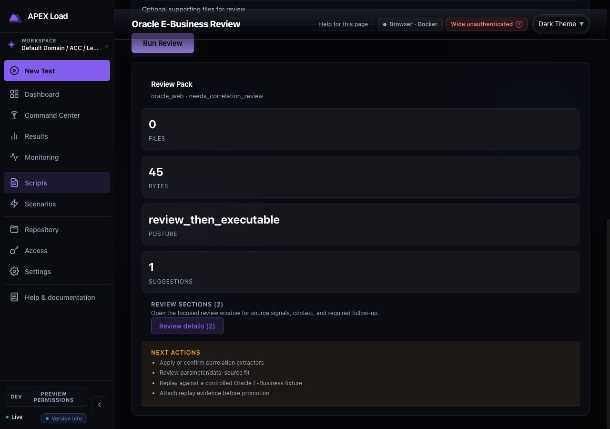

# Script import consistency audit

Date: 2026-09-19. Reference: current LoadRunner import design.

## Verdict

The import catalog is coherent, but review navigation is not. Adopt LoadRunner's six-tab review structure across script importers. Preserve format-specific capabilities inside that structure rather than preserving each importer's separate page architecture. The initial audit below is followed by implementation and verification notes.

## Evidence and scope

Inspected the current rebuilt frontend on port 4021 against the running local controller. Captured fresh browser evidence for catalog, LoadRunner, OpenAPI, JMeter, request samples, Oracle/Siebel review, and Bruno. In-app browser captures were clipped, so accepted evidence was recaptured in Chrome at the desktop test breakpoint. Rejected captures were replaced. Source inspection maps these representative experiences to all 17 catalog entries; it does not establish converter correctness for every format.

No scripts were saved, target requests replayed, source hooks executed, or credentials supplied. OpenAPI used the repository's orders fixture; JMeter, samples, and Oracle review used synthetic example.invalid data. LoadRunner and Bruno used the previously supplied archives. Save success, expiration recovery, large multi-script batches, live authentication, and full accessibility compliance were not exercised.

## Captured steps

| Step | Surface | Health | Main observation |
|---|---|---|---|
| 1 | Import catalog | Good | Search and source families orient the operator; output type is buried in descriptive copy. |
| 2 | LoadRunner validation/review | Reference | Six stable tabs, grouped issues, linked repair, collapsed setup, source evidence, and explicit replay blockers. ArrowRight moved Review to Credentials. |
| 3 | OpenAPI validation/review | Needs improvement | Saveable validation preview, two competing entry actions, large statistics, and a long mixed review page without the reference tabs. |
| 4 | JMeter validation | Blocked | Selected workspace still produces a raw multipart project-context error; no recovery action. Result review could not be visually inspected. |
| 5 | Request/response sample review | Needs improvement | Useful preflight states, but runtime setup and multiple review sections remain stacked. Save action precedes most evidence. |
| 6 | Oracle/Siebel review | Needs improvement | Correctly states review-only; raw state identifiers, oversized statistics, and prose-only next actions weaken the handoff. |
| 7 | Bruno native review | Mostly good, inconsistent tabs | Linked save/replay readiness and scoped inputs are useful; its five-tab taxonomy differs from LoadRunner. |

## Required common tab contract

Keep these exact labels and order. Use the same tab styling, roving keyboard focus, issue-count badges, panel spacing, and source-linked navigation as LoadRunner.

| Tab | Responsibility | Format-specific content |
|---|---|---|
| Review | Outcome, save readiness, replay readiness, grouped actionable findings, next required action, save controls | Conversion losses, unsupported hooks, CloudTest fixture evidence, browser replay evidence, batch summaries |
| Credentials | Unique unresolved bindings first, preserved values collapsed, supported secret choices, explicit deferred state | Collection auth, SOAP security, OAuth, broker identities, certificates; do not merge solely by source name |
| Data & parameters | Required producers/values first; optional substitutions separately; affected script scope and allocation where supported | JMeter CSV/variables/extractors, sample correlations, OpenAPI examples, messaging payloads, Bruno inputs |
| Runtime & source settings | Imported-to-effective behavior, migration decisions, preserved-only settings, runner requirements | JMeter thread groups and scenario draft, browser replay settings, Kafka/Event Hubs modes, Bruno canonical settings |
| DSL Preview | Redacted generated draft with script selector, section/action search, focus mode, clear read-only status | Multiple generated scripts and protocol-specific DSL |
| Source Mapping | Source-to-generated comparison, mapping search, source location and coverage | Schema operations, source lines, archive files, request provenance; explain unavailable mapping without implying success |

Keep batch/API selection ABOVE the tabs as a searchable selector with selected/total count and explicit selection scope. Within each tab, retain current script and findings filter when navigating. Do not turn every generated script into a competing top-level review tab.

For a tab with no applicable content, show a short explicit empty state. For review-only imports, explain that there is no executable DSL or binding workflow; never invent a generated script, save button, mapping, or executable status just to fill the layout.

## Findings and priorities

### P1 — Shared importers do not use the reference review structure

Evidence: steps 3 and 5; `ProtocolAssetImport.tsx`, `SampleScriptImport.tsx`, and `JMeterImport.tsx` render the general `ScriptImportReview` as a stacked page. LoadRunner selectively renders compact review sections behind six tabs. This makes operators relearn where credentials, data, runtime decisions, and evidence live.

Change: extract a shared tabbed review shell from LoadRunner and reuse existing review/credential/data/source components. Keep conversion APIs and format-specific controls separate. Put optional source setup in a collapsed disclosure after inspection. Use one readiness authority rather than independently counting warnings in every tab.

Acceptance: the same task appears under the same label in every importer; a finding links to the exact tab/control/source and returning preserves selection and edits.

### P1 — Save readiness, static readiness, and verified replay need a common presentation

Evidence: OpenAPI's "Ready with notes" plus "Runtime prerequisites: Not verified", sample preflight cards, LoadRunner repair posture, and Bruno's separate save/replay summary. These contain useful distinctions but express them differently.

Change: retain three explicit states: can this draft be saved; what still blocks replay; has a controlled replay actually passed. Never use conversion completion or acknowledgement as evidence of replay success. Review is the default landing tab and contains grouped blockers before secondary statistics.

Acceptance: operators can identify the next required action without opening diagnostics. Acknowledging a finding never clears an execution blocker. Runtime/target checks remain visibly unverified until performed.

### P1 — JMeter validation is blocked and gives no usable recovery

Evidence: step 4 shows `project_id query parameter or leading multipart field is required for multipart imports` with a selected workspace. `useScriptApi.ts` appends the file before project_id in validateJMeterImport, consistent with the server's complaint about multipart ordering. This is a likely request-contract cause, not a verified fix.

Change: verify project scope in both JMeter validation and conversion requests before upload; test required multipart ordering against the active API. Translate the error into actionable workspace/retry guidance, retaining source and options. Do not ask users to edit a transport field.

Acceptance: selected-workspace validation reaches review; missing scope prevents upload with a workspace action; server failure retains inputs and permits a safe retry.

### P2 — Entry and save verbs describe internal processing rather than user progress

Evidence: OpenAPI and JMeter offer "Validate Only" and "Convert", while validation already yields a saveable draft. Samples use "Convert Sample", Bruno "Inspect source", and LoadRunner "Validate Script(s)". Save labels vary among "Save draft", "Save and Continue Importing", and batch-specific wording.

Change: use one primary "Inspect & review" entry action where both routes have the same user outcome. Preserve a genuinely distinct validation mode only if its difference is explained. Use "Save draft" / "Save N drafts" with separate explanatory readiness text; retain an explicit "Save and open in editor" secondary path when required. Surface destination and create-versus-replace impact beside final save controls. Show saved assets and remaining replay requirements after success.

### P2 — Low-value statistics dominate useful decisions

Evidence: steps 3 and 6 show counts each taking a full row at a 1280px viewport. `SampleScriptImport.css` collapses the stats grid at a 980px container threshold; the sidebar makes that threshold relevant on a normal laptop.

Change: use a compact wrapping summary for counts; reserve cards for actionable states. Collapse byte counts, capability inventories, and technical diagnostic codes. Translate `review_then_executable` and `needs_correlation_review` into plain task language. Replace protected-session implementation language such as "compatibility commit path" with the consequence and required action.

### P2 — Review-only recommendations need a usable handoff

Evidence: Oracle/Siebel correctly says it does not save a script, then lists four prose next actions. There is no direct route in the result to perform or associate those tasks.

Change: retain review-only status and add supported destination links for correlation/data review, applicable importer/editor, and evidence attachment. Where no action exists, explain the exact manual handoff and required artifact. Avoid presenting capabilities that the backend does not support.

### P2 — Bruno still has a separate information architecture

Evidence: step 7 and `BrunoImport.tsx`: Summary, APIs, Credentials, Data, Review & save. The recent improvements should be preserved while adopting the user's LoadRunner reference.

Change: combine Summary and Review & save into Review; move APIs to the batch selector; rename Data to Data & parameters; give runtime/source settings, DSL Preview, and Source Mapping dedicated reference tabs. Keep native-conversion versus bundle-preservation fidelity distinct. Do not resolve unsupported dynamic expressions by substituting static values.

## Coverage of all 17 formats

| Format | Current implementation family | Specific content to preserve in common shell | Evidence level |
|---|---|---|---|
| LoadRunner archive | EnterpriseArchiveImport | Guided repairs, parameters/allocation, runtime parity, protocol detection | Actual archive validation and reference review |
| Bruno | BrunoImport | Native/canonical mode, API selection, scoped bindings, runner controls | Actual native archive inspection; canonical path source review |
| OpenAPI/Swagger | ProtocolAssetImport | Operation/auth/data selection, create/replace target | Fixture validated in browser |
| Postman | ProtocolAssetImport | Collection variables/auth, hooks, create/replace | Source-reviewed shared shell and branches |
| WSDL/SOAP | ProtocolAssetImport | SOAP actions, envelopes, namespaces, faults | Source-reviewed shared shell |
| AsyncAPI/Kafka | ProtocolAssetImport | Multi-script scope, broker bindings, replay review, safe batch saving | Source-reviewed shared shell and branches |
| RAML/Anypoint | ProtocolAssetImport | Includes, OAuth, policy review | Source-reviewed shared shell and branches |
| HAR | ProtocolAssetImport | Artifact redaction, Salesforce/Agentforce conversion, correlations | Source-reviewed shared shell and branches |
| Recorder/Playwright | ProtocolAssetImport | Selector review, replay evidence, draft exception | Source-reviewed shared shell and branches |
| Request/response sample | SampleScriptImport | Input profiles, correlation inference, supplemental assets | Synthetic sample converted in browser |
| JMeter | JMeterImport + ScriptImportReview | Thread groups, scenario draft, CSV/extractors, unsupported elements | Browser validation blocked; result layout source-reviewed |
| DevWeb | ProtocolAssetImport | Supported requests and unsupported source code | Source-reviewed shared shell |
| k6 | ProtocolAssetImport | HTTP subset, JavaScript limitations | Source-reviewed shared shell |
| CloudTest | ProtocolAssetImport | Clip selection, composition drafts, fixture gates | Source-reviewed shared shell and branches |
| Event Hubs Capture | ProtocolAssetImport | Avro input, producer draft, explicit mock/native mode | Source-reviewed shared shell |
| Broker Config | ProtocolAssetImport | MQ/JNDI topology and provider requirements | Source-reviewed shared shell |
| Oracle E-Business/Siebel | OracleEBusinessReviewImport | Review-only posture, correlation/evidence handoff | Synthetic source reviewed in browser |

## Implementation sequence and acceptance

1. Fix JMeter request-context handling and recovery; add a browser regression for selected workspace.
2. Extract the LoadRunner review shell with stable tab IDs and shared status vocabulary. Migrate the 12 ProtocolAssetImport formats first, then JMeter and samples.
3. Align Bruno and the review-only Oracle/Siebel flow without losing their distinct execution contracts.
4. Verify small/large inputs, multi-script selection, missing credentials/data, unsupported source, expired candidates, failed save/retry, create/replace, and post-save navigation.
5. Check 1280px and narrow layouts, keyboard tab/arrow navigation, focus after repair, label associations, status announcements, and measured contrast. Keep active findings and focused controls clear of sticky headers. Screenshots alone do not establish WCAG compliance.

Use existing tokens, TabList behavior, SecretBindingReview, SourceMappingReview, protected candidate sessions, and save paths. Shared layout must not bypass format-specific blockers or change converter semantics.

## Captured evidence

### 1 — Catalog

### 2 — LoadRunner reference

### 3 — OpenAPI review

### 4 — JMeter validation failure

### 5 — Sample review

### 6 — Enterprise review-only result

### 7 — Bruno comparison

## Implementation and verification

Implemented the shared six-tab review layout in the 12 protocol asset importers, JMeter, samples, both Bruno output modes, and the Oracle/Siebel review-only flow. LoadRunner remains the reference implementation. API/batch selection stays above the tabs. Credential and data controls retain state while hidden; source and DSL evidence are loaded on demand. Setup collapses after inspection, required values and optional substitutions are separated, and save labels are stable.

Code review corrected the JMeter leading multipart project field in both upload paths, added missing-project recovery, fixed empty Data panels and obsolete guidance, preserved deferred credential handling and protected retry identities, and extended credential-path redaction to multi-script preview/export. For multi-script imports, the complete review JSON now includes all previewed scripts rather than only the primary script. LoadRunner retains its established `script` export wrapper. Browser regression testing also caught and fixed hidden LoadRunner section controls when compact review supplied a preview object, and legacy Bruno pill styles that overrode the shared tab design. New canonical Bruno inspections return to Review instead of inheriting the prior candidate’s evidence tab.

Browser verification against the running local API confirmed OpenAPI runtime edits survive navigation and appear in the draft; source comparison remains available. A synthetic JMeter plan now reaches review and displays its scenario settings. The supplied Bruno archive still produces 41 native candidates with five missing credentials, 16 unresolved inputs, and two conversion repairs. No source hook or target replay was executed, and these local archive drafts were not saved.

Fresh implementation screenshots:

- [OpenAPI review](import-consistency-2026-09-19/08-openapi-implemented.png)
- [JMeter runtime review](import-consistency-2026-09-19/09-jmeter-implemented.png)
- [Bruno review](import-consistency-2026-09-19/10-bruno-implemented.png)
- [JMeter at 760px](import-consistency-2026-09-19/11-jmeter-narrow.png)

Validation on the final implementation:

| Check | Result |
|---|---|
| Type checking and ESLint | Passed |
| Dashboard unit tests | 4,331 passed across 403 files |
| Fresh embedded dashboard build | Passed; existing large-chunk advisory remains |
| Focused dev-admin import workflows | 13 standard checks passed |
| Focused local-auth import workflows | 12 passed; optional private archive check skipped in this profile |
| Full private LoadRunner archive | Passed separately with temporary encrypted import storage: all 492 requests, grouped findings, repair controls, source navigation, and narrow layout |
| OpenAPI error recovery and prerequisite save workflow | Passed in the broader focused authoring/usability run |
| `git diff --check` | Passed |

The private archive check requires operator-managed encrypted import storage. The first attempt on the default disposable controller correctly exposed unavailable protected repair controls. Re-running with a temporary artifact directory and an ephemeral `APEXLOAD_WRAPPING_MASTER_KEY` passed. The key was not printed or persisted; the temporary store was removed after the run. No change to the running controller’s encryption configuration was required.

`npm run test:cycle` exercised both full browser profiles. That initial run reported 105 passed / 16 failed / 4 skipped in dev-admin, and 35 passed / 6 failed / 1 skipped in local-auth. Seven dev-admin and five local-auth failures involved import navigation or the shared LoadRunner preview; those were corrected and passed the final focused runs above. The remaining failures concern Command Center details, dev-admin workspace landing, live run metrics/lifecycle, workspace creation and scoping, guided workspace setup, and the author Problems dialog. The local-auth end-to-end journey stops in workspace creation before reaching import. These are outside the changed import code; the complete workflow suite is not claimed green.

Final execution logs are local at `/tmp/import-consistency-all-unit-final.log`, `/tmp/import-consistency-build-final.log`, `/tmp/import-consistency-verified-dev.log`, `/tmp/import-consistency-verified-auth.log`, `/tmp/import-consistency-protected-acceptance.log`, and `/tmp/import-consistency-cycle.log`. Browser artifacts are under `/tmp/import-consistency-verified-e2e` and `/tmp/import-consistency-protected-e2e`.

This frontend change does not establish converter parity or controlled target replay success for all 17 source formats. No Go implementation or generated DSL/API/protobuf contract changed.
