# Import reviews with open items (September 2026)

Status: Open. Every review below still carries remaining work; see each section's Status line.

Grouped from the JMeter, LoadRunner, importer-consistency and fixture-matrix reviews. The evidence folders (`import-fixture-matrix-2026-09-12/`, `importer-consistency-2026-09-23/`, `jmeter-import-fidelity-2026-09-23/`, `loadrunner-issue-detail-2026-09-23/`, `loadrunner-panel-design-2026-09-23/`) stay next to this file. Completed import reviews were moved to [AUDITS_2026-09.md](../../archive/qa-reviews/AUDITS_2026-09.md) (sections "Import reviews 2026-09" and "Import From Source audit").

## Import fixture matrix and broker runbook

Date: 2026-09-12. Status: Open: Service Bus, Event Hubs, IBM MQ and customer enterprise replay cases are blocked on fixtures/credentials (see 'Remaining gaps and completion criteria')

### Import conversion and replay fixture matrix

Date: 2026-09-12. This follows the [Import From Source usability audit](../../archive/qa-reviews/AUDITS_2026-09.md#import-from-source-audit-2026-09-12). The matrix validates observable source behavior and records unavailable evidence separately.

#### Result

**16 of 20 cases passed; 4 are blocked; no executed case failed.** The final matrix includes real Kafka and Solace round trips, three attached canonical Bruno SOAP assets, source preservation, mock messaging, and enterprise execution constraints. It does not certify every customer application or full original-tool parity.

The source-backed [manifest](../import-fixture-matrix.json), [machine-readable results](import-fixture-matrix-2026-09-12/evidence/results.json), per-case logs, source hashes, and [reproduction runbook](#import-fixture-matrix-and-broker-runbook) make each claim inspectable.

#### Matrix

| Case | Result | Provenance | Evidence scope |
| --- | --- | --- | --- |
| bruno-attached-preservation | [PASSED](import-fixture-matrix-2026-09-12/evidence/bruno-attached-preservation.log) | repository-attached | Byte preservation, variables, headers, body and scripts across three attached SOAP sources |
| bruno-canonical-replay | [PASSED](import-fixture-matrix-2026-09-12/evidence/bruno-canonical-replay.log) | repository-attached-with-synthetic-environment | Attached source → encrypted bundle → Go replay → pinned Node runner → loopback SOAP target |
| bruno-runner-conformance | [PASSED](import-fixture-matrix-2026-09-12/evidence/bruno-runner-conformance.log) | synthetic | Pinned runtime behavior and egress/lease/cleanup contracts against local test servers |
| bruno-commit-revisions | [PASSED](import-fixture-matrix-2026-09-12/evidence/bruno-commit-revisions.log) | synthetic | Canonical inspection, persisted source revision, synchronization and rollback |
| asyncapi-mock-replay | [PASSED](import-fixture-matrix-2026-09-12/evidence/asyncapi-mock-replay.log) | synthetic | Kafka JSON/Avro/request-reply, JMS publish/consume and mixed-provider split; in-memory brokers |
| broker-topology-mock-replay | [PASSED](import-fixture-matrix-2026-09-12/evidence/broker-topology-mock-replay.log) | synthetic | MQSC and JNDI topology drafts replay through mock IBM MQ/Solace adapters |
| capture-mock-replay | [PASSED](import-fixture-matrix-2026-09-12/evidence/capture-mock-replay.log) | synthetic | Capture Avro → persisted/reloaded DSL → mock Event Hubs produce/observe |
| provider-adapter-contracts | [PASSED](import-fixture-matrix-2026-09-12/evidence/provider-adapter-contracts.log) | synthetic | Real adapter builds and local/unit transport contracts; no live provider certification |
| enterprise-persisted-gates | [PASSED](import-fixture-matrix-2026-09-12/evidence/enterprise-persisted-gates.log) | synthetic | CloudTest, SAP GUI and disabled Java runner reject execution after draft persistence |
| cloudtest-commit-attestation | [PASSED](import-fixture-matrix-2026-09-12/evidence/cloudtest-commit-attestation.log) | synthetic | CloudTest commit cannot replace unproven mappings with unattested executable actions |
| enterprise-runtime-fidelity | [PASSED](import-fixture-matrix-2026-09-12/evidence/enterprise-runtime-fidelity.log) | synthetic | Source runtime options that are not implemented cannot claim execution parity |
| truclient-conversion | [PASSED](import-fixture-matrix-2026-09-12/evidence/truclient-conversion.log) | synthetic | TruClient archive inventory and preservation; supported browser subset is not universally gated |
| java-conversion-lifecycle | [PASSED](import-fixture-matrix-2026-09-12/evidence/java-conversion-lifecycle.log) | synthetic | Java VUser and JMS-family sources retain combined lifecycle, manifests and runner constraints |
| pinned-public-corpus | [PASSED](import-fixture-matrix-2026-09-12/evidence/pinned-public-corpus.log) | public-pinned-corpus | Pinned public LoadRunner/DevWeb/JMeter corpus conversion and protocol posture; no customer replay parity |
| kafka-live-import-replay | [PASSED](import-fixture-matrix-2026-09-12/evidence/kafka-live-import-replay.log) | synthetic-live-broker | Imported AsyncAPI order event → real Kafka broker → exact consumed JSON, isolated topic and cleanup |
| solace-live | [PASSED](import-fixture-matrix-2026-09-12/evidence/solace-live.log) | synthetic-live-provider | Imported JNDI topology → live Solace AMQP queue → exact consumed payload |
| servicebus-live | BLOCKED | synthetic-live-provider | Live Azure Service Bus queue publish/consume; topic/session cases remain separate |
| eventhubs-live | BLOCKED | synthetic-live-provider | Existing live Event Hubs produce/observe smoke; does not assert exact marker identity |
| ibmmq-live | BLOCKED | customer-provider-needed | IBM MQ provider certification |
| enterprise-customer-replay | BLOCKED | customer-fixtures-needed | Customer-authenticated enterprise replay parity |

#### What the replay evidence establishes

- **Canonical Bruno:** all three attached SOAP sources are imported without rewriting their source files, saved as encrypted immutable bundles, resolved through the real artifact store, and executed through the Go replay engine and pinned Bruno 3.5.2 runner. Synthetic environment values direct requests to a loopback target. Exact request paths, SOAP bodies, headers and basic-auth values are checked. Original source assertions pass for the expected HTTP 500 SOAP fault and fail when its fault code is altered. The literal attached session identifier is replaced with a synthetic binding for execution.
- **Kafka:** a synthetic AsyncAPI order contract converts to publish/consume actions. A real Kafka 4.2.0 broker returns the exact unique order marker, numeric amount, currency and item array, with an actual offset. Each run creates and deletes its own topic.
- **Solace:** a JNDI queue definition converts to a draft, which is configured for a real Solace 10.26.0.8827 AMQP broker. The replay engine publishes and consumes the exact unique JSON payload using synthetic credentials and a dedicated queue. This is queue round-trip evidence, not certification of all selector, transaction, topic or HA behavior.
- **Mock messaging:** AsyncAPI exercises Kafka JSON/Avro/request-reply, JMS flows and mixed-provider splitting. MQSC/JNDI topology drafts preserve each destination's own payload. Capture Avro fixtures retain Unicode/binary payload content and application properties after DSL JSON persistence. These are explicitly in-memory results.
- **Enterprise:** persisted CloudTest drafts still fail on `cloudtest_fixture_mapping_unproven`; SAP GUI still has no registered runtime; Java lifecycle execution is rejected when its runner is disabled. Generic CloudTest commit cannot substitute unattested executable actions. Separate Java source tests retain lifecycle and protocol-family behavior for the governed runner.
- **Public corpus:** all 26 source directories at pinned LR_Scripts revision `cc010f01ea6f0120d1e22bc1acb41522bf98d03d` pass conversion smoke checks across 11 source families. Public examples are not customer fixtures, and conversion is not replay equivalence.

#### Defects and corrections

##### Fixed: Solace AMQP login identity changed when a VPN was set

The live test failed with a configured VPN and succeeded with the identical broker, queue and credentials when that field was omitted. The adapter appended `@vpn` to the SASL username. Removed this rewrite; the exact-payload test then passed with `SOLACE_VPN=default`. A local SASL peer regression test checks the transmitted identity for ordinary usernames, names containing `@`, and surrounding whitespace.

This aligns with Solace's documented [per-VPN AMQP listen ports](https://docs.solace.com/Services/AMQP-on-VPN-Management.htm) and [TLS virtual-hostname routing on global ports](https://docs.solace.com/Services/Managing-Services.htm). No broader authentication policy or production broker configuration changed.

##### Fixed: public corpus test demanded source families absent from its pin

The existing corpus test converted all 26 directories, then failed because it demanded Java/JMS examples that do not exist anywhere in the pinned repository tree. The required corpus families now match that immutable source set. Java coverage remains a separate explicit matrix case; it was not relabeled as public-corpus evidence.

##### Clarified: TruClient is not universally execution-blocked

The repository's simple TruClient navigation fixture converts into supported browser actions. Its source-tool branding alone does not imply a durable execution blocker. The matrix therefore records archive inventory/preservation and limits, without claiming complete browser replay parity or weakening any unsupported-feature gates.

#### Remaining gaps and completion criteria

| Blocked case | Needed to complete it |
| --- | --- |
| Service Bus | Dedicated test queue and connection configuration; execute exact-payload queue round trip. Topic, session and request/reply fidelity require additional fixtures. |
| Event Hubs | Dedicated namespace/hub and credentials. Strengthen the current live smoke to identify the just-published unique payload before calling it fidelity evidence. |
| IBM MQ | Supported live client/sidecar, dedicated queue, and baseline behavior for acknowledgment, selectors and transactions. Mock topology replay is insufficient. |
| Customer enterprise replay | Dependency-complete customer CloudTest/TruClient/Java/Oracle exports, source-tool versions, original-tool expected results, approved runner configuration and controlled target applications. |

No new customer fixture paths or cloud-provider configuration were supplied during this run. The three repository-attached SOAP files retain their source provenance; their controlled synthetic responses establish assertion behavior, not the behavior of a customer backend.

#### Validation and cleanup

- Full Go suite passed: **105 packages**, **10,812 top-level tests passed**, 4 top-level environment-dependent skips and 11 packages without tests. See [validation record](import-fixture-matrix-2026-09-12/VALIDATION.json).
- The matrix passed 16 cases without skipped tests inside those passing cases. It separately records four unavailable cases as blocked. Exit 0 never implies those gaps are covered.
- Seven Python harness tests passed, covering empty/missing tests, skips, failures, live prerequisites, bounded timeouts, output capture and manifest references. The pinned Compose configuration validates.
- The first full Go attempt ran out of disk space. About 8 GB of unused Docker build cache older than 24 hours was reclaimed; the full suite was rerun successfully. No source files or application data were removed.
- An initial Node reporter mismatch was corrected by requesting explicit TAP output. Broker setup was corrected to explicitly provision Kafka's test topic and enable internal authentication on the disposable Solace VPN. These harness/setup failures are not product conversion defects.
- Both task-owned broker containers and their anonymous volumes were removed after the final matrix. The local fixture runner, HTTP target and temporary artifact store are cleaned up by their tests. No customer service was used as a successful replay target.
- No dashboard code changed in this follow-up. The earlier UI audit's browser evidence remains separate from these conversion/runtime checks.

### Reproducing the import fixture matrix

Run from the repository root. The [manifest](../import-fixture-matrix.json) defines each case's source, assertions, command and prerequisites. The Python runner records hashes and distinguishes failed, skipped/partial and unavailable checks; exit 0 means no executed case failed, **not** that every provider is certified. Inspect `results.json` for blocked rows.

#### Local prerequisites

Use the repository Go toolchain and install the pinned dependencies in `runners/bruno` (`pnpm install --frozen-lockfile`). Node 24.13.0 and Go 1.26.5 were used for this run. Canonical replay starts its own loopback-only runner and SOAP target and uses a temporary encrypted artifact store. Its direct-egress override applies only to those test processes.

Fetch the public source corpus with the repository's pinned fetch script. Choose a new destination; that script replaces a non-Git destination directory.

```sh
scripts/fetch-lr-scripts-corpus.sh /tmp/apex-fixture-public-corpus
export APEXLOAD_LR_SCRIPTS_CORPUS=/tmp/apex-fixture-public-corpus
```

For offline cases only:

```sh
python3 scripts/run-import-fixture-matrix.py --output /tmp/apex-fixture-evidence-offline
```

The output directory must be new. `--only CASE_ID` selects one case and can be repeated. Node/browser-independent prerequisites are evaluated from actual test results: a skipped canonical replay cannot become a passing matrix row.

#### Disposable live Kafka and Solace

The included [Compose file](import-fixture-matrix-2026-09-12/brokers.compose.yaml) pins the exact images used in this validation: Kafka 4.2.0 and Solace 10.26.0.8827. Its credentials are intentionally synthetic and its exposed ports bind only to loopback. It consumes up to 3 GB of container memory plus build/test resources.

```sh
docker compose -p apex-fixture-matrix -f docs/qa/reviews/import-fixture-matrix-2026-09-12/brokers.compose.yaml up -d
```

Wait for Solace's SEMP endpoint to return 200 and Kafka to report started in the container logs. Configure the disposable VPN, client and empty queue. Run these creation requests once per new broker:

```sh
curl --fail --user admin:fixture-admin --header 'Content-Type: application/json' \
  --request PATCH --data '{"authenticationBasicType":"internal"}' \
  http://127.0.0.1:18090/SEMP/v2/config/msgVpns/default
curl --fail --user admin:fixture-admin --header 'Content-Type: application/json' \
  --data '{"queueName":"apex-fixture-roundtrip","accessType":"exclusive","permission":"consume","ingressEnabled":true,"egressEnabled":true}' \
  http://127.0.0.1:18090/SEMP/v2/config/msgVpns/default/queues
curl --fail --user admin:fixture-admin --header 'Content-Type: application/json' \
  --data '{"clientUsername":"fixture-client","password":"fixture-client","enabled":true,"clientProfileName":"default","aclProfileName":"default"}' \
  http://127.0.0.1:18090/SEMP/v2/config/msgVpns/default/clientUsernames
```

Run the complete matrix. Missing cloud/customer prerequisites remain blocked:

```sh
SOLACE_AMQP_URL=amqp://127.0.0.1:15672 \
SOLACE_QUEUE=apex-fixture-roundtrip \
SOLACE_USERNAME=fixture-client SOLACE_PASSWORD=fixture-client SOLACE_VPN=default \
KAFKA_BROKERS=127.0.0.1:19092 \
python3 scripts/run-import-fixture-matrix.py --include-live --output /tmp/apex-fixture-evidence-live
```

Kafka creates a unique one-partition topic and deletes that topic in cleanup. The Solace queue must be dedicated and empty before the case; a leftover or unrelated message causes an exact-body failure instead of a false pass. Do not point these cases at shared application queues.

After testing, remove only this fixture project and its volumes:

```sh
docker compose -p apex-fixture-matrix -f docs/qa/reviews/import-fixture-matrix-2026-09-12/brokers.compose.yaml down --volumes
```

The official setup references are [Apache Kafka Docker](https://kafka.apache.org/42/getting-started/docker/) and [Solace's first broker setup](https://docs.solace.com/Get-Started/tutorial/event-broker-set-up.htm). Solace AMQP selects the VPN by [per-VPN listen port](https://docs.solace.com/Services/AMQP-on-VPN-Management.htm) or [TLS virtual hostname on a global port](https://docs.solace.com/Services/Managing-Services.htm); it does not require the adapter to append a VPN to the SASL username.

#### Adding customer/provider evidence

Record source-tool/export version, sanitized fixture location and SHA-256, original-tool expected behavior, and any permitted local substitutions. Keep provenance explicit: the three attached repository SOAP assets have preserved source bytes but no independently supplied customer execution baseline. Public LR_Scripts assets are public examples, not customer evidence.

- **Service Bus:** configure a dedicated queue and `SERVICEBUS_CONNECTION_STRING` / `SERVICEBUS_QUEUE`. Topic, session and request/reply variants require separate fixture rows.
- **Event Hubs:** configure a dedicated hub and `EVENTHUBS_CONNECTION_STRING` / `EVENTHUBS_EVENT_HUB`. The existing live smoke observes an event; it does not prove that the observed body is the just-published unique marker. Strengthen that assertion before using it as fidelity evidence.
- **IBM MQ:** provide a supported real client/sidecar, queue and expected selector/acknowledgment/transaction behavior. Mock MQSC replay is not IBM MQ runtime parity.
- **Enterprise:** provide dependency-complete customer exports, original-tool expected results, and controlled application/runner targets. CloudTest fixture gates and SAP/Java runtime limits must remain in force until the corresponding evidence exists.

## LoadRunner acc_wls_reg_1 missing-producer investigation

Date: 2026-09-19. Status: Open: see 'Remaining producer findings'

Re-imported the supplied private archive with the current converter and traced all
12 missing producer names plus the conditional producer back to source on
2026-09-19. Source contents and parameter values are not copied into this report.
No target traffic was sent.

### Reported examples

| Finding | Imported consumer | Source evidence |
| --- | --- | --- |
| `c_rewardcard` | `actions[581]`, request starting at `Action.c:7215` | The `c_RewardCard` registration at `Action.c:4222` is commented out. |
| `c_transaction1` | `actions[909]` at `Action.c:14587`; `actions[1042]` at `Action.c:16175` | The registration at `Action.c:14510` is commented out. |
| `productspecificationtype08` | `actions[1062]`, request starting at `Action.c:16436` | Referenced by body templates at `lrw_custom_body.h:200` and `:254`; no producer or parameter definition was found. |
| `tstamp` | First reported consumer `actions[678]`, request starting at `Action.c:11212` | `lr_save_timestamp` calls at `Action.c:8347` and `:11930` are commented out. This unresolved name affects 64 consumer actions. |

The action source locations identify the start of each request call, while the
reference may occur later in a multiline body or in an included body template.
Lowercase diagnostic names reflect converted template names; these cases are
not failures to recognize mixed-case active producers.

### Remaining producer findings

- Commented registrations: `c_idptrace1` (`Action.c:14511`),
  `c_manualpromotions` (`:3270`), `c_productreferenaceid3` (`:3798`),
  `c_productspecificationtype5` (`:4219`), and `c_promotioncatalogid1` (`:3274`).
- `c_productreferenaceid4`: the comment at `Action.c:3800` ends with a backslash.
  C line splicing continues the comment onto the apparent registration at
  `:3801`. The converter correctly excludes that registration.
- `c_offerid` and `c_productspecification01`: references exist, but no matching
  producer or parameter definition was found. Similar names do not establish
  interchangeable meanings.
- `c_offerid1`: an earlier registration at `Action.c:2492` is commented out;
  an active registration at `:3223` occurs after an earlier consumer. This is
  retained as an ordering review finding rather than a definite missing producer.

There are 79 missing-producer occurrences across 12 names, plus one conditional
producer finding. The `.prm` file supplies six parameters, none of which supplies
these names. Repetition reflects affected consumers, not 79 distinct variables.

### Outcome and validation

No parsing correction was warranted for these findings, and no warning was
suppressed. The existing guided repair can add or bind parameters and configure
extractors on preceding responses. Restoring a timestamp producer requires an
explicit source or repair decision about its intended format and lifecycle;
the converter does not infer that behavior from the name `Tstamp`.

Both `go test -p 2 ./pkg/convert/enterprisearchive ./pkg/convert/importreview`
packages passed. Existing regression coverage includes comment continuations,
producer ordering, parameter namespaces, and source-parameter lowercase aliases.
The archive retains 492 primary requests, 58 extractors, 25 transaction pairs,
445 subtransaction pairs, and zero false form blockers.

No implementation files were changed for this investigation. Existing working-tree
changes for the separate NEXT31 import work were left intact.

## Importer review consistency audit

Date: 2026-09-23. Status: Open: audit recommendations only partly addressed (LoadRunner panel and issue detail below); other importers not re-verified

Date: 2026-09-23

### Scope

This audit compares the current importer catalog and the non-LoadRunner importer families against the LoadRunner review pattern now in the dashboard. Evidence was captured from the live dashboard on port 4012.

The catalog exposes 16 importers outside LoadRunner. They resolve to five review architectures:

| Architecture | Importers |
| --- | --- |
| Shared protocol asset review | OpenAPI, Postman, WSDL, AsyncAPI, RAML, DevWeb, k6, Akamai CloudTest, Event Hubs Capture, Broker Config, HAR, Recorder Export |
| Shared sample review | Request / Response Sample |
| JMeter review | JMeter |
| Bruno review | Bruno |
| Review-only report | Oracle E-Business / Siebel |

### User goal and accessibility target

An operator should be able to move among importers without relearning where issues, credentials, data, runtime settings, generated DSL, and source evidence live. The common shell should remain keyboard navigable and expose clear labels, statuses, and recovery actions. Importer-specific fidelity controls must stay available where they are needed.

### Overall verdict

The importers already share a strong six-tab foundation and consistent source-to-review workflow. The largest gap is inside the Review tab: LoadRunner now uses a persistent issue list with specific evidence and in-context repair, while the other families still expose findings through summary cards and detached dialogs. The UI looks related, but the operator workflow is not yet consistent.

### Strengths

- The catalog clearly groups all 17 sources by job and provides searchable, descriptive cards.
- OpenAPI, JMeter, Sample, and most protocol importers reuse the same tab names and order.
- Tab lists expose tab/tabpanel semantics, selected state, and readable count text.
- Severity is expressed in text as well as color in issue dialogs.
- Importer-specific capabilities remain visible: JMeter multi-script/scenario output, Bruno native-versus-canonical execution, HAR comparison and scrubbing, and Oracle review-only posture.
- Source and conversion controls explain that changes require a new review, which protects the operator from silently reviewing stale output.

### UX risks

#### 1. Issue resolution is inconsistent and loses context

JMeter, OpenAPI, and Oracle route the operator from a summary into `IssueDetailsDialog`. The dialog has only a Close action. It does not show the selected issue beside source evidence, offer a repair, or route directly to the relevant Credentials, Data, Runtime, DSL, or Source tab.

Recommendation: use the LoadRunner vertical issue rail and detail pane in every executable importer. Group repeated findings by rule, show occurrence counts and affected assets, and place the most relevant fix or handoff at the top of the detail pane.

#### 2. Repeated diagnostics are not grouped into operator decisions

The JMeter blocker dialog shows three cards with the same generic title, `Blocking Import Diagnostics`, and a diagnostic code. Each says three diagnostics require review, but the operator cannot tell what setting to change or whether one change resolves all three.

Recommendation: title the issue by the actual decision, for example `Set a finite JMeter termination rule`. List all affected thread groups under one issue and provide an inline duration/iteration editor that applies to selected or all groups.

#### 3. Navigation and issue summaries duplicate the same work

Shared reviews show tabs, a `Resolve import requirements` button row, readiness cards, Conversion reference, and Import issue summary. Bruno repeats the same destinations through readiness buttons and tabs. This creates several ways to reach the same place without clarifying which one is primary.

Recommendation: keep the tabs as the stable navigation. Replace the extra button rows with one compact readiness strip that summarizes unresolved counts and moves focus to the corresponding tab. Keep raw conversion diagnostics inside a collapsed Conversion reference rather than repeating them as primary issues.

#### 4. The action hierarchy changes by importer

OpenAPI places editor and save actions at the top of the review. JMeter does the same, but its generated asset inventory immediately becomes the dominant content. Bruno places change-source, readiness actions, API selection, tabs, content, and save guidance in separate blocks. Oracle leaves the entire source form expanded above its review.

Recommendation: standardize the review header as: title/status, primary Edit/Open action, Save action, compact readiness summary, then tabs. Collapse source options after a successful review and expose one `Change source or options` action in the header.

#### 5. Tab labels and counts are not fully consistent

Bruno uses `Runtime & source settings` where other importers use `Runtime settings`. It also shows `Review 0`, which reads as an empty review even though the review contains important readiness guidance. Oracle exposes six tabs although Credentials, DSL Preview, and Source Mapping contain only review-only explanations.

Recommendation: keep the six canonical labels and order. Counts should represent unresolved actionable items and zero badges should be hidden. Review-only importers may disable or omit inapplicable tabs, as long as the remaining tabs retain the same names and positions.

#### 6. Project scope fails late in HAR

HAR accepts a source file and enables `Inspect & review`, then returns `project_id query parameter or leading multipart field is required for multipart imports` in the unassigned workspace. The operator cannot resolve this from the review surface.

Recommendation: treat Unassigned as a valid project scope if supported, or disable Inspect with an inline explanation and a direct workspace selection action before the upload is submitted.

#### 7. The review shell becomes visually unstable at narrower widths

At the captured width, Bruno and Oracle tabs wrap into two rows. The selected tab and related panel content shift vertically between importers, and long labels make scanning harder.

Recommendation: use a single-row horizontally scrollable tab list with visible overflow affordance, or switch to a compact select/list pattern below the breakpoint. Preserve arrow-key behavior and keep the active tab visible.

### Accessibility risks

- The common tab semantics and textual severity labels are strong foundations.
- Detached issue dialogs interrupt spatial context. A persistent issue workspace would reduce focus transitions and make source/fix relationships easier to understand.
- Wrapped tabs can create a visual order that differs from the expected left/right keyboard sequence.
- Raw diagnostic codes and underscored posture values are exposed as primary copy in several places. Human-readable labels should be primary, with codes available as secondary technical detail.
- The HAR error is technically announced as an alert, but it appears only after a preventable submission and does not identify a usable recovery control.
- Screenshot evidence cannot confirm focus return, screen-reader announcements after repairs, contrast ratios, zoom reflow, or full keyboard completion. Those need browser-based accessibility tests.

### Importer-specific guidance

#### Shared protocol and sample importers

Adopt the LoadRunner issue workspace inside `ScriptImportReview`. Preserve protocol-specific panels such as auth schemes, selector candidates, Agentforce/Salesforce review, SOAP faults, messaging topology, and support coverage. Convert their diagnostics into specific issue models with a target tab, source location, evidence, and optional repair action.

#### JMeter

Keep multi-plan selection, generated scripts, scenario draft, messaging preview, CSV sources, extractors, and termination semantics. Move blocker/warning/unsupported findings into the vertical issue workspace. Add inline fixes for finite duration/iteration rules, timestamp policy, unsupported sampler disposition, and per-script parameterization. Group repeated issues across thread groups.

#### Bruno

Keep native-versus-canonical mode, API selection, destination requirements, encrypted source custody, sandbox profile, environments, and source manifest. Normalize the tab label to `Runtime settings`; show source execution profile inside it. Replace the readiness button grid with a compact summary above the tabs, and use the Review tab for grouped acknowledgements/conversion issues. Do not show a zero Review badge.

#### Oracle E-Business / Siebel

Keep the review-only posture and package detection. Collapse the source form after review. Use the vertical issue workspace for package posture and correlation candidates. Since the page cannot apply changes, each issue should provide a precise handoff such as `Open LoadRunner importer`, `Open HAR importer`, or `Copy correlation recipe`, with the source evidence beside it. Omit tabs that cannot contain executable content.

#### HAR and Recorder

Keep comparison capture, scrubbing, static-asset filtering, Salesforce/Agentforce detection, selectors, and replay evidence. Validate project scope before conversion. Correlation findings should use the issue workspace and offer inline extractor/parameter creation where the draft supports it.

### Prioritized recommendations

1. Replace `IssueDetailsDialog` as the primary review path with a shared issue workspace in `ScriptImportReview`.
2. Define a common issue contract: specific title, severity, affected assets, evidence, source location, target tab, repair action, and occurrence grouping.
3. Standardize review header actions, tab labels/order, count rules, and source-panel collapse behavior.
4. Remove duplicate readiness navigation and keep raw diagnostics in Conversion reference.
5. Add importer-specific repair adapters for JMeter, Bruno, HAR/Recorder, protocol assets, and Oracle review handoffs.
6. Fix HAR project-scope validation before Inspect is enabled.
7. Add keyboard, focus, scroll-retention, and narrow-width regression coverage across all five review architectures.

### Evidence limits

The live run captured the importer catalog plus representative JMeter, OpenAPI, Bruno, HAR, and Oracle flows. OpenAPI represents the shared protocol-asset review architecture; source inspection confirms that Postman, WSDL, AsyncAPI, RAML, DevWeb, k6, CloudTest, Event Hubs Capture, Broker Config, HAR, and Recorder share that component. HAR review generation was blocked by the current unassigned-project multipart validation error, which is recorded as a finding. No source data was saved and no replay was started.

### Implementation status

Implemented in the dashboard after this audit:

- Shared protocol, sample, and JMeter reviews now use a persistent vertical issue queue with grouped occurrences, evidence, filters, keyboard navigation, and direct links to the relevant review tab.
- JMeter runtime settings can apply a finite duration or per-VUser iteration rule to every imported thread group, clearing the matching unbounded-run diagnostic from the active review.
- Duplicate review-navigation buttons were replaced with a compact readiness strip. Informational converter output now lives under `Conversion reference`.
- Review tabs remain on one horizontally scrollable row, hide zero badges, and can omit inapplicable tabs. Bruno now uses the canonical `Runtime settings` label.
- Oracle review results use the shared issue workspace, collapse source inputs after a successful review, and expose only Review, Data & parameters, Runtime settings, and Source Mapping.
- HAR blocks inspection before submission when the workspace has no project scope and explains how to recover.
- Large issue groups page their evidence at 100 occurrences so large imports remain bounded.

Verification included the full 4,469-test dashboard unit suite, production build, live inspection on port 4012, and the affected Playwright workflows under both dev-admin and local-auth profiles.

### Evidence

1. `00-import-catalog.png` — importer discovery catalog.
2. `01-jmeter-review.png` — JMeter shared review shell and generated assets.
3. `02-jmeter-blockers.png` — repeated generic blocker dialog.
4. `03-openapi-review.png` — shared protocol review shell.
5. `04-bruno-review.png` — importer-specific readiness and tab layout.
6. `05-har-project-error.png` — late project-scope failure after source selection.
7. `06-oracle-review.png` — review-only flow with source form retained above tabs.
8. `07-oracle-details.png` — specific findings shown in a detached dialog without repair actions.

## LoadRunner issue-detail review

Date: 2026-09-23. Status: Open: implementation recorded, but dev-admin browser profile still listed unrelated failures at the time and the full profile rerun was pending

### Resolve import issues — focused design review

Reviewed 23 September 2026 on the current-source dashboard at port 4012, using the populated archive already open in the operator’s browser. The tab is currently called **Review**. No application code, imported values, or saved scripts were changed.

Keep the vertical issue queue. The right pane should become a focused resolution workspace: explain the exact difference, show its consequences, offer the relevant controls, and verify the outcome in place.

#### Captured flow

##### 1. Select runtime behavior differences — navigation good, resolution unclear


The selected state is clear and the queue remains visible. The detail pane instead offers a generic migration paragraph, aggregate counts (34 executed, 5 partial, 1 compatibility-only, 3 non-applicable), and “Script requirement / Source location unavailable.” None identifies the particular settings requiring a decision. “1 affected location” actually represents a grouped script-level diagnostic. The execution-blocker warning also appears for this nonblocking review item.

**Recommendation:** show the affected settings as rows with source value, current replay behavior, consequence, and available action. Keep compatible settings collapsed. Label the scope “Script-wide” when there is no request location. Put exact technical diagnostics in a secondary disclosure.

##### 2. Select converter warnings — poor specificity and duplicated information


The title is the internal key `diagnostic:warnings`. The same generic instruction appears in the introduction and Diagnostic evidence. The actual warning is available elsewhere in Conversion reference: line 28 uses `web_reg_find Search=ALL`, while replay checks the main response body only and does not reproduce the source’s full search scope.

**Recommendation:** title the issue “Text check searches a narrower response scope.” Show “Source: all response content / Replay: main response body” and explain the risk of a missed or changed assertion. Display the relevant source line and assertion. Offer a supported assertion edit here, or an explicit source-edit handoff when equivalent behavior is unavailable. Do not imply that acknowledging this limitation restores behavioral parity.

##### 3. Follow Open related review — destination works, context is lost


The warning’s button opens Source Mapping at `lr_continue_on_error`, the first selected mapping, rather than the warned line 28. It shows all 30 mappings and no warning-specific selection. The operator must rediscover the problem.

**Recommendation:** prefer editing in the selected issue pane. When navigation is needed, label the button by destination and action, such as “Inspect assertion at line 28”; carry the issue, file, line, target path, and current draft through the handoff. Provide “Back to this issue” after the focused edit.

#### Proposed detail-pane structure

1. **Issue and impact:** plain-language title, Blocks replay / Needs review, and meaningful scope.
2. **What differs:** concise source-versus-current behavior; one specific explanation of the effect on replay.
3. **Fix this issue:** operation-specific fields using the existing runtime, parameter, credential, or assertion editor components. Lead with a supported recommended option; retain alternatives when the operator must choose.
4. **Check the change:** Preview change → concise affected-field diff, affected occurrences, and remaining requirements → Apply change. Keep protected values masked. Backend validation remains authoritative.
5. **Outcome:** show what changed and what remains; offer “Next unresolved issue” without automatically moving before the operator can read the result. Preserve edits when navigating or request a clear discard decision.

A persistent local action row would keep Preview/Apply available for long issue content. Advanced diagnostics and full source evidence belong below the primary repair controls. Retain separate states for resolved, reviewed with an accepted limitation, and unresolved; a review decision must never silently clear an execution blocker.

#### Inline repair coverage

| Issue type | Suggested in-place interaction |
| --- | --- |
| Runtime setting | Source/current values and the existing setting editor; guided TLS migration where required |
| Missing value | Choose an existing producer, add a parameter, or configure extraction from a preceding response |
| Missing credential | Reuse the project-binding picker and existing masked credential controls |
| Missing body | Restore the body through the governed editor; redact previews |
| Unsupported or partial conversion | Show the exact unsupported behavior and supported alternatives; otherwise a focused source/editor handoff |

The current implementation already supports several protected-draft inline operations in `ImportGuidedRepair.tsx`, including parameter creation, producer binding, extraction, restored bodies, proxy secret references, and TLS migration. Reuse those operations rather than creating another repair backend. Diagnostic-prefixed items currently bypass that form; their structured source/setting details must be retained to make them actionable.

#### Priority

1. Replace summary-only diagnostic items with specific findings, useful titles, actual evidence, and accurate scope.
2. Embed existing editors and repair operations in the detail pane with preview/apply/refresh.
3. Fix focused handoffs and add explicit recovery for unavailable/expired protected drafts.
4. Improve queue progression, action placement, and keyboard behavior.

#### Accessibility and verification limits

Selection is conveyed visually and in the accessibility tree. Selecting an issue moves focus to its detail heading; preserve a clear keyboard route back to the queue and announce repair results. The queue uses pressed buttons, not ARIA tabs: keep its semantics consistent and test arrow-key behavior if tab-like navigation is introduced. Muted supporting text in Solarized Dark should receive a measured contrast check; screenshots alone cannot establish compliance.

The current draft reports that protected import storage is unavailable, so a live repair preview/apply could not be completed in this audit. The existing operations above were confirmed by code inspection, not by a successful live repair in this run. Do not promise that a layout change alone enables them. Show a concise “Repairs unavailable for this draft” state with an actionable re-import/admin route. The in-app capture was cropped, so accepted screenshots were captured from the existing Chrome tab on the same current-source server. No stale screenshots or earlier test traces were used as audit evidence.

### Resolve import issues — implementation

Implemented against the current workspace dashboard, served from Vite at http://127.0.0.1:4012/. The adjacent review.md and JPGs document the pre-change baseline.

#### Changes

- Removed the redundant Original import diagnostics section from LoadRunner review; detailed warnings and blockers remain in the issue workspace and conversion reference. Other importers retain their diagnostics.
- Kept the vertical issue queue; added descriptive titles, replay impact, accurate script-wide/location scope, source-versus-replay comparisons, and secondary technical evidence.
- Preserved individual converter warnings instead of replacing them with a generic summary. Deduplicated repeated warnings and consolidated nonblocking runtime coverage into the runtime issue; independent blockers remain visible. Warning identities remain stable when their order changes.
- Embedded the existing runtime editor with source/current/consequence rows and a local change preview before server-validated apply. Existing settings state and API remain shared with the Runtime tab.
- Moved the same credential editor into a selected credential issue using a stable portal host; switching placement preserves pending input and does not create another editor instance.
- Kept governed body, producer, parameter, extractor, proxy-secret, and TLS operations. Added a field-path-only repair summary and persistent preview/apply action row. Protected values are not included in the new summary.
- Added session-only “Reviewed with limitation,” explicit next-issue progression, retained repair drafts, keyboard queue navigation, and Escape-to-queue keyboard support. Removed the unused Back to issue list button and moved runtime edit/preview/apply controls above the table, as requested. Review notes do not clear execution requirements or claim source parity.
- Exact source handoffs retain the mapping identity and include “Back to this issue.” Ambiguous source locations are not assigned an arbitrary file. Fixed StrictMode mount selection overwriting the requested mapping.
- Protected-draft recovery appears when relevant; unsupported source behavior remains explicit. No new assertion-repair backend was invented for Search=ALL semantics.

#### Verification

- Final typecheck, targeted ESLint, embedded Vite build, and git diff whitespace checks passed.
- Final affected component suite: **133 tests passed with the standard timeout**, covering issue repair/navigation, runtime editing, credential placement, warning grouping, ScriptImportReview, and SecretBindingReview. EnterpriseArchiveImport: **85 tests passed**, including removal of the duplicate diagnostics and retention of warnings from older responses. SourceMappingReview's StrictMode handoff regression also passed.
- Current-source LoadRunner browser suite: **15 passed, 1 optional private-fixture test skipped**. The final edit-control positioning/removal flow was rerun and passed at desktop and narrow widths.
- The required `npm run test:cycle` was invoked. The broad unit sweep overlapped the subsequent requested UI adjustments and reported 4,461 passed / 4 failed. Two were superseded layout tests and two were large-input timeouts; all affected tests passed in the final standard-timeout rerun. The full unit sweep was not rerun after that final adjustment.
- Full dev-admin browser profile: **131 passed, 6 failed, 4 skipped**. All runnable LoadRunner tests passed. Remaining failures: workspace hierarchy; project-scope/history navigation; JMeter shared review evidence; JMeter messaging preview; Source Mapping resize/restore timeout; guided workspace setup. Other tasks were also updating this shared workspace during validation.
- Full local-auth browser profile: all 15 runnable LoadRunner tests passed; one optional private-fixture test skipped. Remaining wider workflow checks are still running.

Current screenshots: [warning](loadrunner-issue-detail-2026-09-23/issue-warning.png), [runtime](loadrunner-issue-detail-2026-09-23/issue-runtime.png), [narrow layout](loadrunner-issue-detail-2026-09-23/issue-narrow.png).

Runtime previews are local comparisons; backend validation occurs on apply. Review decisions are session notes, not persisted approvals. Unsupported source behavior is not declared repaired by acknowledging it.

## LoadRunner panel design audit

Date: 2026-09-23. Status: Open: implementation recorded; local-auth profile left two unrelated failures at the time

### LoadRunner import review — design consistency audit

> Historical baseline from the older Docker dashboard. The recommendations have since been implemented against current working-tree source. See [implementation and current verification](#loadrunner-panel-design-audit); these original screenshots are not the current dashboard.

Reviewed 23 September 2026 against the populated local Docker application at port 8080, using the existing `acc_wls_reg_1.zip` review. Theme: Solarized Dark. Capture size: 2048 × 1163. All screenshots were captured and inspected during this audit.

**Verdict: the outer panel is consistent; the six tab interiors are not yet a coherent workspace.** The shared palette, border treatment, top-level tabs, and persistent save row are sound. Most friction comes from inconsistent content hierarchy, unexplained count scopes, and several overlapping ways to make or review changes.

This is an evaluation and implementation recommendation. No application code, draft values, credentials, or saved scripts were changed.

#### Highest-impact findings

##### 1. High — tab badges do not lead to the issues they advertise

Evidence: steps 1–4.

- Data & parameters has a **13** badge, but opens a table of **6** imported parameters with **Needs attention (0)**. The 13 missing-value/correlation issues are in Review. The return link appears after the entire parameter table, so the mismatch is not resolved at the point of entry.
- Credentials shows **2** on its tab, **4 unresolved credential requirements**, **12 credential groups**, and **1 binding needing setup**. These may all be correct at different levels of aggregation; the interface makes users reconcile them.
- Runtime settings shows **1** on the tab, **6 Requires decision** overall, and **5** in the current HTTP category. These represent different scopes, without an equally prominent explanation of each scope.

**Recommendation:** define tab badges consistently as unresolved grouped replay issues. Put an actionable sentence at the top of each relevant tab: “13 replay issues · Review missing values and correlations,” or “2 replay issues · 1 project binding needs setup.” Keep inventory totals in their tables. Label runtime totals “All categories” and the section results “HTTP — 5 settings.” A badge must either open the matching filtered content or have a conspicuous link to it. Do not force different data models to have identical counts.

##### 2. High — navigation and repair ownership overlap

Evidence: Credentials, Runtime, and the Source Mapping → Review handoff in step 6.

Credentials has both **Back to issue queue** and **View remaining execution requirements**, in addition to the Review tab. Source inspection correctly links to a specific TLS issue, but Review then offers a TLS repair while Runtime settings exposes minimum/maximum TLS configuration. A user cannot tell from the presentation whether these paths have identical effects on migration acknowledgment and readiness.

**Recommendation:** keep Review as the issue index and use a single repair component/state contract for each issue type. Both Review and the relevant domain tab may open that component, but should share preview, apply, and readiness refresh behavior. Retain source-to-issue deep links. Replace the two generic Credentials return actions with one consistently positioned “Review issues” link, or a contextual “Back to selected issue” link when arriving from an issue. Preserve migration acknowledgment and protected-draft validation; a raw setting change must not silently stand in for those operations.

The audit establishes overlapping user-facing controls, not that their backend effects are identical.

##### 3. Medium — headers, spacing, and usable width change by tab

Evidence: all six primary screenshots.

Review uses a large nested card with a sentence-case heading. Credentials adds a separate introduction card followed by an uppercase section heading. Data and Runtime use larger sentence-case headings. DSL Preview and Source Mapping use small uppercase headings; DSL's heading and download explanation are flush against the panel edge while nearby controls are inset. “Back to issue queue” is above most tabs' content but below Data's inventory.

Runtime's content is capped at 80rem, leaving a substantial unused right-hand area at this viewport. Data, Credentials, and the code comparison use the available width. The Runtime cap can be a valid readability choice, but currently reads as an unrelated layout rule.

**Recommendation:** give every tab one shared header with a title, one-line purpose, optional contextual return link, and local actions. Use one content inset (the existing 20px pattern is a suitable starting point), one heading scale, and one toolbar alignment. Keep prose at a readable width while allowing tables and code to fill the workspace. Standardize sentence case, including “DSL preview” and “Source mapping.” Keep distinct layouts where the task warrants them: a comparison editor should not be forced into a credential table.

##### 4. Medium — filters look and behave like unrelated components

Evidence: steps 1–4 and 6.

Review has a very wide search with a right-aligned Show dropdown. Credentials has a short search, an inline state dropdown, and a separate review checkbox. Data has compact type/source filters; Runtime has rectangular checkbox status filters above a small search and category rail. Source Mapping uses pill-shaped status controls and very wide file/search fields. Static credential summary pills resemble interactive mapping filters.

**Recommendation:** share a toolbar shell: labeled search, scoped filters, result count, then secondary actions. Use one appearance for multi-select status filters and another for static totals. Make local differences explicit (“Search parameters,” “Search mappings”) without changing control height, label style, and spacing. Avoid a short “Name or source column” field that visibly clips its placeholder at this desktop size.

##### 5. Medium — Data contains three change workflows with different action rules

Evidence: step 3 and its supplementary screenshots.

The parameter inventory has row editing; Optional substitutions uses “Preview substitutions”; Parameterization review uses “Apply Selected (0).” Their headings, typography, and action positions vary. Optional substitutions also repeats “Used in 478 requests” in both the summary and the helper sentence. Allocation repeats selection/update and exhaustion information already present in Parameters, then pushes its distinctive preview further down the page.

**Recommendation:** distinguish the jobs explicitly: **Parameters**, **Data sources**, **Allocation preview**, and an expandable **Suggested changes** area. Within suggestions, label environment substitution separately from parameter creation. Share the selection → preview → apply interaction and result feedback, while retaining each operation's semantics. Make Allocation primarily a simulation view with a compact rule summary and links that open the relevant parameter editor. Keep the read-only source inventory; it answers a different question from parameter editing.

##### 6. Medium — code inspection repeats useful capability with inconsistent controls

Evidence: steps 5–6.

DSL Preview offers section/action navigation, a visible word-wrap control, and “Focus preview.” Source Mapping offers a generated-DSL pane, “Focus destination,” and word wrap hidden under “View options & export.” It also supports an original/current destination choice. These are related inspection capabilities, but their controls and wording diverge. Several rows of guidance and controls precede the code; in the Source Mapping overview the actual comparison begins near the bottom of the viewport.

**Recommendation:** retain both tabs for now. DSL Preview is the whole-draft inspection view; Source Mapping is the provenance comparison. Share code-pane controls and wording: “Word wrap,” “Expand pane,” “Copy,” with clearly scoped export actions. Move the preview-limits explanation into one compact notice with expandable details. Keep “Download protected review JSON” distinct from “Export filtered mappings”: these are different artifacts, not duplicate exports.

##### 7. Medium — visual and accessible status communication need alignment

Evidence: the visible badge counts in all screenshots and the accessibility tree during tab navigation; source confirmation below.

The top-level tabs expose their names and selected state, but their numeric badges are excluded from accessible names. Runtime status checkboxes similarly expose their status name without the adjacent count. The information is visible elsewhere, but users navigating controls do not receive the same immediate summary. Small, muted labels and outlined actions also appear faint in Solarized Dark; no contrast-ratio conclusion is claimed without measurement.

**Recommendation:** expose counts with explicit meaning, for example “Data & parameters, 13 unresolved issues” and “Requires decision, 6 settings across all categories.” Preserve roving tab focus and active-state indicators. Measure text and control contrast in each supported theme and use the established semantic text tokens. Single-selection Data views should use the shared tab pattern rather than looking like independent toggle buttons.

#### Tab-by-tab evidence

##### 1. Review — usable, needs clearer hierarchy

Strengths: grouped issue queue, affected-location counts, a visible next-issue action, and a useful selected-issue pane. The global and local issue totals repeat. Long review content scrolls the tab strip away. The captured initial state leaves a large detail pane empty until selection; the linked TLS issue shows that the detail pane becomes useful once a specific task is chosen.

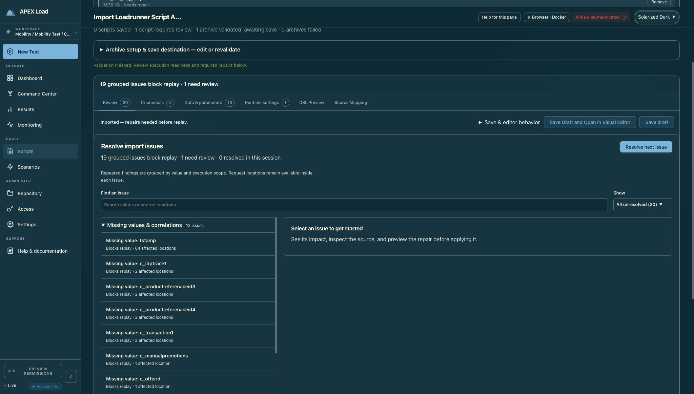

The source-to-issue link selected the intended TLS repair. It did not apply a repair.

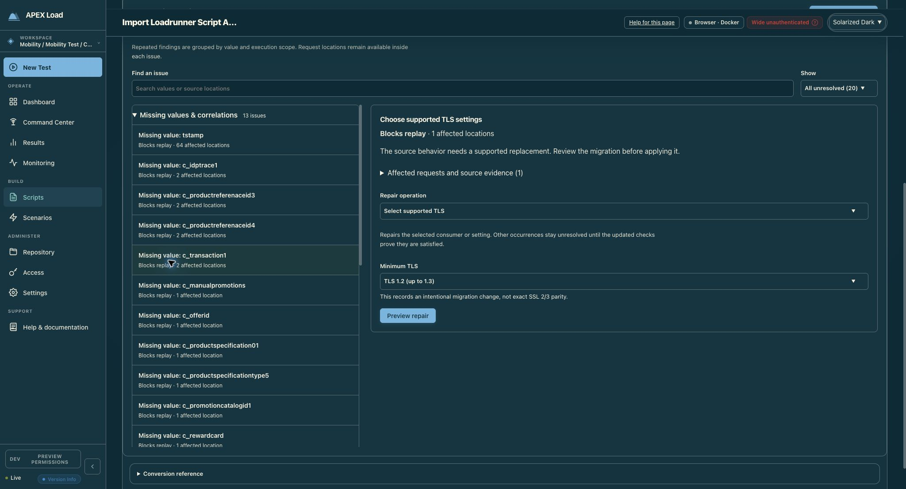

##### 2. Credentials — needs consolidation

Strengths: secret values remain hidden, affected locations are grouped, and destination/current state are separated. The multiple count scopes, duplicate return links, and two introductory/header layers make the one binding needing setup harder to distinguish from preserved values.

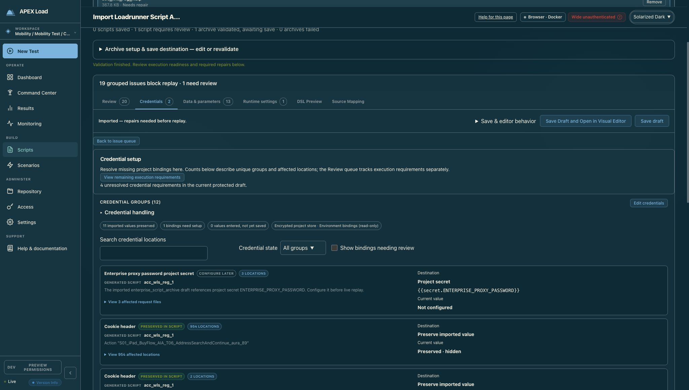

##### 3. Data & parameters — greatest information-architecture friction

Strengths: a useful compact parameter table, explicit sample-value caveat, source evidence, and distinct source/allocation views. The tab badge and “Needs attention” filter describe different populations. Optional workflows below the table follow older card patterns and separate apply conventions.

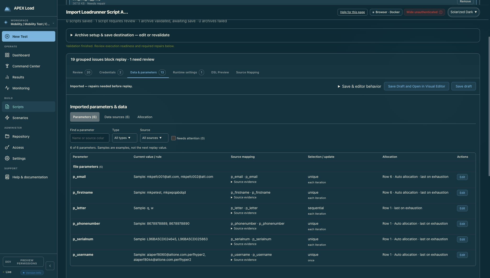

The read-only Data sources inventory is worth keeping. It reports source files, row availability, columns, and consuming parameters.

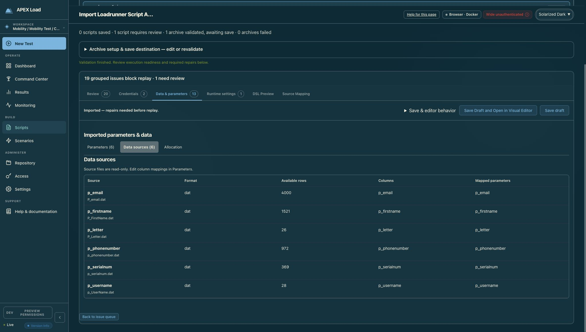

Allocation repeats much of the parameter table before presenting its distinctive simulation tool. Prioritize the preview and make rule edits directly reachable.

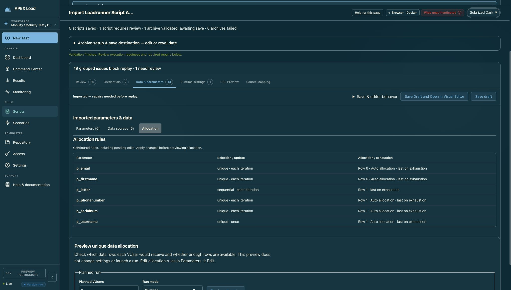

The return-to-queue link appears between the inventory and optional substitutions, rather than in the shared tab header.

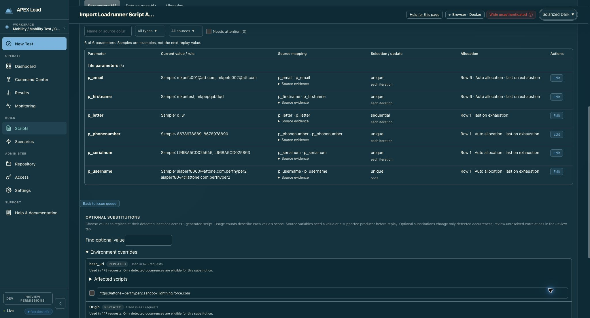

The two optional change sections use different confirmation patterns and action placements.

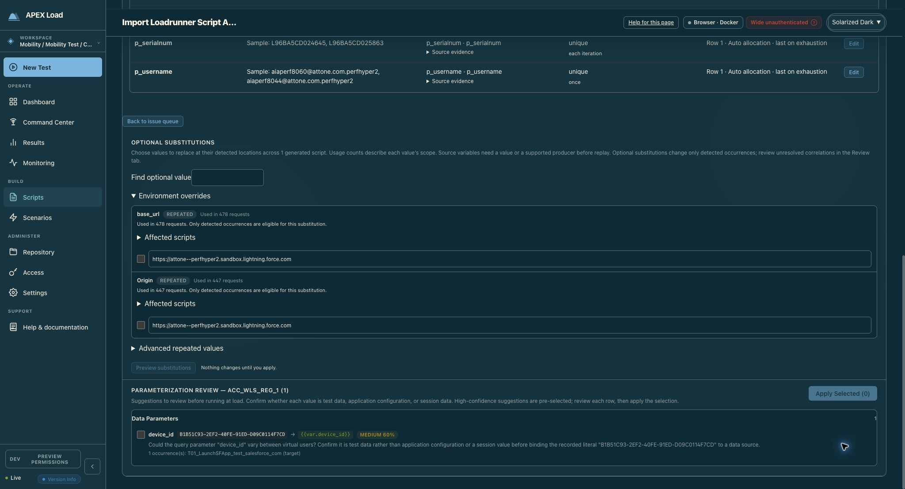

##### 4. Runtime settings — strong comparison model, inconsistent framing

Strengths: source/current comparison, per-row evidence, category navigation, and separation of mapped versus preserved behavior. Counts need their scope labeled. The narrow capped workspace, raw source category names such as FILTERS/ModemSpeed, and adjacent Log/Logging categories interrupt the product's terminology.

Normalize display categories such as Log/Logging where their meaning warrants it, retaining original source-section names in evidence. Do not discard source provenance while simplifying navigation.

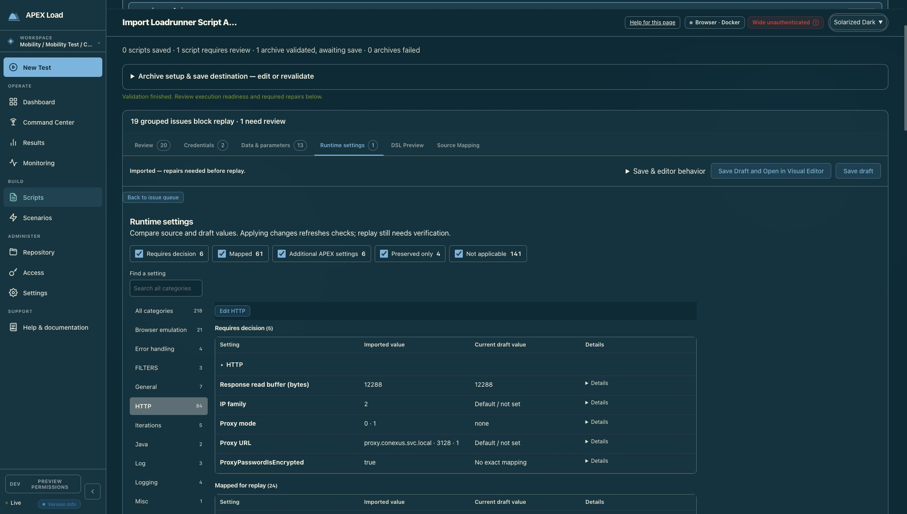

##### 5. DSL Preview — useful capability, needs layout cleanup

Strengths: read-only labeling, action search, section selection, word wrap, and explicit truncation disclosure. The heading scale, edge alignment, and download explanation differ from the neighboring tabs. A shared code-inspection header and compact notice would give more room to the JSON.

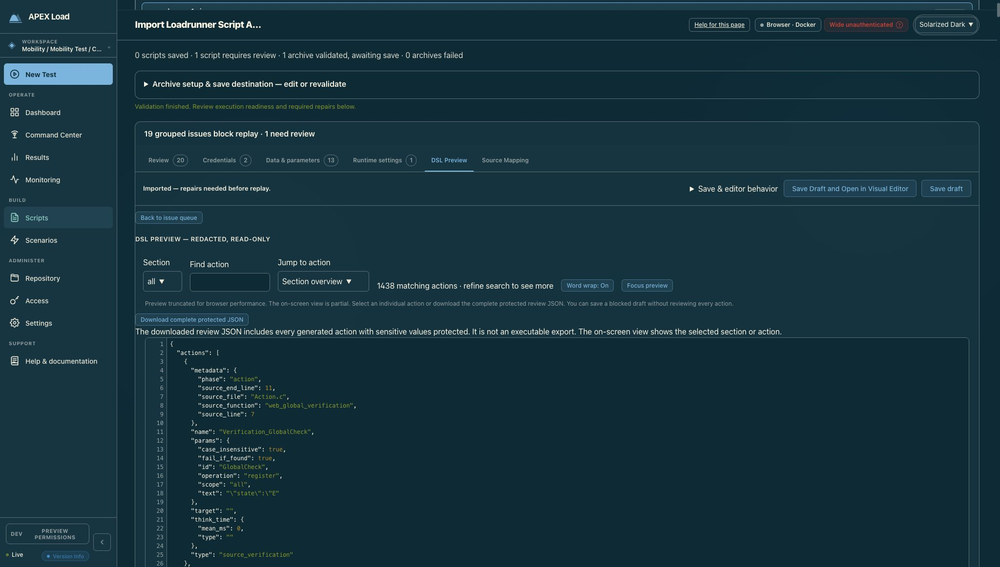

##### 6. Source Mapping — valuable specialist view, too much before the code

Strengths: source/destination comparison, coverage filters, explicit source-preview limitations, original/current destination choices, and a working link to the related repair. Mapping-review counts describe provenance review and should remain distinct from replay issue counts. Retain that distinction in labels rather than merging the two systems.

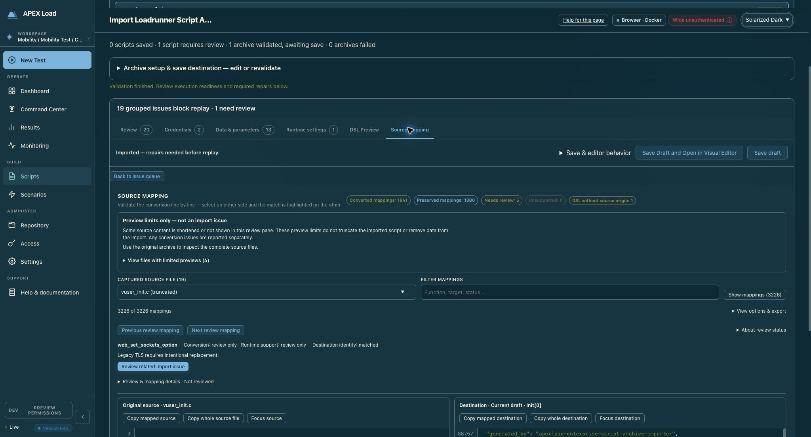

Expanded display controls and the actual comparison show the useful core experience. Consolidate the surrounding controls, and keep the common tab navigation available during long inspection sessions.

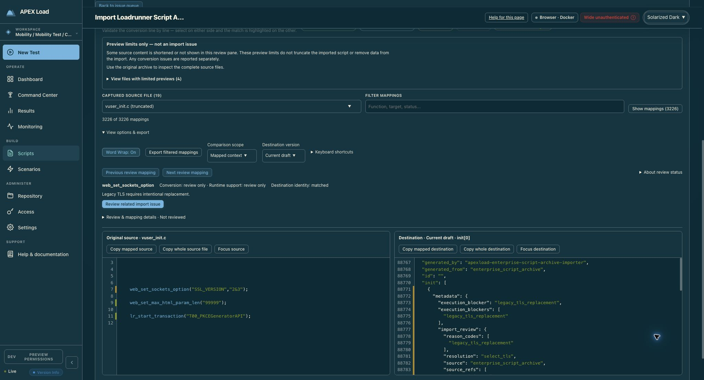

#### Duplicate-functionality decisions

| Area | Assessment | Recommended treatment |
| --- | --- | --- |
| Review tab + Back to issue queue + View remaining execution requirements | Confirmed redundant generic navigation; both buttons call the same overview selection | Keep one contextual return link in a shared header |
| Review TLS repair + Runtime TLS configuration | Overlapping user task; backend equivalence not established | Share a canonical repair flow and readiness refresh; preserve explicit migration acknowledgment |
| Parameters versus Allocation rule table | Confirmed repeated presentation; allocation preview is distinct | Keep preview, compact the repeated rules, deep-link to edits |
| Parameter editing / optional substitutions / parameterization suggestions | Adjacent operations with inconsistent workflow; not exact functional duplicates | Separate purposes, share preview/apply conventions and feedback |
| DSL Preview versus generated DSL in Source Mapping | Intentional overlap serving different inspection tasks | Retain both; share code controls and selected-action navigation where appropriate |
| Protected JSON download versus mapping export | Different output contracts | Retain both and explicitly label scope and protection |
| Current issue queue versus original conversion diagnostics | Current actionable state versus historical evidence | Keep original diagnostics collapsed and clearly marked as original/static |

#### Implementation starting points

- `dashboard/src/components/EnterpriseArchiveImport.tsx:4402`: six-tab assembly and issue badges. At 4453 and 4527, the two generic return actions both select the overview. The shared return link is rendered after the parameter inventory because the latter is injected earlier by ScriptImportReview.
- `dashboard/src/components/ScriptImportReview.tsx:932`: shared status/save header. At 1002 the non-tabbed parameter inventory precedes children; at 1106 the data extras mount separate substitution and parameterization components.
- `dashboard/src/components/ScriptImportReview.css:73`: legacy uppercase 13px section headings and credential framing.
- `dashboard/src/components/ImportSettingsTables.css:33`: newer 1rem workspace padding. At 44 Runtime alone gets an 80rem maximum width; at 40 the settings toolbar defines another control pattern.
- `dashboard/src/components/ImportParameterInventory.tsx:62`: the Data subviews and their shared table content. Keep Parameters as the editing owner while promoting Allocation preview's distinctive value.
- `dashboard/src/components/ImportRuntimeSettingsTable.tsx:53`: runtime heading, global status totals, search, category rail, and result groups.
- `dashboard/src/components/ImportGuidedRepair.tsx:179`: guided TLS selection and repair preview.

Suggested implementation order: fix issue scope and navigation first; extract shared tab header/toolbar and code-pane controls second; then consolidate repair entry points and simplify Data's optional workflows. Add workflow coverage for badge-to-issue navigation, shared counts, pending edits, source-to-repair links, and keyboard names. Run the repository's dashboard test cycle and verify the result visually after implementation.

#### Evidence limits

The audit covers one populated HTTP archive, six tabs, three Data subviews, optional data sections, the Source Mapping display options, and its TLS issue handoff. Right-arrow keyboard navigation from Data & parameters to Runtime settings was verified. The browser was returned to Runtime settings, the originally selected tab.

No saves, applies, revalidations, downloads, credential edits, or replay runs were performed. Save/batch-save equivalence and backend repair equivalence were not tested. Empty/error states, alternate protocols, multi-archive states, other themes, narrow viewports, screen-reader operation, and measured color contrast remain unverified. No application tests were run because this pass only created audit evidence and recommendations. Repository source was used to corroborate visible patterns; the running Docker build was not rebuilt or asserted to match the checkout byte for byte.

### LoadRunner import review — implementation and verification

Updated 23 September 2026. The original audit used the older Docker application on port 8080. Implementation verification uses the current working tree through Vite at [port 4012](http://127.0.0.1:4012/#/scripts), backed by a newly compiled controller and a disposable database. The embedded dashboard was also rebuilt. Existing Docker instances are separate deployments and do not receive source changes automatically.

#### Implemented

- Shared section headings, purpose descriptions, 20px content insets, search/filter controls, and full-width workspaces across the six tabs. Tables and source comparisons retain layouts appropriate to their tasks.
- Consistent tab badges for unresolved grouped replay issues, accessible count descriptions, and a single contextual link into the matching Review category. Inventory, definition-validation, and runtime-mapping totals now explain their separate scopes.
- One guided TLS migration path while migration is unresolved; raw TLS controls cannot bypass the migration review. Source-to-issue navigation remains available.
- Collapsed optional suggestions with explicit preview/apply steps. Parameter previews mask protected values and are invalidated when the selection or draft changes.
- Allocation rules collapsed into a reference disclosure, with links into the existing parameter editor. Data sub-tabs support keyboard navigation.
- Shared word-wrap controls and consistent Expand/Restore labels across DSL and source inspection. Source preview limits are compact and distinguish display limits from conversion issues. Source-pane actions wrap rather than hiding controls behind horizontal scrolling.
- Sticky review tabs, responsive header behavior, opaque themed tab backgrounds, and corrected category scroll height for short windows.

#### Code review fixes

A late repair-preview response could restore a preview after the user switched issues or categories. Preview generations now invalidate that response. Resolved-only queues disable “Resolve next issue.” Regression tests cover both navigation handoffs and preview invalidation. Browser checks also caught and corrected short-window category focus positioning and obsolete assertions for removed duplicate controls.

#### Validation

Manual review covered all six tabs, narrow layouts, and Dark, Light, Solarized Dark, Solarized Light, and Monokai themes. Sanitized archive fixtures were used; private acceptance archives are not available in this checkout.

- Full unit run: **419 files / 4,453 tests passed**. After the additional navigation-race regression, the affected component suite passed **150 tests**.
- Typechecking, ESLint, and the production embedded build passed. A final CSS-only bundle rebuild also passed; the existing large lazy-chunk warning remains.
- Fresh embedded-build local-auth import and source-editor workflows: **17 passed, 1 skipped**. This includes the final source-action wrapping assertion.
- Current-source dev-admin import and source-editor workflows: **18 passed, 1 skipped**. A further source-action wrapping regression passed after the last CSS adjustment.
- `test:cycle` was attempted, but concurrent changes elsewhere in the working tree caused typechecking failures on those attempts. Its stages were subsequently run separately, including the full dev-admin and local-auth workflow profiles. This is not a claim of a green repository-wide cycle.

Useful distinctions are retained: copying the selected mapping differs from copying the complete file; viewing data-source evidence differs from editing parameter definitions. These are labeled separately rather than removed as duplicates.

##### Repository-wide workflow findings

The full dev-admin profile completed with 124 passed, 11 failed, and 4 skipped. Two failures were in the import work (the moved readiness assertion and short-window category positioning); both were fixed and passed in the final targeted run. The other failures were in Command Center details, dev-admin landing, live metrics, run lifecycle/abort, workspace hierarchy, authoring scope/history, JMeter execution/CSV export, and guided workspace setup. Those touch concurrent work outside this change and were not silently altered to make this run green.

The full local-auth profile completed with **53 passed, 2 failed, 1 skipped**. Its remaining failures were the JMeter execution/CSV-export workflow and the sign-in/workspace/launch/stop workflow. All LoadRunner and source-sidebar tests in that profile passed. The final focused local-auth rerun additionally verified the last source-toolbar change.

#### Current screenshot evidence

These captures come from the final current-source browser runs, not the port-8080 Docker baseline. They use sanitized fixtures and represent particular review/empty states rather than every possible imported archive.

| Tab | Current evidence |
| --- | --- |
| Review | [Issue workspace](loadrunner-panel-design-2026-09-23/current/review.png) |
| Credentials | [Populated credential group](loadrunner-panel-design-2026-09-23/current/credentials.png) |
| Data & parameters | [Desktop](loadrunner-panel-design-2026-09-23/current/data.png), [narrow populated editor](loadrunner-panel-design-2026-09-23/current/data-narrow.png) |
| Runtime settings | [Populated runtime settings](loadrunner-panel-design-2026-09-23/current/runtime.png) |
| DSL Preview | [DSL controls and preview](loadrunner-panel-design-2026-09-23/current/dsl.png) |
| Source Mapping | [Comparison with wrapping actions](loadrunner-panel-design-2026-09-23/current/source.png) |

#### Source identity

The source identity below records the local implementation; it does not imply that another running deployment has been refreshed.

Base HEAD: `92889f6c28f9c17bb386d111ae1dfffa3885b83d`.

SHA-256 at verification:

```text
38a574d599775d48e3a17ee78362e20f4e0d45f929c56100025da8c9d74db229  EnterpriseArchiveImport.tsx
21ab2a762d2b2569e0335b78511fb9e14f0b48edb5cc0ae4450d286dd6c4b7d9  EnterpriseArchiveImport.css
c1e9042f652e01003a1f2d21ee6e0d2a02710a5a0384c06f0ac37b0757d159d2  ImportGuidedRepair.tsx
18feb1cc9ec23abce6c149ac05372ea65ea60a3d3e8a2ec1e64b887f4fe5191a  ImportReviewWorkspace.css
bfaf0cf12fec9fe248b9f04202f6c0cb3d8619fd904be28eb0882072860fe799  ImportReviewSectionHeader.tsx
b70e846347463517a02428526503dc719ceb74d2b89f96b89dc95f4262a1849e  ParameterizationReview.tsx
70b223aa092a41b6f86fd02dbfdc2b8e7b98fc0e62ce50f51ca06c925bce13c6  SourceMappingReview.tsx
```

## JMeter import fidelity review, code review and recheck

Date: 2026-09-23 / 2026-09-24. Status: Open: see 'Remaining source requirements' and 'Remaining product issues' in the recheck

### JMeter import fidelity verification — 2026-09-23

Source attachment SHA-256 remains `b92245ad1443767a6d9e20c87bc6988b04cff804368b5dcafca180e1be9b0cb0`. The attachment was not modified. Sanitized original and repaired fixtures were committed in `86b15ac1`.

The implementation and finding-to-test matrix are documented in [JMeter import fidelity](../../IMPORT_FIDELITY_AND_REPAIRS.md#jmeter-import-fidelity). The subsequent two-pass review and fixes are recorded in [Code review](#jmeter-import-fidelity-review-code-review-and-recheck).

#### Verified behavior

- The original fixture retains its HTTPS endpoint, 50 users, one-second ramp, and 200 iterations per user. Missing credential bindings, masked source values, and unresolved timezone semantics remain actionable blockers.
- UTC repair generates one timestamp with milliseconds. Source-timezone repair preserves the source wall-clock fields and records the literal-suffix decision. Unsupported date expressions remain blocked.
- HTTP extraction defaults overwrite an earlier trace ID on a miss; malformed expressions/responses and resource-limit errors fail instead of falling back.
- Local and generator-backed loopback tests each execute exactly 10,000 samples for 50 × 200 normal completion. A separate race-enabled test sends protobuf assignments and commits to two independent generator services over gRPC, with 25 users per shard, and verifies exactly 10,000 requests. Pause/resume, cancellation, failed samples, multiple groups, and older-generator rejection have focused regressions.
- Native CSV generation uses finalized full archives, excludes synthetic transaction duplicates, retains failed samples, uses first-byte latency, and rejects incomplete archives or failed writes. Distributed merge, redaction, concurrency, escaping, and extraction-retention limits are covered.
- The actual browser flow passes under both dev-admin and local-auth: upload, inspect source mappings and blockers, regenerate explicit repairs, save a two-user/three-iteration scenario, run six loopback samples, and download `traceId-results.csv` through the results UI. The file has one header and six sample rows.

#### Checks

- Focused engine, HTTP, generator, and API archive race tests: passed.
- SQLite and PostgreSQL termination migration tests: passed against a disposable PostgreSQL 16 database; the container was removed afterward.
- Import contract registry and golden corpus checks: passed.
- Dashboard unit suite: 422 files / 4,465 tests passed.
- Focused JMeter browser workflows: two tests passed in each authentication profile.
- Full Go suite, including generated contract freshness: passed (`go test -timeout 30m -p 2 ./...`).
- The full dashboard cycle passed type checking, lint, all unit tests, and the embedded build. Its initial dev-admin profile ran all 141 cases: 125 passed, 4 fixture/profile-dependent cases skipped, and 12 failures. Nine stale navigation/label expectations were corrected; all 37 targeted dev-admin rechecks passed in an isolated checkout. The remaining three LoadRunner review cases also passed against the latest isolated build. Every initially failing case has a passing rerun.
- The full local-auth profile passed in an isolated checkout: 57 passed and one expected private-fixture case skipped. The isolated checkout avoided concurrent dashboard builds replacing shared embedded assets during controller compilation.

The initial `npm run test:cycle` invocation did not exit successfully. Its failed browser cases were corrected or rebuilt and all passed the isolated reruns above; local-auth was rerun in full. These are recovered validation results, not a claim that the original single invocation was green. No toolchain-related failure is counted as a pass or an accepted skip.

Go commands use `DEVELOPER_DIR=/Library/Developer/CommandLineTools`; dashboard commands use Node 22.22.0. The full Go run uses a 30-minute package timeout and two-package concurrency. Dashboard unit tests use four workers to avoid contention with other concurrent workspace validation. No required test is excluded.

The optional repository documentation checker also reports pre-existing audit-link and documentation-index issues outside this change; the new JMeter guide is indexed.

### JMeter fidelity follow-up code review

Two review-and-fix passes examined conversion, extraction, finite execution, generator capability/admission, archive generation, persistence, and download handling. Review scope was the JMeter fidelity implementation; unrelated concurrent LoadRunner and messaging work was preserved.

#### Pass 1

| Finding | Fix | Regression |
| --- | --- | --- |
| A missing JSONPath ancestor returned a miss before an invalid trailing expression was parsed, allowing `on_miss: default` to hide invalid configuration. | Parse the complete supported expression before evaluating any response fields. | `TestHTTPExtractorDefaultDoesNotSuppressErrors`: missing ancestors, malformed suffixes, unsupported indices, and wrong response types. |
| Java date patterns containing doubled apostrophes lost the literal apostrophe. | Preserve escaped apostrophes both outside and inside quoted literals. | `TestJavaTimeLayoutPreservesEscapedApostrophes`. |
| CSV filenames containing a quote produced malformed Content-Disposition headers; international filenames were not encoded. | Use the standard MIME parameter encoder for artifact downloads. | `TestCSVExportDownloadFilenameEncoding`: quoted, international, ordinary, and uppercase-extension filenames through the API. |

#### Pass 2

| Finding | Fix | Regression |
| --- | --- | --- |
| The native CSV recognizer ignored processor ordering: a writer before extraction, or before a later overwrite, could export a different value than JMeter. | Translate only when the last enabled assignment to the selected extraction precedes the writer; retain a durable processor gate otherwise. | `TestCSVWriterRequiresFinalSourceExtraction`, including disabled later extractors. |
| Converter, DSL, and artifact filename rules disagreed on uppercase extensions and noncanonical names. | Share one filename validator across all three layers; preserve uppercase extensions, and review-gate whitespace, Windows drive-relative names, control characters, and empty stems. | `TestCSVExportDeclarationValidation`, `TestCSVWriterRejectsUnrepresentableFilenames`, and the download filename regression. |
| Redaction could collapse distinct action names or change a selected name, yielding extra or missing CSV rows. | Bind samples to declared export IDs before redaction; retain bindings, including explicitly empty bindings, in local and generator JSONL archives. Legacy records without bindings retain the previous matching path. | `TestCSVExportIdentityPrecedesNameRedaction`, `TestCSVExportIdentitySurvivesRedactedNameCollision`, and `TestCSVExportIdentityGeneratorArchiveRoundTrip`. |
| Sensitive extraction defaults could bypass name-based redaction when the sample lacked a value. | Apply the extraction name’s sensitivity policy to both archived provenance defaults and exported fallback cells. | `TestCSVExportSensitiveFallbackIsRedacted`. |

Generated OpenAPI and TypeScript contracts include the archive export bindings. The original attachment remains unchanged.

#### Validation

- Focused regressions across JMeter conversion, HTTP extraction, DSL validation, engine, generator, and API: passed.
- Focused race checks covering engine, HTTP extraction, generator execution/archive, and API export paths: passed.
- Dashboard type checking, lint, fresh embedded build, and all 422 unit-test files / 4,465 tests: passed.
- Initial browser cycle: dev-admin had 136 passes, four expected profile/fixture skips, and one scroll assertion failure; local-auth had 56 passes, one private-fixture skip, and the same assertion failure. The geometry test now uses the supported reduced-motion preference, captures scroll at the actual click event after Playwright positioning, and accounts for clamping to a shorter tab. The assertion still rejects an application-induced jump. The complete workflow passed twice in each authentication profile after this correction. The initial single `test:cycle` command was not green; every failed case has a passing final rerun.
- Final-build JMeter browser workflows: two tests passed in dev-admin and two in local-auth.
- Final CSV boundary race tests across converter, DSL, and API: passed.
- Full Go suite: passed (`go test -timeout 30m -p 2 ./...`), including generated contract freshness. The API package completed in 364.603 seconds.

The first full Go attempt exhausted local disk space. Unused compiler scratch directories were removed only after confirming no process held them open; the failed job was stopped and the full suite restarted. This environment failure is not counted as a passing or skipped check.

All seven review findings above are fixed and covered by regressions. No unresolved finding remains from these review passes. The original attachment SHA-256 remains `b92245ad1443767a6d9e20c87bc6988b04cff804368b5dcafca180e1be9b0cb0`.

### Original JMeter import recheck — 2026-09-24

Reimported the original Downloads attachment through the current API router using a temporary SQLite-backed server. Both import and validation returned HTTP 200 and agreed on preflight, scenario settings, statistics, and review sections. No requests were sent to the source endpoint, and no repairs were saved to the original attachment.

Source SHA-256: `b92245ad1443767a6d9e20c87bc6988b04cff804368b5dcafca180e1be9b0cb0`.

#### Correctly preserved

- Original HTTPS endpoint, including port 443.
- One enabled sampler; 50 users, 1-second ramp, 200 iterations per user; iteration termination with no duration cutoff.
- JSONPath trace extraction with `NOT_FOUND` default and `on_miss: default`.
- Native `traceId-results.csv` archive declaration with ordered `traceId,latencyMs` columns and the source writer's `NOT_FOUND` fallback.
- Disabled CSV source and throughput timer ignored; extractor, assertion, and postprocessor source ranges retained.
- UTC trial produces a single millisecond timestamp parameter. This was a diagnostic trial, not an operator-selected repair.

#### Remaining source requirements

1. Explicit timestamp policy: UTC normalization or an acknowledged wall-clock timezone.
2. Explicit name repair: references `client_id`/`client_secret` differ from declarations `cid`/`cs`.
3. Real credential values/bindings: trying the name repairs plus UTC still produces masked-source and missing-secret gates. No placeholder became runnable.

The unmodified import has `preflight.valid: false`; this is correct. Credential storage was not configured in this temporary server, and no credential was provisioned.

#### Remaining product issues

##### P2 — Structured diagnostic payload is absent

The response contains `diagnostics: null`, although the review sections contain two blocker diagnostics, a credential warning, and informational records. Consumers cannot use the structured diagnostics field to render/filter those findings. The JMeter response writer passes review sections and unsupported strings but does not populate structured diagnostics.

##### P2 — Review accounting still mixes categories

The original response reports `stats.unsupported: 0`, but `unsupported_elements` contains six strings: the successfully translated CSV writer, two informational listeners, two blockers, and a warning. `stats.review_required: 1` describes a blocked sampler while the review section reports two distinct blocker behaviors. These fields remain inconsistent as behavior-level review evidence, even though execution stays correctly gated. The compatibility report also includes the credential warning among unsupported fragments.

No additional conversion/runtime defect was reproduced in this check. These reporting issues mean the earlier requirement for a single normalized review outcome model is not fully satisfied.

#### Verification

- Original import, validate, UTC-only trial, and UTC plus name-binding trial: passed through the API router.
- Converter/date-pattern/extractor regressions: passed.
- Local and distributed iteration regressions, including exact 10,000-request completion: passed against loopback services.
- Finalized CSV samples, incomplete archives/write failures, concurrent/distributed merge, filename encoding, redacted identity, and sensitive fallback regressions: passed.
- Import and validation readiness agree.

This was an API and regression-test recheck. It was not a new browser walkthrough or a live execution against the source service.

#### Resolution: normalized JMeter review evidence

The two findings above are addressed by one JMeter-specific review projection built from typed findings, source mappings, and durable gate reasons. Structured diagnostics include canonical reason codes and source references. Source mapping IDs keep distinct elements separate even on the same line of minified XML; document paths keep ZIP entries separate.

| Original fixture evidence | Before | After |
| --- | --- | --- |
| Structured diagnostics | `null` | Typed source-qualified diagnostic array |
| Blocking source behaviors | Implicit in mixed strings | `review_summary.blocking_behaviors: 2` |
| Unsupported behaviors | Zero statistic but six mixed strings | Zero behaviors and empty unsupported list |
| Workload | One converted, blocked sampler | Unchanged; separate from behavior counts |
| UTC-only diagnostic trial | Missing-variable gate remains | One blocking behavior; timestamp finding removed |
| UTC + source-name binding trial | Masked values remain blocked | Two credential/source-value behaviors, without duplicate gate evidence |

Review sections, compatibility evidence, and review-gate preflight use the normalized model. Other readiness checks remain intact. New single-script drafts preserve the evidence through attested save/reload. The dashboard uses behavior counts, renders typed findings once, retains source navigation, and falls back to legacy evidence when normalized evidence is absent. Client-side runtime edits and reviewed marks do not clear server gates.

Regression coverage includes original/UTC/binding cases, attested save and reload, ZIP source identity, nested controllers, unsupported and repeated processors, minified same-line samplers, empty diagnostics, normalized UI rendering, and legacy fallback. The browser workflow checks the original fixture and explicit repairs under both authentication profiles.

##### Resolution verification

- Full `go test -timeout 30m -p 2 ./...`: passed, including API, converter, import-contract golden, DSL/OpenAPI freshness, and storage tests.
- Dashboard cycle: type checking, lint, 424 unit-test files / 4,474 tests, fresh embedded build, and dev-admin workflows (137 passed, four intentional skips) passed. The first local-auth profile run passed 56 tests with one intentional skip, but its unrelated viewer login/sign-out test timed out; a full-profile retry is recorded below.
- Final focused JMeter browser workflows: three passed under dev-admin and three under local-auth, including source navigation, durable blockers after a reviewed mark, explicit repairs, save, finite execution, and CSV download.
- Final focused dashboard regression run: 63 tests passed. Shared-checkout integration: focused API/converter regressions and dashboard type checking passed after merging alongside concurrent changes.
- Broad validation used an isolated checkout to avoid concurrent source edits; the implementation was then merged into the shared checkout without replacing the other task's work.
- The original attachment's SHA-256 remains `b92245ad1443767a6d9e20c87bc6988b04cff804368b5dcafca180e1be9b0cb0`. Final conversion yields seven structured diagnostics: two blockers, two warnings, three informational records, and no unsupported behaviors.
- Full local-auth retry: **57 passed, one intentional skip**. The viewer login/sign-out test passed without code or timeout changes. Thus both browser profiles passed; the first cycle's transient authentication timeout remains documented above.

##### Follow-up code review loop

Two review/fix passes found and corrected these normalization defects:

- Empty action paths could compare equal and collapse separate source findings. Matching now requires a nonempty identity and respects qualified source references.
- A durable gate could suppress a separate authored reason on the same action. Independent canonical reasons now survive reconciliation, including coded diagnostics.
- Duplicate evidence merging depended on arrival order and could discard unsupported status, promotion/execution gates, acknowledgement requirements, or stronger severity. Merging retains the strongest readiness evidence and execution gates always emit blocker diagnostics.
- Enriching a finding's display detail could discard its stronger gate/severity. The normalized merger now receives that evidence too.

Regression tests reproduced the first two defects and all four merge-order cases before the fixes. Additional tests cover coded diagnostics and stronger authored findings. Existing original/UTC/credential, nested, disabled, distinct-source, and import-contract regressions remain passing.

Final review-loop verification: full `go test -timeout 30m -p 1 ./...` passed, including contract freshness. The initial two-package run encountered temporary-disk exhaustion during builds; its retry completed without disabling checks. Dashboard type checking and lint passed. The initial dashboard unit run had one unrelated editor-completion failure; it passed in isolation, and the full retry passed 425 files / 4,476 tests with two workers and no code changes to that test. The fresh embedded build passed, followed by both full browser profiles: dev-admin 137 passed / four intentional skips; local-auth 57 passed / one intentional skip. No unresolved finding remains from the two review passes.

## JMeter source-plan batch repair and code review

Date: 2026-09-24. Status: Open: see 'Remaining evidence boundary'

### Source-plan execution and protected batch repair verification

This change supplies grouped-source execution and atomic repair publication. It
does not establish strict JMeter client parity or advertise
`jmeter_messaging_v1`.

#### Verified implementation

- Versioned, hash-bound manifests stage all groups before one commit epoch;
  complete-population reservations, failed-stage cleanup, immutable membership,
  retry handling and capability negotiation preserve single-generator affinity.
- One `MultiGroupEngine` owns source state and lifecycle. Group sinks and secret
  resolvers remain separate; shared telemetry is emitted once. Owner failures
  release every waiter, and shared resources drain with the owner.
- Encrypted batch parents preserve original source bytes, source identities,
  scripts, scenario and reviewed overlays. Preview digests bind exact results.
  Lease-fenced publication receipts prevent competing repair/save revisions.
- Restart recovery, stale revisions, stripped identities, mixed membership,
  source/workload preservation, independent credentials and concurrent repair
  and save are covered. Payload edits reject trailing JSON and invalid pointers.
- Browser repairs replace the whole batch and refresh review/preflight evidence;
  credentials remain reference-only and strict blockers remain enforced.

#### Checks

- `go test -p 2 -timeout 30m ./...`: passed (the full API suite took 698 seconds).
- Latest focused API batch/manifest tests: passed after the final payload checks.
- Race tests: engine, generator RPC, import artifact/session packages and protected
  batch API tests passed. A loaded-host iteration-count failure passed isolated
  recheck and a subsequent complete generator race run.
- Kafka and Event Hubs packages with both real-adapter build tags: passed. These
  are adapter tests, not authorized live-service conformance.
- API/protobuf artifacts were regenerated through their repository generators;
  generated-artifact checks passed in the full Go run.
- Dashboard type checking, lint, embedded build and 4,476 unit tests passed.
- Dev-admin browser profile: 137 passed, four expected skips.
- Protected browser checks passed in dev-admin and local-auth modes. The latter
  binds separate Kafka/east/west references, saves/reopens the scenario, rejects
  a stale revision and verifies blocked launch.
- Full local-auth browser profile: 56 passed, one expected skip, one environmental
  failure (`ENOSPC` while writing a dashboard-analysis screenshot). After freeing
  reproducible cache space, that exact test passed on an isolated port/output
  directory. The original `npm run test:cycle` therefore exited nonzero; its sole
  remaining failed test passed the targeted rerun.

Concurrent embedded builds interrupted earlier Go compilations; a stable source
snapshot was used for the protected API race run. Reproducible old Go build-cache
objects were pruned when local disk pressure interrupted another build.

#### Remaining evidence boundary

Authorized Kafka/OAuth and Event Hubs endpoints were unavailable. No live strict
parity claim is made. PostgreSQL service-level crash/failover testing was not run
against an external database; publication uses the existing protected-store
fence and asset saves use the existing transactional persistence contract.

### JMeter source-plan and atomic batch review

#### Findings fixed

1. Protected batch child capabilities could be consumed by older single-script
   create/mutation paths, bypassing whole-batch publication. Only the dedicated
   JMeter batch save can now claim those children. Ordinary create rejects batch
   drafts even when their child token is omitted. Legacy single-script repair
   also explicitly rejects a batch candidate.
2. The generator checked source/project compatibility only when a script already
   declared JMeter compatibility. Every manifested script now checks its project,
   and a compatibility-bearing manifest cannot admit an ordinary script.
3. A rejected assignment that omitted its manifest did not immediately abort an
   existing staged source plan. Failed staging now releases that plan's complete
   reservation regardless of the failed request's manifest presence, while
   retaining generation, supervision-token and committed-run fences.
4. The new draft guard would also constrain copies of successfully saved library
   scripts if their active batch marker survived persistence. Atomic save now
   converts the marker to `jmeter_batch_origin_v1` provenance. Saved assets retain
   source identity without depending on an expiring draft capability. Interrupted-save
   recovery normalizes the requested draft to the same provenance representation
   before comparing it with persisted assets.

#### Regression coverage

Tests cover standalone child claims and tokenless partial creation, successful
whole-batch claims/save, persistent provenance, SQLite-backed repeated save
receipts and interrupted-save identity recovery, mismatched project/profile
identities, and reservation release after manifest omission.
The protected browser workflow also checks standalone creation is rejected before
repairing, saving and reopening the complete import.

The subsequent code review found no further actionable issues in the revised
candidate publication, save, staging, ownership and cleanup paths. Final verification:

- Focused batch tests pass, including SQLite receipt replay and recovery identity.
- API batch race tests pass (146 seconds); full generator/engine/protected-store
  race suites pass.
- Kafka/Event Hubs real-adapter build-tag tests pass; these are not authorized
  live-service conformance evidence.
- The protected local-auth browser journey passes, including the partial-save
  rejection, repairs, save/reopen and launch blocker.
- The full dashboard cycle passes: type checking, lint, 4,476 unit tests, fresh
  build, dev-admin browser workflows (137 passed, four skipped) and local-auth
  workflows (57 passed, one skipped).
- `go test -p 1 -timeout 30m ./...` passes on the final validation snapshot
  (API package: 522 seconds), including generated-artifact freshness checks.
  The snapshot isolates tests from concurrent dashboard rebuilds in the shared
  checkout; all nine reviewed source/test files were verified identical.
  Initial snapshot-only Git-history failures were resolved before this final run.

Strict client parity and authorized live-service conformance remain outside these
fixes.
