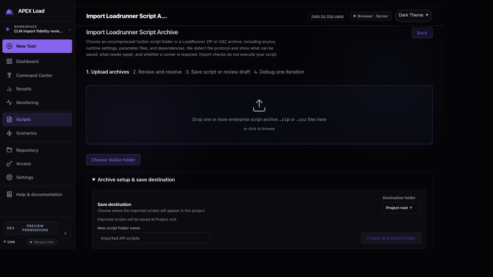
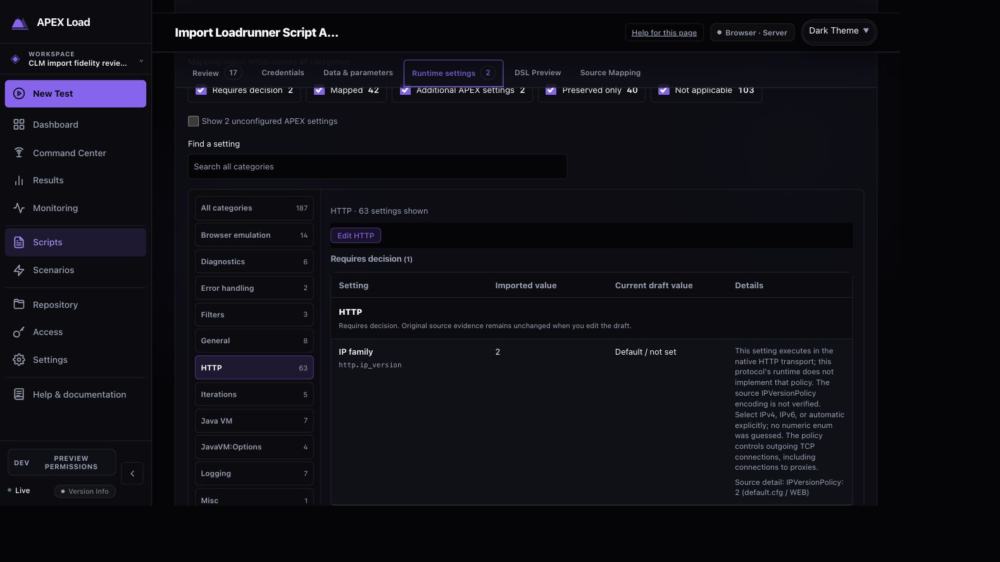
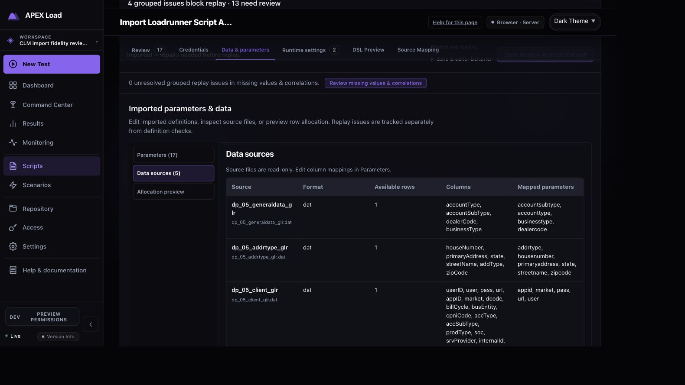
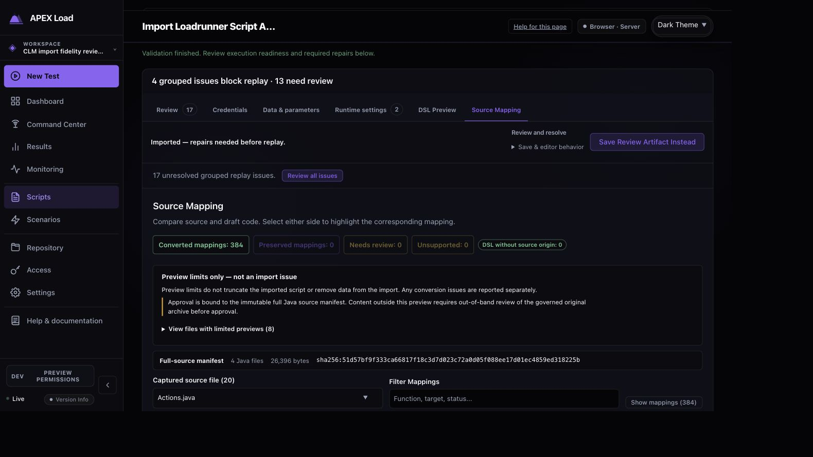
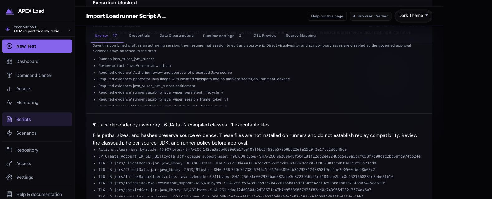
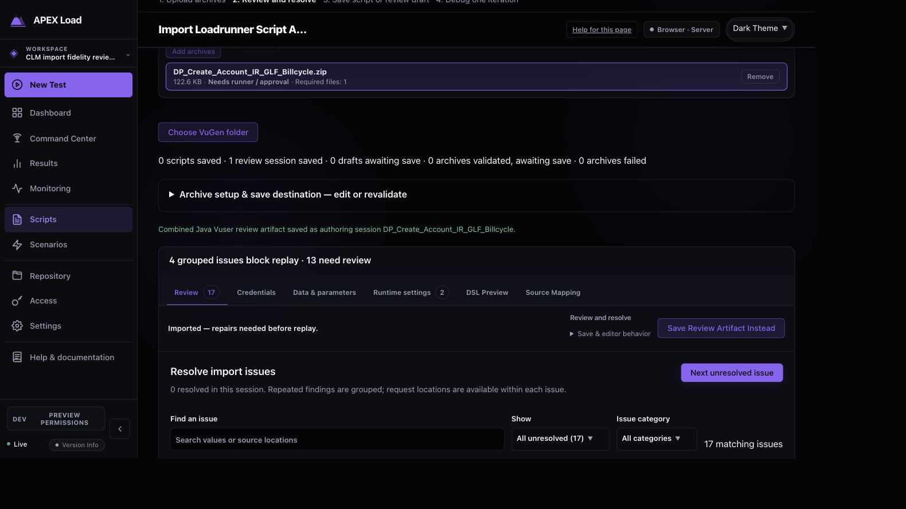
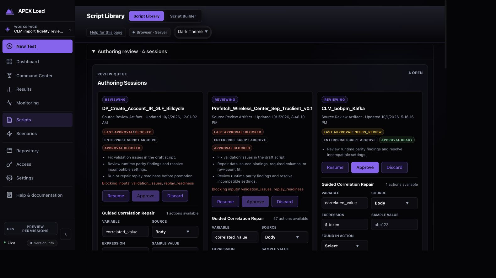
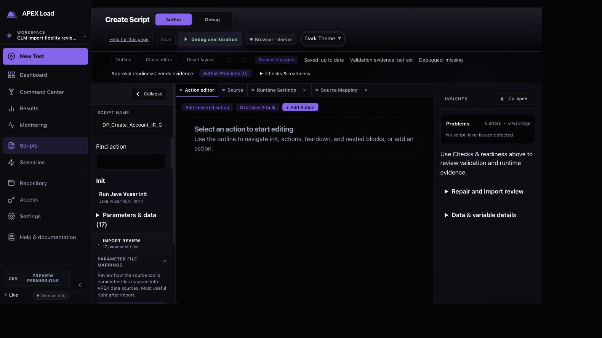
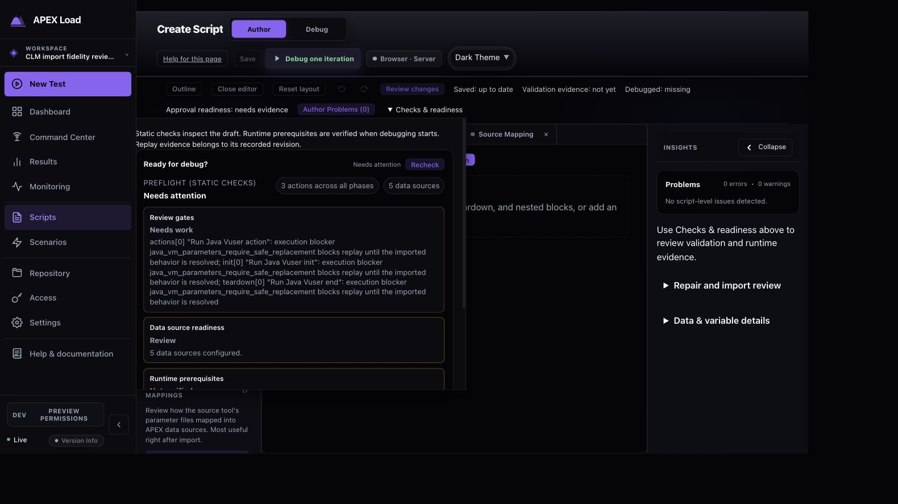

# Java VuGen import and review — 2026-10-01 to 2026-10-02

Status: import, attachment storage, save and reopen verified on 2026-10-02; independent code review is clean. Validation is complete; the authenticated browser profile passed its full rerun. The initial timeout is retained in the validation history. The original application was not contacted and supplied Java/JAR/class/EXE code was not executed.

## Fidelity result

The primary `DP_Create_Account_IR_GLF_Billcycle.zip` and supplemental `OneDrive_2026-10-01.zip` account for 107 regular source members. Six supplied JAR basenames match all six JAR entries in the source classpath; the seventh classpath entry is a directory. Dependency fingerprints are inspection evidence, not runner installation or dependency closure.

All 205 selected CFG/USP assignments, 77 USR assignments, 17 parameter definitions and 221 selected PRM assignments are accounted for. Five datasets retain seven data rows (1, 1, 1, 3, 1), with 584 combined bytes including headers. An earlier audit counted the string length of `inline_data` as rows; the browser and independent CSV parsing corrected that report error. Primary and paired data definitions are byte-identical.

Paired conversion conserves 362 of 362 function dispositions: 116 native LR bridge dispositions and 246 requiring the Java runner. The review shows 384 source mappings, a different denominator that includes other statement mappings. Four Java source files retain a 26,396-byte full-source manifest. The supplied helper text resolves two source-inheritance accounting findings; its equivalence to the compiled helper remains unproved.

Four fidelity gates remain: malformed imported VM quoting and safe VM replacement in init, action and teardown. Three governed lifecycle actions are structurally valid; approval, runner qualification, JDK/classpath configuration and application reachability remain prerequisites. No source VM arguments were guessed or replay gates removed.

The [detailed fidelity report](java-dependency-fidelity.md) links value-free setting inventories, physical-member fingerprints and manifest dependency checks.

## Product Design flow audit

Current-run Codex in-app browser captures support this review. Original hosts, credentials, data values and source code are excluded from repository screenshots. Private attachment-policy evidence stays with the private local review artifacts.

| Step | Task | Health | Evidence and finding |
| --- | --- | --- | --- |
| 1 | Queue the project and attach the dependency ZIP | Good | Entry explains source/settings/dependencies and says import does not execute the script. Required Files accepts the intact supplemental ZIP. |
| 2 | Validate and inspect runtime coverage | Good, replay gated | Every selected source assignment is accounted for. Categories, status filters and search make the large settings list navigable. The UI merges related source keys; its 187 displayed rows differ from 205 physical assignments. |
| 3 | Inspect parameters, data and source mapping | Good, review required | Parameter definitions and read-only datasets are separated from replay issues. Source Mapping distinguishes bounded previews from full-source evidence. Converted mapping counts represent conservation, including external Java dispositions; they do not imply native Go execution. |
| 4 | Inspect inert inventory and attach JARs | Good, runtime qualification required | All six JAR uploads completed, including the 53.8 MB WebLogic JAR. Stored bytes match the supplied SHA-256 and sizes in the project-owned storage namespace. Inventory remains inert; policy-off upload gives operator guidance. The seventh classpath entry is a directory, not a missing JAR. |
| 5 | Save the combined authoring review | Good, approval blocked | The receipt confirms zero executable scripts and one saved review. Database readback verifies settings, data, source accounting, original/member fingerprints and all six exact bindings; four fidelity blockers remain. |
| 6 | Find and reopen the saved review | Good, replay gated | Scripts → Authoring review → Resume reopens the named review, three lifecycle actions and 17 parameter mappings. Repeated after controller restart with uploads and Java execution disabled; API readback preserves all six bindings. Checks & readiness explains the safe-VM replacement and governed runner prerequisites. |

### Captured evidence

1. Entry and destination:

2. Runtime categories and an explicit unresolved source policy:

3. Data source counts and column/parameter mappings, with no row values:

4. Source coverage, full-source fingerprint and preview limit:

5. Inert dependency evidence (cropped before recorded host paths):

6. Save receipt:

7. Durable review queue and Resume:

8. Reopened authoring workbench:

9. Explicit replay gates after reopening:

The [sanitized saved-review verification](save-verification.json) records exact attachment hashes and typed import counts. The complete archive backups, raw database, file capability references and values remain in the private local review directory.

### Design and accessibility observations

The import status and execution status are distinct, and blocked replay still permits a durable review save. Tab labels, issue counts, filters and mapping navigation support a long review. The native details controls expose dependency evidence without requiring it all to stay expanded.

At some scrolled positions, the sticky review tabs overlap the section heading or status. The first source-mapping capture was recaptured at a stable heading position. This is a visible layout issue to refine; it did not prevent tab selection, filtering or saving. Long data-source names wrap into short fragments in narrow table columns, and the dense hash list needs generous width. Keyboard Home moves to the first review tab by normal tablist behavior; Page Up/Down scrolls the containing view. These observations do not establish screen-reader or WCAG compliance. Contrast measurement, zoom/mobile layout and a complete assistive-technology pass were outside this audit.

## Independent code review

The converter, API and frontend were reviewed by agents other than their authors, with root review of the combined diff and actual browser verification. Findings were repaired and regression tests added. Final independent re-review found no remaining actionable code findings. Validation outcomes and the browser-cycle timing caveat are recorded below.

| Finding | Repair / regression scope |
| --- | --- |
| Opaque JAR/class/EXE/store/certificate bytes could enter source previews | Known extensions and binary signatures stay inert; disguised binary and valid UTF-16 source cases are tested. |
| Dependency-only archives lacked a clear project attachment path and durable inventory | Recognize dependency bundles without inventing an executable script; retain finalized path/size/hash inventories and explicit attachment guidance. |
| Supplemental ZIP handling could lose member-level provenance or merge ambiguous content | Bounded one-level expansion, combined budgets, collision/project/nested-ZIP rejection and original/member fingerprints. |
| Primary merge could erase unsafe ZIP header metadata | Reject encryption, nonregular entries, invalid names and directory/path mismatch before rewriting, including explicit replacements. |
| Authoring save lost uploaded Java bindings | Carry exact-entry bindings into the governed review draft; save/reopen contract is checked by real API browser regression. |
| Attachment exception could accept executable changes or forged/foreign files | Server-owned project capability, size, hash and ZIP signature verification; exact full execution baseline after masked-secret reconciliation. |
| Concurrent or stale uploads could overwrite bindings across reviews/projects | Serialized uploads, operation locks, project/item/generation fencing, explicit empty removal and changed save identity. |
| Authoring PUT did not apply the attachment checks | Same capability checks on changed bindings; preserve the raw-credential execution-context guard. |
| Submitted protocol whitespace or a protected protocol switch could skip the Java guard | Select the strict guard from the trusted original family and normalize family comparison; exact baseline still rejects protocol changes. |
| Equal inactive bindings could activate through protocol/enabled-state transitions | Verify changed protocol, project, ordered classpath and false-to-true activation. A server-private checked marker limits the attested-create exception; all other claims receive attachment verification. Legacy activation and policy-off unchanged evidence are covered. |

## Validation

| Gate | Result |
| --- | --- |
| Complete converter/sourceview package suites | Passed and repeated independently. |
| Final API trust regressions | Passed in 8.334 s; independent final repeat passed in 5.082 s. |
| Java attachment policy/auth matrix | 4/4 passed against the final reviewed controller: dev-admin and local-auth, each with uploads disabled (404) and explicitly enabled (201). Exact durable bindings, Resume, disabled runner and zero executable scripts are asserted. |
| Dashboard type checking, lint, units and build | Passed on Node 22.22.0: both TypeScript configurations, full lint, 447 unit files / 4,712 tests and the final embedded build. The existing ScriptEditor chunk-size warning remains. |
| Complete browser profiles | Dev-admin: 181 passed / four expected skips. Final full local-auth rerun: 101 passed / one expected skip, exit 0 (14.2 min). |
| Full Go suite | Passed all 117 tested packages, with six additional packages containing no tests (`go test -count=1 -p 2 -timeout 20m ./...`). |
| Documentation and whitespace | Passed: 92 active Markdown files and `git diff --check`. |

The initial `npm run test:cycle` exited 1. Its broad dev-admin profile passed 181 tests with four skips; local-auth passed 100 tests with one skip and one existing Source Mapping layout test exceeding its 30-second timeout. The new Java import/save/reopen case passed in both broad profiles. Three dev-admin skips require restricted local-auth personas; the private acceptance-archive case was skipped in both profiles because its environment variable was unset. Actual supplied-script import/save/reopen was independently checked in the local review workspace.

The unchanged failed workflow subsequently passed its focused local-auth rerun against the exact final reviewed controller and fresh test state, completing all layout assertions. Two independent reviews found no demonstrated product or layout-contract defect in the retained artifacts. The initial cycle failure and truncated trace remain retained privately; the focused pass is a separate result, and the initial full cycle is not reported as green. No source, assertion, timeout or asset changes were made for that rerun.

Before publication, the entire unchanged standard local-auth profile was rerun using Node 22.22.0, fresh test state and the standard workflow harness. It passed all 101 eligible cases with one optional private-archive skip and exit 0. The previously timed-out Source Mapping case passed in 11.6 seconds, and the Java JAR policy/save/reopen case passed. Together with the completed dev-admin profile, this closes the browser-profile validation gate; the original cycle failure remains part of the history.

Test fixture/type/assertion corrections are tracked separately from production findings; the final test-only JSON/Outline corrections received a clean independent review. The new fixtures are synthetic inert JAR/ZIP files. Public evidence was checked independently against private counts, fingerprints and endpoint/value candidates; supplied customer bytes remain private. All nine screenshot copies match the individually inspected accepted captures.

## Review handoff

The saved `DP_Create_Account_IR_GLF_Billcycle` review is available through Scripts → Authoring review → Resume. The queue clearly marks approval blocked; reopening exposes the three lifecycle actions, 17 parameter mappings and Checks & readiness. A controller restart with new uploads and Java execution disabled retained the saved six-JAR bindings.

Implementation and validation used the isolated `codex/java-dependency-fidelity` worktree, based on the previously pushed import work. The original shared checkout’s unrelated working files were preserved.
