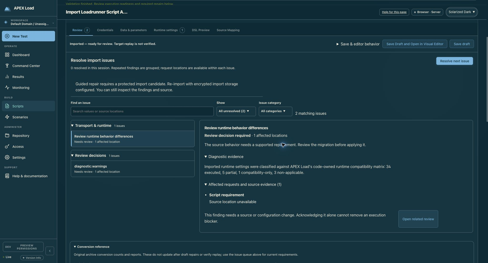
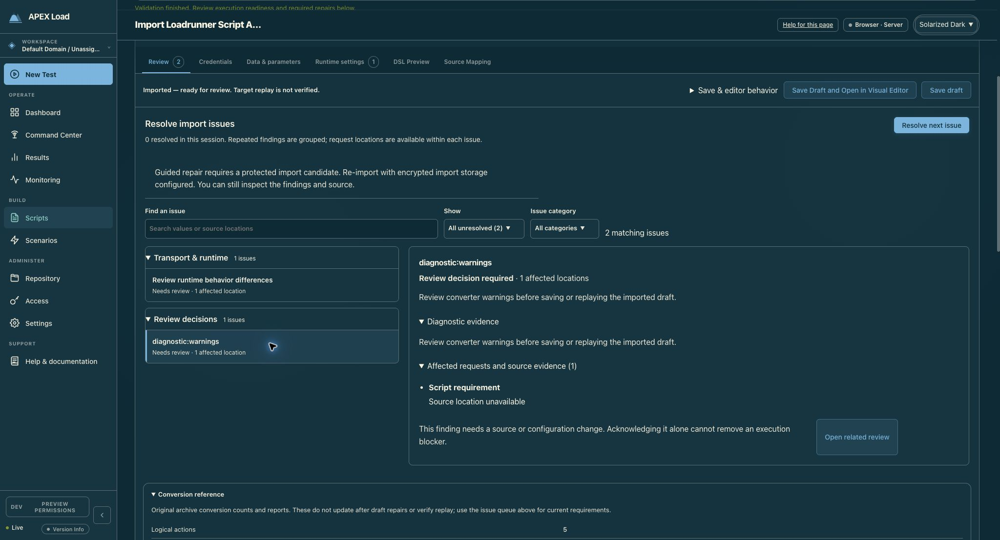
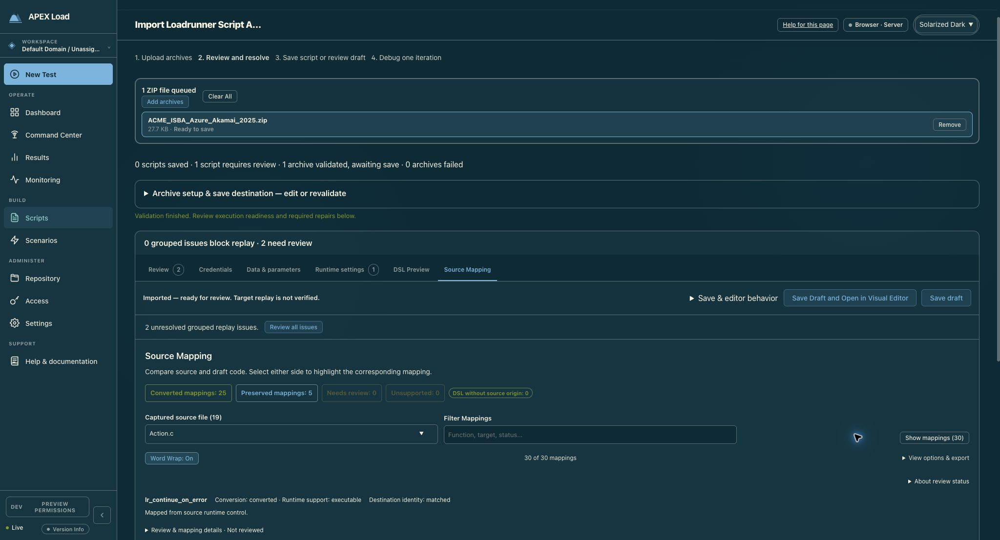

# Resolve import issues — focused design review

Reviewed 23 September 2026 on the current-source dashboard at port 4012, using the populated archive already open in the operator’s browser. The tab is currently called **Review**. No application code, imported values, or saved scripts were changed.

Keep the vertical issue queue. The right pane should become a focused resolution workspace: explain the exact difference, show its consequences, offer the relevant controls, and verify the outcome in place.

## Captured flow

### 1. Select runtime behavior differences — navigation good, resolution unclear

The selected state is clear and the queue remains visible. The detail pane instead offers a generic migration paragraph, aggregate counts (34 executed, 5 partial, 1 compatibility-only, 3 non-applicable), and “Script requirement / Source location unavailable.” None identifies the particular settings requiring a decision. “1 affected location” actually represents a grouped script-level diagnostic. The execution-blocker warning also appears for this nonblocking review item.

**Recommendation:** show the affected settings as rows with source value, current replay behavior, consequence, and available action. Keep compatible settings collapsed. Label the scope “Script-wide” when there is no request location. Put exact technical diagnostics in a secondary disclosure.

### 2. Select converter warnings — poor specificity and duplicated information

The title is the internal key `diagnostic:warnings`. The same generic instruction appears in the introduction and Diagnostic evidence. The actual warning is available elsewhere in Conversion reference: line 28 uses `web_reg_find Search=ALL`, while replay checks the main response body only and does not reproduce the source’s full search scope.

**Recommendation:** title the issue “Text check searches a narrower response scope.” Show “Source: all response content / Replay: main response body” and explain the risk of a missed or changed assertion. Display the relevant source line and assertion. Offer a supported assertion edit here, or an explicit source-edit handoff when equivalent behavior is unavailable. Do not imply that acknowledging this limitation restores behavioral parity.

### 3. Follow Open related review — destination works, context is lost

The warning’s button opens Source Mapping at `lr_continue_on_error`, the first selected mapping, rather than the warned line 28. It shows all 30 mappings and no warning-specific selection. The operator must rediscover the problem.

**Recommendation:** prefer editing in the selected issue pane. When navigation is needed, label the button by destination and action, such as “Inspect assertion at line 28”; carry the issue, file, line, target path, and current draft through the handoff. Provide “Back to this issue” after the focused edit.

## Proposed detail-pane structure

1. **Issue and impact:** plain-language title, Blocks replay / Needs review, and meaningful scope.
2. **What differs:** concise source-versus-current behavior; one specific explanation of the effect on replay.
3. **Fix this issue:** operation-specific fields using the existing runtime, parameter, credential, or assertion editor components. Lead with a supported recommended option; retain alternatives when the operator must choose.
4. **Check the change:** Preview change → concise affected-field diff, affected occurrences, and remaining requirements → Apply change. Keep protected values masked. Backend validation remains authoritative.
5. **Outcome:** show what changed and what remains; offer “Next unresolved issue” without automatically moving before the operator can read the result. Preserve edits when navigating or request a clear discard decision.

A persistent local action row would keep Preview/Apply available for long issue content. Advanced diagnostics and full source evidence belong below the primary repair controls. Retain separate states for resolved, reviewed with an accepted limitation, and unresolved; a review decision must never silently clear an execution blocker.

## Inline repair coverage

| Issue type | Suggested in-place interaction |
| --- | --- |
| Runtime setting | Source/current values and the existing setting editor; guided TLS migration where required |
| Missing value | Choose an existing producer, add a parameter, or configure extraction from a preceding response |
| Missing credential | Reuse the project-binding picker and existing masked credential controls |
| Missing body | Restore the body through the governed editor; redact previews |
| Unsupported or partial conversion | Show the exact unsupported behavior and supported alternatives; otherwise a focused source/editor handoff |

The current implementation already supports several protected-draft inline operations in `ImportGuidedRepair.tsx`, including parameter creation, producer binding, extraction, restored bodies, proxy secret references, and TLS migration. Reuse those operations rather than creating another repair backend. Diagnostic-prefixed items currently bypass that form; their structured source/setting details must be retained to make them actionable.

## Priority

1. Replace summary-only diagnostic items with specific findings, useful titles, actual evidence, and accurate scope.
2. Embed existing editors and repair operations in the detail pane with preview/apply/refresh.
3. Fix focused handoffs and add explicit recovery for unavailable/expired protected drafts.
4. Improve queue progression, action placement, and keyboard behavior.

## Accessibility and verification limits

Selection is conveyed visually and in the accessibility tree. Selecting an issue moves focus to its detail heading; preserve a clear keyboard route back to the queue and announce repair results. The queue uses pressed buttons, not ARIA tabs: keep its semantics consistent and test arrow-key behavior if tab-like navigation is introduced. Muted supporting text in Solarized Dark should receive a measured contrast check; screenshots alone cannot establish compliance.

The current draft reports that protected import storage is unavailable, so a live repair preview/apply could not be completed in this audit. The existing operations above were confirmed by code inspection, not by a successful live repair in this run. Do not promise that a layout change alone enables them. Show a concise “Repairs unavailable for this draft” state with an actionable re-import/admin route. The in-app capture was cropped, so accepted screenshots were captured from the existing Chrome tab on the same current-source server. No stale screenshots or earlier test traces were used as audit evidence.
