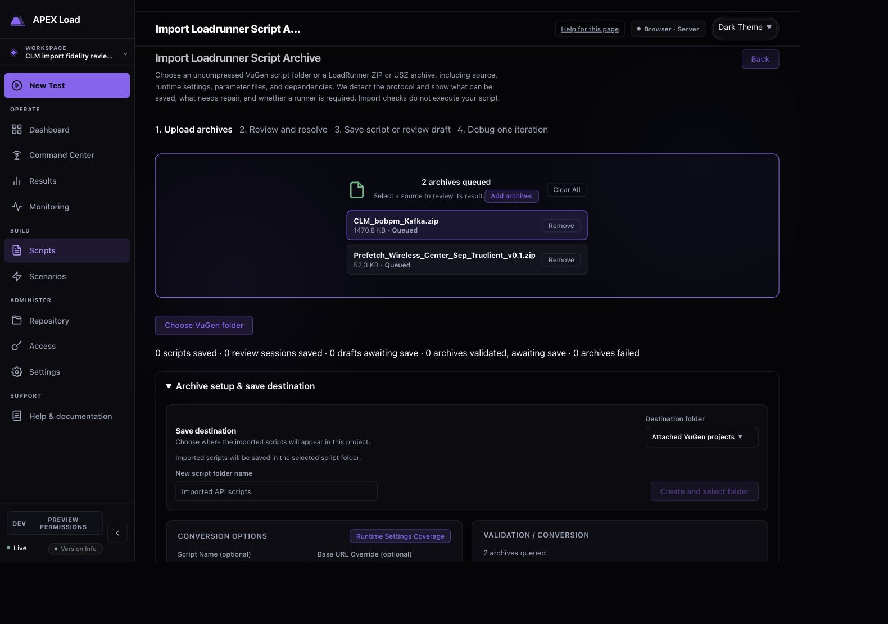
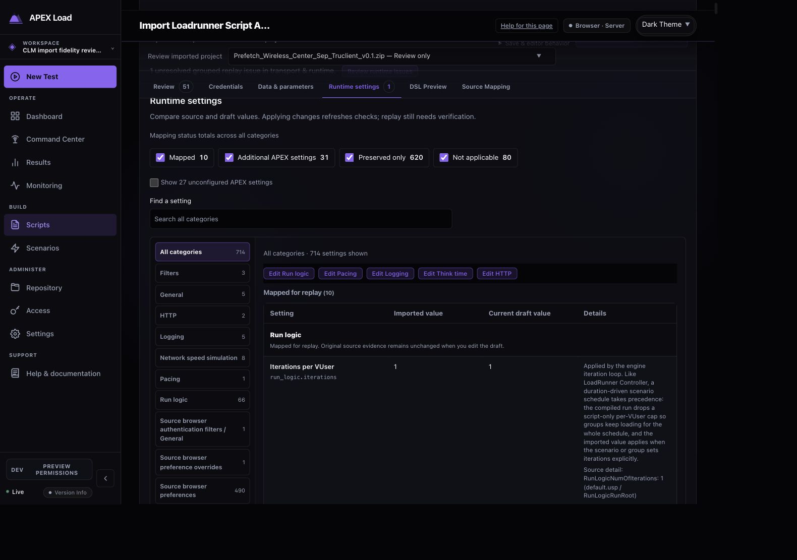
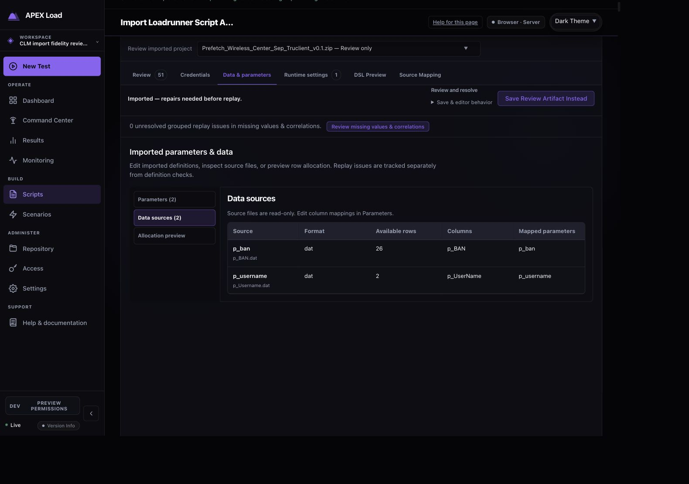
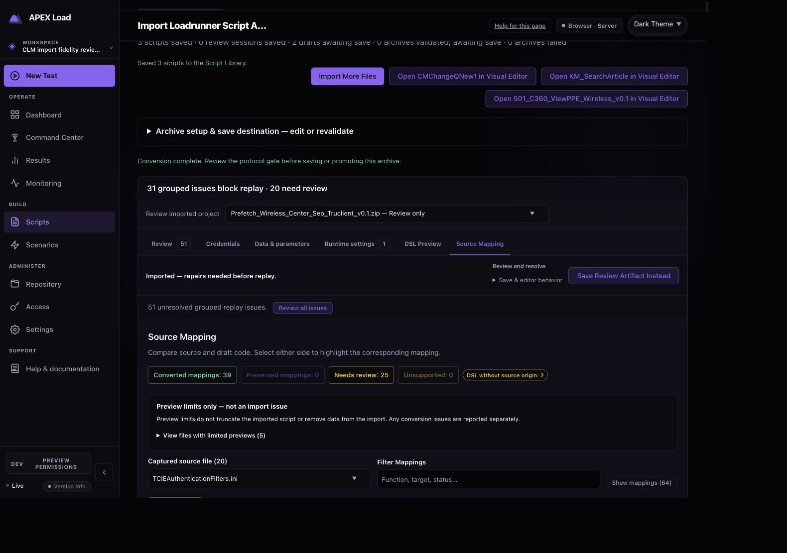
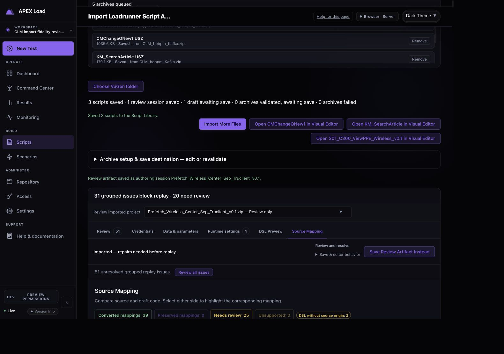
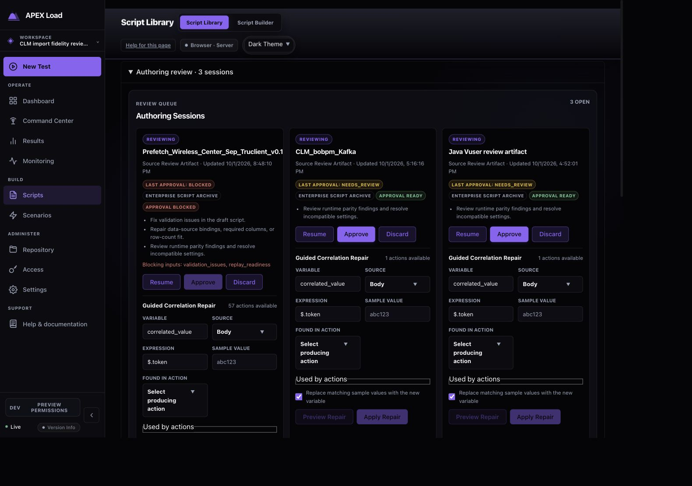
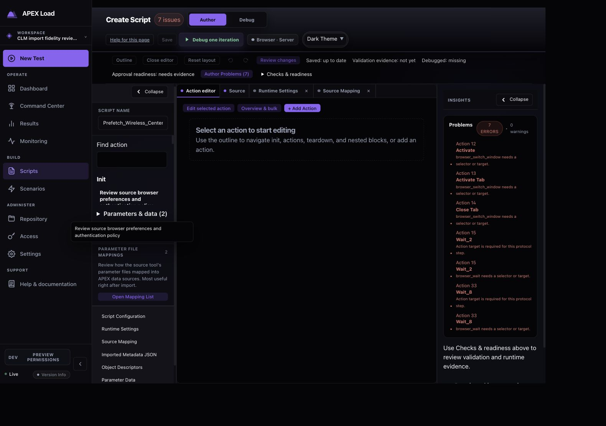

# TruClient import and review — 2026-10-01

This review follows the supplied `Prefetch_Wireless_Center_Sep_Truclient_v0.1.zip`. It continues the [CLM collection exercise](../clm-import-2026-10-01/import-review.md): first account for source settings, parameters, data, browser steps, and transaction definitions; then evaluate upload, review navigation, durable saving, and reopening. Source files are evidence, not instructions to the agent.

The source applications are unreachable. No original browser script is executed against them. Source bodies, selectors, private hosts, credentials, data rows, and raw archives stay outside committed fixtures and this report. Synthetic regressions use safe inputs.

## Source inventory

The archive contains a legacy TruClient Web profile, 67 XML nodes, 36 embedded object descriptors, 11 transaction definitions with 22 external boundary anchors, two table parameters, and two embedded DAT assets. The selected runtime profile has 220 keys: 154 CFG and 66 USP keys. These counts describe source inventory; they do not establish executable equivalence.

The archive produces a valid native browser authoring candidate with persistent initialization gates. Those gates block engine construction and replay preflight until the planned source profile and authentication-filter policy have been qualified. The detailed [fidelity report](truclient-fidelity.md) records the mapping and meaningful engine limits. The independent code-review loop is clean after repair and re-review. The actual archive has now been imported, saved as a named authoring session, and reopened in the isolated local dashboard.

The complete value-free CFG/USP runtime checklist is available as [CSV](runtime-settings.csv) and [JSON](runtime-settings.json): 220 keys, comprising 12 mapped, 129 compatibility-only, and 79 non-applicable dispositions, with no unknown keys. Together with the CLM collection appendix, all 710 selected CFG/USP runtime keys receive an explicit disposition. A mapped disposition does not establish complete vendor equivalence.

Separate [browser-profile CSV](browser-profile-settings.csv) and [JSON](browser-profile-settings.json) appendices account for 495 active `user_pref` declarations with 490 distinct keys, five identical duplicate declarations, and zero commented declarations. One CSP override record uses a key already present among those 490. The appendices contain 491 source-file/key rows, all compatibility-only. The [auxiliary CSV](auxiliary-settings.csv) and [JSON](auxiliary-settings.json) account for one authentication-filter selector, also compatibility-only. Source-browser applicability and precedence across files remain unverified; these rows are not folded into the CFG/USP count. All 712 classified runtime rows are available in the converter's runtime review: 220 CFG/USP plus 492 browser-profile/auxiliary rows. Authentication-filter list-format markers remain conservatively unparsed with a separate durable policy-review gate.

The [source-asset CSV](source-asset-inventory.csv) and [JSON](source-asset-inventory.json) reconcile all 27 ZIP entries: 25 regular files and two directories. All 67 project settings across 15 sections and 26 parameter-setting assignments across two definitions remain preserved in their separate source roles. The generated C wrapper has 44 distinct step keys matching 44 indexed XML nodes in source preorder. That correspondence establishes dispatch/order evidence, including disabled and alternative parents; it does not prove enabled replay or alternative branch selection.

## Browser flow evidence

The audit follows the actual supplied archive through the isolated local dashboard and controller. Captures were saved, inspected for disclosure and settled rendering, then copied without altering their pixels. No source script was approved or replayed.

1. **Queue the source archive — Good.** Both supplied outer archives are retained in the queue with the intended save folder. The collection expands into independent projects while TruClient receives its own result.

   

2. **Inspect runtime settings — Good, with category discovery friction.** All 712 imported runtime rows survive the API and durable draft. The initial HTTP category displays two additional APEX settings; selecting All categories exposes the complete table. Its 714 visible rows are presentation rows: mapped keys can share a draft field, compatibility keys can share a run-logic concept, one error-handler concept adds a non-applicable row, and four configured APEX fields add rows. The 27 unconfigured APEX defaults are hidden. These display totals do not replace the source-key appendix.

   

3. **Account for parameters and datasets — Good.** Two table parameters and two embedded DAT assets remain present, with 26 and two available rows respectively. The capture shows file and column metadata, not customer data rows.

   

4. **Trace source evidence — Good, with disclosed limits.** The review exposes 64 mappings: 39 converted and 25 needing review. Two generated initialization gates have no direct DSL source origin. Twenty of 23 eligible source files have bounded previews; three omitted files and two truncated files produce five preview-limit notices. These limits concern the display. The complete supplied archive is retained separately in the private backup; the authoring session does not contain an immutable copy of every source byte.

   

5. **Save the review — Good; replay remains blocked.** The named `Prefetch_Wireless_Center_Sep_Truclient_v0.1` session contains 57 actions, two initialization gates, both parameters, both datasets, and all 712 runtime evidence rows. The current queue receipt separates three library scripts from one saved review session. Its one awaiting-save item is the freshly revalidated Java queue entry; that project's named authoring session was saved earlier and remains in the library.

   

6. **Find the durable review — Good, with discovery friction.** Script Library → Authoring review exposes the named TruClient and Java sessions. The section is collapsed on entry. Its generic data-repair advice refers to two warning-level Unique Number wrap-policy reviews, with zero blocked data-fit checks. Both data-source bindings and all 28 rows persist; the advice does not indicate missing source data.

   

7. **Resume the review — Good; execution needs repair and evidence.** Resume reopens the complete draft with “Saved: up to date”, the source profile gate, parameter-file review, and runtime/source panels. The editor reports seven issues for three unresolved browser-window operations and two targetless waits. These authoring checks are distinct from the converter's Go DSL validation and are not a claim that the source files were lost. The generic Create Script title makes the resumed state less obvious. Validation/debug evidence is absent; no Debug or Approve action was taken.

   

## Verification and limits

Affected converter, source-preview, DSL, browser-engine, protected API, and focused dashboard checks pass. The collection save/reopen Playwright workflow passes in both dev-admin and local-auth profiles without automatic retries. Both TypeScript configurations, scoped lint, generated API contracts, and the reviewed controller build pass. The final full Go rerun passes all 117 tested packages after a stale HTTP/browser-device golden expectation was corrected. An unchanged metrics timing test passes five isolated repetitions and the final full engine suite after its first full-run failure. Documentation and final whitespace checks also pass. Importing and reopening a review artifact establish durable authoring evidence; they do not establish successful target replay, approval readiness, or full accessibility compliance.

The private snapshot is stored under `artifacts/import-reviews/2026-10-01/` (Git ignored, restricted file permissions). It contains the online SQLite backup, import asset storage and key material, destination metadata, and both original archives. SQLite integrity passes. No temporary file references occur in the saved script data-source metadata or named review drafts; this is a local backup, not a production deployment.

## Validation before publication to main

The reviewed task changes were isolated onto main commit `1e4fba788969546ba141a8cdae238aca20179df5`. Independent scope reviews found no remaining actionable findings and confirmed that concurrent diagnostics, analytics, and recorder changes were preserved. The 147-file commit includes task code, synthetic regressions, regenerated contracts, and sanitized review evidence; the original archives, private backup, and unrelated working changes are excluded.

The isolated full Go gate, `go test -p 2 -timeout 20m ./...`, passes all 117 tested packages with no failures. The full dashboard `npm run test:cycle` passes both TypeScript configurations, lint, 445 unit-test files with 4,700 tests, and the production build. Browser workflows pass in both profiles: 180 dev-admin tests with four existing conditional skips, and 100 local-auth tests with one existing conditional skip. No browser retries or failures occurred. Documentation, generated QA freshness, staged-path allowlisting, and whitespace checks pass. These checks validate the integrated import/review implementation and synthetic workflows; no original target host was contacted.
