# UX reviews with open items (September 2026)

Status: Open. Both reviews still have unimplemented recommendations.

The `command-center-usability-2026-09-09/` and `heatmap-audit-2026-09-14/` folders next to this file hold the screenshots. Completed UX reviews are in [the consolidated September audit record](../../archive/qa-reviews/AUDITS_2026-09.md).

## Command Center usability review

Date: 2026-09-09. Status: Open: the implementation follow-up covered the Details navigation and zero-error attribution only; the remaining original audit recommendations are unchanged

The Command Center has useful operational depth, but its visual hierarchy makes a healthy run look busier and more concerning than it is. Preserve the controls and diagnostics; simplify their presentation and fix the places where content becomes obscured.

Evaluated September 9, 2026 against the current local development dashboard, including existing uncommitted changes. Used a real three-group HTTP run with one VUser per group and one-second pacing against the local controller health endpoint. No application code changed. The audit run was stopped after capture; its records remain available for inspection.

### Implementation follow-up

The two requested follow-up changes are implemented:

- Details is now Advanced run details and opens the Overview tab of the advanced execution workspace. Back to Command Center explicitly targets the same run, including after a reload or run completion. During an ordinary details visit, the cockpit stays mounted so staged load values, table filters, and graph selections survive; keyboard focus returns to its entry button. Draft state is in memory and does not survive a full page reload.
- Highest Error Rate now shows neutral No errors with no group attribution when sampled groups have zero errors. No samples remains separate. Actual small error rates display <0.01% instead of rounding misleadingly to zero, positive ties name the tied groups, and unavailable group attribution is distinguished from zero errors. Overall zero-error styling is neutral as well.
- The summary and action row have separate space so the longer navigation label does not squeeze No errors into an ellipsis. Full metric values are also available in their titles.

Validation: type checking, lint, and the embedded build passed; 368 unit-test files passed (4,025 tests). The dev-admin suite passed 79 checks initially; the new details check failed on a case-sensitive test selector, then passed on its isolated rerun after correction. All 10 local-auth checks passed. The full cycle command therefore recorded a nonzero initial browser result, with its only failing check subsequently resolved and reverified. No unresolved failures remain from these checks.

The remaining original audit recommendations are unchanged. This implementation does not remove the advanced workspace or any of its controls.

Browser checks confirmed staged load and filter retention, Graph Wall retention, and focus restoration. Regression coverage includes the same-run navigation path and reload return, zero errors, no samples, positive errors, ties, small nonzero rates, and the return action for completed runs.

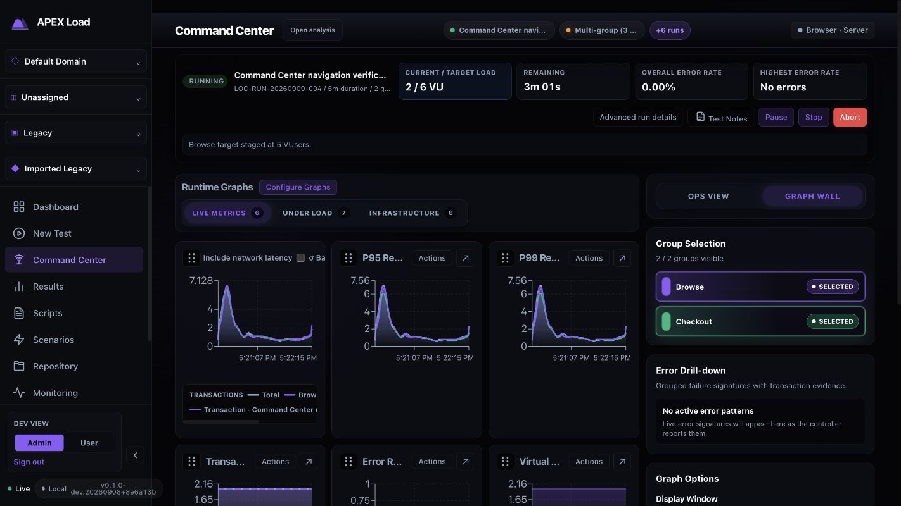

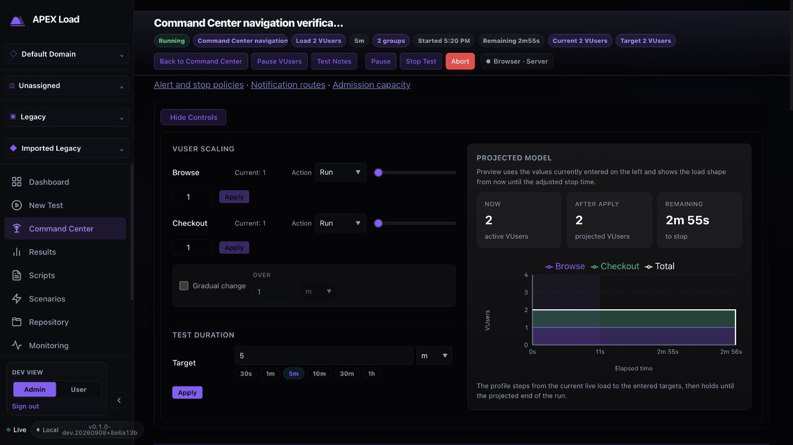

### Priority findings

| Priority | Evidence | Finding | Recommended change |
| --- | --- | --- | --- |
| High | 9–11 | Details unexpectedly opens a second execution workspace with repeated live controls and a generic Back button. The destination and return path are unclear. | Rename to Advanced run details, add a prominent Back to Command Center link bound to this run, and preserve the originating mode, filters, and staged edits. Consider an in-context details drawer while retaining the complete advanced workspace. |
| High | 5 | The graph configuration drawer is transparent enough that underlying labels, cards, and buttons overlap its contents. Reopening confirmed this was a settled state. | Use an opaque surface and a separate backdrop. Preserve every graph toggle and Reset action. |
| High | 7–8 | The fixed page header covers the upper portion of the run shelf after scrolling, partially obscuring run identity, summary, and controls. | Give the run shelf a correct sticky offset, or combine the two headers into one persistent region. Verify keyboard focus is never covered. |
| High | 1 | Narrow group cards lose visible metric headings. Numbers such as 1 and 1.0 appear without nearby Current VU and TPS labels. | Give each responsive metric a visible label and unit; use a compact labeled grid. |
| High | 4 | Graph titles and legends truncate; the first chart's controls crowd out its title. Meanwhile substantial card height is unused. | Protect a dedicated title row, move secondary toggles into chart options, size plots to available height, and wrap or expand legends. Use two columns when three cannot fit readable headings; retain the user's dense layout option. |
| Medium | 1–2, 4, 9 | Highest Error Rate incorrectly attributes a healthy zero-error tie to Browse; this is misleading group attribution as well as excessive red emphasis. | When valid samples have zero errors, show No errors with no group name and neutral styling. Name a group only when it has actual errors. Keep No samples distinct from zero errors, handle positive ties explicitly, and retain all group metrics. |
| Medium | 2 | Current/target, planned/actual/delta, and allocated/projected VUsers occupy several prominent panels. Empty error detail and explanatory copy add more weight. | Establish one primary run summary, compress capacity to a status row, and make the load model expandable while retaining a small trend preview. Expand exceptions when relevant. |
| Medium | 2 | The Scenario Run table has 17 columns; even on the wide capture, latency and errors require horizontal scrolling. | Default to Name, Group, Current/Target VU, TPS, Error %, and p95. Preserve every column in a column picker and a full-detail preset; freeze identity columns. |
| Medium | 3 | Runtime Settings and Parameters are reachable through the group name, but that name lacks a clear menu indicator. | Add a visible chevron or a labeled group-actions button. Keep the same menu destinations. |
| Medium | 2, 4–5 | Graph configuration is split between Configure Graphs, the sidebar, and per-chart actions. TPS and Change duration disappear from the top shelf in Graph Wall. | Keep a stable run summary and intervention shelf across both modes. Group chart selection and display options in one organized drawer; retain per-chart actions. |
| Medium | 7 | With no filter entered and no errors, the table says no patterns match the current filter and shows a second empty evidence panel. | Distinguish No errors recorded from No matching errors. Show the evidence pane only after selection; keep diagnostics one click away. |
| Medium | 8 | Infrastructure combines capacity and route rows; WARNING badges have no immediate explanatory reason in the visible columns. | Show the reason beside each warning and distinguish unknown telemetry from confirmed pressure. Preserve all route and capacity metrics. The underlying warnings were not independently validated. |

### Functionality-preserving organization

| Always visible | Available on demand |
| --- | --- |
| Run name, state, current/target load, remaining time, TPS, error rate, connection freshness | Full run metadata and details |
| Pause/Resume, Stop, distinct Abort, duration control, Notes | Existing confirmation and editing dialogs |
| Operations / Graphs switch in one stable location | Existing graph categories and configuration |
| Compact group health rows and explicit target editing | Slider, immediate/gradual ramp controls, staged values and Apply, runtime settings, parameters |
| Small load-profile preview and capacity status | Full profile, planned/actual/delta values, allocation/projection and generator details |
| Scenario, Errors, Infrastructure tabs | All existing columns, percentiles, signatures and transaction evidence |

Retain the purple accent, group colors, and established components. Reduce decorative gradients, repeated card borders, unnecessary status prose, and fixed empty space. Keep errors discoverable with a count/status indicator even when the detailed empty panel is collapsed. Any disclosure change should preserve staged inputs when switching views.

### Capture walkthrough

#### 1. Open a running test in the narrow layout — needs improvement

Live status, current/target load, remaining time, and intervention buttons are available. Group metrics lose visible labels, the highest-error group truncates, and stacked panels push diagnostics below the initial viewport. Small supporting text is an accessibility risk.

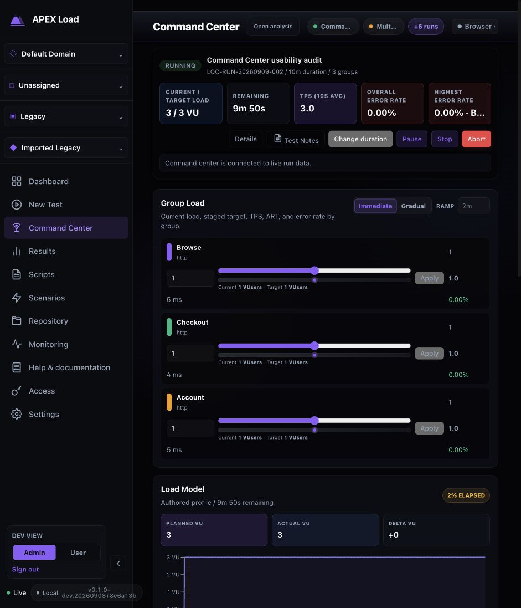

#### 2. Inspect Operations on a wide layout — usable but crowded

Group colors and current/target controls help orientation. Repeated VUser values, red zero-error tiles, a large empty error panel, and a horizontally scrolling detail table compete for attention. The group button shows a clear focus outline after dismissing its menu.

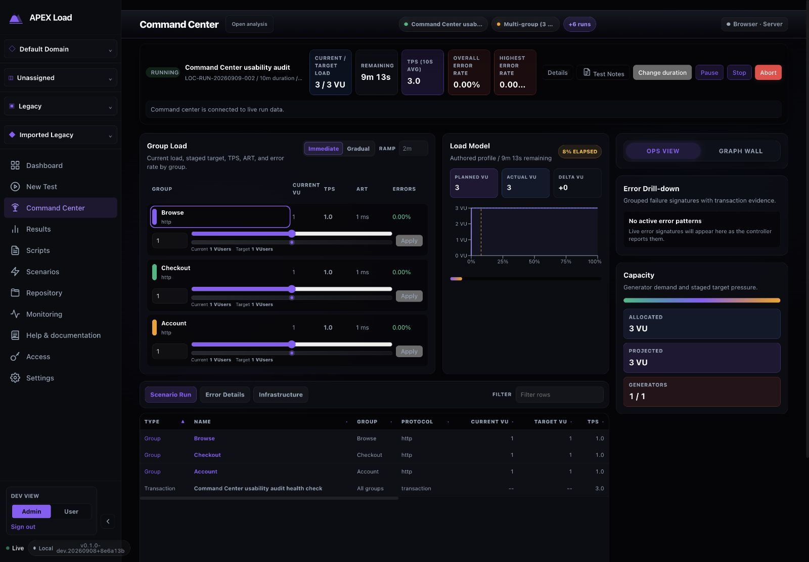

#### 3. Open group actions — functional, weak discoverability

Runtime Settings and Parameters are available in a compact menu. Escape dismisses the menu and returns focus to the group button. The closed trigger needs a visible affordance. Editing these settings was not exercised.

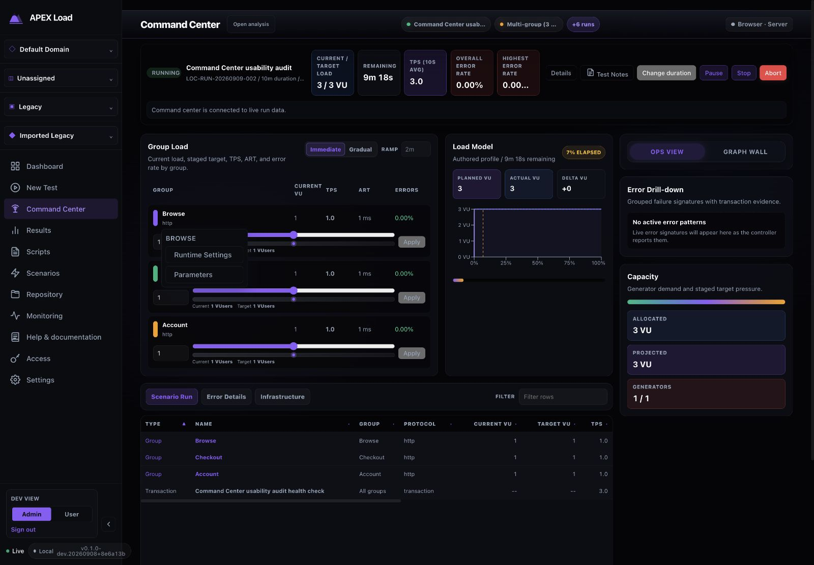

#### 4. Switch to Graph Wall — needs improvement

Live charts, group selection, expansion controls, graph categories, and display options are present. Three-column cards truncate titles and legends. The first chart's options dominate its heading. TPS and duration adjustment disappear from the shared run shelf. Accessible chart measurement tables and named expansion/reorder controls are exposed in the accessibility tree, a useful foundation to retain.

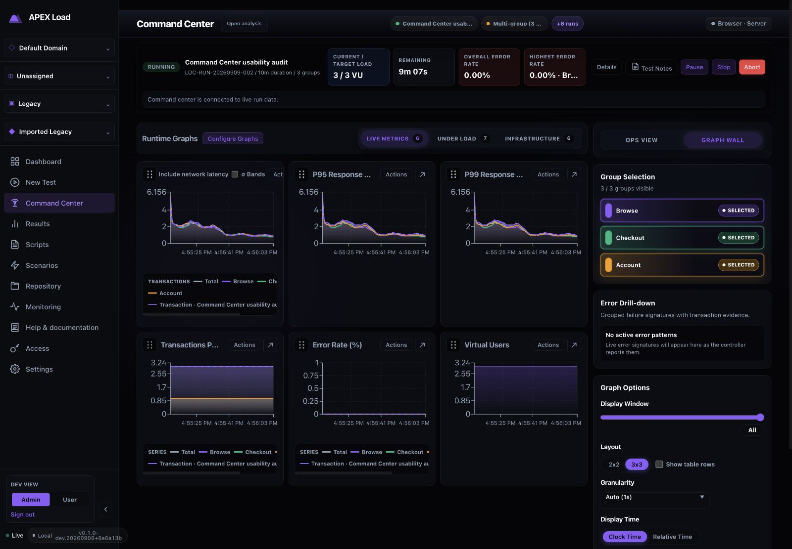

#### 5. Open graph configuration — readability defect

Graph selection and Reset are discoverable, and focus enters on Close. The drawer's background allows underlying content to remain visible through labels and options. This is a concrete readability problem, not a preference about visual density. Graph settings were inspected without changing them.

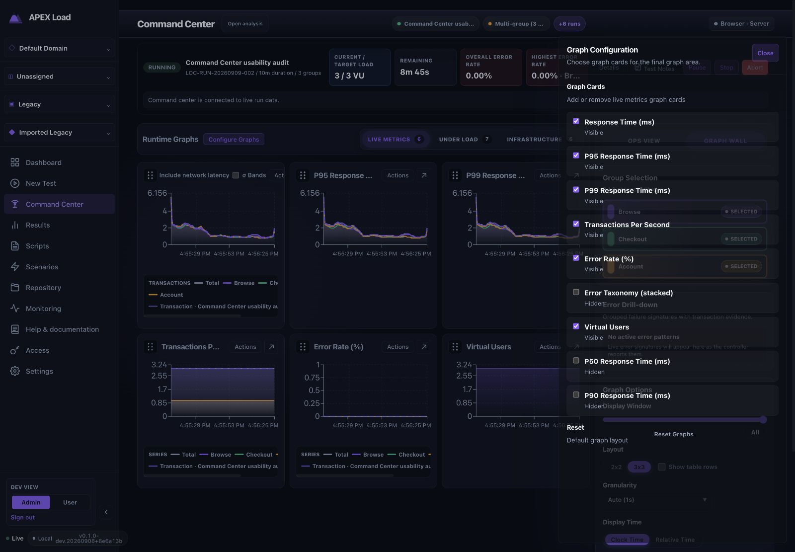

#### 6. Inspect Pause confirmation — generally clear

The dialog names the run and explains the action boundary and resumability. Cancel initially receives focus. Preserve that specificity. Button contrast deserves measurement. The dialog was cancelled; pause/resume execution was not tested.

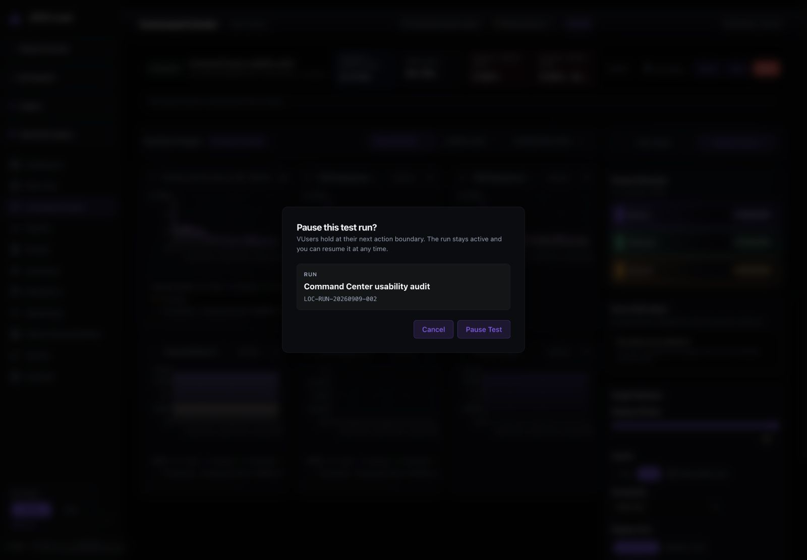

#### 7. Open Error Details and scroll — needs improvement

Error patterns and evidence share one tab, which is useful. An unfiltered healthy run receives filter-related empty copy and two large blank regions. The page header overlaps the sticky run shelf. Populated signatures, evidence retrieval, and failure recovery were not tested.

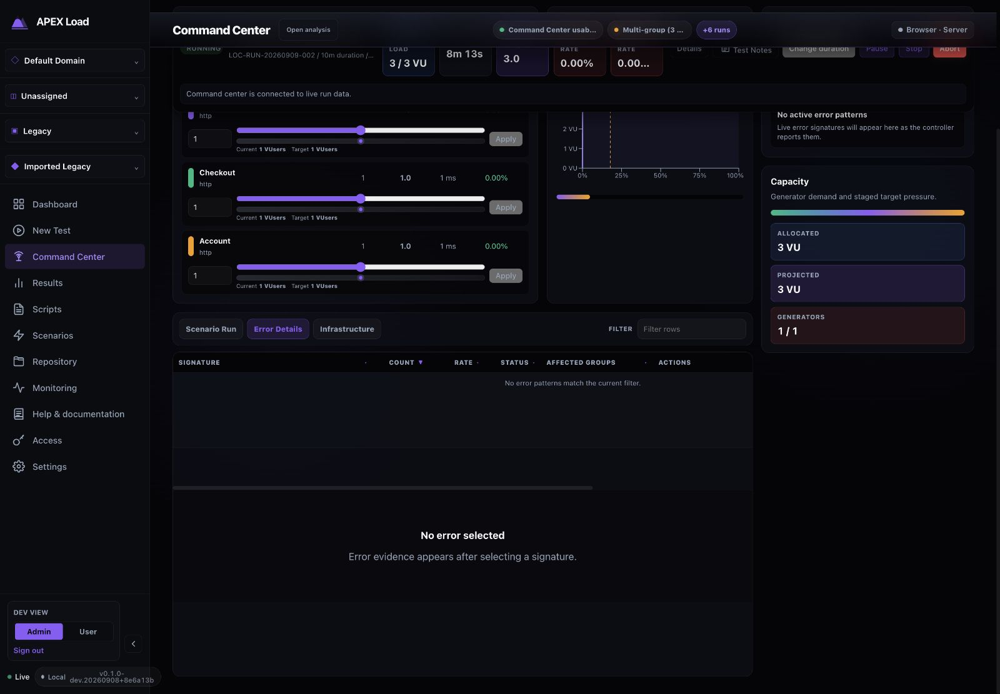

#### 8. Open Infrastructure — useful detail, unclear warning context

Capacity and route information are available with status text as well as color. Warning reasons are not apparent in the visible columns, and horizontal scrolling separates identity from later details. The same header overlap persists.

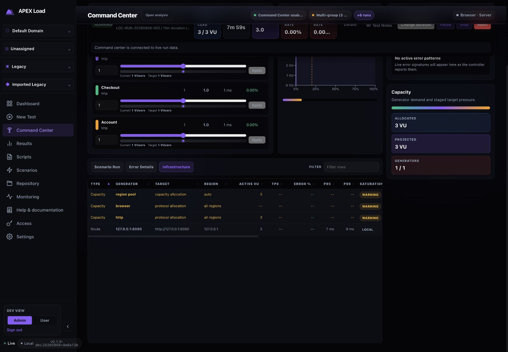

### Follow-up: Details navigation and zero-error attribution

A second local HTTP run with two one-VUser groups was used for this follow-up. It was stopped after capture. Only review documentation and screenshots changed.

#### 9. Locate Details and inspect Highest Error Rate — misleading label and attribution

Details is a small generic action beside Notes and duration controls. It does not explain that it leaves Command Center for a different full execution workspace. The accessibility tree again reports Highest Error Rate as 0.00% · Browse while both groups have zero errors; the screenshot also shows how severely the compact card truncates this content.

Source inspection confirms that `highestGroupErrorRate` chooses the first group even when every rate is zero. That is a ranking artifact, not an unhealthy group. Require actual recorded errors before attributing a group. Do not simply test the formatted percentage: a small nonzero rate can round to 0.00%, so show adequate precision or an error count in that case. For positive ties, say that multiple groups are tied or make the tie discoverable rather than implying a unique worst group.

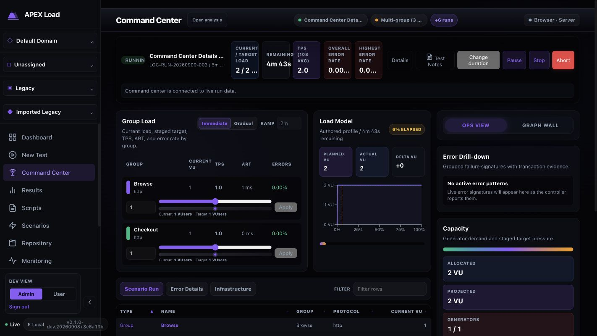

#### 10. Follow Details to the execution workspace — confusing context switch

The route changes from the run's Command Center to its `/test/` workspace. In this session the Graphs tab was selected, with expanded VUser scaling and duration controls filling the initial viewport. The destination repeats operational controls, including Pause VUsers and Pause, and uses a different information hierarchy. It feels like another runtime dashboard rather than a focused details view.

A Back button does exist at the upper left of the action row. Its generic text, low prominence, and placement among operational actions do not clearly promise a return to this run's Command Center. This is a discoverability and orientation issue; the captured build does not lack a return control entirely. Keep the full advanced capabilities, but label the destination and give navigation its own clearly named return link. A focused details drawer could serve common inspection needs, with Advanced execution workspace available explicitly.

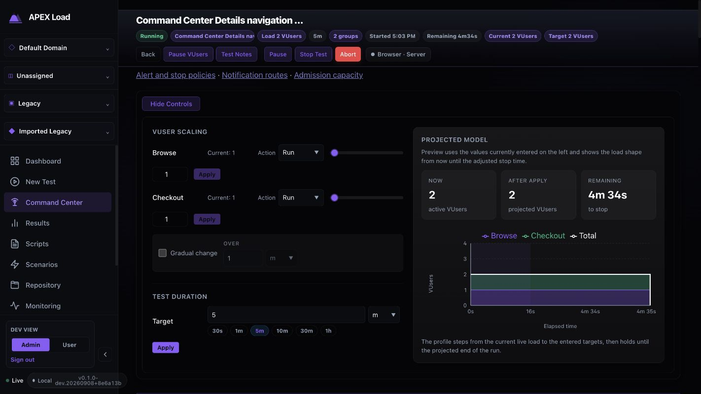

#### 11. Use Back — return works in the inspected path

Clicking the page's Back button returned to the same run's Command Center with its application/release scope. This verifies the direct return path in this local build. It does not establish retention of Graph Wall mode, filters, scroll position, or staged load edits, nor behavior after deep links, reloads, or intermediate navigation. Those must be regression cases.

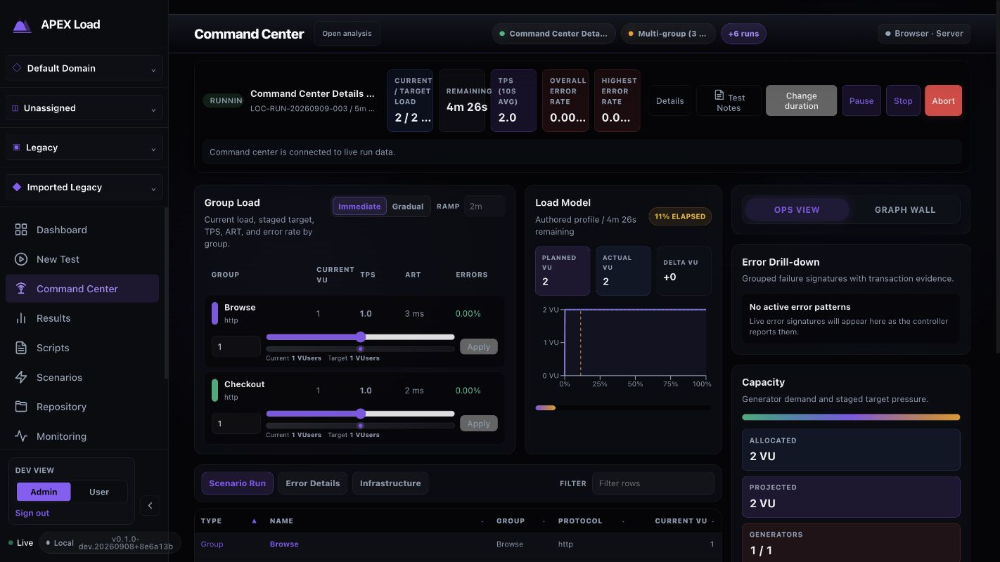

Follow-up acceptance criteria: Details announces its destination; a visible Back to Command Center action always targets the same run; keyboard focus returns to the Details trigger; the original view and draft inputs survive; zero-error runs never name a highest-error group; no-sample and real low-rate-error states remain distinct. Cover both Operations and Graph Wall entry, deep links, reloads, positive ties, and run completion while viewing details.

### Evidence limits and acceptance criteria

This is a design inspection of a low-load, healthy HTTP run in the dark theme, not an operator study or a complete functional/accessibility certification. Captures cover narrow and wide rendered layouts. A temporary viewport override produced incorrectly scaled captures; those were rejected and replaced after reset. No findings rely on that capture artifact.

Not covered: large group counts, real error evidence, missing/disconnected streams, other themes, full keyboard traversal, screen-reader announcements, measured contrast, backend correctness of infrastructure warnings, and successful changes to duration/load/pause/abort. The accessibility tree also exposes prototype-oriented names such as Grafana wall mockup and Final graph configuration; replace them with user-facing names.

For a follow-up implementation, preserve all existing capabilities and verify: no overlapping sticky headers; readable titles, labels and key values at both widths; opaque drawers; all prior metrics reachable; stable run controls across modes; staged edits survive navigation; neutral healthy states and explanatory warnings; keyboard focus remains visible. Add meaningful regression tests and run the repository's full dashboard test cycle, including both browser workflow profiles.

Recommended next step: fix the obscured controls, transparent drawer, and missing/truncated labels before reorganizing the broader layout.

### Implementation: interface cleanup

Implemented the remaining recommendations in the existing Command Center:

- The sticky run shelf measures the wrapping application header. TPS and duration controls remain available in both views.
- Graph selection, layout, time display, and reset share one opaque configuration drawer. Chart titles wrap on their own row; secondary chart toggles use a disclosure. The dense grid adapts to available width and card heights follow their content.
- Responsive group values have visible labels and the group actions trigger has a chevron.
- Scenario Run starts with seven essential columns. Individual column selection and a full 17-column preset retain every metric. Name and Group remain pinned while scrolling.
- Capacity is a compact disclosure, expanded for pressure. Missing generator counts display as unavailable instead of invented defaults. The load trend stays visible with its numerical comparison on demand.
- Healthy error tables say “No errors recorded”; filtered results say “No matching errors.” Evidence appears only for a visible selected signature. Warning reasons sit beside infrastructure status badges.
- Filters, sorting, column selection, and graph category/display mode survive Operations/Graph Wall switches within the same run. Filter text is independent per table. Presentation state resets for another run.

Code review corrected the inherited wide table minimum, pinned-header stacking, run-specific presentation state, and unavailable capacity values. Existing run controls, group settings, graph actions, metrics, and diagnostics remain available.

#### Review and validation

The final diff review additionally corrected VUser projections for TPS-based runs, delayed error-signature messaging, and keyboard focus spacing including the scroll container's padding. The observer also handles the run shelf appearing after asynchronous loading. No unresolved findings remain from this review.

`npm run test:cycle` was run, covering type checking, lint, 4,027 unit tests across 368 files, the embedded production build, 81 dev-admin workflows, and 10 local-auth workflows. An initial complete cycle passed. The strengthened narrow-screen focus assertion in the subsequent cycle exposed a small overlap; that implementation was corrected and both Command Center browser tests passed on a fresh build. All other browser workflows passed. The error-signature edge case also passed the focused 68-test Command Center suite. Desktop, narrow, and drawer screenshots were visually inspected.

Latest evidence is saved below. These are low-load HTTP smoke runs; they validate the interface and navigation rather than production-scale performance.

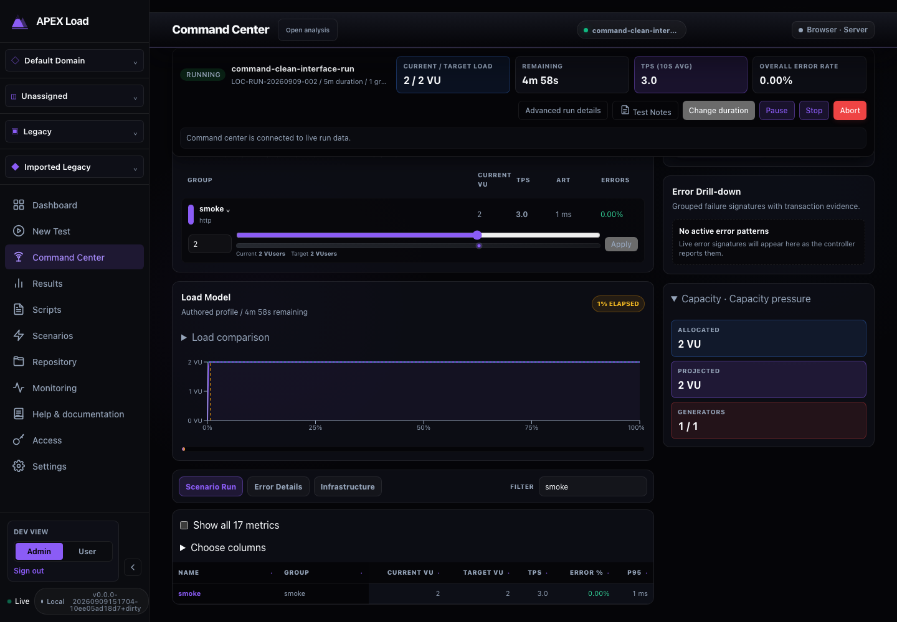

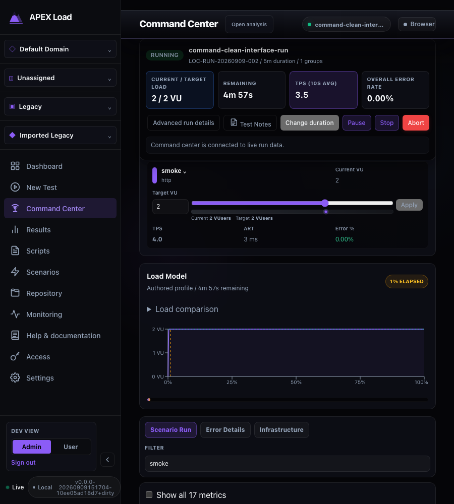

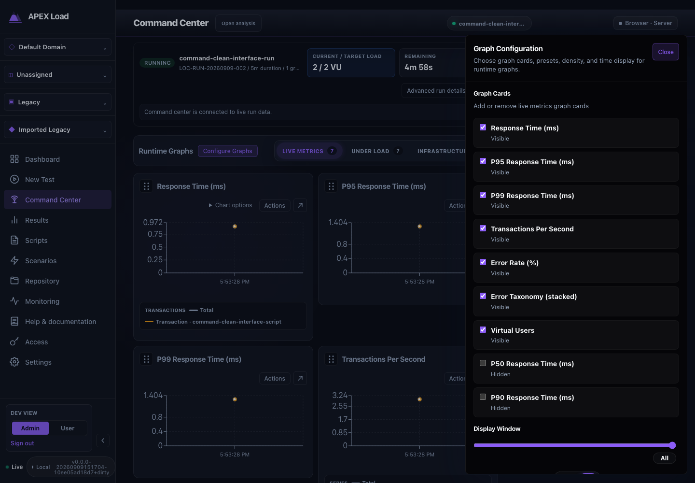

## Load impact heatmap (2D/3D) operator-experience review

Date: 2026-09-14. Status: Open: audit only, no implementation record

Reviewed 2026-09-14. Verdict: retain 2D as the default operational view; treat 3D as optional exploration until its scale, motion, labeling, and interaction controls are explicit. The most consequential improvements concern interpretation and investigation, followed by presentation polish.

### Scope and evidence

Current dashboard source was served by Vite against the existing local controller binary and an isolated SQLite backup. Schedules were disabled and nonterminal tests marked complete only in that disposable backup to prevent executions. No application implementation was edited or tests launched. Browser evidence used the archived `web wiki` run, `LOC-RUN-20260730-001`: 275 interval samples, 15 available metrics, one observed load level of 10 VUsers. Its legacy interval population differs from the request/action KPI population, as the report itself explains.

The audit followed Results → Performance → Load impact, switched 2D/3D, selected P95, and opened/closed configuration. Screenshots were captured during this review, saved, reopened, and inspected. They are viewport captures, not complete-page captures. The browser's native surface changed width during the review; the accepted 2D capture is 1422px wide and the remaining captures are 690px wide. These are not same-viewport visual comparisons. Temporary viewport overrides produced capture scaling artifacts and were reset; those captures were replaced.

| Step | Task | Health |
| --- | --- | --- |
| 1 | Find and read the 2D map | Usable numeric comparison; unclear color meaning and excessive surrounding chrome |
| 2 | Switch to 3D and inspect the retained selection | Renders and preserves selection; difficult labels, automatic motion, unexplained height |
| 3 | Select P95 and inspect samples | Details work; separated from selection, wide table, duplicate P95 column |
| 4 | Open configuration | Logical metric groups and focus restoration; translucent panel damages readability |

### Prioritized recommendations

#### P1 — Explain what color and height measure

Evidence: steps 1–2. In the single-load run, ART 476ms, P95 514ms, and Error 0% have the same 2D shade. The 3D bars have the same model height across metrics. Source inspection confirms that each metric independently normalizes its bucket averages to that row's observed minimum/maximum. A constant row receives intensity 0.65, including a constant zero row. Height is `0.14 + intensity * 2.7`.

Add a persistent legend: “Relative value within each metric · lighter = lower · darker = higher.” Explain that shading does not establish an SLA breach and that values cannot be compared across different units. For constant rows use a neutral “No variation” treatment. For a single load, explain “One observed load level; load sensitivity cannot be assessed,” and show a compact value summary by default.

Offer a separate threshold or baseline comparison mode when supported by valid evidence. Threshold direction must be metric-specific: high error rate and low free memory mean different things; rising TPS alone does not establish poor health. Use text/icons with severity colors. In live views, consider locking scale and load buckets during inspection; this is an implementation-derived follow-up, not a behavior verified during this archived-run audit.

Source: `dashboard/src/components/loadImpactModel.ts` (buildLoadImpactModel), `LoadImpactHeatmap.tsx` (cell alpha), `LoadImpact3DHeatmap.tsx` (heightValue).

#### P1 — Make 3D stable, labeled, and deliberately interactive

Evidence: step 2. The view rotates without operator input. Metric labels are tiny and overlap in perspective; there is no visible height scale, pause control, reset camera, or interaction instruction. Small chips repeat some axis labels but expose only eight metric names plus “+7.” The selected P95 remains selected across the view switch, which is a useful behavior to preserve.

Disable automatic rotation by default. Add explicit Rotate/Pause, Reset view, Top view, and zoom controls plus concise drag/zoom instructions. Fit labels to available space, keep critical axis titles outside the moving scene, and offer a focus-on-metric control. Keep selected and hovered values visually distinct. Provide keyboard-accessible selection outside the canvas; current canvas semantics expose an image, while 2D cells expose named buttons.

If the current cross-metric layout remains, label height as normalized relative value. A future exploration design should consider a single selected metric with a real unit-bearing height axis and meaningful load/time dimensions, but only when the available sampling supports those dimensions. That would be a design proposal, not an existing capability.

Automatic motion warrants accessibility review against [W3C's Pause, Stop, Hide guidance](https://www.w3.org/WAI/WCAG22/Understanding/pause-stop-hide). The existing 2D switch can hide 3D, so this review does not assert a formal WCAG failure. Also honor reduced-motion preferences and test keyboard/screen-reader equivalents.

#### P1 — Put aggregation and evidence scope beside the map

Evidence: steps 1 and 3. The row label is P95, but its selected summary is “Avg 514ms.” Source confirms an arithmetic mean of interval P95 values, rather than recomputing a pooled percentile. “275 samples” represents telemetry points, not necessarily 275 requests. The report's top KPI shows a different P95 population; its contextual explanation is far above the map.

Label the display “Mean interval P95” or add an always-visible “Cells show averages of interval metrics” explanation. Show population, time window, sample interval, and resource ownership near the map. Resource metrics should explicitly identify the load generators; they should not invite inference about application-server saturation. Distinguish missing data, zero values, and intervals with no relevant observations where the source evidence supports that distinction. Mark low-coverage cells using a defined, evidence-based rule rather than treating sample counts as confidence by themselves.

#### P2 — Make a heatmap read like a matrix

Evidence: step 1. The outer “Load impact” disclosure repeats the inner “Load Impact” title. Nested bordered surfaces, a tall header, three count chips, cell-level sample counts, and a table-pagination toolbar consume space. Only 10 of the 15 enabled metric rows are initially visible because the global table-pagination manager applies to the matrix.

Flatten to one panel with a compact toolbar and legend. Exempt this small metric matrix from generic row pagination; show grouped Performance and Generator resources rows together, with sticky headings where needed. Offer a concise key-metrics preset such as ART, P95, TPS, Error %, CPU, and memory. Put repeated sample counts in a secondary detail treatment while keeping coverage discoverable. Preserve exact numeric values and row/column highlighting.

Source-only follow-up: clicking a load header currently sorts different metric rows by their raw numeric averages, mixing milliseconds, percentages, MB, and rates. Such a ranking has no common meaning. Replace it with within-unit sorting or a defined dimensionless baseline/threshold deviation. This behavior was confirmed in source, not exercised as a browser task.

#### P2 — Shorten the path from an interesting cell to an explanation

Evidence: step 3. Clicking P95 adds details below the entire matrix; the click leaves focus on the originating cell. The table contains both the selected-metric P95 column and the standard P95 column, and requires horizontal scrolling at the narrower width. It supplies timestamps and useful adjacent measurements, but no direct investigation action.

Use a compact pinned inspector beside the map on wide screens and directly below the selected area on smaller screens. Start with value, load, units, sample count, min/max, and coverage; show raw samples as a secondary disclosure. Remove duplicate metric columns. Add a small time series and a “View these intervals in timeline” action; a load bucket can contain disjoint intervals, so preserve that distinction. Consider related error and generator-metric links where evidence exists. Provide a visible close action and an accessible update announcement.

#### P2 — Use an opaque configuration surface and task presets

Evidence: step 4. Text and blue cells from the underlying page remain visible through the drawer. A read-only computed-style inspection confirmed background `rgba(15, 17, 26, 0.65)` with opacity 1. This is the panel's color, not a transitional screenshot. The panel uses `--bg-card`.

Use an opaque modal/drawer token, stronger text and control contrast, and a clearly dimmed backdrop. Preserve the existing Performance/Resource grouping, native checkboxes, initial Close-button focus, and return focus to Configure Map. Add category-level selection and useful presets; rename Add All/Remove All to Select all/Clear selection, and clarify that Reset means default selection. If an empty selection is allowed, place a direct Restore defaults action in that state. These configuration recommendations do not imply the current controls are broken.

### Screenshots

#### 1. 2D map — readable values, unexplained uniform shading

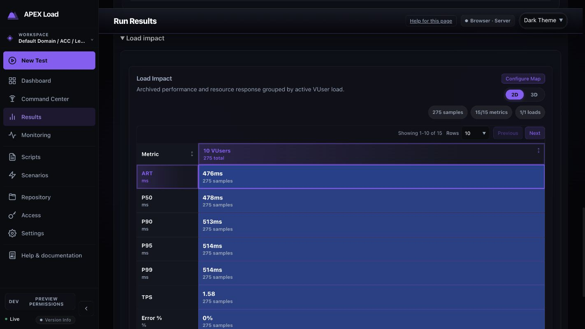

#### 2. 3D map — tiny labels and retained P95 selection

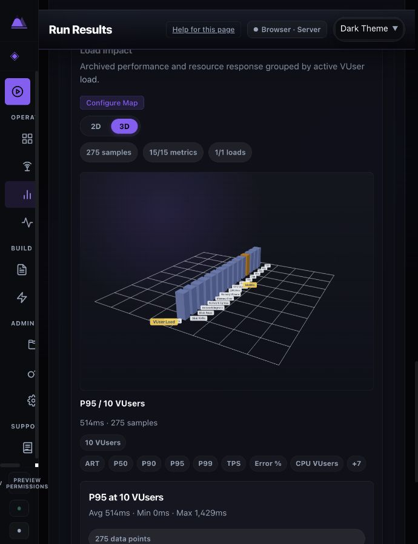

#### 3. Sample details — useful evidence behind a wide table

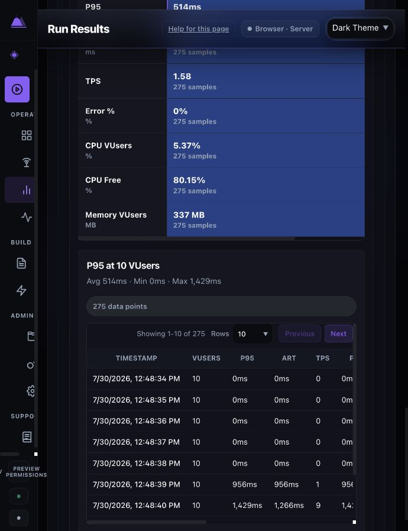

#### 4. Configuration — background content shows through the drawer

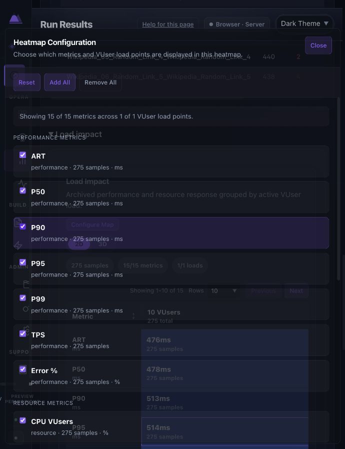

### Limits and recommended validation

This was an operator-experience review of the rendered archived-run flow and shared component source, not an audit of telemetry correctness. No live stream, multilevel ramp, sparse-load fixture, WebGL failure, full keyboard-only workflow, screen reader, formal contrast measurement, or complete responsive matrix was tested. No full accessibility compliance is claimed. Detailed live behavior and dense multibucket occlusion remain follow-up checks. The legacy run cannot establish whether current runtime telemetry encodes missing observations correctly.

For an implementation pass, validate fixed load, ramp-up/down, constant-zero rows, sparse/missing observations, and different metric populations. Test scale meaning, population labels, duplicate-column removal, selection preservation, keyboard access, reduced motion, and the opaque drawer. Repository policy requires the dashboard test cycle for frontend changes; no application code changes were made by this review.

Start with the legend/aggregation copy, single-load treatment, opaque drawer, and default-static 3D controls before investing in a larger 3D redesign.
